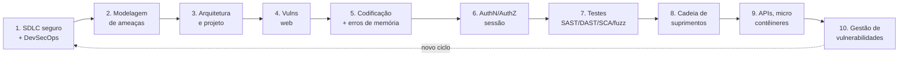

# Mapa de estudo — como os dez pontos se ligam

Este mapa é a visão relacional do laboratório. O README guarda o método (objetivo → princípios → técnicas; e a tríade princípio → técnica → mecanismo). Aqui está o que o README não mostra: **onde cada fundamento reaparece** e **como um ponto puxa o outro**.

Regra: conceito faz sentido quando está ligado, não isolado. Então primeiro o esqueleto que atravessa tudo, depois cada ponto no lugar.

---

## 1. A ordem e a dependência

Os dez pontos seguem o ciclo de vida: do que vem antes do código até o que acontece depois do deploy. Cada ponto assume o anterior.

| Fase do ciclo | Pontos |
|---|---|
| Antes do código (requisito, design) | 1, 2, 3 |
| Durante o código | 4, 5, 6 |
| Verificação | 7 |
| O que você não escreveu | 8, 9 |
| Depois do deploy | 10 |

Ponto 1 é o moldura: nomeia as fases e onde cada atividade entra. Os outros nove detalham uma atividade que o ponto 1 só cita.

---

## 2. Fundamentos transversais — o que não é fase

Estes princípios valem em todos os pontos. Não são de nenhum ponto; cada ponto apenas os aplica. Fonte canônica no laboratório: ponto 1, seção Fundamentos (Janca, 2020).

| Fundamento | Regra | Onde fica mais forte |
|---|---|---|
| CIA | confidencialidade, integridade, disponibilidade são o que se protege | 2, 3, 6 |
| Assume breach | presuma a invasão já ocorrida; desenhe para conter o dano | 3, 9, 10 |
| Defense in depth | várias camadas; uma falha não derruba tudo | 3, 4, 9 |
| Least privilege | mínimo de acesso por componente e por pessoa | 3, 6, 9 |
| Zero trust | verificar sempre, nunca confiar por padrão | 6, 9 |
| Fail secure | erro nega acesso, nunca libera | 5, 6 |
| Redução da superfície de ataque | menos porta aberta, menos coisa para defender | 2, 9 |
| Validar entrada hostil | todo dado externo é hostil até prova em contrário | 4, 5, 9 |
| Sem segredo em código | credencial no fonte é credencial vazada | 1, 8 |
| Cadeia de suprimentos | código que você não escreveu também é seu risco | 8, 9 |

Como usar: ao estudar qualquer ponto, pergunte quais destes fundamentos ele executa. Se a resposta for "nenhum", você entendeu o ponto errado.

---

## 3. A tríade aplicada — uma âncora por ponto

Para cada ponto, o par que mais cai: a técnica nomeada (com fonte) e o mecanismo que a executa. É o mínimo para não confundir regra, método e implementação.

| Ponto | Técnica âncora (fonte) | Mecanismo que executa |
|---|---|---|
| 1. SDLC seguro | Pushing Left (Janca, 2020); NIST SSDF | pipeline CI/CD com gates por fase |
| 2. Modelagem de ameaças | STRIDE (Microsoft); attack tree (Schneier, 1999) | DFD + Threat Dragon / threat modeling |
| 3. Arquitetura segura | Saltzer & Schroeder, 1975 (8 princípios) | trust boundary, segmentação, sandbox |
| 4. Vulns web | OWASP Top 10; OWASP ASVS | query parametrizada, output encoding, CSP |
| 5. Codificação + memória | CWE Top 25; SEI CERT | type-safe lang, bounds checking, ASLR/DEP |
| 6. AuthN/AuthZ/sessão | OAuth 2.0; OIDC; RBAC/ABAC | token assinado, cookie HttpOnly+Secure, MFA |
| 7. Testes de segurança | SAST, DAST, SCA, fuzzing (NIST SP 800-115) | scanner no CI, fuzzer (AFL/libFuzzer) |
| 8. Cadeia de suprimentos | SLSA; SBOM (CycloneDX/SPDX) | assinatura (Sigstore), pin de dependência |
| 9. APIs/micro/contêineres | OWASP API Top 10; zero trust de rede | mTLS, API gateway, imagem mínima, política |
| 10. Gestão de vulns | CVSS; CVE; disclosure coordenado | scanner de vuln, patch management, SLA |

Faltando fonte na linha, é lacuna a preencher quando a pasta for construída — não invente.

---

## 4. Como um ponto puxa o outro

A ligação que faz os dez virarem um só assunto.

| De | Para | A ponte |
|---|---|---|
| 1 → 2 | o SDLC diz *quando* modelar; a modelagem é a atividade da fase de design |
| 2 → 3 | a ameaça encontrada vira requisito de arquitetura (a mitigação) |
| 3 → 4 | a falha de design mal resolvida vira a vulnerabilidade web explorável |
| 4 → 5 | a vuln web (injeção) é um caso de entrada não validada no código |
| 5 → 6 | controle de acesso é o código que mais erra; authn/authz é o recorte |
| 6 → 7 | o requisito negativo de authz é o que o teste de segurança prova |
| 7 → 8 | SCA é o teste que aponta a dependência vulnerável da cadeia |
| 8 → 9 | a imagem de contêiner é a cadeia de suprimentos empacotada |
| 9 → 10 | a vuln exposta em produção entra no funil de gestão de vulnerabilidades |
| 10 → 1 | o incidente vira requisito do próximo ciclo (pushing left de novo) |

---

## 5. Loop de estudo

O mesmo do README, em três passos por ponto:

1. **Esqueleto primeiro**: objetivo → princípios → técnicas. Memoriza-se o molde, não o texto.
2. **Pergunta em vez de definição**: "o que não pode falhar aqui?" (princípio), "qual método nomeado revela onde aplicar?" (técnica), "o que executa a regra?" (mecanismo).
3. **Retrieval practice**: fechar a pasta e reconstruir a tríade de cabeça. Travou, releia só aquele ponto e tente de novo no dia seguinte.

Teste final por ponto: escrever a seção dele de memória, com pelo menos uma técnica nomeada e sua fonte. Se a fonte não vem, o ponto ainda não está internalizado.

---

## Pontos

1. [Ciclo de vida de desenvolvimento seguro e DevSecOps](01-ciclo-de-vida-seguro/README.md)
2. [Modelagem de ameaças e análise de superfície de ataque](02-modelagem-de-ameacas/README.md)
3. [Princípios de arquitetura e projeto seguros](03-principios-de-arquitetura-segura/README.md)
4. [Vulnerabilidades em aplicações web](04-vulnerabilidades-em-aplicacoes-web/README.md)
5. [Práticas de codificação segura e erros de memória](05-praticas-de-codificacao-segura/README.md)
6. [Autenticação, autorização e gestão de sessão](06-autenticacao-autorizacao-sessao/README.md)
7. [Testes de segurança (SAST, DAST, SCA, fuzzing)](07-testes-de-seguranca/README.md)
8. [Segurança da cadeia de suprimentos de software](08-cadeia-de-suprimentos/README.md)
9. [Segurança de APIs, microsserviços e contêineres](09-seguranca-de-apis/README.md)
10. [Gestão de vulnerabilidades](10-gestao-de-vulnerabilidades/README.md)
