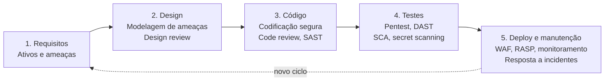
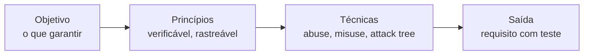
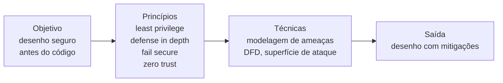
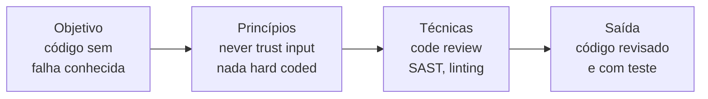
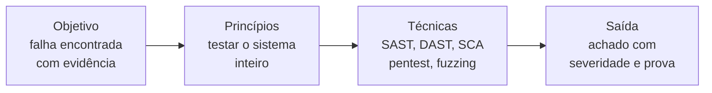
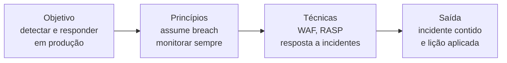

# Ponto 1 — Ciclo de vida de desenvolvimento seguro e DevSecOps

## Objetivo

Entender o SDLC seguro: o que é, as cinco fases, as técnicas de cada fase, e como o DevSecOps executa esse ciclo de forma contínua e automatizada.

Referência principal: Janca, Tanya. *Alice and Bob Learn Application Security*. Wiley, 2020. O ciclo, os nomes das fases e as atividades de cada fase seguem a Figura I-1 e a Figura 7-1 do livro.

---

## 1. Pushing Left — a ideia que sustenta o ciclo

Todo software erra. A questão de engenharia nunca foi evitar o erro, e sim decidir *em que fase do ciclo* ele é descoberto — porque é a fase que define o custo.

### A regra: o custo cresce com o tempo

Quanto mais tarde a falha é corrigida, mais cara ela fica. Falha encontrada no requisito custa uma frase reescrita; a mesma falha em produção custa incidente, investigação e notificação de clientes.

- No requisito e no design, não existe código escrito — corrigir é mudar um documento.
- No commit, o código é pequeno e o contexto está fresco.
- Em produção, a falha já afetou dados, clientes ou receita.

### A tese: pushing left

Dessa curva de custo nasce a ideia que organiza todo o ciclo: *pushing left* — empurrar a segurança para a esquerda, para as fases iniciais, antes de o código existir. Não é um princípio (não restringe nada); é a **estratégia** que decide *quando* aplicar os princípios. A curva de custo é o fundamento (Boehm, *Software Engineering Economics*, 1981); "pushing left" é o nome dessa estratégia (Janca, 2020). No restante do ponto 1, tudo é como executá-la cedo.

### Falha de design e bug de implementação

A distinção entre os dois decide em que fase a correção cabe (Janca, 2020):

| Tipo | O que é | Onde nasce | Custo de corrigir |
|---|---|---|---|
| Falha (flaw) | erro no desenho; o sistema faz o que foi desenhado, e o desenho está errado | Requisitos, Design | alto depois de codificado |
| Bug | erro na implementação; o desenho está certo e o código não cumpre | Código | menor, localizado |

Regra de ouro: bug se corrige com patch; falha se corrige com reprojeto.

### Exemplo

SQL injection corrigida no pull request: reescreve a query, adiciona teste. Fim.

A mesma em produção: incidente, investigação forense, notificação de clientes, patch emergencial fora do horário.

Essa é a estratégia. Mas se ela manda agir cedo e ao longo de todo o ciclo, surge a pergunta que a próxima seção responde: o que vale em *todas* as fases — antes de entrar em qualquer uma?

---

## 2. Fundamentos — o que vale em todas as fases

Antes de construir software seguro é preciso entender um conjunto de conceitos de base: sem saber *quando* e *por que* um controle é necessário, não adianta decorar como implementá-lo. São esses conceitos que sustentam as decisões de projeto e dão razão às regras de segurança (Janca, 2020, cap. 1, "Security Fundamentals"). Eles valem em todo o ciclo, por isso vêm antes das fases.

Os doze conceitos de base (Janca, 2020):

| Conceito | Natureza | Regra | Página |
|---|---|---|---|
| CIA | fundamento | confidencialidade, integridade e disponibilidade são o que se protege | 3 |
| Assume breach | fundamento | presumir que a invasão já aconteceu e desenhar para conter o dano | 6 |
| Ameaça interna | ameaça | quem tem acesso legítimo também é vetor, por malícia ou acidente | 7 |
| Defense in depth | princípio | várias camadas; uma falha não derruba tudo | 9 |
| Least privilege | princípio | mínimo de acesso por componente e por pessoa | 10 |
| Cadeia de suprimentos | ameaça | código que você não escreveu também é seu risco | 11 |
| Sem segurança por obscuridade | princípio | esconder não é proteger; o segredo é a chave, não o desenho | 13 |
| Redução da superfície de ataque | princípio | menos porta aberta, menos coisa para defender | 14 |
| Sem segredo em código | princípio | credencial em código-fonte é credencial vazada | 15 |
| Never trust, always verify | princípio | verificar sempre, nunca confiar por padrão | 15 |
| Segurança usável | princípio | controle que atrapalha é controle que o usuário contorna | 17 |
| Fatores de autenticação | taxonomia | algo que você tem, algo que você é, algo que você sabe; mais de um fator é MFA | 18 |

A tabela resume; cada conceito abaixo tem o problema que o motiva e o que muda quando ele é aplicado.

### CIA — o mandato da segurança

Confidencialidade, integridade e disponibilidade são as três propriedades que toda equipe de segurança existe para proteger — o mandato (Janca, 2020, Figura 1-1). Confidencialidade: só quem deve acessa. Integridade: o dado é o que deveria ser, sem alteração indevida. Disponibilidade: o sistema está lá quando é preciso. Parece abstrato até virar decisão: cada controle que incomoda — tirar direito de administrador, bloquear dispositivo desconhecido — existe para proteger uma dessas três. Por isso CIA vem primeiro: é o critério contra o qual todo requisito e todo risco é medido.

### Assume breach — presumir a invasão

A postura ingênua desenha o sistema para impedir a entrada. A postura madura presume que a entrada já aconteceu — ou vai acontecer — e desenha para limitar o dano. A diferença é prática: se o atacante já está dentro, segmentação, logs, menor privilégio e detecção deixam de ser luxo e viram o plano principal. Assume breach é a premissa que torna defense in depth e least privilege necessários, não opcionais.

### Ameaça interna — o vetor com crachá

Quem tem acesso legítimo também é vetor: por malícia (funcionário que exporta a base de clientes) ou por acidente (quem clica no link errado, quem configura mal). A consequência de projeto é que o perímetro não basta — controles precisam valer *dentro*, para contas autenticadas, e não só na porta.

### Defense in depth — camadas

Nenhum controle é infalível. Defense in depth é colocar várias barreiras independentes, de modo que a falha de uma não exponha tudo: validação de entrada *e* query parametrizada *e* WAF *e* menor privilégio no banco. O atacante precisa vencer todas; o defensor só precisa que uma segure.

### Least privilege — o mínimo necessário

Cada componente e cada pessoa recebe o menor acesso que permite fazer o trabalho — nada a mais. Reduz o que um erro ou um comprometimento pode alcançar: uma conta de serviço que só lê não vaza o que não pode escrever, e um usuário sem admin não instala o que não deveria. É o princípio mais barato de aplicar e o mais frequentemente ignorado por conveniência.

### Cadeia de suprimentos — o código que você não escreveu

A maior parte de uma aplicação moderna é código de terceiros: bibliotecas, frameworks, imagens, serviços. Cada um é risco seu, porque roda com os seus privilégios e toca os seus dados. Uma dependência vulnerável ou maliciosa compromete o sistema tanto quanto um bug próprio. Daí a necessidade de saber o que se usa (inventário), de onde vem e se está atualizado.

### Sem segurança por obscuridade

Esconder o desenho não é proteger. Um sistema seguro continua seguro mesmo quando o atacante conhece sua arquitetura e seu código — o que deve permanecer secreto é a chave, não o mecanismo. Depender de "ninguém vai descobrir" é apostar contra o tempo: alguém descobre.

### Redução da superfície de ataque

Superfície de ataque é o conjunto de pontos por onde o sistema pode ser atacado: portas, endpoints, parâmetros, integrações, funcionalidades. Cada um exige proteção e cada um pode falhar. Reduzir a superfície — desligar o que não se usa, expor só o necessário — diminui o que precisa ser defendido antes de qualquer controle ser escrito.

### Sem segredo em código

Senha, token ou chave no código-fonte é segredo vazado: o repositório é clonado, copiado, compartilhado, e o histórico guarda tudo. Segredos vivem em cofre ou em variáveis de ambiente injetadas em runtime, nunca no fonte. É a regra mais simples do conjunto e uma das mais quebradas.

### Never trust, always verify — zero trust

Todo dado e toda requisição são tratados como não confiáveis até prova em contrário, inclusive quando vêm de dentro da rede ou de outro sistema seu. Confiança implícita baseada em "está na rede interna" é o que insiders e invasores já dentro exploram. Verifica-se sempre: identidade, autorização, integridade da entrada.

### Segurança usável

Controle que atrapalha é controle que o usuário contorna — senha impossível vira post-it, aprovação lenta vira atalho. Segurança que ignora o humano falha pelo lado humano. Projetar o controle para ser o caminho mais fácil é parte da segurança, não concessão.

### Fatores de autenticação

Três categorias de prova de identidade: algo que você sabe (senha), algo que você tem (telefone, token físico), algo que você é (biometria). Autenticação multifator combina mais de uma categoria — não dois fatores do mesmo tipo. Uma senha vazada não basta quando o segundo fator está em outra categoria.

Fail secure não entra neste conjunto: é princípio de arquitetura, detalhado no ponto 3 com fonte própria, não um dos conceitos de base do ciclo.

Fixada a base que vale no ciclo inteiro, falta o ciclo: quais são as fases, e o que essa base vira em cada uma. A próxima seção abre o mapa completo; depois, fase por fase.

---

## 3. Overview visual — o ciclo completo

As cinco fases existem em qualquer metodologia — Waterfall, Agile ou DevOps. O que muda é a duração e a frequência de cada volta, não a existência das fases.

Deploy e manutenção são uma fase só, não duas: as atividades de segurança são as mesmas (monitorar, alertar, responder). A descontinuação não está no ciclo clássico de cinco fases; vem do Microsoft SDL e do NIST SSDF.

---

## 4. As cinco fases do SDLC seguro

O SDLC seguro é o mesmo ciclo de vida de software, com segurança embutida em cada fase — não um teste no final.

### Fase 1 — Requisitos

#### Objetivo

Identificar ativos, classificar dados e escrever requisitos de segurança verificáveis. Responde o que o sistema deve garantir, não como implementar.

**O que se faz:**

| Atividade | O que é |
|---|---|
| Identificar ativos | dados, segredos, funções, infra — o que vale proteger |
| Classificar dados | Público, Interno, Confidencial, Restrito |
| Escrever requisitos | traduzir ativo e classificação em comportamento testável |
| Security user story | o requisito escrito no formato que o time ágil já usa |
| Revisão da stack | avaliar linguagem, framework e serviços antes de adotar |

A revisão da stack é a primeira decisão de segurança do projeto: framework que trata saída por padrão elimina uma classe inteira de falha antes da primeira linha de código.

**O que se produz:**

| Produto | O que é |
|---|---|
| Tipo de requisito | funcional, não funcional, restrição |
| Premissas | o que assume e o que não promete |
| Critério de aceite | o teste que prova que o requisito funciona |

**A lente da classificação:**

CIA — Confidencialidade, Integridade, Disponibilidade. Não é atividade nem produto: é o critério que você aplica ao classificar cada dado.

#### Princípios

| Princípio | Regra |
|---|---|
| Verificabilidade | se não dá para testar, não serve |
| Rastreabilidade | ativo → requisito → controle → teste |
| Negação explícita | o que não deve acontecer vira requisito negativo |

Regra de ouro: ruim = "seja seguro". Bom = "rota autenticada rejeita token expirado com 401".

#### Técnicas

As técnicas são lentes diferentes para achar falhas. Cada uma faz uma pergunta ao sistema e o requisito nasce da resposta.

| Técnica | Quem | Pergunta que faz | Como funciona | Exemplo |
|---|---|---|---|---|
| Abuse case | McDermott e Fox, 1999 | O que um atacante externo faria? | Inverte o caso de uso normal: desenha o fluxo legítimo e depois o fluxo do atacante | Caso de uso: usuário faz login. Abuse case: atacante tenta login com senha vazada. Requisito: bloqueia após três tentativas falhas |
| Misuse case | Sindre e Opdahl, 2000 | O que um insider faria? | Insider com acesso legítimo fazendo o que não deve; aparece no mesmo diagrama do caso de uso | Funcionário exporta a base de clientes. Requisito: exportação exige aprovação de dois níveis |
| Attack tree | Schneier, 1999 | Qual é o objetivo do atacante e quais os caminhos? | Parte do objetivo na raiz; cada ramo é um caminho pra chegar lá | Raiz: roubar dados de cartão. Ramos: SQL injection, upload sem validação, sessão sem expiração. Cada ramo vira um requisito |
| Bug bar | Microsoft SDL | O que não pode ir pra release? | Define o limiar antes de escrever qualquer requisito; é requisito de processo, não de produto | Nenhuma falha crítica conhecida vai pra release |

OWASP ASVS não é técnica: é o catálogo de requisito testável, usado como checklist quando a elicitação termina. SQUARE (Mead, SEI) é o processo que escolhe a técnica. O chamado *confuse case* — erro humano sem intenção (usuário digita CEP inválido; o formulário rejeita com mensagem clara) — é variação informal do misuse case, sem fonte canônica.

#### Saída

Requisito com critério de aceite. Sem teste, não entrou no ciclo.

### Fase 2 — Design

É a fase mais barata para corrigir erro: mudar um desenho custa uma reunião; reescrever código custa meses. É também onde nasce a falha de design — a que patch nenhum corrige.

#### Objetivo

Definir a arquitetura segura do sistema antes de escrever código: onde os dados fluem, onde entram as ameaças, e quais controles mitigam cada uma.

| Atividade | O que é |
|---|---|
| Modelagem de ameaças | levantar o que pode dar errado e decidir o que fazer com cada ameaça |
| Design review | revisão do desenho por alguém que não o escreveu |
| Diagrama de fluxo de dados | processos, armazenamentos, fluxos |
| Superfície de ataque | pontos de entrada do sistema |
| Mitigação | controle que reduz a ameaça |
| Separação de ambientes | produção não empresta dado para teste nem desenvolvimento |

Separação dos dados de produção é regra de desenho, não de operação: dado real em ambiente de teste é vazamento com data marcada, porque o teste não tem o controle que a produção tem.

#### Princípios

| Princípio | Regra |
|---|---|
| Least privilege | mínimo de acesso por componente |
| Defense in depth | várias camadas; uma falha não derruba tudo |
| Fail secure | erro nega acesso, nunca libera |
| Zero trust | verificar sempre, nunca confiar por padrão |

Regra de ouro: design errado custa uma reunião; código errado custa meses.

#### Técnicas

| Técnica | Quem | O que faz |
|---|---|---|
| Modelagem de ameaças | Shostack, 2014 | responde quatro perguntas: o que estamos construindo, o que pode dar errado, o que fazemos a respeito, fizemos um bom trabalho |
| Diagrama de fluxo de dados (DFD) | DeMarco, 1979 | processos, armazenamentos e fluxos; é o insumo da modelagem de ameaças |
| Análise de superfície de ataque | Manadhata e Wing, 2004 | lista pontos de entrada e prioriza por risco |

STRIDE (Kohnfelder e Garg, Microsoft, 1999) é a taxonomia de ameaças que alimenta a modelagem; PASTA (UcedaVélez e Morana, 2015) é um processo alternativo de modelagem, centrado em risco. Nenhum dos dois substitui o DFD nem as quatro perguntas.

#### Saída

Desenho com ameaças mapeadas e mitigações definidas. Sem mitigação, o desenho não saiu da fase.

### Fase 3 — Código

É a fase onde o requisito e o desenho viram comportamento real.

#### Objetivo

Escrever código que não repita os padrões de falha conhecidos, e provar isso antes do merge.

| Atividade | O que é |
|---|---|
| Codificação segura | escolher a construção segura do framework em vez da insegura |
| Validação de entrada | tratar todo dado externo como hostil até prova em contrário |
| Tratamento de erro e log | falhar sem vazar detalhe; registrar o que permite investigar depois |
| Code review | olhar de segurança no pull request |
| SAST no commit | análise estática rodando antes do merge |
| Linting | padrão de código que elimina construção perigosa |
| Teste unitário de segurança | teste que prova o requisito negativo da fase 1 |

#### Princípios

| Princípio | Regra |
|---|---|
| Never trust, always verify | todo dado que vem de fora é não confiável, inclusive de outro sistema seu |
| Nada hard coded | senha, token e chave ficam em cofre, nunca no código |
| Verbo e rota corretos | cada operação usa o método HTTP que corresponde ao efeito dela |
| Identidade e sessão não se improvisam | usar o mecanismo do framework, nunca escrever o seu |
| Bounds checking | todo limite de tamanho e de índice é verificado |
| Erro não é mensagem de ajuda ao atacante | stack trace não vai para o usuário |

Regra de ouro: se você está escrevendo criptografia, autenticação ou sessão do zero, pare — já existe implementação revisada.

#### Técnicas

| Técnica | Quem | O que faz |
|---|---|---|
| Inspeção formal de código | Fagan, 1976 | revisão estruturada com papéis e checklist; é a raiz do code review moderno |
| Secure code review | OWASP Code Review Guide | revisão focada nos controles de segurança, manual ou apoiada por SAST |
| SAST | ver ponto 7 | analisa o código-fonte sem executar, no commit |

OWASP Top 10 e CWE não são técnicas: são catálogos de padrão de falha.

#### Saída

Código revisado, com teste que prova o requisito e sem achado crítico em aberto.

### Fase 4 — Testes

#### Objetivo

Encontrar falhas antes de produção, com evidência que permita corrigir.

A fase não testa só o código. São sete alvos, e esquecer um deixa buraco (Janca, 2020):

| Alvo | O que se verifica |
|---|---|
| Código | padrão de falha conhecido no fonte |
| Aplicação | comportamento da aplicação rodando |
| Infraestrutura | sistema operacional, serviço exposto, configuração |
| Banco de dados | permissão, conta de serviço, dado em repouso |
| APIs | autenticação, autorização e exposição de dado por endpoint |
| Integrações | o que entra e sai de sistemas de terceiros |
| Rede | segmentação, porta aberta, tráfego em claro |

#### Princípios

| Princípio | Regra |
|---|---|
| Evidência | achado sem prova de reprodução não é achado |
| Severidade antes da correção | o bug bar da fase 1 decide o que bloqueia a release |
| Cobertura do sistema, não do código | testar os sete alvos, não só o fonte |

#### Técnicas

| Técnica | O que faz |
|---|---|
| SAST | analisa o código-fonte sem executar |
| DAST | testa a aplicação rodando, como atacante |
| SCA | verifica dependências de terceiros |
| Fuzzing | envia entrada malformada e observa se quebra |
| Secret scanning | procura credencial vazada no repositório |
| Pentest | simula ataque real, geralmente por time externo |

#### Saída

Achado com severidade, prova de reprodução e decisão: corrige agora, aceita o risco ou bloqueia a release.

### Fase 5 — Deploy e manutenção

#### Objetivo

Colocar em produção sem abrir brecha, e detectar e responder ao que aparecer depois, sem derrubar o serviço.

| Atividade | O que é |
|---|---|
| Deploy seguro | release só com verificação aprovada e segredo fora do artefato |
| WAF | filtra requisição maliciosa antes de chegar na aplicação |
| RASP | proteção dentro da própria aplicação em execução |
| Monitoramento e log | registrar o que permite perceber o ataque acontecendo |
| Alerta | avisar alguém que pode agir, no tempo de agir |
| Resposta a incidentes | conter, erradicar, recuperar, aprender |
| Rastreio de CVEs | saber quais afetam o que roda |
| Patch management | corrigir sem downtime |
| Varredura contínua | o que estava seguro ontem pode não estar hoje |
| Inventário | não se protege o que não se sabe que existe |

#### Princípios

| Princípio | Regra |
|---|---|
| Assume breach | operar como se o atacante já estivesse dentro |
| Log sem segredo | o log registra o evento, nunca a credencial nem o dado sensível |
| Detecção vale o que vale a resposta | alerta que ninguém lê é alerta que não existe |

Regra de ouro: simulação (fire drill) antes do incidente — plano de resposta que nunca foi ensaiado falha no dia.

#### Técnicas

| Técnica | O que faz |
|---|---|
| Resposta a incidentes (NIST SP 800-61) | processo de contenção, erradicação, recuperação e lição aprendida |
| Gestão de vulnerabilidades | ciclo de identificar, priorizar, corrigir e verificar |

#### Saída

Produção monitorada, incidente contido e a lição virando requisito do próximo ciclo.

### Fase extra — Descontinuação

Não está no ciclo clássico de cinco fases; vem do Microsoft SDL e do NIST SSDF. Entra porque o sistema que sai do ar continua guardando dado e credencial.

**Objetivo:** encerrar o sistema sem vazar dados nem deixar credenciais ativas.

| Atividade | O que é |
|---|---|
| Remoção segura de dados | apagar ou anonimizar sem resíduo |
| Revogação de credenciais | invalidar tokens, chaves, senhas |
| Transferência controlada | passar dados para o sistema sucessor |

**Técnica:** nenhuma técnica nomeada nesta fase — é checklist de encerramento.

---

### Os modelos nomeados de ciclo de vida seguro

O ciclo descrito acima tem várias formulações com nome, autor e ano. Conhecê-las pelo que cada uma é — prescrição, medição ou descrição — é o que distingue a dissertação da resenha.

**Microsoft SDL (Howard e Lipner, 2006).** O primeiro ciclo de vida seguro de uma grande empresa, nascido do memorando *Trustworthy Computing* de Bill Gates (2002) depois dos vermes Code Red e Nimda. Prescritivo: fases com atividades obrigatórias — treinamento, requisitos de segurança e *bug bar*, modelagem de ameaças no design, funções proibidas e análise estática no código, fuzzing e revisão de superfície nos testes, plano de resposta a incidentes antes do lançamento, e a *Final Security Review* como gate. O princípio SD3+C (seguro por design, por padrão, no deploy, e comunicação) é dele. A Microsoft mediu queda na contagem de vulnerabilidades por versão depois da adoção; o SDL virou o molde dos demais.

**Touchpoints (McGraw, 2006).** Em *Software Security: Building Security In*, sete pontos de contato aplicados aos artefatos do desenvolvimento, em ordem de eficácia: revisão de código com ferramenta, análise de risco de arquitetura, testes de intrusão, testes de segurança baseados em risco, casos de abuso, requisitos de segurança, e operações de segurança. É o ciclo visto pelos artefatos (código, arquitetura, testes), não pelas fases — e a origem da tese de que metade dos defeitos é de design (ponto 3).

**OWASP CLASP (2006) e OWASP SAMM (2009; versão 2 em 2020).** O CLASP foi a primeira tentativa aberta de catálogo de atividades; o SAMM (*Software Assurance Maturity Model*) o substituiu como modelo de maturidade: cinco funções de negócio (governança, design, implementação, verificação, operações), três práticas por função, quinze no total, cada uma em três níveis de maturidade, com avaliação por questionário. Não prescreve o que fazer; mede onde a organização está e oferece um caminho. É a ferramenta para dizer "estamos no nível 1 em modelagem de ameaças e queremos o 2 em um ano".

**BSIMM (McGraw, Migues e West, desde 2009).** O *Building Security In Maturity Model* é descritivo: observa o que dezenas de organizações com programas de segurança de software de fato fazem e cataloga as atividades (cerca de 120, em 12 práticas e 4 domínios — governança, inteligência, pontos de contato do SDLC, implantação), com a frequência de cada uma. Não diz o que se deve fazer; diz o que os outros fazem, e com que frequência. Serve para comparação; campeões de segurança, inventário de aplicações e treinamento por função aparecem entre as atividades mais comuns.

**NIST SSDF (SP 800-218, 2022).** Produzido por ordem do decreto executivo 14028 (2021), o *Secure Software Development Framework* é a lista de resultados esperados de quem produz software, em quatro grupos: preparar a organização (PO), proteger o software (PS), produzir software bem protegido (PW) e responder a vulnerabilidades (RV). Não escolhe ferramenta nem processo; cada prática referencia como SDL, SAMM, BSIMM e OWASP a atendem. Virou exigência contratual do governo americano por autoatestação (2023) e a referência comum a que os demais modelos se mapeiam.

**Como se relacionam.** SDL e SSDF dizem o que fazer (prescrição e resultado); SAMM mede e planeja (maturidade); BSIMM compara (observação); Touchpoints organiza por artefato. Uma organização típica adota o SSDF como alvo, mede-se com o SAMM, compara-se com o BSIMM e executa atividades que vêm do SDL. Janca (2020), que fundamenta este laboratório, está na linhagem do SDL com a ênfase em *pushing left* e em cultura. A dissertação que cita os cinco e os distingue pela natureza mostra domínio; a que os lista como sinônimos, não.

## 5. Atividades de segurança por fase (Figura 7-1)

O ciclo inteiro em uma tabela: o mapa de onde cada atividade entra.

| Fase | Atividades de segurança |
|---|---|
| Requisitos | requisitos de segurança, security user stories, revisão segura da stack |
| Design | modelagem de ameaças, design review, princípios de design seguro aplicados |
| Código | code review, SAST, DAST, SCA, linting, testes unitários de segurança, codificação segura |
| Testes | pentest, DAST, code review, SAST, SCA, secret scanning |
| Deploy e manutenção | WAF, RASP, monitoramento, log, alerta, resposta a incidentes |

Repare que SAST, DAST, SCA e code review aparecem em duas fases. Não é redundância: no Código roda rápido e por commit, para dar retorno ao desenvolvedor; nos Testes roda completo e com evidência, para decidir a release.

Isto descreve *o que* fazer em cada fase. Mas processo escrito não é processo executado — depende de alguém lembrar, toda vez. A pergunta final do ponto é: como fazer isso acontecer sempre, sem depender de disciplina humana? É o que o DevSecOps responde.

---

## 6. O que é DevSecOps

DevSecOps = **Development + Security + Operations**.

É a prática de integrar segurança no pipeline de CI/CD, de forma automatizada e contínua. Segurança deixa de ser etapa separada no final e roda junto com tudo.

O nome junta três áreas:

- **Development** — o time que escreve o código
- **Security** — a camada de segurança: ferramentas e práticas
- **Operations** — o time que cuida de deploy, monitoramento e infraestrutura

### A ideia central

Segurança passa a ser responsabilidade compartilhada pelos três, não de um time isolado. Cada commit dispara verificações automáticas; se algo falhar, o pipeline bloqueia o deploy.

### O oposto

Modelo tradicional: o time de segurança recebia o sistema pronto, fazia um pentest no final, encontrava falhas caras e devolvia. Todo mundo perdia tempo.

---

## 7. Shift-left e shift-right

Aqui o princípio da seção 1 vira prática de pipeline. **Shift-left é o pushing left aplicado ao CI/CD** — não é ideia nova, é a mesma regra de custo executada a cada commit. O que o DevSecOps acrescenta é o par que falta: o lado direito.

### Shift-left — o pushing left no pipeline

Trazer segurança para o mais cedo possível. Em vez de testar no final, testar em cada commit: SAST no push, SCA nas dependências, secrets scanning antes do merge.

### Shift-right — o que o pushing left sozinho não cobre

Empurrar para a esquerda previne, mas não enxerga o que já está rodando. Shift-right é monitorar em produção: CVEs novos aparecem todo dia, e o time precisa saber quais afetam o que roda e responder rápido.

### Juntas

Shift-left previne, shift-right detecta. Um sem o outro deixa buraco: só shift-left ignora o que já está em produção; só shift-right corrige tarde demais.

---

## 8. Pipeline de CI/CD com segurança

O pipeline é a sequência automatizada de etapas do commit ao deploy. Com segurança embutida, cada etapa ganha uma verificação.

### Etapas típicas

1. **Commit** — o desenvolvedor envia o código
2. **Build** — compilação ou empacotamento
3. **Testes** — testes automatizados
4. **Análise de segurança** — SAST, SCA, secrets scanning
5. **Deploy em staging** — ambiente de teste
6. **DAST** — a aplicação rodando é testada como um atacante
7. **Deploy em produção** — só se tudo passou

### Regra de ouro

Se uma verificação falhar, o pipeline para. Nada vai para produção com falha de segurança conhecida.

---

## 9. Ferramentas do DevSecOps

Cada técnica do DevSecOps tem ferramentas que a executam.

### SAST — Static Application Security Testing

Analisa o código-fonte sem executá-lo. Encontra padrões de falha conhecidos: SQL injection, buffer overflow, funções inseguras.

Exemplo: Semgrep.

### DAST — Dynamic Application Security Testing

Testa a aplicação rodando, como um atacante. Envia requisições maliciosas e observa as respostas.

Exemplo: OWASP ZAP.

### SCA — Software Composition Analysis

Verifica dependências de terceiros. Bibliotecas com CVEs conhecidas são sinalizadas.

Exemplo: Trivy.

### Fuzzing

Envia entradas aleatórias ou malformadas e observa se o programa quebra. Bom para falhas de memória e parsing.

### Secrets scanning

Procura credenciais vazadas no código: senhas, tokens, chaves de API.

Exemplo: gitleaks.

### WAF e RASP

WAF filtra requisição antes de chegar na aplicação. RASP protege de dentro da aplicação em execução. Nenhum dos dois corrige a falha: compram tempo até o patch.

---

### Medir o programa — métricas de DevSecOps

DevSecOps herda do DevOps a obsessão por medir. Forsgren, Humble e Kim (2018), em *Accelerate*, estabeleceram as quatro métricas de entrega (DORA): tempo de entrega de uma mudança, frequência de implantação, tempo de restauração após falha e taxa de falha de mudanças. A segurança entra nelas de dois jeitos: um controle que destrói a frequência de implantação será contornado; e a pesquisa mostrou que organizações de alto desempenho integram segurança no fluxo e gastam metade do tempo em retrabalho de segurança. As métricas próprias de segurança no pipeline: **tempo de correção por severidade** (do achado à correção verificada, em dias); **taxa de escape** (vulnerabilidades encontradas em produção que o pipeline deveria ter pegado); **cobertura dos gates** (fração de repositórios e pipelines com SAST, SCA e varredura de segredos ativos — a primeira a medir, porque gate que não roda não existe); **cobertura de modelagem** (fração de funcionalidades novas com modelo de ameaças revisado); **dívida de segurança** (achados aceitos e idade deles); **tempo de atualização de dependência** (dias entre a publicação da versão corrigida e a adoção). O que não medir como sucesso: número de achados (cresce quando se liga ferramenta nova), número de ferramentas, horas de treinamento.

### Gates que funcionam — proporcionais, com exceção e com dono

O gate é o ponto em que o pipeline recusa seguir. A regra que faz um gate sobreviver: **bloqueia o novo e grave; registra o resto**. Bloquear tudo que a ferramenta aponta, no primeiro dia, para o pipeline inteiro — o time desliga o gate na primeira entrega urgente, e o desliga para sempre. A alternativa: linha de base dos achados existentes vira dívida com dono e prazo; o gate bloqueia só achado novo acima da severidade combinada; exceção tem motivo, dono, prazo e fica visível. Política como código (OPA, Conftest) torna a regra do gate versionada, revisável e igual para todos os repositórios. E o gate reporta onde o desenvolvedor está — comentário no *pull request*, aviso na IDE — não em relatório que ninguém abre. Shift-left é isso: a regra encontra o erro no lugar e na hora em que custa menos corrigir.

### Cultura — a parte do DevSecOps que não é ferramenta

Kim, Humble, Debois e Willis (*The DevOps Handbook*, 2016) descrevem as "três vias": fluxo (do desenvolvimento à operação sem fila), retorno (informação de produção voltando rápido) e aprendizado contínuo (experimentar sem medo). DevSecOps é segurança aplicada às três: o controle não pode travar o fluxo; o incidente e o achado de produção voltam ao desenvolvimento como requisito; e o erro é analisado sem culpa (*blameless postmortem*) para virar regra, não punição. As práticas culturais que os modelos de maturidade mais observam: **campeões de segurança** (um por time, com tempo reservado, treinado, ponte com o time central); **segurança como responsabilidade compartilhada** (o time que constrói é dono da segurança do que constrói; o time central dá ferramenta, padrão e revisão); **treinamento ancorado em achado real** do próprio código, não em lista genérica; **segurança que diz sim com condições** em vez de não — Janca (2020) insiste: o time de segurança que só bloqueia é contornado; o que oferece o caminho seguro é procurado. O erro mais caro do DevSecOps é comprar as ferramentas e pular esta seção.

## 10. SDLC seguro vs DevSecOps

### SDLC seguro

É o **processo**: as cinco fases com segurança embutida. Responde "o que fazer em cada fase".

### DevSecOps

É a **prática**: como esse processo roda no dia a dia, com segurança automatizada no pipeline. Responde "como garantir que a segurança aconteça em cada fase, de forma contínua".

### Resumo

| | SDLC seguro | DevSecOps |
|---|---|---|
| Natureza | Processo | Prática |
| Pergunta | O que fazer? | Como fazer? |
| Escala | Qualquer projeto | Projetos com CI/CD |

Um não substitui o outro: o DevSecOps é a forma de executar o SDLC seguro em escala.

---

### Os dez pontos como um só ciclo

O ciclo de vida seguro é a moldura dos outros nove pontos deste laboratório, e a dissertação ganha se mostrar o encaixe. **Requisitos**: a modelagem de ameaças (ponto 2) produz os requisitos negativos — o que o sistema não pode permitir — e a análise de superfície decide o tamanho do problema. **Design**: os princípios de arquitetura (ponto 3) dizem que forma o sistema deve ter para satisfazer esses requisitos; a revisão contra as dez falhas de design é o gate da fase. **Código**: as vulnerabilidades web (ponto 4) e os erros de memória (ponto 5) são o que acontece quando o código trai o design; padrões de codificação, funções proibidas e sanitizadores são os controles da fase; autenticação, autorização e sessão (ponto 6) são o recorte do código que mais erra. **Testes**: SAST, DAST, SCA e fuzzing (ponto 7) provam, cada um por sua janela, que os requisitos negativos foram atendidos; a rastreabilidade ameaça → requisito → controle → teste fecha aqui. **Build e entrega**: a cadeia de suprimentos (ponto 8) garante que o artefato que vai a produção é o que foi revisado e testado, com proveniência e assinatura. **Deploy e operação**: APIs, microsserviços e contêineres (ponto 9) são o ambiente em que o artefato roda, com suas fronteiras multiplicadas. **Manutenção**: a gestão de vulnerabilidades (ponto 10) governa o tempo entre a falha aparecer e ser corrigida, e devolve a lição ao início — o incidente é o requisito do próximo ciclo. Lido assim, o laboratório inteiro é um ciclo de vida seguro desdobrado; cada ponto é a atividade de uma fase, com seus princípios, técnicas e mecanismos.

### O mínimo viável para um time pequeno

Nem toda organização tem time de segurança. O ciclo de vida seguro de um time de cinco pessoas, sem especialista, cabe em sete práticas que custam pouco e cobrem a maior parte do risco: (1) uma hora de modelagem de ameaças por funcionalidade que cruza fronteira nova, com o jogo de cartas ou o DFD no quadro; (2) *lockfile*, SCA e varredura de segredos no pipeline, ligados no primeiro dia, bloqueando só o crítico novo; (3) SAST diferencial no *pull request* com regras ajustadas em duas semanas; (4) revisão de código com roteiro de segurança para o que toca entrada externa, autenticação e autorização; (5) *framework* mantido, na versão atual, com atualização automatizada de dependências; (6) um campeão de segurança com 10% do tempo e um canal com um especialista externo quando preciso; (7) `security.txt`, política de divulgação e o hábito de corrigir vulnerabilidade reportada em dias. É o SSDF em escala pequena, e é mais do que a maioria das organizações faz.

### Exigências externas que moldam o ciclo

O ciclo de vida seguro deixou de ser escolha interna. O **decreto executivo americano 14028** (2021) exigiu de fornecedores do governo práticas de desenvolvimento seguro, SBOM e autoatestação (formulário da CISA, 2023) contra o SSDF. A **Cyber Resilience Act** europeia (2024) obriga fabricantes de produtos com elementos digitais a segurança por design e por padrão, tratamento de vulnerabilidades, SBOM e notificação de vulnerabilidades exploradas em 24 horas — ao longo de todo o ciclo de vida do produto, com multas. O **PCI DSS 4.0** (2022), requisito 6, exige ciclo de desenvolvimento seguro documentado, treinamento, revisão de código e gestão de vulnerabilidades para quem trata dados de cartão. A **ISO/IEC 27001:2022** (controle A.8.25, *secure development life cycle*, e A.8.28, *secure coding*) exige regras de desenvolvimento seguro estabelecidas e aplicadas. O **NIST CSF 2.0** (2024) acrescentou a função *Govern* e aponta o SSDF para a cadeia de suprimentos de software. O efeito prático: o programa precisa produzir evidência — política escrita, registro de atividades por fase, SBOM, métricas — e não só executar. O que este laboratório chama de rastreabilidade (ativo → requisito → controle → teste) é também o que o auditor pede.

### Erros frequentes — o que não confundir

| Confusão | Por que está errado | Como dizer certo |
|---|---|---|
| "DevSecOps é colocar scanners no pipeline" | ferramenta sem cultura, gate proporcional e retorno ao desenvolvimento é ruído automatizado | "ferramentas no fluxo, segurança como responsabilidade compartilhada, retorno de produção" |
| "Shift-left dispensa o lado direito" | o que não se pode saber antes de produção (configuração real, comportamento, ataque) só se vê à direita | "pushing left para o que é decidível antes; shift-right para o que só produção mostra" |
| "SDL é coisa da Microsoft" | o SDL é o molde do SSDF, do SAMM e da CRA; as atividades são universais | "SDL como origem; SSDF como referência atual" |
| "Segurança é uma fase" | a fase de testes não corrige falha de design; cada fase tem sua atividade | "atividade de segurança em toda fase, com gate entre fases" |
| "Conformidade com a norma = seguro" | normas são piso e evidência; o atacante não lê a norma | "norma como piso; modelo de ameaças como teto" |
| "Gate bloqueia tudo que a ferramenta aponta" | é desligado na primeira urgência | "bloqueia novo e grave; o resto é dívida com dono" |
| "Treinamento anual de OWASP Top 10 resolve" | não muda linha de código; treinamento com o achado do próprio repositório muda | "treinamento ancorado em achado real" |
| "Pushing left é uma técnica" | é estratégia (decisão sobre onde investir); as técnicas são as de cada fase | "estratégia que organiza as técnicas" |
| "SAMM, BSIMM e SSDF são sinônimos" | maturidade, observação e prescrição são naturezas distintas | "SSDF diz o que; SAMM mede; BSIMM compara" |

## 11. Síntese

| Fase / Conceito | Objetivo | Princípio | Técnica |
|---|---|---|---|
| Requisitos | requisito verificável | verificável, rastreável, negação explícita | abuse case, misuse case, attack tree, bug bar |
| Design | desenho seguro antes do código | least privilege, defense in depth, fail secure, zero trust | modelagem de ameaças, DFD, superfície de ataque |
| Código | código sem falha conhecida | never trust input, nada hard coded, bounds checking | inspeção de Fagan, secure code review, SAST, linting |
| Testes | falha encontrada com evidência | evidência, severidade, cobertura dos sete alvos | SAST, DAST, SCA, fuzzing, secret scanning, pentest |
| Deploy e manutenção | falha detectada e respondida | assume breach, log sem segredo | resposta a incidentes, gestão de vulnerabilidades |
| Descontinuação | encerramento sem vazamento | — | — (checklist) |
| Pushing Left | corrigir onde é barato | falha ≠ bug | — |
| DevSecOps | segurança no pipeline | responsabilidade compartilhada | Dev + Sec + Ops integrados |
| Shift-left | segurança no início do ciclo | — | — |
| Shift-right | monitoramento em produção | — | — |

---

## Referências
- **Howard, Michael; Lipner, Steve. *The Security Development Lifecycle*. Microsoft Press, 2006** — o SDL: fases, atividades obrigatórias, bug bar, Final Security Review, SD3+C
- **McGraw, Gary. *Software Security: Building Security In*. Addison-Wesley, 2006** — os sete touchpoints por artefato
- **OWASP. *Software Assurance Maturity Model (SAMM)* v2, 2020** — cinco funções, quinze práticas, três níveis de maturidade
- **McGraw, Gary; Migues, Sammy; West, Jacob. *Building Security In Maturity Model (BSIMM)*, desde 2009** — modelo descritivo de atividades observadas
- **NIST SP 800-218. *Secure Software Development Framework (SSDF)* v1.1, 2022; CISA. *Secure Software Development Attestation Form*, 2023**
- **Forsgren, Nicole; Humble, Jez; Kim, Gene. *Accelerate*. IT Revolution, 2018** — as quatro métricas DORA e a relação entre desempenho de entrega e segurança integrada
- **Kim, Gene; Humble, Jez; Debois, Patrick; Willis, John. *The DevOps Handbook*. IT Revolution, 2016** — as três vias; segurança no fluxo
- **Executive Order 14028 (2021); União Europeia, *Cyber Resilience Act* (2024); PCI DSS v4.0 requisito 6 (2022); ISO/IEC 27001:2022 controles A.8.25 e A.8.28; NIST *Cybersecurity Framework* 2.0 (2024)** — exigências externas sobre o ciclo

- **Janca, Tanya. *Alice and Bob Learn Application Security*. Wiley, 2020** — referência principal. Figura I-1 (o SDLC e suas cinco fases), Figura 7-1 (atividades de segurança por fase). Por fase: Requisitos — cap. 2; Design — cap. 3; Código — cap. 4 e 5; Testes — cap. 6; Deploy e manutenção — cap. 6 e 9 (Figura 7-1). Também: cap. 1 (conceitos de base), cap. 7 (programa de AppSec)
- Microsoft SDL — learn.microsoft.com (procure "Security Development Lifecycle")
- NIST SSDF — nist.gov/publications/sp-800-218
- NIST SP 800-61 — resposta a incidentes
- OWASP SAMM — owaspsamm.org
- OWASP ASVS — catálogo de requisitos verificáveis
- OWASP Code Review Guide — secure code review
- Misuse cases — Sindre e Opdahl, Requirements Engineering, 2005
- Abuse cases — McDermott e Fox, 1999
- SQUARE — Mead, SEI
- DFD — DeMarco, 1979
- Superfície de ataque — Manadhata e Wing, 2004
- Modelagem de ameaças — Shostack, 2014
- Inspeção de código — Fagan, 1976
