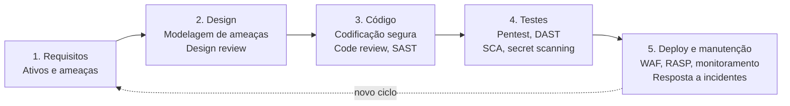
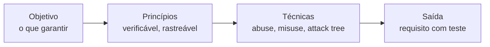
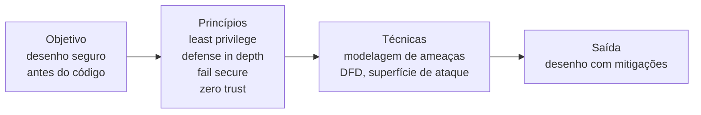
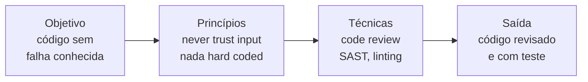
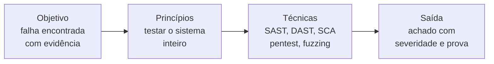
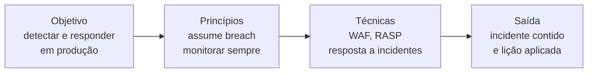

# Ponto 1 — Ciclo de vida de desenvolvimento seguro e DevSecOps

## Objetivo

Entender o SDLC seguro: o que é, as cinco fases, as técnicas de cada fase, e como o DevSecOps executa esse ciclo de forma contínua e automatizada.

Referência principal: Janca, Tanya. *Alice and Bob Learn Application Security*. Wiley, 2020. O ciclo, os nomes das fases e as atividades de cada fase seguem a Figura I-1 e a Figura 7-1 do livro.

---

## 1. Pushing Left — a ideia que sustenta o ciclo

Todo software erra. A questão de engenharia nunca foi evitar o erro, e sim decidir *em que fase do ciclo* ele é descoberto — porque é a fase que define o custo.

### A regra: o custo cresce com o tempo

Quanto mais tarde a falha é corrigida, mais cara ela fica. Falha encontrada no requisito custa uma frase reescrita; a mesma falha em produção custa incidente, investigação e notificação de clientes.

- No requisito e no design, não existe código escrito — corrigir é mudar um documento.
- No commit, o código é pequeno e o contexto está fresco.
- Em produção, a falha já afetou dados, clientes ou receita.

### A tese: pushing left

Dessa curva de custo nasce a ideia que organiza todo o ciclo: *pushing left* — empurrar a segurança para a esquerda, para as fases iniciais, antes de o código existir. É o princípio; tudo que segue neste ponto é como aplicá-lo.

### Falha de design e bug de implementação

Janca separa os dois, e a distinção decide em que fase a correção cabe:

| Tipo | O que é | Onde nasce | Custo de corrigir |
|---|---|---|---|
| Falha (flaw) | erro no desenho; o sistema faz o que foi desenhado, e o desenho está errado | Requisitos, Design | alto depois de codificado |
| Bug | erro na implementação; o desenho está certo e o código não cumpre | Código | menor, localizado |

Regra de ouro: bug se corrige com patch; falha se corrige com reprojeto.

### Exemplo

SQL injection corrigida no pull request: reescreve a query, adiciona teste. Fim.

A mesma em produção: incidente, investigação forense, notificação de clientes, patch emergencial fora do horário.

---

## 2. Fundamentos — o que vale em todas as fases

Os fundamentos não são uma fase. A autora os reúne no cap. 1, antes dos capítulos de fase, como a base necessária para entender como o resto do livro se aplica (p. 6). O que a Figura 7-1 distribui por fase são atividades, não fundamentos.

Cuidado ao ler os "Princípios" de cada fase adiante — ali se misturam duas coisas: o **fundamento transversal** que a fase *seleciona* desta tabela (ex.: least privilege, fail secure) e a **regra própria da fase**, local, que não vale fora dela (ex.: "bounds checking" no código, "negação explícita" no requisito). Fundamento reaparece em várias fases; regra de fase aparece em uma só.

Os doze fundamentos do cap. 1, na ordem do livro:

| Fundamento | Regra | Página |
|---|---|---|
| CIA | confidencialidade, integridade e disponibilidade são o que se protege | 3 |
| Assume breach | presumir que a invasão já aconteceu e desenhar para conter o dano | 6 |
| Ameaça interna | quem tem acesso legítimo também é vetor, por malícia ou acidente | 7 |
| Defense in depth | várias camadas; uma falha não derruba tudo | 9 |
| Least privilege | mínimo de acesso por componente e por pessoa | 10 |
| Cadeia de suprimentos | código que você não escreveu também é seu risco | 11 |
| Sem segurança por obscuridade | esconder não é proteger; o segredo é a chave, não o desenho | 13 |
| Redução da superfície de ataque | menos porta aberta, menos coisa para defender | 14 |
| Sem segredo em código | credencial em código-fonte é credencial vazada | 15 |
| Never trust, always verify | verificar sempre, nunca confiar por padrão | 15 |
| Segurança usável | controle que atrapalha é controle que o usuário contorna | 17 |
| Fatores de autenticação | algo que você tem, algo que você é, algo que você sabe; mais de um fator é MFA | 18 |

Nem todos são princípios no sentido estrito: ameaça interna é categoria de risco, sem segredo em código é antipadrão e fatores de autenticação é taxonomia. A autora os trata como *security concepts*, não como princípios.

Fail secure não entra nesta tabela: não é fundamento do cap. 1. Como princípio de arquitetura, pertence ao ponto 3, com fonte própria.

Detalhamento dos princípios de arquitetura: ponto 3. Cadeia de suprimentos: ponto 8.

---

## 3. Overview visual — o ciclo completo

As cinco fases existem em qualquer metodologia — Waterfall, Agile ou DevOps. O que muda é a duração e a frequência de cada volta, não a existência das fases.

### De onde vem cada fase

| Fase (Janca) | Fonte |
|---|---|
| Requisitos | Figura I-1, cap. 2 |
| Design | Figura I-1, cap. 3 |
| Código | Figura I-1, cap. 4 e 5 |
| Testes | Figura I-1, cap. 6 |
| Deploy e manutenção | Figura 7-1, cap. 6 e 9 |
| Descontinuação | não está no livro; Microsoft SDL e NIST SSDF |

A fase de Operação deixou de ser separada: na Figura 7-1 o deploy e a manutenção são a mesma fase, porque as atividades de segurança são as mesmas (monitorar, alertar, responder).

---

## 4. As cinco fases do SDLC seguro

O SDLC seguro é o mesmo ciclo de vida de software, com segurança embutida em cada fase — não um teste no final.

### Fase 1 — Requisitos

Ordem: objetivo → princípios → técnicas → saída.

#### Objetivo

Identificar ativos, classificar dados e escrever requisitos de segurança verificáveis. Responde o que o sistema deve garantir, não como implementar.

**O que se faz:**

| Atividade | O que é |
|---|---|
| Identificar ativos | dados, segredos, funções, infra — o que vale proteger |
| Classificar dados | Público, Interno, Confidencial, Restrito |
| Escrever requisitos | traduzir ativo e classificação em comportamento testável |
| Security user story | o requisito escrito no formato que o time ágil já usa |
| Revisão da stack | avaliar linguagem, framework e serviços antes de adotar |

As duas últimas vêm da Figura 7-1. A revisão da stack é a primeira decisão de segurança do projeto: framework que trata saída por padrão elimina uma classe inteira de falha antes da primeira linha de código.

**O que se produz:**

| Produto | O que é |
|---|---|
| Tipo de requisito | funcional, não funcional, restrição |
| Premissas | o que assume e o que não promete |
| Critério de aceite | o teste que prova que o requisito funciona |

**A lente da classificação:**

CIA — Confidencialidade, Integridade, Disponibilidade. Não é atividade nem produto: é o critério que você aplica ao classificar cada dado.

#### Princípios

| Princípio | Regra |
|---|---|
| Verificabilidade | se não dá para testar, não serve |
| Rastreabilidade | ativo → requisito → controle → teste |
| Negação explícita | o que não deve acontecer vira requisito negativo |

Regra de ouro: ruim = "seja seguro". Bom = "rota autenticada rejeita token expirado com 401".

#### Técnicas

As técnicas são lentes diferentes para achar falhas. Cada uma faz uma pergunta ao sistema e o requisito nasce da resposta.

| Técnica | Quem | Pergunta que faz | Como funciona | Exemplo |
|---|---|---|---|---|
| Abuse case | McDermott e Fox, 1999 | O que um atacante externo faria? | Inverte o caso de uso normal: desenha o fluxo legítimo e depois o fluxo do atacante | Caso de uso: usuário faz login. Abuse case: atacante tenta login com senha vazada. Requisito: bloqueia após três tentativas falhas |
| Misuse case | Sindre e Opdahl, 2000 | O que um insider faria? | Insider com acesso legítimo fazendo o que não deve; aparece no mesmo diagrama do caso de uso | Funcionário exporta a base de clientes. Requisito: exportação exige aprovação de dois níveis |
| Attack tree | Schneier, 1999 | Qual é o objetivo do atacante e quais os caminhos? | Parte do objetivo na raiz; cada ramo é um caminho pra chegar lá | Raiz: roubar dados de cartão. Ramos: SQL injection, upload sem validação, sessão sem expiração. Cada ramo vira um requisito |
| Bug bar | Microsoft SDL | O que não pode ir pra release? | Define o limiar antes de escrever qualquer requisito; é requisito de processo, não de produto | Nenhuma falha crítica conhecida vai pra release |

Apoio, não técnica: OWASP ASVS é o catálogo de requisito testável — serve como checklist quando a elicitação termina, para achar o que ninguém lembrou. SQUARE (Mead, SEI) é o processo que escolhe a técnica. Confuse case não é técnica nomeada com fonte canônica — é uma variação informal do misuse case para cobrir erro humano sem intenção (usuário digita CEP inválido; o formulário rejeita com mensagem clara); use como lembrete, não como técnica.

#### Saída

Requisito com critério de aceite. Sem teste, não entrou no ciclo.

### Fase 2 — Design

Ordem: objetivo → princípios → técnicas → saída.

É a fase mais barata para corrigir erro: mudar um desenho custa uma reunião; reescrever código custa meses. É também onde nasce a falha de design — a que patch nenhum corrige.

#### Objetivo

Definir a arquitetura segura do sistema antes de escrever código: onde os dados fluem, onde entram as ameaças, e quais controles mitigam cada uma.

| Atividade | O que é |
|---|---|
| Modelagem de ameaças | levantar o que pode dar errado e decidir o que fazer com cada ameaça |
| Design review | revisão do desenho por alguém que não o escreveu |
| Diagrama de fluxo de dados | processos, armazenamentos, fluxos |
| Superfície de ataque | pontos de entrada do sistema |
| Mitigação | controle que reduz a ameaça |
| Separação de ambientes | produção não empresta dado para teste nem desenvolvimento |

Separação dos dados de produção é regra de desenho, não de operação: dado real em ambiente de teste é vazamento com data marcada, porque o teste não tem o controle que a produção tem.

#### Princípios

| Princípio | Regra |
|---|---|
| Least privilege | mínimo de acesso por componente |
| Defense in depth | várias camadas; uma falha não derruba tudo |
| Fail secure | erro nega acesso, nunca libera |
| Zero trust | verificar sempre, nunca confiar por padrão |

Regra de ouro: design errado custa uma reunião; código errado custa meses.

#### Técnicas

| Técnica | Quem | O que faz |
|---|---|---|
| Modelagem de ameaças | Shostack, 2014 | responde quatro perguntas: o que estamos construindo, o que pode dar errado, o que fazemos a respeito, fizemos um bom trabalho |
| Diagrama de fluxo de dados (DFD) | DeMarco, 1979 | processos, armazenamentos e fluxos; é o insumo da modelagem de ameaças |
| Análise de superfície de ataque | Manadhata e Wing, 2004 | lista pontos de entrada e prioriza por risco |

Apoio, não técnica: STRIDE (Microsoft) e PASTA são as taxonomias que alimentam a modelagem. Detalhamento da modelagem de ameaças: ponto 2.

#### Saída

Desenho com ameaças mapeadas e mitigações definidas. Sem mitigação, o desenho não saiu da fase.

### Fase 3 — Código

Ordem: objetivo → princípios → técnicas → saída.

É o capítulo mais longo do livro, e a fase onde o requisito e o desenho viram comportamento real.

#### Objetivo

Escrever código que não repita os padrões de falha conhecidos, e provar isso antes do merge.

| Atividade | O que é |
|---|---|
| Codificação segura | escolher a construção segura do framework em vez da insegura |
| Validação de entrada | tratar todo dado externo como hostil até prova em contrário |
| Tratamento de erro e log | falhar sem vazar detalhe; registrar o que permite investigar depois |
| Code review | olhar de segurança no pull request |
| SAST no commit | análise estática rodando antes do merge |
| Linting | padrão de código que elimina construção perigosa |
| Teste unitário de segurança | teste que prova o requisito negativo da fase 1 |

#### Princípios

| Princípio | Regra |
|---|---|
| Never trust, always verify | todo dado que vem de fora é não confiável, inclusive de outro sistema seu |
| Nada hard coded | senha, token e chave ficam em cofre, nunca no código |
| Verbo e rota corretos | cada operação usa o método HTTP que corresponde ao efeito dela |
| Identidade e sessão não se improvisam | usar o mecanismo do framework, nunca escrever o seu |
| Bounds checking | todo limite de tamanho e de índice é verificado |
| Erro não é mensagem de ajuda ao atacante | stack trace não vai para o usuário |

Regra de ouro: se você está escrevendo criptografia, autenticação ou sessão do zero, pare — já existe implementação revisada.

#### Técnicas

| Técnica | Quem | O que faz |
|---|---|---|
| Inspeção formal de código | Fagan, 1976 | revisão estruturada com papéis e checklist; é a raiz do code review moderno |
| Secure code review | OWASP Code Review Guide | revisão focada nos controles de segurança, manual ou apoiada por SAST |
| SAST | ver ponto 7 | analisa o código-fonte sem executar, no commit |

Apoio, não técnica: OWASP Top 10 e CWE são catálogos de padrão de falha. Detalhamento das vulnerabilidades web: ponto 4. Codificação segura e erros de memória: ponto 5. AuthN, AuthZ e sessão: ponto 6.

#### Saída

Código revisado, com teste que prova o requisito e sem achado crítico em aberto.

### Fase 4 — Testes

Ordem: objetivo → princípios → técnicas → saída.

#### Objetivo

Encontrar falhas antes de produção, com evidência que permita corrigir.

A fase não testa só o código. Janca cobre sete alvos, e esquecer um deixa buraco:

| Alvo | O que se verifica |
|---|---|
| Código | padrão de falha conhecido no fonte |
| Aplicação | comportamento da aplicação rodando |
| Infraestrutura | sistema operacional, serviço exposto, configuração |
| Banco de dados | permissão, conta de serviço, dado em repouso |
| APIs | autenticação, autorização e exposição de dado por endpoint |
| Integrações | o que entra e sai de sistemas de terceiros |
| Rede | segmentação, porta aberta, tráfego em claro |

#### Princípios

| Princípio | Regra |
|---|---|
| Evidência | achado sem prova de reprodução não é achado |
| Severidade antes da correção | o bug bar da fase 1 decide o que bloqueia a release |
| Cobertura do sistema, não do código | testar os sete alvos, não só o fonte |

#### Técnicas

| Técnica | O que faz |
|---|---|
| SAST | analisa o código-fonte sem executar |
| DAST | testa a aplicação rodando, como atacante |
| SCA | verifica dependências de terceiros |
| Fuzzing | envia entrada malformada e observa se quebra |
| Secret scanning | procura credencial vazada no repositório |
| Pentest | simula ataque real, geralmente por time externo |

Detalhamento das técnicas e ferramentas: ponto 7. Dependências e SCA: ponto 8.

#### Saída

Achado com severidade, prova de reprodução e decisão: corrige agora, aceita o risco ou bloqueia a release.

### Fase 5 — Deploy e manutenção

Ordem: objetivo → princípios → técnicas → saída.

#### Objetivo

Colocar em produção sem abrir brecha, e detectar e responder ao que aparecer depois, sem derrubar o serviço.

| Atividade | O que é |
|---|---|
| Deploy seguro | release só com verificação aprovada e segredo fora do artefato |
| WAF | filtra requisição maliciosa antes de chegar na aplicação |
| RASP | proteção dentro da própria aplicação em execução |
| Monitoramento e log | registrar o que permite perceber o ataque acontecendo |
| Alerta | avisar alguém que pode agir, no tempo de agir |
| Resposta a incidentes | conter, erradicar, recuperar, aprender |
| Rastreio de CVEs | saber quais afetam o que roda |
| Patch management | corrigir sem downtime |
| Varredura contínua | o que estava seguro ontem pode não estar hoje |
| Inventário | não se protege o que não se sabe que existe |

#### Princípios

| Princípio | Regra |
|---|---|
| Assume breach | operar como se o atacante já estivesse dentro |
| Log sem segredo | o log registra o evento, nunca a credencial nem o dado sensível |
| Detecção vale o que vale a resposta | alerta que ninguém lê é alerta que não existe |

Regra de ouro: simulação (fire drill) antes do incidente — plano de resposta que nunca foi ensaiado falha no dia.

#### Técnicas

| Técnica | O que faz |
|---|---|
| Resposta a incidentes (NIST SP 800-61) | processo de contenção, erradicação, recuperação e lição aprendida |
| Gestão de vulnerabilidades | ciclo de identificar, priorizar, corrigir e verificar |

Detalhamento da gestão de vulnerabilidades: ponto 10.

#### Saída

Produção monitorada, incidente contido e a lição virando requisito do próximo ciclo.

### Fase extra — Descontinuação

Não está no ciclo da Janca. Vem do Microsoft SDL e do NIST SSDF, e entra aqui porque o sistema que sai do ar continua guardando dado e credencial.

**Objetivo:** encerrar o sistema sem vazar dados nem deixar credenciais ativas.

| Atividade | O que é |
|---|---|
| Remoção segura de dados | apagar ou anonimizar sem resíduo |
| Revogação de credenciais | invalidar tokens, chaves, senhas |
| Transferência controlada | passar dados para o sistema sucessor |

**Técnica:** nenhuma técnica nomeada nesta fase — é checklist de encerramento.

---

## 5. Atividades de segurança por fase (Figura 7-1)

O resumo do livro, em uma tabela. É o mapa de onde cada ferramenta entra.

| Fase | Atividades de segurança |
|---|---|
| Requisitos | requisitos de segurança, security user stories, revisão segura da stack |
| Design | modelagem de ameaças, design review, princípios de design seguro aplicados |
| Código | code review, SAST, DAST, SCA, linting, testes unitários de segurança, codificação segura |
| Testes | pentest, DAST, code review, SAST, SCA, secret scanning |
| Deploy e manutenção | WAF, RASP, monitoramento, log, alerta, resposta a incidentes |

Repare que SAST, DAST, SCA e code review aparecem em duas fases. Não é redundância: no Código roda rápido e por commit, para dar retorno ao desenvolvedor; nos Testes roda completo e com evidência, para decidir a release.

---

## 6. O que é DevSecOps

DevSecOps = **Development + Security + Operations**.

É a prática de integrar segurança no pipeline de CI/CD, de forma automatizada e contínua. Segurança deixa de ser etapa separada no final e roda junto com tudo.

O nome junta três áreas:

- **Development** — o time que escreve o código
- **Security** — a camada de segurança: ferramentas e práticas
- **Operations** — o time que cuida de deploy, monitoramento e infraestrutura

### A ideia central

Segurança passa a ser responsabilidade compartilhada pelos três, não de um time isolado. Cada commit dispara verificações automáticas; se algo falhar, o pipeline bloqueia o deploy.

### O oposto

Modelo tradicional: o time de segurança recebia o sistema pronto, fazia um pentest no final, encontrava falhas caras e devolvia. Todo mundo perdia tempo.

---

## 7. Shift-left e shift-right

Aqui o princípio da seção 1 vira prática de pipeline. **Shift-left é o pushing left aplicado ao CI/CD** — não é ideia nova, é a mesma regra de custo executada a cada commit. O que o DevSecOps acrescenta é o par que falta: o lado direito.

### Shift-left — o pushing left no pipeline

Trazer segurança para o mais cedo possível. Em vez de testar no final, testar em cada commit: SAST no push, SCA nas dependências, secrets scanning antes do merge.

### Shift-right — o que o pushing left sozinho não cobre

Empurrar para a esquerda previne, mas não enxerga o que já está rodando. Shift-right é monitorar em produção: CVEs novos aparecem todo dia, e o time precisa saber quais afetam o que roda e responder rápido.

### Juntas

Shift-left previne, shift-right detecta. Um sem o outro deixa buraco: só shift-left ignora o que já está em produção; só shift-right corrige tarde demais.

---

## 8. Pipeline de CI/CD com segurança

O pipeline é a sequência automatizada de etapas do commit ao deploy. Com segurança embutida, cada etapa ganha uma verificação.

### Etapas típicas

1. **Commit** — o desenvolvedor envia o código
2. **Build** — compilação ou empacotamento
3. **Testes** — testes automatizados
4. **Análise de segurança** — SAST, SCA, secrets scanning
5. **Deploy em staging** — ambiente de teste
6. **DAST** — a aplicação rodando é testada como um atacante
7. **Deploy em produção** — só se tudo passou

### Regra de ouro

Se uma verificação falhar, o pipeline para. Nada vai para produção com falha de segurança conhecida.

---

## 9. Ferramentas do DevSecOps

Cada letra do DevSecOps tem ferramentas correspondentes. Os nomes abaixo são exemplo, não recomendação: um por categoria, só para ancorar a técnica a uma ferramenta concreta. O que se memoriza é o que a técnica faz, não o vendor.

### SAST — Static Application Security Testing

Analisa o código-fonte sem executá-lo. Encontra padrões de falha conhecidos: SQL injection, buffer overflow, funções inseguras.

Exemplo: Semgrep.

### DAST — Dynamic Application Security Testing

Testa a aplicação rodando, como um atacante. Envia requisições maliciosas e observa as respostas.

Exemplo: OWASP ZAP.

### SCA — Software Composition Analysis

Verifica dependências de terceiros. Bibliotecas com CVEs conhecidas são sinalizadas.

Exemplo: Trivy.

### Fuzzing

Envia entradas aleatórias ou malformadas e observa se o programa quebra. Bom para falhas de memória e parsing.

### Secrets scanning

Procura credenciais vazadas no código: senhas, tokens, chaves de API.

Exemplo: gitleaks.

### WAF e RASP

WAF filtra requisição antes de chegar na aplicação. RASP protege de dentro da aplicação em execução. Nenhum dos dois corrige a falha: compram tempo até o patch.

---

## 10. SDLC seguro vs DevSecOps

### SDLC seguro

É o **processo**: as cinco fases com segurança embutida. Responde "o que fazer em cada fase".

### DevSecOps

É a **prática**: como esse processo roda no dia a dia, com segurança automatizada no pipeline. Responde "como garantir que a segurança aconteça em cada fase, de forma contínua".

### Resumo

| | SDLC seguro | DevSecOps |
|---|---|---|
| Natureza | Processo | Prática |
| Pergunta | O que fazer? | Como fazer? |
| Escala | Qualquer projeto | Projetos com CI/CD |

Um não substitui o outro: o DevSecOps é a forma de executar o SDLC seguro em escala.

---

## 11. Técnicas para memorizar

| Fase / Conceito | Objetivo | Princípio | Técnica |
|---|---|---|---|
| Requisitos | requisito verificável | verificável, rastreável, negação explícita | abuse case, misuse case, attack tree, bug bar |
| Design | desenho seguro antes do código | least privilege, defense in depth, fail secure, zero trust | modelagem de ameaças, DFD, superfície de ataque |
| Código | código sem falha conhecida | never trust input, nada hard coded, bounds checking | inspeção de Fagan, secure code review, SAST, linting |
| Testes | falha encontrada com evidência | evidência, severidade, cobertura dos sete alvos | SAST, DAST, SCA, fuzzing, secret scanning, pentest |
| Deploy e manutenção | falha detectada e respondida | assume breach, log sem segredo | resposta a incidentes, gestão de vulnerabilidades |
| Descontinuação | encerramento sem vazamento | — | — (checklist) |
| Pushing Left | corrigir onde é barato | falha ≠ bug | — |
| DevSecOps | segurança no pipeline | responsabilidade compartilhada | Dev + Sec + Ops integrados |
| Shift-left | segurança no início do ciclo | — | — |
| Shift-right | monitoramento em produção | — | — |

---

## Referências

- **Janca, Tanya. *Alice and Bob Learn Application Security*. Wiley, 2020** — referência principal. Figura I-1 (o SDLC e suas cinco fases), Figura 7-1 (atividades de segurança por fase), cap. 1 (fundamentos), cap. 2 (requisitos), cap. 3 (design seguro), cap. 4 (código seguro), cap. 5 (armadilhas comuns), cap. 6 (testes e deploy), cap. 7 (programa de AppSec), cap. 9 (bons hábitos)
- Microsoft SDL — learn.microsoft.com (procure "Security Development Lifecycle")
- NIST SSDF — nist.gov/publications/sp-800-218
- NIST SP 800-61 — resposta a incidentes
- OWASP SAMM — owaspsamm.org
- OWASP ASVS — catálogo de requisitos verificáveis
- OWASP Code Review Guide — secure code review
- Misuse cases — Sindre e Opdahl, Requirements Engineering, 2005
- Abuse cases — McDermott e Fox, 1999
- SQUARE — Mead, SEI
- DFD — DeMarco, 1979
- Superfície de ataque — Manadhata e Wing, 2004
- Modelagem de ameaças — Shostack, 2014
- Inspeção de código — Fagan, 1976
