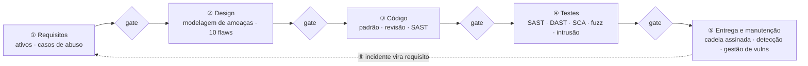

# Dissertação-modelo — Ciclo de vida de desenvolvimento seguro e DevSecOps

> Texto corrido, no registro de uma dissertação, com cerca de dez páginas à mão. Três fontes nomeadas, um caso construído por molde (real opcional), um exemplo que atravessa o texto. **[+]** marca onde alongar; **[−]** marca o que cortar primeiro.

## Esqueleto — o que você anota em 5 minutos antes de escrever

- **Seções, na ordem:** Introdução → A ideia que sustenta o ciclo → O que vale em todas as fases → As fases e a atividade de cada uma → Os modelos nomeados → O que DevSecOps acrescenta → Exemplo → O caso que deu origem a tudo → O que não confundir → Conclusão
- **Figura 1:** O ciclo com uma atividade de segurança por fase e um gate entre fases.
- **Caso:** hipotético pelo molde de cinco lacunas; o elo que falha: a segurança tratada como etapa final: os achados chegam quando o código já está pronto e prometido. (Real, se lembrar: Trustworthy Computing, Microsoft, 2002.)
- **Três fontes:** Boehm, *Software Engineering Economics* (1981) — custo por fase; Janca, *Alice and Bob Learn Application Security* (2020) — pushing left e fundamentos; Howard e Lipner, *The Security Development Lifecycle* (2006) — o SDL.
- **Exemplo:** a API de pagamentos (aplicativo, gateway, contas, transferências, banco, fila, parceiro).
- **Desfecho começa com:** "Em síntese, o ciclo de vida de desenvolvimento seguro não é uma lista de boas práticas, e sim uma cadeia."

## 1. Introdução — segurança como atividade de cada fase

Durante décadas, a segurança de software foi tratada como uma etapa: o sistema era especificado, desenhado, codificado e testado, e, pouco antes de entrar em produção, alguém "fazia a segurança" — uma revisão, um teste de intrusão, uma lista de verificação. O resultado era previsível. As falhas encontradas nesse momento eram as mais caras de corrigir, porque já estavam no código, na arquitetura e às vezes no contrato com o cliente; e as falhas não encontradas iam para produção, onde custavam mais ainda.

Um ciclo de vida de desenvolvimento seguro inverte essa lógica. Em vez de uma fase de segurança, há uma atividade de segurança em cada fase do desenvolvimento — requisitos, design, código, testes, entrega e manutenção — e um ponto de verificação entre uma fase e a seguinte. DevSecOps é o mesmo princípio aplicado a um modo de produzir software em que as fases se repetem muitas vezes por dia, automatizadas, no mesmo fluxo que leva a mudança do desenvolvedor até a produção. Este texto apresenta a ideia que sustenta os dois — o custo cresce com o tempo —, os fundamentos que valem em todas as fases, as fases com a atividade de cada uma, os modelos nomeados que organizam a prática, o que DevSecOps acrescenta, um exemplo aplicado e o caso que deu origem a tudo isso.

## 2. A ideia que sustenta o ciclo — o custo cresce com o tempo

Barry Boehm, em *Software Engineering Economics* (1981), mediu algo que todo engenheiro intuía: o custo de corrigir um defeito cresce a cada fase em que ele sobrevive, e cresce por ordem de grandeza. Um erro de requisito corrigido na fase de requisitos custa uma reunião; o mesmo erro descoberto em produção custa reescrita, novo teste, nova implantação e, frequentemente, prejuízo ao cliente. A curva de Boehm é o argumento econômico do ciclo de vida seguro: se a correção é mais barata quanto mais cedo, então a atividade que encontra a falha deve estar o mais cedo possível.

Tanya Janca, em *Alice and Bob Learn Application Security* (2020), deu a essa estratégia um nome que ficou: *pushing left* — empurrar para a esquerda, na direção do início do cronograma, cada atividade de segurança que puder ser feita antes. Não é um princípio de segurança nem uma técnica; é uma estratégia que organiza as técnicas: modelar ameaças no design em vez de descobri-las em produção, revisar código no commit em vez de no fim do projeto, varrer dependências no pipeline em vez de depois do incidente.

**[+]** Há uma distinção que a curva de Boehm torna visível. Uma falha de design é um erro de intenção: o código faz o que o projeto mandou, e o projeto estava errado — confiar no identificador que o cliente envia, por exemplo. Um bug é um erro de execução: o projeto estava certo e o código não o seguiu. Gary McGraw estimou que metade dos defeitos de segurança são de design, e esses são exatamente os que nenhuma ferramenta de análise de código encontra, porque não há linha errada para apontar. É por eles que a segurança precisa estar na fase de design, e não só na de testes.

## 3. O que vale em todas as fases

Antes das fases, os conceitos que atravessam todas elas. O primeiro é o mandato da segurança: confidencialidade, integridade e disponibilidade — o dado é visto só por quem deve, é o que deveria ser, e está lá quando é preciso. Tudo que a segurança faz é proteger uma dessas três propriedades, mais as que delas derivam: autenticação, autorização e não repúdio.

O segundo é a premissa de que a invasão vai acontecer. *Assume breach*, na expressão consagrada: alguma defesa vai falhar — uma credencial vaza, uma dependência tem uma falha descoberta depois, um operador erra. O desenho que parte dessa premissa não tenta só impedir a entrada; limita o que o invasor alcança depois de entrar. Daí vêm a defesa em profundidade — mais de uma camada entre o atacante e o ativo, de modo que a falha de uma não decide o resultado — e o menor privilégio — cada componente e cada pessoa com o mínimo de acesso para a sua função.

**[+]** O terceiro é a desconfiança como padrão: toda entrada é hostil até ser verificada, inclusive a que vem de dentro da rede ou de outro sistema nosso; é o que hoje se chama de *zero trust*. O quarto é que segredo não vive em código: senha, chave e token no repositório são segredo vazado, porque o repositório é copiado, clonado e guardado para sempre. O quinto é a redução da superfície de ataque: menos pontos de entrada, menos coisa para defender. E o sexto é a segurança usável: o controle que atrapalha é o controle que o usuário contorna, de modo que a segurança bem projetada é a que torna o caminho seguro o mais fácil.

## Figura 1 — O ciclo com uma atividade de segurança por fase e um gate entre fases

> Desenhe à mão em três ou quatro minutos, à caneta, com os elementos rotulados e numerados. Cite "a Figura 1" antes de desenhar e percorra a trilha abaixo no texto: cada número é um parágrafo, com um protagonista que atravessa a figura. É assim que o desenho vira uma página — e que o leitor o acompanha em vez de pular.

**A trilha: siga uma mudança — "transferência agendada" — do pedido à produção.** A Figura 1 é o caminho que essa mudança percorre, e cada número é uma parada em que a segurança age.

1. **① Requisitos.** A mudança nasce como história de usuário. Aqui se pergunta que ativos ela toca (saldo, agenda) e o que ela não pode permitir: nasce o requisito negativo "não agenda a partir de conta alheia", já com o teste que o prova.
2. **② Design.** A história ganha desenho: um fluxo novo entre o aplicativo e um serviço de agendamento, cruzando uma fronteira. A modelagem de ameaças produz as ameaças desse fluxo e as mitigações viram requisitos de arquitetura; a revisão contra as falhas de design conhecidas é o gate.
3. **③ Código.** O desenho vira linhas. O padrão de codificação proíbe a consulta concatenada; a análise estática bloqueia no pedido de integração o que o padrão proíbe; a revisão segue o dado da entrada ao uso.
4. **④ Testes.** O que foi prometido em ① vira evidência: o caso de abuso tenta agendar da conta alheia e recebe negação; a análise dinâmica, a de composição e o fuzzing cobrem o que o teste escrito não vê.
5. **⑤ Entrega e manutenção.** A imagem sai assinada, com inventário; em produção, a detecção observa e a gestão de vulnerabilidades governa o tempo até a próxima correção.
6. **⑥ A seta de volta.** Um incidente, ou um achado em produção, não é fim: volta a ① como requisito da próxima mudança. É essa seta que transforma a linha em ciclo — e cada parada está o mais à esquerda que a curva de Boehm permite.

## 4. As fases e a atividade de cada uma

Na fase de **requisitos**, a atividade de segurança é escrever o que o sistema não pode permitir. Os requisitos funcionais dizem o que o sistema faz; os requisitos de segurança são negativos — "um cliente não lê a conta de outro", "uma transferência acima de um valor exige segundo fator" — e nascem de duas fontes: a classificação dos ativos (que dado importa e quanto) e os casos de abuso, que descrevem o que um atacante tentaria. Cada requisito negativo precisa ser verificável, isto é, precisa ter um teste que o prove.

Na fase de **design**, a atividade central é a modelagem de ameaças: desenhar o sistema com suas fronteiras de confiança, enumerar o que pode dar errado em cada parte, decidir o que fazer com cada ameaça, e registrar as mitigações como requisitos de arquitetura. É aqui que se aplicam os princípios de projeto seguro — mediação completa, menor privilégio, padrões à prova de falha — e é aqui que a falha de design, a mais cara de todas, pode ser evitada pelo preço de uma reunião. A saída é um desenho com as mitigações, revisado contra uma lista de falhas de design conhecidas.

Na fase de **código**, a atividade é a codificação segura: um padrão de codificação com regras verificáveis, uma lista de funções e construções proibidas, revisão de código com roteiro de segurança para o que toca entrada externa e controle de acesso, e análise estática rodando no momento do commit. O princípio é que nenhuma entrada é confiável, nenhum segredo fica no fonte, e todo erro é tratado de modo a negar em vez de liberar.

Na fase de **testes**, a atividade é produzir evidência. Análise estática completa, análise dinâmica contra a aplicação em execução, análise de composição das dependências, fuzzing dos componentes que analisam entrada, e teste de intrusão manual guiado pela modelagem de ameaças. Cada técnica vê uma parte; nenhuma vê tudo; o programa de testes é a combinação, e o resultado é um conjunto de achados triados — confirmados, classificados por severidade, com dono e prazo.

**[−]** Na fase de **entrega e manutenção**, a atividade se divide. Na entrega: garantir que o artefato que vai a produção é o que foi revisado e testado, com assinatura e registro de origem — a segurança da cadeia de suprimentos. Na operação: configuração segura, detecção, resposta a incidentes e gestão de vulnerabilidades, que governa o tempo entre uma falha ser conhecida e ser corrigida. E a manutenção fecha o ciclo: o incidente de produção volta como requisito da próxima iteração, que é o *pushing left* mais caro e mais eficaz que existe. Alguns modelos acrescentam uma fase de descontinuação — desligar sem deixar dado nem acesso para trás.

## 5. Os modelos nomeados — e a natureza de cada um

A ideia do ciclo tem várias formulações com nome, e distingui-las pela natureza é o que separa domínio de resenha. O **SDL da Microsoft**, descrito por Michael Howard e Steve Lipner em *The Security Development Lifecycle* (2006), é prescritivo: lista as atividades obrigatórias de cada fase — treinamento, requisitos e *bug bar*, modelagem de ameaças, funções proibidas e análise estática, fuzzing, plano de resposta — e um gate final antes do lançamento. Dele vem a fórmula "seguro por design, por padrão e no deploy". O **SSDF do NIST** (SP 800-218, 2022) é uma lista de resultados esperados, em quatro grupos — preparar a organização, proteger o software, produzir software bem protegido, responder a vulnerabilidades —, que não escolhe ferramenta nem processo e por isso virou a referência comum a que os demais se mapeiam; é o que o governo americano exige de fornecedores. O **SAMM da OWASP** é um modelo de maturidade: mede em que nível a organização está em cada prática e oferece um caminho para o seguinte. O **BSIMM** é descritivo: observa o que dezenas de organizações fazem e cataloga as atividades com a frequência de cada uma, para comparação.

A relação entre eles cabe em uma frase: SDL e SSDF dizem o que fazer; SAMM mede onde se está; BSIMM diz o que os outros fazem. Uma organização adota o SSDF como alvo, mede-se com o SAMM, compara-se com o BSIMM e executa atividades que vêm do SDL. Tratá-los como sinônimos é o erro mais comum nesse assunto.

## 6. O que DevSecOps acrescenta

DevOps mudou o ritmo: em vez de uma entrega por trimestre, dezenas por dia, com a mudança indo do desenvolvedor à produção por um pipeline automatizado. Um ciclo de vida seguro desenhado para entregas trimestrais não cabe nesse ritmo — a revisão manual de duas semanas antes do lançamento não existe quando o lançamento é hoje à tarde. DevSecOps é a resposta: as atividades de segurança entram no pipeline, automatizadas, e o que não pode ser automatizado é redesenhado para não travar o fluxo.

Na prática, isso significa um pipeline em camadas. No momento do commit, em segundos: varredura de segredos e regras de estilo seguro. No pedido de integração, em minutos: análise estática do que mudou, análise de composição das dependências, varredura da infraestrutura descrita como código. No build: testes de segurança escritos pelo time e verificações do binário. À noite, em horas: análise estática completa, análise dinâmica autenticada contra o ambiente de testes, fuzzing contínuo. A cada versão: teste de intrusão e revisão de arquitetura. Em produção: detecção, programa de recompensas, gestão de vulnerabilidades. A regra que organiza as camadas é a de Boehm outra vez: cada falha é encontrada pela técnica mais barata capaz de encontrá-la.

**[+]** DevSecOps tem também uma metade que não é ferramenta, e é a que mais falha. Gene Kim e coautores descrevem o DevOps em três vias — fluxo, retorno e aprendizado contínuo —, e a segurança precisa entrar nas três: o controle não pode travar o fluxo, senão é desligado na primeira urgência; o achado e o incidente de produção voltam ao desenvolvimento como requisito; e o erro é analisado sem culpa, para virar regra em vez de punição. As práticas que os modelos de maturidade mais observam em organizações que conseguem isso são três: um campeão de segurança em cada time, com tempo reservado; treinamento ancorado em achados reais do próprio código, não em listas genéricas; e um time de segurança que diz "sim, com estas condições" em vez de "não".

**[−]** O que se mede importa tanto quanto o que se faz. As métricas que mudam comportamento: tempo entre achado e correção, por severidade; taxa de escape — falhas em produção que o pipeline deveria ter pego; fração dos repositórios com os gates ativos; idade da dívida de segurança aceita. As que enganam: número de achados, que sobe quando se liga uma ferramenta nova; número de ferramentas; horas de treinamento. Um gate bem desenhado bloqueia o que é novo e grave e registra o resto como dívida com dono — o gate que bloqueia tudo é desligado e nunca mais volta.

## 7. Exemplo — uma API de pagamentos

Considere uma API de pagamentos com aplicativo móvel, gateway, serviços de contas e de transferências, banco de dados, fila de notificações e um parceiro externo de antifraude, mantida por um time que entrega várias vezes por dia. Na fase de requisitos, a classificação dos ativos coloca saldo e dados de cartão no topo, e os casos de abuso produzem requisitos negativos: "nenhum cliente lê conta que não é sua", "transferência acima de um valor exige segundo fator", "o canal com o parceiro não aceita texto claro". Cada um já nasce com o teste que o prova.

No design, a modelagem de ameaças desenha as duas fronteiras — aplicativo e parceiro — e produz, entre outras, a ameaça de um cliente trocar o identificador da conta na requisição; a mitigação é um ponto único de verificação de dono, que vira requisito de arquitetura. No código, a consulta ao banco é parametrizada por regra do padrão de codificação, e o analisador estático bloqueia no pedido de integração qualquer consulta montada por concatenação. Nos testes, a análise dinâmica noturna encontra um cabeçalho de segurança ausente na página de erro; o fuzzer derruba o decodificador de mensagens do parceiro com um comprimento negativo; o teste de intrusão, com duas contas, confirma que a verificação de dono vale em todos os endpoints. Na entrega, a imagem vai assinada, com a lista de componentes; em produção, o cruzamento dessa lista com as bases de vulnerabilidades avisa em horas quando uma dependência ganha uma falha pública, e a correção sai pelo mesmo pipeline. Quando um incidente acontece, a lição vira regra nova do analisador estático ou caso de teste novo — e o ciclo recomeça um pouco mais à esquerda.

## 8. Um caso — como construí-lo

> **Como montar o caso hipotético na hora (cinco lacunas).** Não precisa lembrar nome nem ano: invente uma organização plausível — por exemplo, a própria empresa dona da API de pagamentos deste texto — e preencha: (1) **contexto**: que sistema, que decisão de projeto ou de processo estava em vigor; (2) **o elo que falhou**: a segurança tratada como etapa final: os achados chegam quando o código já está pronto e prometido; (3) **consequência em uma frase**: o que se perdeu, em termos de confidencialidade, integridade ou disponibilidade, sem detalhar o ataque; (4) **a correção**: inserir a atividade de segurança em cada fase, com gate entre fases; (5) **a lição em uma frase**, que a conclusão retoma. Se lembrar do caso real equivalente, cite em uma frase como reforço: Trustworthy Computing, Microsoft, 2002.

O caso entra depois do exemplo e antes dos erros, em dois parágrafos: o primeiro conta (contexto, elo que falhou, consequência); o segundo lê o caso com as lentes do texto (qual premissa foi ignorada, qual princípio violado, qual técnica teria agido) e termina com a lição. A conclusão o retoma em uma frase.

## 9. O que não confundir

DevSecOps não é instalar scanners no pipeline; sem gate proporcional, retorno ao desenvolvimento e cultura, os scanners produzem ruído automatizado. *Shift-left* não dispensa o lado direito: há coisas que só a produção mostra — configuração real, comportamento sob ataque — e elas voltam como requisito. Segurança não é uma fase: é uma atividade em cada fase com um gate entre elas. Conformidade com uma norma é piso e evidência, não segurança: o atacante não lê a norma. O SDL não é "coisa da Microsoft": é a origem de que o SSDF e os demais descendem. E *pushing left* é uma estratégia que organiza técnicas, não uma técnica em si.

## 10. Conclusão

Em síntese, o ciclo de vida de desenvolvimento seguro não é uma lista de boas práticas, e sim uma cadeia. Parte da premissa, medida por Boehm, de que o custo de corrigir cresce com a fase. Fixa como regra que cada fase tem a sua atividade de segurança e que nenhuma mudança passa de uma fase à seguinte sem verificação. Aplica essa regra por meio de modelos nomeados — o SDL que prescreve, o SSDF que define resultados, o SAMM que mede — e a executa, em DevSecOps, por um pipeline em camadas em que cada falha é encontrada pela técnica mais barata capaz de encontrá-la, com métricas de tempo de correção e de escape que dizem se o ciclo funciona.

O caso mostra o custo de não ter essa cadeia: uma empresa inteira parada por dois meses para corrigir o que a atividade por fase teria evitado. E é por isso que o ciclo de vida seguro é a moldura dos demais temas da engenharia de software seguro — a modelagem de ameaças é a sua fase de design, a codificação segura é a sua fase de código, os testes de segurança são a sua fase de verificação, a cadeia de suprimentos é a sua entrega, e a gestão de vulnerabilidades é a sua manutenção, que devolve o incidente ao início. Essa rastreabilidade, do requisito ao teste e do incidente ao requisito, é o que faz da segurança uma propriedade do processo, e não um acréscimo ao seu fim.

---

**Referências usadas no texto:** Boehm, *Software Engineering Economics* (1981) — custo por fase; Janca, *Alice and Bob Learn Application Security* (2020) — pushing left e fundamentos; Howard e Lipner, *The Security Development Lifecycle* (2006) — o SDL. De passagem: McGraw (falha de design vs bug, 2006), NIST SP 800-218 (SSDF, 2022), OWASP SAMM, BSIMM, Kim et al. (*The DevOps Handbook*).
