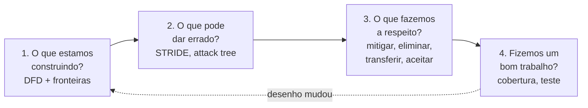
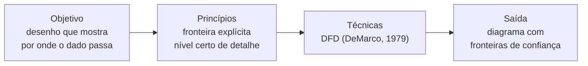
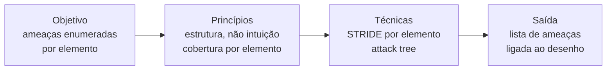
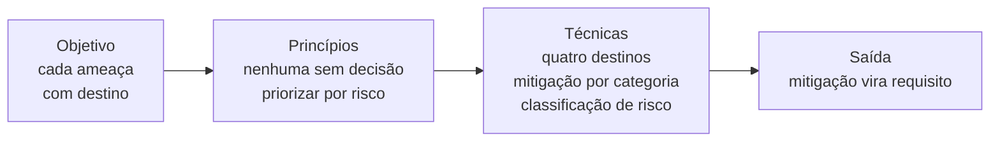
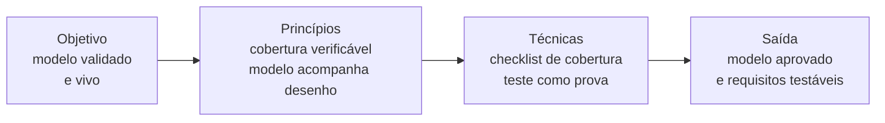

# Ponto 2 — Modelagem de ameaças e análise de superfície de ataque

## Objetivo

Entender a modelagem de ameaças como o método que responde, na fase de design, à pergunta "o que pode dar errado": o que se toma como dado, que regras não podem falhar, quais métodos nomeados executam cada etapa e que ferramentas os materializam. E entender a análise de superfície de ataque como o passo que delimita *por onde* a ameaça entra — e que, por isso, decide o tamanho do problema antes de qualquer ameaça ser enumerada.

Referência principal: Shostack, Adam. *Threat Modeling: Designing for Security*. Wiley, 2014. O método das quatro perguntas, STRIDE por elemento e os quatro destinos de uma ameaça seguem esse livro. A superfície de ataque segue Manadhata e Wing (2011).

---

## 1. O que pode dar errado — a pergunta que a fase de design deve responder

O ciclo de vida seguro manda agir cedo porque a falha de desenho é a mais cara de corrigir depois que o código existe. Mas "agir cedo" exige saber *contra o quê* agir: não se desenha um controle sem antes nomear o que ele impede. A fase de design precisa, portanto, de uma resposta sistemática à pergunta "o que pode dar errado neste sistema?" — e a modelagem de ameaças é o nome dessa resposta.

### Ameaça, vulnerabilidade e risco não são a mesma coisa

A confusão entre os três termos é a origem da maioria dos modelos ruins. A distinção vem da gestão de risco (NIST SP 800-30 r1, 2012):

| Termo | O que é | Pergunta que responde |
|---|---|---|
| Ameaça | o evento ou agente com potencial de causar dano — alguém altera um pagamento em trânsito | o que pode acontecer? |
| Vulnerabilidade | a fraqueza que permite à ameaça se concretizar — o canal sem integridade verificada | por onde? |
| Risco | probabilidade de a ameaça explorar a vulnerabilidade × impacto quando explora | quanto importa? |

A modelagem de ameaças trabalha no primeiro termo. Ela não procura bugs (isso é teste) nem calcula risco em primeiro lugar (isso é priorização, que vem depois): ela enumera o que pode acontecer, antes de o sistema existir, para que o desenho já nasça com resposta.

### Por que modelar, e não só revisar

Revisão de desenho encontra o que o revisor já conhece. A modelagem de ameaças substitui a intuição por estrutura: percorre cada parte do sistema com um conjunto fixo de perguntas, de modo que a cobertura não dependa da experiência de quem revisa. É por isso que "pense como um atacante" não é método — é conselho (Shostack, 2014, cap. 1). Quem não é atacante não sabe pensar como um; quem segue um método encontra ameaças mesmo sem saber atacar.

### Exemplo

Um sistema de pagamentos revisado por intuição: o revisor lembra de SQL injection e de senha fraca, e o desenho sai com dois controles.

O mesmo sistema modelado: cada fluxo e cada armazenamento é interrogado contra seis categorias de ameaça. Aparecem o repúdio da transferência (quem prova que o cliente autorizou?), a adulteração do valor entre a API e o gateway, e a negação de serviço no endpoint de consulta. Nenhuma das três depende de o revisor ter lembrado.

Modelar, então, é método. Mas antes de aplicar qualquer método, é preciso fixar o que ele pressupõe — as premissas sem as quais as regras não fazem sentido. É o que a próxima seção fixa.

---

## 2. Fundamentos — o que se toma como dado

Quatro premissas sustentam toda a modelagem. Não se discutem dentro do método: são o chão sobre o qual as regras se apoiam.

| Fundamento | Premissa | O que decorre dela |
|---|---|---|
| Toda ameaça viola uma propriedade | ameaça só existe em relação a algo que se quer garantir | a lista de propriedades é a lista do que procurar |
| Ameaça não se elimina, decide-se | não existe sistema sem ameaça; existe ameaça sem decisão | cada ameaça encontrada precisa de um destino |
| Ameaça concentra-se na fronteira de confiança | o dano acontece onde o dado cruza de um nível de confiança para outro | sem fronteira desenhada, não há onde procurar |
| O atacante escolhe a porta | quem ataca escolhe o ponto de entrada; quem defende precisa de todos | o tamanho da superfície define o tamanho da defesa |

### Toda ameaça viola uma propriedade

As ameaças não são uma lista arbitrária: cada uma é a negação de uma propriedade de segurança. À tríade CIA — confidencialidade, integridade, disponibilidade — somam-se as três propriedades que respondem pela identidade e pela ação: autenticação (quem é), autorização (o que pode) e não-repúdio (não pode negar que fez). Seis propriedades, seis ameaças que as negam. É essa correspondência que torna a enumeração completa: cobrir as seis propriedades é cobrir o espaço do que pode dar errado (Shostack, 2014, Tabela 3-1).

### Ameaça não se elimina, decide-se

Um sistema útil expõe função, e função exposta é ameaça possível. O objetivo da modelagem não é zerar ameaças — é garantir que nenhuma fique sem decisão consciente. Uma ameaça pode ser mitigada, eliminada, transferida ou aceita; o que não pode é ser ignorada por ninguém ter perguntado. Modelo que termina com ameaças sem destino não terminou.

### Ameaça concentra-se na fronteira de confiança

Fronteira de confiança é a linha onde o dado passa de um domínio para outro com nível de confiança diferente: do navegador para o servidor, do serviço para o banco, do processo para o sistema operacional. É nela que spoofing, tampering e elevação de privilégio acontecem, porque é onde a identidade e a integridade precisam ser reverificadas. Desenhar a fronteira é, portanto, a primeira decisão do modelo: onde ela está, está o trabalho (Shostack, 2014, cap. 2).

### O atacante escolhe a porta

O defensor precisa proteger todos os pontos de entrada; o atacante só precisa de um. Essa assimetria é o que torna a superfície de ataque uma grandeza que importa: cada endpoint, parâmetro, porta e integração a mais é uma porta a mais para defender e uma a mais para falhar. Reduzir a superfície vem antes de proteger o que sobra.

Com as premissas fixadas, a pergunta que se abre é de método: *como* percorrer o sistema para que nenhuma ameaça fique de fora? A próxima seção responde com as quatro perguntas que organizam todo o resto do ponto.

---

## 3. Overview visual — as quatro perguntas

A modelagem de ameaças é a resposta disciplinada a quatro perguntas, nessa ordem (Shostack, 2014, cap. 1):

Cada pergunta é uma etapa com objetivo, princípios, técnicas e mecanismos próprios. A ordem não é arbitrária: não se enumera ameaça sem desenho (2 depende de 1), não se decide sem ameaça (3 depende de 2) e não se valida sem decisão (4 depende de 3). A seta de volta é a regra de que modelo acompanha desenho: mudou a arquitetura, reabre-se a primeira pergunta.

---

## 4. As quatro etapas da modelagem

### Etapa 1 — O que estamos construindo?

#### Objetivo

Produzir um desenho do sistema no nível em que as ameaças aparecem: quem fala com quem, por onde o dado passa, onde ele fica guardado, e onde muda o nível de confiança. Não é o diagrama de classes nem o de infraestrutura — é o diagrama do *fluxo*.

| Atividade | O que é |
|---|---|
| Identificar entidades externas | tudo que está fora do controle do sistema: usuário, navegador, serviço de terceiro |
| Identificar processos | o que executa código seu: API, worker, job |
| Identificar armazenamentos | onde o dado repousa: banco, fila, cache, arquivo, log |
| Traçar fluxos | cada seta por onde o dado viaja, com o protocolo |
| Traçar fronteiras de confiança | a linha onde o nível de confiança muda |

A fronteira de confiança é a atividade que diferencia o DFD de segurança do DFD de análise de sistemas: sem ela, o diagrama mostra o fluxo mas não mostra o risco.

#### Princípios

| Princípio | Regra |
|---|---|
| Fronteira explícita | toda mudança de nível de confiança está desenhada; o que não está desenhado não será modelado |
| Nível certo de detalhe | detalhe suficiente para que cada elemento receba ameaça própria; detalhe a mais esconde o fluxo |
| Desenho é do sistema real | modela-se o que vai existir, não o que o documento de arquitetura prometeu |

Regra de ouro: se o diagrama cabe em uma caixa, não há fronteira; se tem cinquenta caixas, não há leitura. Começa-se no nível de contexto e desce-se só onde a fronteira exige.

#### Técnicas

| Técnica | Quem | O que faz |
|---|---|---|
| Diagrama de fluxo de dados (DFD) | DeMarco, 1979 | quatro elementos — entidade externa, processo, fluxo, armazenamento — e a fronteira de confiança que a segurança acrescenta (Shostack, 2014, cap. 2) |

Os elementos do DFD e o símbolo de cada um:

| Elemento | Símbolo | O que representa |
|---|---|---|
| Entidade externa | retângulo | fora do controle do sistema |
| Processo | círculo | código em execução |
| Fluxo de dados | seta | dado em trânsito |
| Armazenamento | duas linhas paralelas | dado em repouso |
| Fronteira de confiança | linha tracejada | mudança de nível de confiança |

#### Mecanismos

| Mecanismo | O que executa |
|---|---|
| Microsoft Threat Modeling Tool | desenha o DFD com fronteiras e gera a lista de ameaças por elemento |
| OWASP Threat Dragon | o mesmo, em código aberto, com o modelo versionável em JSON |
| pytm e modelos como código | o DFD descrito em código, versionado no repositório junto com o sistema que descreve |

#### Saída

Diagrama de fluxo de dados com fronteiras de confiança marcadas. Sem fronteira, o desenho não saiu da etapa.

O desenho diz *onde* procurar. Falta o que procurar em cada lugar: a lista fixa de perguntas que torna a enumeração completa. É a segunda etapa.

### Etapa 2 — O que pode dar errado?

#### Objetivo

Enumerar, para cada elemento do desenho, as ameaças que se aplicam a ele — de forma que a lista seja rastreável ao diagrama e completa em relação às seis propriedades.

| Atividade | O que é |
|---|---|
| Percorrer o diagrama | elemento por elemento, fronteira por fronteira |
| Aplicar a taxonomia | para cada elemento, perguntar quais categorias se aplicam |
| Registrar a ameaça | o que, onde no diagrama, qual propriedade viola |
| Ligar ao objetivo do atacante | quando a ameaça é um meio, perguntar para que fim |

#### Princípios

| Princípio | Regra |
|---|---|
| Estrutura, não intuição | a enumeração segue uma taxonomia fixa; o que a experiência lembra entra por cima, não no lugar |
| Cobertura por elemento | todo elemento do diagrama é interrogado; elemento sem ameaça registrada é elemento não examinado |
| Ameaça ligada ao desenho | ameaça sem elemento no diagrama é especulação; elemento sem ameaça é omissão |
| Tudo que cruza a fronteira é hostil | dado que atravessa fronteira de confiança é tratado como não confiável do outro lado |

Regra de ouro: a pergunta não é "este sistema é seguro?", é "o que *este fluxo* permite a quem está do lado de fora da fronteira?".

#### Técnicas

| Técnica | Quem | Pergunta que faz | Como funciona |
|---|---|---|---|
| STRIDE | Kohnfelder e Garg, Microsoft, 1999 | qual propriedade esta ameaça viola? | seis categorias, uma por propriedade; é a taxonomia que torna a lista completa |
| STRIDE por elemento | Shostack, 2014, cap. 3 | quais categorias se aplicam a *este* tipo de elemento? | cruza a taxonomia com o tipo de elemento do DFD; reduz a enumeração ao que faz sentido |
| Attack tree | Schneier, 1999 | qual o objetivo do atacante e por quais caminhos ele chega? | raiz é o objetivo; ramos são os caminhos, com nós E/OU; cada folha é uma ameaça concreta |

**STRIDE — as seis categorias e a propriedade que cada uma nega** (Shostack, 2014, Tabela 3-1):

| Letra | Ameaça | Propriedade violada | O que é |
|---|---|---|---|
| S | Spoofing | autenticação | fingir ser outra pessoa, processo ou sistema |
| T | Tampering | integridade | alterar dado em trânsito ou em repouso sem autorização |
| R | Repudiation | não-repúdio | negar ter feito uma ação, sem que o sistema possa provar o contrário |
| I | Information disclosure | confidencialidade | expor dado a quem não deveria vê-lo |
| D | Denial of service | disponibilidade | tornar o sistema indisponível ou degradado |
| E | Elevation of privilege | autorização | fazer o que não se tem permissão de fazer |

**STRIDE por elemento — o que procurar em cada tipo** (Shostack, 2014, cap. 3):

| Elemento | S | T | R | I | D | E |
|---|---|---|---|---|---|---|
| Entidade externa | ✓ | | ✓ | | | |
| Processo | ✓ | ✓ | ✓ | ✓ | ✓ | ✓ |
| Fluxo de dados | | ✓ | | ✓ | ✓ | |
| Armazenamento | | ✓ | (✓ se guarda log) | ✓ | ✓ | |

A tabela é o que impede a enumeração de explodir: um fluxo não sofre spoofing (quem finge é a entidade que o origina), e um armazenamento não eleva privilégio (quem o faz é o processo que o lê). O processo é o único elemento que recebe as seis — porque é o único que executa código.

**Attack tree — quando a ameaça tem objetivo.** STRIDE responde "o que pode acontecer a este elemento"; a árvore de ataque responde "como o atacante chega ao que quer". As duas se complementam: a árvore organiza as ameaças do STRIDE em caminhos. Exemplo: raiz "ler dados de cartão de outro cliente"; ramos "IDOR no endpoint de consulta" OU ("adulterar o token" E "token sem assinatura verificada"). Cada folha é uma ameaça que o STRIDE já teria apontado — a árvore mostra qual delas importa para o objetivo (Schneier, 1999).

CAPEC (MITRE), ATT&CK (MITRE) e OWASP Top 10 não são técnicas de enumeração: são bibliotecas de padrões de ataque, consultadas para dar nome e detalhe à ameaça que o STRIDE apontou. O chamado "brainstorming de ameaças" não é técnica: é a intuição que a seção 1 descartou como método.

#### Mecanismos

| Mecanismo | O que executa |
|---|---|
| Geração automática por elemento (Threat Modeling Tool, Threat Dragon) | aplica a tabela STRIDE por elemento ao DFD e lista as ameaças candidatas |
| Elevation of Privilege — jogo de cartas (Shostack, Microsoft, 2010) | cada carta é uma ameaça STRIDE; o time percorre o diagrama jogando as cartas que se aplicam |
| Template de registro | cada ameaça com id, elemento do DFD, categoria, propriedade violada, descrição |

#### Saída

Lista de ameaças, cada uma ligada a um elemento do diagrama e a uma categoria. Sem elemento, não é ameaça do sistema; sem categoria, não se sabe que propriedade protege.

Uma enumeração honesta produz dezenas de ameaças, e a maioria não merece controle. A pergunta seguinte é de decisão: o que fazer com cada uma — e qual atacar primeiro.

### Etapa 3 — O que fazemos a respeito?

#### Objetivo

Dar um destino a cada ameaça enumerada e transformar os destinos escolhidos em requisitos de segurança que o resto do ciclo possa implementar e provar.

| Atividade | O que é |
|---|---|
| Decidir o destino | mitigar, eliminar, transferir ou aceitar |
| Escolher a mitigação | o controle padrão para a categoria, ajustado ao elemento |
| Priorizar | ordenar pelo risco: o que é provável e grave vem primeiro |
| Escrever o requisito | a mitigação no formato verificável da fase de requisitos |

#### Princípios

| Princípio | Regra |
|---|---|
| Nenhuma ameaça sem decisão | aceitar é decisão; esquecer não é |
| Mitigação é requisito, não anotação | o controle escolhido entra no backlog com critério de aceite |
| Risco ordena, não elimina | priorizar decide a ordem; não autoriza deixar ameaça sem destino |
| Aceitar exige dono | risco aceito tem quem o aceitou, por quê e até quando |

Regra de ouro: mitigação que não virou requisito não existe para o desenvolvedor, e o que não existe para o desenvolvedor não vai para produção.

#### Técnicas

| Técnica | Quem | O que faz |
|---|---|---|
| Quatro destinos de uma ameaça | Shostack, 2014, cap. 1 | mitigar (reduzir), eliminar (remover a função ou o fluxo), transferir (contrato, seguro, terceiro), aceitar (registrar e conviver) |
| Mitigação padrão por categoria | Shostack, 2014, cap. 8 | para cada letra do STRIDE, a família de controle que a responde |
| Classificação de risco | NIST SP 800-30 r1, 2012 | risco = probabilidade × impacto; ordena as ameaças pelo produto |

**Mitigação padrão por categoria** — a resposta de primeira linha, antes do ajuste ao caso:

| Ameaça | Família de controle | Mecanismos típicos |
|---|---|---|
| Spoofing | autenticação | senha com hash, MFA, certificado, assinatura de mensagem |
| Tampering | integridade | hash, MAC, assinatura digital, TLS, permissão de escrita mínima |
| Repudiation | não-repúdio | log com integridade e timestamp, assinatura, trilha de auditoria |
| Information disclosure | confidencialidade | criptografia em trânsito e em repouso, autorização, minimização |
| Denial of service | disponibilidade | rate limit, cota, redundância, validação de tamanho de entrada |
| Elevation of privilege | autorização | verificação de permissão em toda operação, least privilege, sandbox |

O quadro é ponto de partida: a mitigação exata depende do elemento e da fronteira. Tampering em um fluxo pede TLS; tampering em um armazenamento pede permissão de escrita e hash.

**Sobre a classificação de risco.** DREAD (Howard e LeBlanc, 2003) — dano, reprodutibilidade, explorabilidade, usuários afetados, descoberta — foi a escala da Microsoft e foi abandonada pela própria por produzir notas inconsistentes entre avaliadores (Shostack, 2014, cap. 9). O que sobrevive dela é a ideia: pontuar para ordenar. Na prática, o bug bar (limiar de severidade definido antes da modelagem) decide o que bloqueia a release, e o CVSS entra quando a ameaça virou vulnerabilidade conhecida — isto é, já em produção, na gestão de vulnerabilidades.

#### Mecanismos

| Mecanismo | O que executa |
|---|---|
| Registro de ameaças com campo "destino" | a lista da etapa 2 ganha, por ameaça, o destino escolhido e o dono |
| Backlog ligado ao modelo | cada mitigação é um item rastreável até a ameaça que a motivou |
| Registro de risco aceito | ameaça aceita, responsável, justificativa, data de revisão |

#### Saída

Toda ameaça com destino; toda mitigação escrita como requisito com critério de aceite. Sem requisito, a decisão ficou na reunião.

Decidir não é provar. A última pergunta é a que fecha o ciclo: como saber se o modelo cobriu o sistema e se as mitigações realmente entraram?

### Etapa 4 — Fizemos um bom trabalho?

#### Objetivo

Verificar três coisas: que o diagrama corresponde ao sistema, que todo elemento foi interrogado, e que toda mitigação tem como ser provada. E garantir que o modelo continue valendo quando o desenho mudar.

| Atividade | O que é |
|---|---|
| Validar o diagrama | o sistema construído é o desenhado? fronteiras batem? |
| Validar a cobertura | todo elemento tem ameaças registradas em cada categoria aplicável? |
| Validar o destino | toda ameaça tem decisão? toda mitigação tem requisito? |
| Validar a prova | todo requisito tem teste que o verifica? |
| Reabrir quando muda | alteração de arquitetura reabre a etapa 1 |

#### Princípios

| Princípio | Regra |
|---|---|
| Cobertura verificável | a prova de que o modelo está completo é a tabela elemento × categoria preenchida |
| Mitigação prova-se no teste | o modelo termina quando a mitigação tem teste; antes disso, é intenção |
| Modelo acompanha desenho | modelo é documento vivo; versão do modelo acompanha versão da arquitetura |
| Modelo pertence ao time | o time que constrói modela; segurança facilita e revisa |

Regra de ouro: modelo feito uma vez e arquivado é modelo de um sistema que não existe mais.

#### Técnicas

| Técnica | Quem | O que faz |
|---|---|---|
| Checklist de validação | Shostack, 2014, cap. 1 e 7 | diagrama confere, cobertura confere, destino confere, teste confere |
| Teste de segurança como prova | NIST SP 800-115, 2008 | o requisito negativo que nasceu da ameaça vira caso de teste; o teste fecha a rastreabilidade ameaça → requisito → controle → teste |

A quarta pergunta é a que liga a modelagem ao resto do ciclo: a ameaça encontrada aqui é o requisito negativo de que a fase de testes precisa, e o teste de segurança é o que prova que a mitigação existe.

#### Mecanismos

| Mecanismo | O que executa |
|---|---|
| Modelo versionado junto com o código | o arquivo do modelo (JSON, código) muda no mesmo pull request que muda a arquitetura |
| Revisão de modelo no pipeline | mudança em componente marcado como fronteira exige revisão do modelo antes do merge |
| Rastreabilidade ameaça → teste | id da ameaça referenciado no requisito e no caso de teste |

#### Saída

Modelo aprovado, com cobertura demonstrada e requisitos testáveis no backlog. E a regra de reabertura: desenho mudou, modelo reabre.

As quatro etapas respondem "o que pode dar errado" para um sistema cujo contorno já está dado. Mas o contorno é decisão: quantas portas o sistema expõe é escolha de projeto, e cada porta a mais é ameaça a mais a enumerar. A análise de superfície de ataque é o que mede e reduz esse contorno — por isso, na prática, vem antes ou junto da primeira etapa.

---

## 5. Análise de superfície de ataque

### O que é

A superfície de ataque é o conjunto de pontos por onde um atacante pode entrar no sistema ou extrair dado dele. Manadhata e Wing (2011) a definem em três dimensões: os *métodos* (pontos de entrada e saída: endpoints, funções exportadas, handlers), os *canais* (por onde se chega: portas, sockets, pipes) e os *itens de dado* (o que passa: parâmetros, arquivos, campos). Quanto mais métodos, canais e dados expostos, maior a superfície — e maior a chance de um deles falhar.

A relação com o DFD é direta: os pontos de entrada da superfície são os fluxos que cruzam a fronteira externa do diagrama. Analisar a superfície é olhar o diagrama de fora para dentro; modelar ameaças é olhar de dentro para fora. O mesmo desenho serve às duas.

### Objetivo

Enumerar os pontos de entrada e saída, estimar o quanto cada um expõe, e reduzir o que não precisa estar exposto — antes de proteger o que sobra.

| Atividade | O que é |
|---|---|
| Enumerar pontos de entrada | endpoints, formulários, uploads, filas consumidas, portas, integrações, dependências |
| Enumerar pontos de saída | respostas, logs, exportações, webhooks, erros |
| Classificar por exposição | quem alcança: anônimo da internet, autenticado, interno, administrador |
| Medir | contagem ponderada por exposição e por privilégio do que está atrás |
| Reduzir | desligar, restringir, agrupar, exigir autenticação antes |

### Princípios

| Princípio | Regra |
|---|---|
| Redução antes de proteção | o que não está exposto não precisa de controle; remover vence defender |
| Exposição define prioridade | ponto alcançável por anônimo vale mais que ponto só interno |
| Padrão fechado | função, porta e endpoint ficam desligados até que alguém precise; não o contrário |
| Superfície inclui o que você não escreveu | dependência, plugin e serviço de terceiro são pontos de entrada seus |

Regra de ouro: a feature que ninguém usa continua sendo atacável; superfície morta é superfície viva para o atacante.

### Técnicas

| Técnica | Quem | O que faz |
|---|---|---|
| Métrica de superfície de ataque | Manadhata e Wing, 2011 | mede a superfície pelas três dimensões (métodos, canais, dados), ponderadas por dano potencial e esforço de acesso; permite comparar duas versões do mesmo sistema |
| Superfície de ataque relativa (RASQ) | Howard, Pincus e Wing, 2003 | compara a exposição de versões ou configurações de um produto a partir de uma lista de vetores de ataque com peso |
| Redução de superfície de ataque | Howard, Microsoft, 2003; Microsoft SDL | princípio e prática: desligar por padrão, reduzir privilégio do que fica, reduzir quem alcança |

OWASP Attack Surface Analysis Cheat Sheet não é técnica: é checklist operacional dos pontos a enumerar. Varredura de portas e de endpoints não é técnica: é mecanismo que descobre o que já está exposto.

### Mecanismos

| Mecanismo | O que executa |
|---|---|
| Inventário de endpoints gerado da especificação (OpenAPI) | a lista de métodos vem do contrato, não da memória |
| Varredura de portas e serviços (nmap) | descobre canais abertos que ninguém lembrava |
| Análise de dependências (SCA) | enumera o código de terceiro que entra na superfície |
| Feature flag e configuração "off by default" | executa o padrão fechado |
| API gateway com rota explícita | só passa o que está declarado; o resto não existe para fora |

### Saída

Inventário de pontos de entrada e saída, classificado por exposição, com lista do que foi removido e do que ficou — e, para o que ficou, a entrada correspondente no DFD para a modelagem.

O método de Shostack e o STRIDE são a via principal, mas não a única. Há abordagens que partem de outro lugar — do risco de negócio, da privacidade — e saber onde cada uma cabe é parte de dominar o ponto.

---

## 6. Outras abordagens — e quando cada uma cabe

| Abordagem | Quem | De onde parte | Quando usar |
|---|---|---|---|
| PASTA — Process for Attack Simulation and Threat Analysis | UcedaVélez e Morana, 2015 | do objetivo de negócio ao risco, em sete estágios: objetivos, escopo técnico, decomposição, análise de ameaças, análise de vulnerabilidades, modelagem de ataque, análise de risco e impacto | quando a prioridade é alinhar segurança ao impacto no negócio, não só ao desenho |
| LINDDUN | Deng, Wuyts, Scandariato, Preneel e Joosen, 2011 | das propriedades de privacidade: linkability, identifiability, non-repudiation, detectability, disclosure, unawareness, non-compliance | quando o ativo central é dado pessoal; é o STRIDE da privacidade e usa o mesmo DFD |
| Modelagem centrada em dados | NIST SP 800-154 (rascunho), 2016 | do dado a proteger e de onde ele vive, não do sistema | quando o escopo é um dado específico atravessando vários sistemas |

STRIDE é taxonomia de ameaça; PASTA é processo; LINDDUN é taxonomia de outra propriedade. Nenhum substitui o DFD nem as quatro perguntas: todos os três precisam de um desenho e terminam em decisão.

O Threat Modeling Manifesto (Shostack e outros, 2020) fixa o que atravessa todas as abordagens: as quatro perguntas como estrutura mínima, modelagem como atividade contínua e do time, e preferência por "fazer modelagem" sobre "falar de modelagem".

---

## 7. Exemplo guiado — uma API de pagamentos

O sistema: um cliente, pelo aplicativo, consulta saldo e faz transferência. A API autentica o cliente, grava a transferência no banco e chama o gateway do banco parceiro. Tudo passa por log.

**Etapa 1 — desenho.** Entidades externas: aplicativo do cliente, gateway do parceiro. Processo: API. Armazenamentos: banco de transferências, log. Fluxos: app → API (HTTPS), API → banco, API → gateway (HTTPS), API → log. Fronteiras: entre o app e a API (internet → sistema), entre a API e o gateway (sistema → terceiro).

**Etapa 2 — ameaças, por elemento.**

| Elemento | Categoria | Ameaça |
|---|---|---|
| App (entidade externa) | S | atacante com credencial vazada se passa pelo cliente |
| App | R | cliente nega ter ordenado a transferência |
| Fluxo app → API | T | valor da transferência alterado em trânsito |
| API (processo) | E | cliente comum altera o parâmetro de conta e opera a conta de outro |
| API | D | rajada de consultas de saldo derruba o serviço |
| Fluxo API → gateway | I | dado de cartão exposto se o canal com o parceiro cair para texto claro |
| Banco (armazenamento) | T | operador altera valor direto na tabela |
| Log | R | log sem integridade não prova quem fez o quê |

A árvore de ataque para a raiz "transferir dinheiro de outro cliente" liga três dessas folhas: spoofing do app OU elevação de privilégio na API OU tampering no fluxo.

**Etapa 3 — destinos.** Spoofing: mitigar com MFA para transferência. Repúdio: mitigar com assinatura da ordem e log com integridade. Tampering no fluxo: mitigar com TLS obrigatório e assinatura do corpo. Elevação: mitigar com verificação de dono do recurso em toda operação. Negação de serviço: mitigar com rate limit por cliente. Exposição no canal do parceiro: mitigar com mTLS; transferir, por contrato, a parte que está no lado do parceiro. Tampering no banco: mitigar com permissão de escrita só para a API e trilha de auditoria. Cada mitigação vira requisito: "transferência acima de X exige segundo fator" com critério de aceite.

**Etapa 4 — prova.** A tabela elemento × categoria está preenchida. Cada requisito tem teste: "requisição com conta de outro cliente retorna 403" é o teste da elevação de privilégio. O modelo fica no repositório; adicionar um novo canal (webhook do parceiro) reabre a etapa 1.

**Superfície.** Pontos de entrada: dois endpoints públicos (saldo, transferência), um canal com o parceiro, o SDK do gateway como dependência. Redução: o endpoint de exportação de extrato, previsto e sem cliente, não entra na release.

---

## 8. Síntese

| Etapa / Tema | Objetivo | Princípio | Técnica (fonte) | Mecanismo |
|---|---|---|---|---|
| Fundamentos | o que se toma como dado | ameaça viola propriedade; não se elimina, decide-se; concentra-se na fronteira; atacante escolhe a porta | — | — |
| 1. O que construímos | desenho por onde o dado passa | fronteira explícita; nível certo de detalhe | DFD (DeMarco, 1979) + fronteira de confiança (Shostack, 2014) | Threat Modeling Tool, Threat Dragon, pytm |
| 2. O que pode dar errado | ameaças por elemento | estrutura, não intuição; cobertura por elemento | STRIDE (Kohnfelder e Garg, 1999); STRIDE por elemento (Shostack, 2014); attack tree (Schneier, 1999) | geração por elemento, jogo EoP, registro |
| 3. O que fazemos | cada ameaça com destino | nenhuma sem decisão; mitigação é requisito | quatro destinos e mitigação por categoria (Shostack, 2014); risco = probabilidade × impacto (NIST SP 800-30) | registro com destino, backlog, risco aceito |
| 4. Fizemos bem | modelo validado e vivo | cobertura verificável; modelo acompanha desenho | checklist (Shostack, 2014); teste como prova (NIST SP 800-115) | modelo versionado, revisão no pipeline, rastreabilidade |
| Superfície de ataque | medir e reduzir pontos de entrada | redução antes de proteção; padrão fechado | métrica (Manadhata e Wing, 2011); RASQ (Howard, Pincus e Wing, 2003); redução (Howard, 2003) | inventário por OpenAPI, nmap, SCA, feature flag, gateway |
| Outras abordagens | partir do negócio ou da privacidade | — | PASTA (UcedaVélez e Morana, 2015); LINDDUN (Deng et al., 2011) | — |

A cadeia inteira em uma linha: ameaça (etapa 2) → requisito (etapa 3) → controle → teste (etapa 4). É a rastreabilidade do ciclo, vista do ponto onde a ameaça nasce.

---

## Referências

- **Shostack, Adam. *Threat Modeling: Designing for Security*. Wiley, 2014** — referência principal. Cap. 1 (quatro perguntas, quatro destinos), cap. 2 (DFD e fronteiras de confiança), cap. 3 (STRIDE e STRIDE por elemento, Tabela 3-1), cap. 8 (mitigações por categoria), cap. 9 (crítica ao DREAD)
- Kohnfelder, Loren; Garg, Praerit. *The threats to our products*. Microsoft, 1999 — origem do STRIDE
- Schneier, Bruce. "Attack Trees". *Dr. Dobb's Journal*, 1999
- DeMarco, Tom. *Structured Analysis and System Specification*. Yourdon Press, 1979 — DFD
- Manadhata, Pratyusa; Wing, Jeannette. "An Attack Surface Metric". *IEEE Transactions on Software Engineering*, 2011
- Howard, Michael; Pincus, Jon; Wing, Jeannette. "Measuring Relative Attack Surfaces". 2003 — RASQ
- Howard, Michael. "Fending Off Future Attacks by Reducing Attack Surface". MSDN, 2003 — redução de superfície; incorporada ao Microsoft SDL
- Howard, Michael; LeBlanc, David. *Writing Secure Code*, 2ª ed. Microsoft Press, 2003 — DREAD
- UcedaVélez, Tony; Morana, Marco. *Risk Centric Threat Modeling: Process for Attack Simulation and Threat Analysis*. Wiley, 2015 — PASTA
- Deng, Mina; Wuyts, Kim; Scandariato, Riccardo; Preneel, Bart; Joosen, Wouter. "A privacy threat analysis framework". *Requirements Engineering*, 2011 — LINDDUN
- NIST SP 800-30 r1 — *Guide for Conducting Risk Assessments*, 2012 — ameaça, vulnerabilidade, risco
- NIST SP 800-154 (rascunho) — *Guide to Data-Centric System Threat Modeling*, 2016
- NIST SP 800-115 — *Technical Guide to Information Security Testing and Assessment*, 2008
- Threat Modeling Manifesto — threatmodelingmanifesto.org, 2020
- Microsoft SDL — Threat Modeling e Attack Surface Reduction — learn.microsoft.com
- OWASP Threat Dragon; OWASP Threat Modeling Cheat Sheet; OWASP Attack Surface Analysis Cheat Sheet — owasp.org
- Elevation of Privilege (jogo de cartas) — Shostack, Microsoft, 2010
- CAPEC e ATT&CK — MITRE — bibliotecas de padrões de ataque
