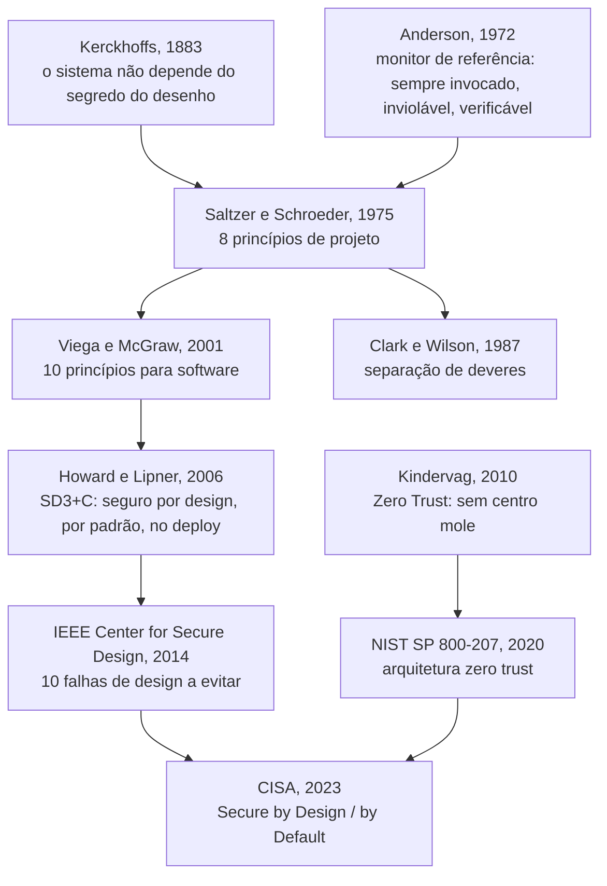

# Ponto 3 — Princípios de arquitetura e projeto seguros

## Objetivo

Entender os princípios de arquitetura e projeto seguros como o conjunto de regras que decide, antes do código, *como* o sistema resiste quando algo falha: o que se toma como dado, que regras não podem ser violadas pelo desenho, quais métodos nomeados aplicam cada regra e que mecanismos as materializam. E entender a linhagem desses princípios — de Saltzer e Schroeder (1975) a Zero Trust (NIST SP 800-207, 2020) e Secure by Design (CISA, 2023) — como um único corpo de ideias que mudou de vocabulário, não de conteúdo.

Referência principal: Saltzer, Jerome H.; Schroeder, Michael D. "The Protection of Information in Computer Systems". *Proceedings of the IEEE*, 63(9), 1975. Os oito princípios de projeto seguem esse artigo. A leitura contemporânea segue Viega e McGraw (2001), o IEEE Center for Secure Design (2014) e o NIST SP 800-207 (2020).

O ponto anterior (modelagem de ameaças) termina com uma lista de ameaças e um destino para cada uma. Este ponto começa onde aquele acaba: a mitigação decidida vira requisito de arquitetura, e o requisito precisa de uma regra que diga *como* desenhar para satisfazê-lo. Sem princípio, cada mitigação é um remendo isolado; com princípio, as mitigações formam um desenho.

---

## 1. Falha de design — a pergunta que a arquitetura responde

### Falha de design não é bug

Um *bug* é um erro de implementação: o código não faz o que o projeto mandou. Uma *falha de design* (flaw) é um erro de intenção: o código faz exatamente o que o projeto mandou, e o projeto estava errado. Uma injeção de SQL é bug — a query devia ser parametrizada e não foi. Um sistema que confia no identificador de conta enviado pelo cliente para decidir que saldo mostrar não tem bug nenhum: cada linha faz o que devia; o desenho é que entregou ao atacante a decisão de autorização. McGraw (2006) estima que cerca de metade dos defeitos de segurança são falhas de design, não bugs, e que ferramentas de análise de código não as encontram, porque não há linha errada para apontar.

A distinção importa porque muda a resposta. Bug se corrige no código, com teste de regressão. Falha de design se corrige redesenhando — e redesenho depois do código custa o que Boehm (1981) mediu: ordens de grandeza acima do custo na fase de projeto. Por isso o ciclo de vida seguro (ponto 1) coloca revisão de arquitetura antes da implementação, e por isso este ponto existe como disciplina separada da codificação segura (ponto 5).

### Por que princípio, e não checklist

Uma lista de verificação enumera falhas conhecidas. Serve para o que já aconteceu. Um princípio é uma regra sobre a forma do sistema que vale para falhas que ainda não aconteceram: "toda decisão de acesso passa por um único ponto verificável" impede uma classe inteira de falhas, inclusive as que ninguém catalogou. Saltzer e Schroeder (1975) escreveram os oito princípios exatamente assim — não como lista de erros, mas como propriedades de um mecanismo de proteção que resiste ao erro de quem o usa e de quem o constrói. Quarenta anos depois, o IEEE Center for Secure Design (2014) publicou os dez *flaws* mais comuns e chegou ao mesmo lugar: cada flaw é a violação de um princípio de 1975.

Aqui vale a taxonomia do laboratório. **Fundamento** é a premissa que não se discute dentro do método. **Princípio** é a regra de restrição: diz o que o desenho não pode violar. **Técnica** é o método nomeado, com autor e ano, que aplica a regra a um sistema concreto. **Mecanismo** é a peça de software ou infraestrutura que executa a regra em produção. "Menor privilégio" é princípio; "separação de privilégios do OpenSSH" (Provos, Friedl e Honeyman, 2003) é técnica; o processo sem privilégio que faz o parsing da rede é mecanismo. Confundir os níveis é o erro mais comum ao dissertar sobre este ponto: chamar RBAC de princípio, ou zero trust de produto.

### Exemplo

Uma API de pagamentos expõe `GET /contas/{id}/saldo`. O cliente autenticado envia o `id`; a API consulta o banco e devolve o saldo. Nenhum bug: autenticação funciona, a query é parametrizada, o TLS está ligado. A falha é de desenho: a decisão "este cliente pode ver esta conta?" não existe em lugar nenhum. O princípio violado é *mediação completa* (toda acesso a todo objeto é verificado) e, por trás dele, a regra moderna "autorize depois de autenticar" (IEEE CSD, 2014). A correção não é uma linha: é um ponto de decisão de autorização que todo acesso atravessa — um mecanismo que o desenho não previu. O restante deste ponto é sobre como prever.

---

## 2. Fundamentos — o que se toma como dado

Quatro premissas sustentam os princípios. Não se discutem dentro do método: são o chão sobre o qual as regras se apoiam.

| Fundamento | Premissa | O que decorre dela |
|---|---|---|
| Confiança é decisão explícita, não estado padrão | nada é confiável por estar "dentro"; confiança se concede, se verifica e expira | todo acesso é verificado; a rede não é perímetro de confiança |
| A violação vai acontecer em algum lugar | alguma defesa vai falhar: credencial vaza, dependência tem CVE, operador erra | o desenho limita o dano de uma falha, não só a probabilidade |
| Segurança depende de mecanismo pequeno e sempre invocado | o que decide acesso precisa ser inviolável, sempre chamado e verificável | concentra-se a decisão; não se espalha por todo o código |
| Quem opera o sistema é parte dele | usuário e operador contornam o que atrapalha | controle inusável é controle desligado |

### Confiança é decisão explícita, não estado padrão

O modelo de perímetro assumia que o que está dentro da rede é confiável e o que está fora não é. Kindervag (2010) chamou isso de "centro mole" (*chewy center*): perímetro duro, interior sem verificação, de modo que uma única credencial roubada ou um único host comprometido dá acesso a tudo. A premissa contrária — nenhum sujeito, dispositivo ou serviço é confiável pela posição que ocupa — é o que o NIST SP 800-207 (2020) formaliza como Zero Trust. Não é produto nem arquitetura específica: é a premissa de que confiança se concede por decisão explícita, com base em identidade verificada e contexto, para um acesso de cada vez. Dela decorre o princípio de mediação completa e a técnica de arquitetura zero trust, que vêm adiante.

### A violação vai acontecer em algum lugar

Nenhum controle é perfeito. Credenciais vazam, bibliotecas têm vulnerabilidades descobertas depois do deploy, operadores cometem erros, e o atacante tem tempo. A premissa *assume breach* (presuma a invasão) inverte a pergunta de projeto: em vez de "como impedir que entrem?", "quando entrarem por aqui, até onde chegam?". Disso decorrem defesa em profundidade (mais de uma camada entre o atacante e o ativo) e compartimentação (o dano de uma falha fica contido no compartimento onde ela ocorreu). O jargão "raio de explosão" (*blast radius*) nomeia a grandeza que o desenho deve minimizar.

### Segurança depende de mecanismo pequeno e sempre invocado

Anderson (1972) descreveu o *monitor de referência*: o componente que medeia todo acesso de sujeito a objeto, e que precisa ter três propriedades — ser sempre invocado (nenhum acesso o contorna), ser à prova de adulteração (nenhum sujeito o modifica) e ser pequeno o bastante para ser verificado. Essa é a premissa por trás de "economia de mecanismo" e "mediação completa" em Saltzer e Schroeder. A consequência prática é que decisões de segurança não se espalham pelo código: concentram-se em poucos componentes que podem ser revisados, testados e protegidos. O conjunto desses componentes é a *base computacional confiável* (TCB); quanto menor, melhor.

### Quem opera o sistema é parte dele

Saltzer e Schroeder incluíram "aceitabilidade psicológica" entre os oito princípios porque observaram que o mecanismo que o usuário não entende é o mecanismo que ele contorna. Adams e Sasse (1999) mostraram empiricamente o mesmo: políticas de senha que ignoram como as pessoas trabalham produzem senhas anotadas e compartilhadas. O desenho seguro inclui a pessoa — usuário final, desenvolvedor, operador — como componente com comportamento previsível. Controle que exige esforço desproporcional será desligado, e o desenho precisa contar com isso.

---

## 3. Overview visual — a linhagem dos princípios

Os princípios de arquitetura segura têm uma origem datada e uma linhagem contínua. O vocabulário mudou; o conteúdo, pouco.

Leitura: o artigo de 1975 é o tronco. Viega e McGraw traduziram os princípios para quem escreve software de aplicação; Howard e Lipner os ligaram ao processo (SDL); o IEEE CSD os inverteu em lista de falhas; o NIST deu forma arquitetural à premissa de confiança explícita; a CISA transformou tudo em exigência a fabricantes. Dissertar sobre este ponto é mostrar essa continuidade — não listar princípios como se fossem independentes.

---

## 4. Os princípios clássicos — Saltzer e Schroeder (1975)

Os oito princípios são regras sobre a forma do mecanismo de proteção. Para cada um: a regra como foi escrita, o que a viola, a técnica nomeada que a aplica e o mecanismo que a executa.

| Princípio | Regra (1975) | Nome contemporâneo |
|---|---|---|
| Economia de mecanismo | mantenha o desenho tão simples e pequeno quanto possível | TCB mínima; "keep it simple" |
| Padrões à prova de falha | baseie decisões de acesso em permissão, não em exclusão | default deny; fail secure; secure by default |
| Mediação completa | todo acesso a todo objeto é verificado quanto à autoridade | monitor de referência; zero trust |
| Desenho aberto | o desenho não deve ser secreto | Kerckhoffs; sem segurança por obscuridade |
| Separação de privilégios | mecanismo que exige duas chaves é mais robusto que um de uma | MFA; separação de deveres; aprovação dupla |
| Menor privilégio | todo programa e usuário opera com o menor conjunto de privilégios necessário | least privilege |
| Menor mecanismo comum | minimize o mecanismo compartilhado entre usuários | isolamento; multi-tenancy seguro |
| Aceitabilidade psicológica | interface projetada para que o uso correto seja o fácil | usable security |

Dois outros, que os autores dizem aplicar-se "imperfeitamente": **fator de trabalho** (compare o custo de burlar com os recursos do atacante) e **registro de comprometimento** (quando não puder impedir, registre de forma confiável).

### Economia de mecanismo

**Regra.** O mecanismo de proteção deve ser pequeno e simples o bastante para ser inspecionado linha a linha. Saltzer e Schroeder dão a razão: erros de projeto e implementação que criam caminhos de acesso indesejados não aparecem no uso normal, então só a inspeção os encontra — e inspeção só é viável em mecanismo pequeno.

**O que viola.** Autorização espalhada por centenas de pontos do código, cada um com sua lógica; frameworks de segurança com mais configuração que código protegido; criptografia própria no lugar de biblioteca revisada.

**Técnica.** Base computacional confiável mínima (TCB), herdada do monitor de referência de Anderson (1972): identificar o conjunto de componentes de que a segurança depende e reduzi-lo. Em aplicações, o equivalente é concentrar decisões de segurança em poucos módulos — o *Check Point* dos padrões de segurança (Yoder e Barcalow, 1997).

**Mecanismo.** Middleware único de autorização; biblioteca criptográfica padrão da plataforma em vez de implementação própria; serviço de identidade compartilhado em vez de login por aplicação.

**Exemplo.** Em vez de cada endpoint da API de pagamentos verificar o dono da conta à sua maneira, um único middleware carrega o recurso, confere o dono contra o sujeito autenticado e nega antes de qualquer handler rodar. Um lugar para revisar; um lugar para testar; um lugar para errar — e consertar.

### Padrões à prova de falha

**Regra.** A decisão de acesso parte da negação: o que não foi explicitamente permitido está proibido. Saltzer e Schroeder observam que o erro no desenho de uma permissão falha fechado (alguém legítimo é barrado e reclama), enquanto o erro no desenho de uma exclusão falha aberto (alguém ilegítimo passa e ninguém percebe).

**O que viola.** Lista de bloqueio em vez de lista de permissão; porta aberta "por enquanto"; recurso novo acessível a todos até alguém configurar; tratamento de exceção que, diante de erro no serviço de autorização, deixa passar.

**Técnica.** *Default deny* como política: toda regra de acesso é uma exceção explícita à negação. Seguro por padrão (*secure by default*) de Howard e Lipner (2006): a configuração de fábrica é a mais restrita que ainda funciona, e o usuário relaxa conscientemente. A CISA (2023) reafirma: o produto sai seguro sem que o cliente precise configurar nada.

**Mecanismo.** Política de rede que nega tudo e abre portas nomeadas; feature flag desligada por padrão; permissões de IAM vazias na criação; exceção de autorização que resulta em 403, nunca em 200.

**Vocabulário que confunde.** Na segurança física, *fail-safe* é a porta que destranca em caso de incêndio — falha a favor da vida. No software, o mesmo termo em Saltzer e Schroeder significa falhar a favor da proteção. Para evitar o choque, a literatura de software prefere *fail secure*: diante de erro, o sistema nega. Na dissertação, nomeie a ambiguidade e use "fail secure".

### Mediação completa

**Regra.** Toda acesso a todo objeto é verificado quanto à autoridade — não só o primeiro. Saltzer e Schroeder alertam contra o atalho de verificar uma vez e lembrar o resultado: se a autoridade for revogada, o cache continua concedendo.

**O que viola.** Verificar permissão na listagem e não no detalhe; checar autorização no front-end e confiar que a API nunca será chamada direto; cache de decisão sem invalidação; o clássico *time-of-check to time-of-use* (TOCTOU), em que o objeto muda entre a verificação e o uso.

**Técnica.** Monitor de referência (Anderson, 1972): um ponto de decisão que todo acesso atravessa, inviolável e verificável. Em arquitetura contemporânea, o NIST SP 800-207 (2020) separa *ponto de decisão de política* (PDP — o motor que decide) de *ponto de aplicação de política* (PEP — o componente que bloqueia ou libera), e exige que a decisão seja por sessão, com base em identidade e contexto, não por posição na rede.

**Mecanismo.** Gateway de API como PEP; motor de políticas (OPA, Cedar) como PDP; autorização reavaliada a cada requisição, com tokens de curta duração; verificação do dono do recurso em cada operação, inclusive em lote.

**Exemplo.** O `GET /contas/{id}/saldo` da seção 1 passa a atravessar o PEP: o gateway valida o token, o middleware carrega a conta e pergunta ao PDP "este sujeito pode ler esta conta?". A resposta não é lembrada entre requisições. O preço — uma consulta a mais — é o preço do princípio.

### Desenho aberto

**Regra.** A segurança não pode depender do segredo do desenho; só do segredo de chaves e senhas, que são fáceis de trocar. A ideia é de Kerckhoffs (1883): o sistema deve poder cair nas mãos do inimigo sem inconveniente. Shannon (1949) a resumiu como "o inimigo conhece o sistema".

**O que viola.** Algoritmo de criptografia próprio; endpoint "escondido" sem autenticação; segurança que depende de o atacante não saber o formato de um identificador.

**Técnica.** Uso de primitivas públicas e revisadas (AES, RSA, curvas elípticas padronizadas) e de protocolos abertos (TLS, OAuth 2.0, OIDC); revisão externa do desenho. O corolário operacional é que o que precisa ser secreto — a chave — recebe proteção específica: rotação, cofre, menor privilégio para quem a lê.

**Mecanismo.** Biblioteca criptográfica padrão; gerenciador de segredos (cofre) com rotação; documentação pública da API, para que a segurança não dependa de ninguém conhecer os endpoints.

**Nuance.** Desenho aberto não é "publicar tudo". É "não depender do segredo". Ofuscar a topologia da rede pode atrasar um atacante sem ser o que o impede — e isso é legítimo como camada adicional. O erro é fazer da obscuridade a única camada.

### Separação de privilégios

**Regra.** Um mecanismo que exige duas chaves independentes é mais robusto que um de uma só, porque nenhum acidente, engano ou abuso de confiança isolado compromete o todo.

**O que viola.** Uma credencial que faz tudo; o mesmo operador que pede e aprova uma transferência; deploy em produção por uma pessoa, sem segunda revisão.

**Técnica.** Separação de deveres (Clark e Wilson, 1987): uma transação sensível exige mais de um agente, e os papéis de quem executa e quem autoriza não coincidem. Autenticação multifator é o mesmo princípio aplicado à identidade: duas evidências de naturezas diferentes (algo que sabe, algo que tem, algo que é). No pipeline, a revisão obrigatória de código antes do merge e a aprovação separada para deploy são separação de privilégios aplicada ao processo.

**Mecanismo.** MFA; aprovação em dupla para operações acima de um limite; branch protegida com revisor obrigatório; contas de administração separadas das contas de uso diário.

### Menor privilégio

**Regra.** Todo programa e todo usuário operam com o menor conjunto de privilégios necessário para completar a tarefa. Saltzer e Schroeder dão dois motivos: o dano de um acidente ou erro fica limitado ao que aquele privilégio alcança, e o número de interações entre programas privilegiados cai — o que torna o uso indevido de um privilégio mais provável de ser notado.

**O que viola.** Serviço que roda como administrador porque "precisa de uma coisa"; token de API com todos os escopos; conta de banco de dados compartilhada por todas as aplicações; container executando como root.

**Técnica.** Separação de privilégios no sentido de Provos, Friedl e Honeyman (2003): dividir o programa em um processo privilegiado mínimo e processos sem privilégio que fazem o trabalho exposto (parsing de rede, autenticação de senha). O OpenSSH é o caso canônico: o processo que fala com a rede não tem privilégio; se for comprometido, o atacante fica preso num processo que não pode nada. Em nuvem, a técnica equivalente é a política de IAM por função com escopo mínimo e revisão periódica de permissões não usadas.

**Mecanismo.** Usuário de sistema dedicado por serviço; capabilities em vez de root; política de IAM por função; escopos de OAuth por operação; conta de banco somente-leitura para o serviço que só lê; `seccomp` e perfis de container restritivos.

**Exemplo.** O serviço de consulta de saldo da API de pagamentos tem credencial de banco que só lê a tabela de saldos. Se ele for comprometido, o atacante lê saldos — não transfere, não apaga, não altera. O princípio não impediu a invasão; limitou o que ela alcança. É o fundamento "a violação vai acontecer" em ação.

### Menor mecanismo comum

**Regra.** Minimize o mecanismo compartilhado entre mais de um usuário e do qual todos dependem. Todo mecanismo compartilhado é um canal potencial de informação entre usuários que não deveriam se ver, e um ponto cuja falha afeta todos.

**O que viola.** Cache compartilhado entre tenants sem chave de isolamento; banco único em que o filtro por tenant é responsabilidade de cada query; biblioteca de sessão que mistura dados de usuários diferentes sob carga.

**Técnica.** Isolamento por domínio de segurança: separar o que pertence a sujeitos diferentes em processos, contêineres, esquemas de banco ou contas de nuvem distintos, conforme o nível de garantia exigido. O ataque Spectre (Kocher et al., 2019) é a ilustração contemporânea extrema: estado microarquitetural compartilhado entre domínios de segurança virou canal de vazamento — exatamente o que o princípio de 1975 previa.

**Mecanismo.** Chave de cache prefixada pelo identificador do tenant; *row-level security* no banco; um esquema ou um banco por tenant quando o risco justifica; sandboxes de processo para código de terceiros; isolamento de rede entre ambientes.

### Aceitabilidade psicológica

**Regra.** A interface humana do mecanismo de proteção deve ser projetada para facilidade de uso, de modo que as pessoas o apliquem correta e automaticamente. Saltzer e Schroeder acrescentam: o modelo mental do usuário sobre a proteção deve coincidir com o mecanismo real; quando divergem, o usuário erra.

**O que viola.** Política de senha que exige troca mensal e produz senhas em post-it; alerta de segurança que dispara tanto que é ignorado; fluxo de aprovação tão lento que o time cria um atalho fora do processo.

**Técnica.** Segurança usável como disciplina (Adams e Sasse, 1999; e, para senhas, NIST SP 800-63B, 2017, que abandonou a troca periódica obrigatória por causar o efeito contrário). O caminho seguro deve ser o caminho de menor esforço — o que Howard e Lipner (2006) chamam de seguro por padrão, visto do lado da pessoa.

**Mecanismo.** Gerenciador de senhas e passkeys; SSO que elimina senhas por aplicação; padrões seguros que não exigem configuração; mensagens de erro que dizem o que fazer, não só o que falhou.

### Fator de trabalho e registro de comprometimento

**Fator de trabalho.** Compare o custo de burlar o mecanismo com os recursos do atacante. Saltzer e Schroeder reconhecem que, em sistemas computacionais, o cálculo é difícil — um atacante pode não precisar de força bruta se houver um caminho lógico barato. Ainda assim, o princípio governa decisões reais: o custo de derivação de uma senha com bcrypt ou Argon2 (parâmetro ajustável de trabalho) e o limite de tentativas por minuto são escolhas de fator de trabalho.

**Registro de comprometimento.** Quando não for possível impedir, registre de forma confiável que houve comprometimento. É a origem do requisito de trilha de auditoria íntegra e do não-repúdio (ponto 2, a letra R do STRIDE): log com integridade protegida, timestamp confiável e armazenamento que o atacante não alcança. O princípio é imperfeito porque registrar não impede — mas sem ele, a violação assumida como inevitável passa despercebida.

> **Junta.** Os oito princípios são de 1975 e falam de sistemas operacionais com usuários interativos. A pergunta que se segue é: o que mudou quando o sistema virou rede de serviços, nuvem e dependências de terceiros? A resposta: o vocabulário. Os princípios contemporâneos são releituras dos mesmos oito.

---

## 5. Princípios contemporâneos e a linhagem

Cinco princípios dominam a literatura de arquitetura segura hoje. Nenhum é novo; cada um é a combinação de um fundamento da seção 2 com um ou mais princípios de 1975, dita para o sistema distribuído.

### Defesa em profundidade

**Regra.** Nenhum controle é a única barreira entre o atacante e o ativo. Camadas independentes garantem que a falha de uma não decide o resultado. A origem é militar; a formulação para sistemas de informação está no *Information Assurance Technical Framework* da NSA (2000), que organiza as camadas em pessoas, tecnologia e operações. Viega e McGraw (2001) a colocam entre os dez princípios para software.

**O que decorre.** Validar entrada na borda *e* parametrizar a query *e* dar ao banco um usuário sem permissão de escrita: três camadas contra a mesma injeção. Se o atacante passa pela primeira, a segunda segura; se passa pela segunda, a terceira limita o dano.

**O que não é.** Dois produtos que fazem a mesma coisa do mesmo jeito não são duas camadas: falham juntos. Camadas precisam ser independentes em mecanismo e em falha. Defesa em profundidade também não substitui corrigir a falha: é o que segura enquanto a correção não chega, e o que segura quando a correção falha.

**Linhagem.** Fundamento "a violação vai acontecer" + menor privilégio + mediação completa.

### Assume breach e contenção

**Regra.** Desenhe como se o atacante já estivesse dentro. A pergunta de projeto passa a ser "até onde ele chega daqui?" — e a resposta deve ser "pouco". A Microsoft popularizou o termo *assume breach* como estratégia de segurança a partir dos anos 2010, em oposição ao modelo de prevenção pura.

**O que decorre.** Segmentação de rede e de identidade, de modo que um host comprometido não alcança os demais; credenciais de curta duração, para que a credencial roubada expire antes de ser útil; detecção e resposta como parte do desenho, não acréscimo; exercícios de time vermelho para medir o raio de explosão real.

**Linhagem.** Fundamento "a violação vai acontecer" + menor privilégio + menor mecanismo comum + registro de comprometimento.

### Zero Trust

**Regra.** Nenhum acesso é concedido pela posição do sujeito na rede; todo acesso é verificado por identidade, dispositivo e contexto, por sessão, com privilégio mínimo. Kindervag (2010) formulou o modelo na Forrester; o Google o implementou como BeyondCorp (Ward e Beyer, 2014), eliminando a VPN em favor de um proxy ciente de identidade; o NIST SP 800-207 (2020) o formalizou em sete princípios (*tenets*) e uma arquitetura de referência.

**Os sete princípios do NIST, em resumo.** (1) Todo dado e serviço é um recurso. (2) Toda comunicação é protegida, independentemente da localização. (3) Acesso é concedido por sessão. (4) A decisão é por política dinâmica, que considera identidade, dispositivo, comportamento. (5) A organização monitora a integridade de todos os ativos. (6) Autenticação e autorização são dinâmicas e aplicadas antes de cada acesso. (7) A organização coleta informação para melhorar a política.

**O que não é.** Zero trust não é produto, não é "desligar a VPN" e não é "autenticar mais". É a arquitetura em que a decisão de acesso saiu da rede e foi para um ponto de decisão que conhece o sujeito e o recurso. A técnica correspondente — arquitetura zero trust, com PDP e PEP — está na seção 6.

**Linhagem.** Fundamento "confiança é decisão explícita" + mediação completa + menor privilégio + padrões à prova de falha.

### Seguro por padrão e por design

**Regra.** O sistema é seguro na configuração de fábrica, sem que o usuário faça nada (*secure by default*), e a segurança foi decidida no projeto, não acrescentada depois (*secure by design*). Howard e Lipner (2006) formularam o par como SD3+C — *Secure by Design, Secure by Default, Secure in Deployment, Communications* — no SDL da Microsoft. A CISA, com agências parceiras, publicou em 2023 *Shifting the Balance of Cybersecurity Risk*, que transforma o par em três exigências a fabricantes: assumir a responsabilidade pelos resultados de segurança do cliente; transparência radical sobre vulnerabilidades e decisões; liderança a partir do topo da organização.

**O que decorre.** MFA ligado por padrão; portas fechadas até serem abertas; linguagens e bibliotecas seguras em memória como escolha de projeto (ponto 5); logs de segurança incluídos sem custo adicional. O ônus da configuração segura sai do cliente e vai para quem constrói.

**Linhagem.** Padrões à prova de falha + aceitabilidade psicológica + economia de mecanismo.

### Separação de deveres e o elo mais fraco

**Separação de deveres.** Clark e Wilson (1987), estudando integridade em sistemas comerciais, mostraram que a fraude exige a mesma pessoa em dois papéis — quem executa e quem confere. A regra de projeto é que transações sensíveis exigem agentes distintos para cada papel. É separação de privilégios (1975) aplicada a pessoas e processos.

**Elo mais fraco.** Viega e McGraw (2001) abrem sua lista com "proteja o elo mais fraco": o atacante não enfrenta a defesa mais forte, procura a mais fraca. O corolário é que investir na parte já forte não melhora a segurança do todo. Ligado a isso, o IEEE CSD (2014) coloca em primeiro lugar entre as falhas: "conquiste ou conceda confiança, nunca a presuma" — o que inclui nunca confiar no cliente (navegador, aplicativo móvel, SDK), porque o cliente está do outro lado da fronteira de confiança (ponto 2).

**Linhagem.** Separação de privilégios + fundamento "confiança é decisão explícita".

### A tabela da linhagem

| Princípio contemporâneo | Fundamento | Princípios de 1975 que combina | Fonte |
|---|---|---|---|
| Defesa em profundidade | a violação vai acontecer | menor privilégio, mediação completa | NSA IATF (2000); Viega e McGraw (2001) |
| Assume breach / contenção | a violação vai acontecer | menor privilégio, menor mecanismo comum, registro de comprometimento | Microsoft (2010s) |
| Zero Trust | confiança é decisão explícita | mediação completa, menor privilégio, padrões à prova de falha | Kindervag (2010); NIST SP 800-207 (2020) |
| Seguro por padrão / por design | quem opera é parte do sistema | padrões à prova de falha, aceitabilidade psicológica, economia de mecanismo | Howard e Lipner (2006); CISA (2023) |
| Separação de deveres | confiança é decisão explícita | separação de privilégios | Clark e Wilson (1987) |
| Elo mais fraco / não confiar no cliente | confiança é decisão explícita | mediação completa | Viega e McGraw (2001); IEEE CSD (2014) |

> **Junta.** Princípio diz o que o desenho não pode violar. Falta o método: dado um sistema concreto, como aplicar a regra de forma repetível e verificável? É o que as técnicas respondem.

---

## 6. Técnicas de projeto seguro

Uma técnica é um método nomeado, com fonte, que transforma princípio em decisão de desenho. Seis técnicas cobrem o que cai neste ponto. Para cada uma: o que é, que princípios aplica, que mecanismos a executam e qual é a saída.

### Monitor de referência e ponto único de decisão

**O que é.** Anderson (1972): um componente que medeia todo acesso de sujeito a objeto, com três propriedades — sempre invocado, inviolável, pequeno o bastante para ser verificado. Em arquitetura de aplicação, é o padrão *Check Point* (Yoder e Barcalow, 1997): um lugar por onde toda requisição passa e onde a política é aplicada.

**Princípios que aplica.** Mediação completa; economia de mecanismo; padrões à prova de falha (o ponto nega por padrão).

**Mecanismos.** Middleware de autorização; gateway de API; motor de políticas (OPA, Cedar, Casbin) consultado por serviço; *policy as code* versionado junto com a aplicação.

**Saída.** Um diagrama em que toda seta de acesso a recurso passa por um componente nomeado, e um teste que prova que não há caminho alternativo.

### Padrões de segurança

**O que é.** Yoder e Barcalow (1997) catalogaram sete padrões arquiteturais de segurança para aplicações: *Single Access Point* (uma entrada só), *Check Point* (um ponto de verificação), *Roles* (papéis em vez de permissões individuais), *Session* (estado do sujeito autenticado), *Full View with Errors* (mostrar tudo e negar ao agir), *Limited View* (mostrar só o permitido), *Secure Access Layer* (camada que isola a aplicação dos mecanismos de segurança externos). Schumacher et al. (2006) expandiram o catálogo em *Security Patterns*, com padrões para identificação, autorização, controle de acesso, firewall e auditoria, no formato de padrões de projeto.

**Princípios que aplica.** Economia de mecanismo (Single Access Point, Check Point); menor privilégio (Roles, Limited View); mediação completa (Check Point em toda requisição).

**Mecanismos.** Gateway como Single Access Point; RBAC/ABAC como Roles; token de sessão com expiração como Session; serialização por papel como Limited View.

**Saída.** Vocabulário comum na revisão de arquitetura: "falta Check Point no serviço X" é uma frase verificável.

### Separação de privilégios e compartimentação

**O que é.** Provos, Friedl e Honeyman (2003): dividir um programa em processos com privilégios distintos, de modo que o código exposto a entrada hostil rode sem privilégio e só peça ao processo privilegiado operações estritamente definidas. O OpenSSH é a implementação de referência. Em sistemas distribuídos, a mesma ideia vira compartimentação: contêineres, contas de nuvem, redes e bancos separados por domínio de segurança, para que um comprometimento fique contido.

**Princípios que aplica.** Menor privilégio; menor mecanismo comum; o fundamento *assume breach*.

**Mecanismos.** Processos separados com IPC estreito; contêiner por serviço, sem root, com `seccomp` e sistema de arquivos somente-leitura; conta de nuvem por ambiente; VPC e sub-redes por camada; *row-level security* ou banco por tenant.

**Saída.** Mapa de compartimentos: o que roda onde, com que credencial, e o que um compartimento comprometido alcança.

### Arquitetura Zero Trust

**O que é.** NIST SP 800-207 (2020): o modelo lógico tem um *policy engine* (decide), um *policy administrator* (emite ou revoga a credencial de sessão) — juntos, o ponto de decisão de política (PDP) — e *policy enforcement points* (PEP) que aplicam a decisão no caminho do acesso. O documento descreve três variantes: governança de identidade aprimorada (a decisão gira em torno da identidade), microssegmentação (gateways por grupo de recursos) e perímetro definido por software (SDP, rede sobreposta por sessão). Precursor: BeyondCorp (Ward e Beyer, 2014), proxy ciente de identidade e inventário de dispositivos no lugar da VPN.

**Princípios que aplica.** Mediação completa; menor privilégio; padrões à prova de falha; fundamento "confiança é decisão explícita".

**Mecanismos.** mTLS entre serviços; proxy ciente de identidade; tokens curtos e renováveis; avaliação de postura do dispositivo; microssegmentação por política; identidade de carga de trabalho (SPIFFE/SPIRE).

**Saída.** Diagrama em que cada acesso tem um PEP nomeado e o PDP que consulta, e nenhuma seta "confiável por estar na rede interna".

### Revisão de arquitetura contra as dez falhas

**O que é.** IEEE Center for Secure Design (2014), *Avoiding the Top 10 Software Security Design Flaws*: dez falhas de projeto recorrentes, cada uma uma violação de princípio. (1) Conquiste ou conceda confiança, nunca presuma. (2) Use um mecanismo de autenticação que não possa ser contornado nem adulterado. (3) Autorize depois de autenticar. (4) Separe estritamente dados de instruções de controle, e nunca processe instruções de controle vindas de fonte não confiável. (5) Defina uma abordagem que garanta que todo dado é explicitamente validado. (6) Use criptografia corretamente. (7) Identifique dados sensíveis e como devem ser tratados. (8) Sempre considere os usuários. (9) Entenda como integrar componentes externos muda a superfície de ataque. (10) Seja flexível ao considerar mudanças futuras em objetos e atores.

**Princípios que aplica.** Todos: a lista é o inverso dos princípios. (1) e (3) são mediação completa; (2) é economia de mecanismo e desenho aberto; (4) e (5) são a fronteira de confiança do ponto 2 aplicada ao dado; (6) é desenho aberto; (8) é aceitabilidade psicológica; (9) é superfície de ataque.

**Mecanismos.** Revisão de arquitetura com a lista como roteiro, antes do código; registro de decisão arquitetural (ADR) de segurança para cada item; gate no ciclo de vida (ponto 1) que exige a revisão concluída.

**Saída.** Documento de revisão com um veredito por falha: não se aplica, atendida (como), ou achado com destino.

### Requisitos de arquitetura verificáveis

**O que é.** Princípio sem requisito verificável é intenção. Duas fontes convertem princípio em requisito. O OWASP ASVS 4.0 (2019), no capítulo V1 (Arquitetura, Projeto e Modelagem de Ameaças), lista requisitos como "todos os componentes de aplicação são identificados e necessários", "a arquitetura de autenticação é centralizada", "a comunicação entre componentes é autenticada" — em três níveis de garantia. O NIST SP 800-160 vol. 1 (2016; rev. 1, 2022) trata engenharia de segurança de sistemas como disciplina de engenharia: define processos técnicos (definição de necessidades, requisitos, arquitetura, projeto, verificação) e exige que a segurança seja propriedade emergente do sistema projetado, não acréscimo.

**Princípios que aplica.** Todos, por via de requisito testável.

**Mecanismos.** Requisitos do ASVS no backlog com critério de aceite; teste de arquitetura automatizado (dependências proibidas entre camadas, acesso ao banco só pela camada permitida); revisão de conformidade por nível.

**Saída.** Lista de requisitos arquiteturais com nível de garantia, dono e teste — a mesma rastreabilidade ativo → requisito → controle → teste do ciclo inteiro.

> **Junta.** A técnica aplica a regra a um sistema. Falta mostrar a aplicação num caso concreto, do início ao fim — a mesma API de pagamentos do ponto 2, agora vista pela arquitetura.

---

## 7. Exemplo guiado — a mesma API de pagamentos

Sistema: aplicativo móvel de clientes, API de pagamentos (consulta de saldo e transferência), banco de dados, serviço de antifraude de um parceiro externo, fila de eventos para notificações. No ponto 2, a modelagem produziu ameaças com destino. Aqui, cada mitigação decidida vira decisão de arquitetura, nomeando o princípio e a técnica.

**Ameaça: cliente troca o `id` da conta e opera a de outro (elevação de privilégio).** Princípio: mediação completa; "autorize depois de autenticar" (IEEE CSD). Técnica: monitor de referência / Check Point. Decisão: todo endpoint que recebe identificador de recurso passa por um middleware único que carrega o recurso e confere o dono contra o sujeito do token. O middleware nega por padrão (padrões à prova de falha). Teste: conta de outro cliente → 403, em todos os endpoints, inclusive os futuros.

**Ameaça: serviço de saldo comprometido por dependência vulnerável (tampering, disclosure).** Fundamento: a violação vai acontecer. Princípio: menor privilégio; menor mecanismo comum. Técnica: compartimentação. Decisão: o serviço de saldo roda em contêiner próprio, sem root, com credencial de banco somente-leitura restrita à tabela de saldos; não compartilha processo nem credencial com o serviço de transferência. Resultado: comprometido, lê saldos; não move dinheiro.

**Ameaça: credencial interna roubada dá acesso a tudo "por estar na rede" (spoofing).** Fundamento: confiança é decisão explícita. Princípio: mediação completa. Técnica: arquitetura zero trust. Decisão: comunicação entre serviços com mTLS e identidade de carga de trabalho; o gateway é PEP e consulta um PDP por requisição; tokens expiram em minutos. Nenhuma regra de firewall "interno pode tudo".

**Ameaça: transferência fraudulenta por operador interno (repúdio, tampering).** Princípio: separação de privilégios; separação de deveres (Clark e Wilson). Decisão: transferência acima de um limite exige segundo fator do cliente e, para operações administrativas, aprovação de um segundo operador com papel distinto. Registro de comprometimento: log de transações assinado, com timestamp confiável, em armazenamento que a aplicação só anexa.

**Ameaça: canal com o antifraude do parceiro cai para texto claro (disclosure).** Princípio: desenho aberto (TLS padrão, não protocolo próprio); defesa em profundidade. Decisão: TLS com verificação de certificado obrigatória *e* assinatura do payload *e* minimização do dado enviado ao parceiro (IEEE CSD 7 e 9). Se o canal falhar, o serviço nega a transferência em vez de prosseguir sem antifraude (fail secure).

**Ameaça: rajada de consultas de saldo (negação de serviço).** Princípio: fator de trabalho. Decisão: limite de taxa por cliente no gateway; cota por token; a consulta de saldo é separada da transferência para que a saturação de uma não derrube a outra (menor mecanismo comum).

**Decisão de configuração (seguro por padrão).** Nova funcionalidade entra atrás de flag desligada; conta nova nasce sem permissão; MFA ligado por padrão para o cliente, com opção de desligar que exige confirmação — aceitabilidade psicológica pede que o caminho seguro seja o fácil, não o único.

**Revisão de arquitetura.** Antes do código, a lista do IEEE CSD percorrida item a item, com um veredito por item registrado em ADR. Os requisitos resultantes entram no backlog no formato do ASVS V1, com nível de garantia e teste. O gate do ciclo de vida (ponto 1) bloqueia a implementação até a revisão existir.

O que o exemplo mostra: nenhuma decisão é "uma boa prática solta". Cada uma nomeia a ameaça que responde, o princípio que aplica e a técnica que a torna repetível. Essa é a forma da dissertação: ameaça → princípio → técnica → mecanismo → teste.

---

## 8. Erros frequentes — o que não confundir

| Confusão | Por que está errado | Como dizer certo |
|---|---|---|
| "RBAC é um princípio" | RBAC é mecanismo (ou padrão *Roles*); o princípio é menor privilégio | "RBAC é o mecanismo que executa menor privilégio" |
| "Zero trust é um produto" | é arquitetura e premissa (NIST SP 800-207); produtos implementam partes | "arquitetura zero trust, com PDP e PEP" |
| "Defesa em profundidade = dois antivírus" | camadas iguais falham juntas; precisam ser independentes | "camadas independentes em mecanismo e em modo de falha" |
| "Fail-safe = liberar em caso de erro" | na segurança física, sim; em software, Saltzer e Schroeder querem negar | "fail secure: erro nega" |
| "Desenho aberto = publicar tudo" | o princípio é não *depender* do segredo do desenho | "a segurança depende só do segredo da chave" |
| "Menor privilégio = autenticação forte" | autenticar diz quem é; privilégio diz o que pode | "autentique, depois autorize com o mínimo" |
| "Princípios são independentes" | são releituras de 1975 com vocabulário novo | mostrar a linhagem (seção 3) |
| "Falha de design se acha com SAST" | SAST acha bug; flaw exige revisão de arquitetura | "revisão contra o IEEE CSD, antes do código" |

---

## 9. Síntese

| Tema | Objetivo | Princípio | Técnica (fonte) | Mecanismo |
|---|---|---|---|---|
| Fundamentos | o que se toma como dado | confiança explícita; violação vai acontecer; mecanismo pequeno e sempre invocado; pessoa é parte do sistema | — | — |
| Clássicos (1975) | regras sobre a forma do mecanismo | economia; padrões à prova de falha; mediação completa; desenho aberto; separação de privilégios; menor privilégio; menor mecanismo comum; aceitabilidade psicológica (+ fator de trabalho, registro) | Saltzer e Schroeder (1975); Anderson (1972); Kerckhoffs (1883) | TCB mínima; default deny; middleware único; cripto padrão; MFA; IAM por função; isolamento; SSO |
| Contemporâneos | mesmos princípios para sistemas distribuídos | defesa em profundidade; assume breach; zero trust; seguro por padrão/design; separação de deveres; elo mais fraco | NSA IATF (2000); Viega e McGraw (2001); Kindervag (2010); Howard e Lipner (2006); CISA (2023); Clark e Wilson (1987) | camadas independentes; segmentação; mTLS + PDP/PEP; flags off por padrão; aprovação dupla |
| Técnicas de projeto | princípio → decisão repetível | mediação completa; menor privilégio; economia | monitor de referência (Anderson, 1972); padrões de segurança (Yoder e Barcalow, 1997; Schumacher et al., 2006); separação de privilégios (Provos et al., 2003); arquitetura zero trust (NIST SP 800-207); revisão contra 10 flaws (IEEE CSD, 2014); requisitos verificáveis (ASVS V1; NIST SP 800-160) | gateway, OPA, contêiner sem root, mTLS, ADR, backlog com critério |
| Ponte com o ciclo | mitigação vira desenho | rastreabilidade | ameaça (ponto 2) → requisito de arquitetura → controle → teste (ponto 7) | gate de revisão de arquitetura (ponto 1) |

A cadeia inteira em uma linha: a ameaça decidida no ponto 2 vira requisito de arquitetura; o princípio diz que forma o desenho deve ter; a técnica aplica o princípio de modo repetível; o mecanismo executa; o teste prova. Arquitetura segura é a parte do ciclo em que a segurança deixa de ser lista e vira forma.

---

## Referências

- **Saltzer, Jerome H.; Schroeder, Michael D. "The Protection of Information in Computer Systems". *Proceedings of the IEEE*, 63(9), 1975** — referência principal. Seção I.A.3: os oito princípios de projeto e os dois que se aplicam imperfeitamente
- **Anderson, James P. *Computer Security Technology Planning Study*. ESD-TR-73-51, USAF, 1972** — monitor de referência: sempre invocado, inviolável, verificável
- **Kerckhoffs, Auguste. "La cryptographie militaire". *Journal des sciences militaires*, 1883** — o sistema não deve exigir segredo e deve poder cair nas mãos do inimigo
- **Clark, David D.; Wilson, David R. "A Comparison of Commercial and Military Computer Security Policies". *IEEE S&P*, 1987** — separação de deveres e transações bem formadas como controles de integridade
- **Viega, John; McGraw, Gary. *Building Secure Software*. Addison-Wesley, 2001** — dez princípios: elo mais fraco, defesa em profundidade, fail securely, menor privilégio, compartimentalizar, simplicidade, privacidade, segredos são difíceis de esconder, relutância em confiar, recursos da comunidade
- **McGraw, Gary. *Software Security: Building Security In*. Addison-Wesley, 2006** — bugs versus flaws; cerca de metade dos defeitos de segurança são de design
- **Howard, Michael; Lipner, Steve. *The Security Development Lifecycle*. Microsoft Press, 2006** — SD3+C: seguro por design, por padrão, no deploy, e comunicação
- **IEEE Computer Society Center for Secure Design. *Avoiding the Top 10 Software Security Design Flaws*, 2014** — dez falhas de projeto recorrentes, cada uma a violação de um princípio
- **Kindervag, John. *No More Chewy Centers: Introducing the Zero Trust Model of Information Security*. Forrester Research, 2010** — origem do termo e do modelo
- **Ward, Rory; Beyer, Betsy. "BeyondCorp: A New Approach to Enterprise Security". *;login:*, 39(6), 2014** — implementação do Google: proxy ciente de identidade no lugar da VPN
- **NIST SP 800-207. *Zero Trust Architecture*. Rose, Borchert, Mitchell, Connelly, 2020** — sete princípios, componentes PDP/PEP, três variantes de arquitetura
- **NIST SP 800-160 vol. 1. *Engineering Trustworthy Secure Systems*. 2016; rev. 1, 2022** — engenharia de segurança de sistemas como disciplina de engenharia
- **NIST SP 800-63B. *Digital Identity Guidelines: Authentication and Lifecycle Management*. 2017** — fim da troca periódica obrigatória de senha; aceitabilidade psicológica aplicada
- **CISA et al. *Shifting the Balance of Cybersecurity Risk: Principles and Approaches for Secure by Design Software*. 2023** — três princípios para fabricantes: responsabilidade pelos resultados, transparência radical, liderança a partir do topo
- **NSA. *Information Assurance Technical Framework*, release 3.0, 2000** — defesa em profundidade em pessoas, tecnologia e operações
- **Provos, Niels; Friedl, Markus; Honeyman, Peter. "Preventing Privilege Escalation". *USENIX Security*, 2003** — separação de privilégios no OpenSSH
- **Yoder, Joseph; Barcalow, Jeffrey. "Architectural Patterns for Enabling Application Security". *PLoP*, 1997** — sete padrões: Single Access Point, Check Point, Roles, Session, Full View with Errors, Limited View, Secure Access Layer
- **Schumacher, Markus; Fernandez-Buglioni, Eduardo; Hybertson, Duane; Buschmann, Frank; Sommerlad, Peter. *Security Patterns: Integrating Security and Systems Engineering*. Wiley, 2006** — catálogo de padrões de segurança
- **Adams, Anne; Sasse, M. Angela. "Users Are Not the Enemy". *Communications of the ACM*, 42(12), 1999** — base empírica da segurança usável
- **Kocher, Paul et al. "Spectre Attacks: Exploiting Speculative Execution". *IEEE S&P*, 2019** — mecanismo compartilhado como canal de vazamento entre domínios de segurança
- **OWASP. *Application Security Verification Standard* 4.0, 2019 (4.0.3, 2021)** — capítulo V1: requisitos de arquitetura, projeto e modelagem de ameaças por nível de garantia
- **Boehm, Barry. *Software Engineering Economics*. Prentice Hall, 1981** — custo de corrigir cresce com a fase; base do argumento para revisar o desenho antes do código
