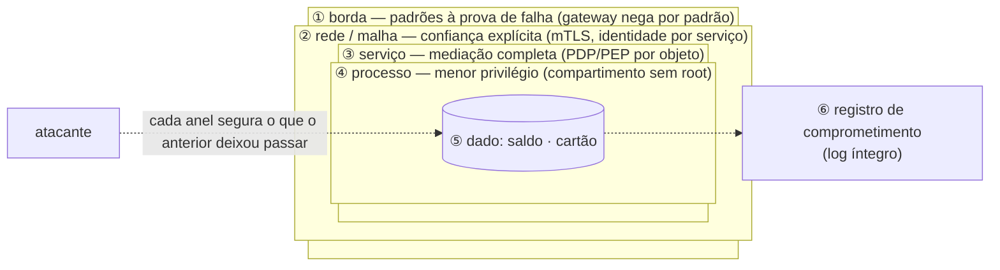

# Dissertação-modelo — Princípios de arquitetura e projeto seguros

> Texto corrido, no registro de uma dissertação, com cerca de dez páginas à mão. Três fontes nomeadas, um caso construído por molde (real opcional), um exemplo que atravessa o texto. **[+]** marca onde alongar; **[−]** marca o que cortar primeiro.

## Esqueleto — o que você anota em 5 minutos antes de escrever

- **Seções, na ordem:** Introdução → Princípio, técnica e mecanismo → O que se toma como dado → Os oito princípios de Saltzer e Schroeder → As releituras contemporâneas → As técnicas → Exemplo → Um caso real → O que não confundir → Conclusão
- **Figura 1:** Anéis de defesa em profundidade com o princípio que cada anel aplica.
- **Caso:** hipotético pelo molde de cinco lacunas; o elo que falha: a chamada interna aceita pela posição na rede, sem identidade nem autorização. (Real, se lembrar: Operação Aurora e o BeyondCorp, 2009–2014.)
- **Três fontes:** Saltzer e Schroeder, *The Protection of Information in Computer Systems* (1975) — os oito princípios; Anderson (1972) — monitor de referência; NIST SP 800-207, *Zero Trust Architecture* (2020).
- **Exemplo:** a API de pagamentos (aplicativo, gateway, contas, transferências, banco, fila, parceiro).
- **Desfecho começa com:** "Em síntese, os princípios de arquitetura e projeto seguros não são uma lista de boas práticas, e sim uma cadeia."

## 1. Introdução — a falha que não é bug

Há dois tipos de defeito de segurança, e eles se corrigem de modos diferentes. O primeiro é o bug: o projeto estava certo e o código não o seguiu — a consulta que deveria ser parametrizada e não foi. O segundo é a falha de design: o código faz exatamente o que o projeto mandou, e o projeto estava errado — o sistema que confia no identificador de conta enviado pelo cliente para decidir que saldo mostrar não tem nenhuma linha errada; o desenho é que entregou ao atacante a decisão de autorização. Gary McGraw, em *Software Security: Building Security In* (2006), estimou que cerca de metade dos defeitos de segurança são do segundo tipo, e que nenhuma ferramenta de análise de código os encontra, porque não há linha para apontar.

Falhas de design se evitam com princípios de projeto: regras sobre a forma do sistema que valem para falhas que ainda não aconteceram. Este texto apresenta as premissas que sustentam esses princípios, os oito princípios clássicos de Saltzer e Schroeder, as releituras contemporâneas que os reformulam para sistemas distribuídos, as técnicas que os aplicam de modo repetível, um exemplo em uma API de pagamentos e o caso que transformou um princípio de 1975 na arquitetura dominante de hoje.

## 2. Princípio, técnica e mecanismo — uma distinção que organiza tudo

Convém fixar o vocabulário. Um **fundamento** é uma premissa que não se discute dentro do método. Um **princípio** é uma regra de restrição: diz o que o desenho não pode violar. Uma **técnica** é um método nomeado, com autor e fonte, que aplica a regra a um sistema concreto. Um **mecanismo** é a implementação que executa a regra em produção. "Menor privilégio" é princípio; a separação de privilégios do OpenSSH, em que o processo exposto à rede roda sem nenhum privilégio, é técnica; o processo sem privilégio é mecanismo. Chamar o controle de acesso baseado em papéis de "princípio", ou chamar o *zero trust* de "produto", é confundir os níveis — e é o erro mais frequente neste assunto.

## 3. O que se toma como dado

Quatro premissas sustentam os princípios. A primeira: **confiança é decisão explícita, não estado padrão**. O modelo de perímetro assumia que o que está dentro da rede é confiável; John Kindervag chamou isso, em 2010, de "centro mole" — casca dura e interior sem verificação, de modo que uma credencial roubada dá acesso a tudo. A premissa contrária, de que nada é confiável pela posição que ocupa, é o que o NIST formalizou como *zero trust* (SP 800-207, 2020).

A segunda: **a violação vai acontecer em algum lugar**. Nenhum controle é perfeito; credenciais vazam, bibliotecas ganham falhas, operadores erram. O desenho que assume isso pergunta "quando entrarem por aqui, até onde chegam?" — e responde com compartimentos e camadas.

A terceira: **segurança depende de um mecanismo pequeno e sempre invocado**. James Anderson, em 1972, descreveu o monitor de referência: o componente que medeia todo acesso de um sujeito a um objeto, e que precisa ser sempre invocado, à prova de adulteração e pequeno o bastante para ser verificado. Decisões de segurança espalhadas por todo o código não têm nenhuma dessas três propriedades.

**[+]** A quarta: **quem opera o sistema é parte dele**. O mecanismo que o usuário não entende é o que ele contorna; a política de senha que ignora como as pessoas trabalham produz senhas anotadas. Anne Adams e Angela Sasse mostraram isso empiricamente em 1999, e a conclusão é de projeto: o controle precisa contar com o comportamento previsível de quem o usa.

## Figura 1 — Anéis de defesa em profundidade com o princípio que cada anel aplica

> Desenhe à mão em três ou quatro minutos, à caneta, com os elementos rotulados e numerados. Cite "a Figura 1" antes de desenhar e percorra a trilha abaixo no texto: cada número é um parágrafo, com um protagonista que atravessa a figura. É assim que o desenho vira uma página — e que o leitor o acompanha em vez de pular.

**A trilha: siga um atacante de fora para dentro.** A Figura 1 são anéis em volta do dado, e cada número é um anel que ele precisa atravessar — rotulado com o princípio de 1975 que o anel aplica.

1. **① A borda.** O gateway nega tudo que não foi declarado: rota fora do catálogo, requisição fora do esquema, token inválido. É o princípio de padrões à prova de falha: o erro fecha, não abre.
2. **② A rede.** Se o atacante entrou por um serviço qualquer, nenhuma chamada dali é aceita por "estar dentro": cada serviço prova identidade e só chama o que a política permite. Confiança explícita — o zero trust — no lugar do centro mole.
3. **③ O serviço.** Mesmo chamando o serviço certo, cada acesso a cada objeto passa pelo ponto de decisão: "este sujeito pode esta ação sobre este recurso?". Mediação completa.
4. **④ O processo.** Se o código do serviço for comprometido, roda sem privilégio, em compartimento que não alcança o vizinho nem o nó. Menor privilégio: o dano fica do tamanho do compartimento.
5. **⑤ O dado.** É o que se protege — saldo e cartão — e a razão de os anéis existirem. Cada anel segurou o que o anterior deixou passar; é isso que defesa em profundidade significa, e por isso os anéis precisam falhar de modos diferentes.
6. **⑥ O registro.** Se todos os anéis falharem, resta saber que falharam: o log íntegro, que ninguém altera. É o registro de comprometimento de Saltzer e Schroeder — o princípio para quando os outros não bastam. O caso da seção seguinte é esta figura sem o anel ②.

## 4. Os oito princípios de Saltzer e Schroeder

Em 1975, Jerome Saltzer e Michael Schroeder publicaram *The Protection of Information in Computer Systems*, e nele oito princípios de projeto de mecanismos de proteção que, cinquenta anos depois, continuam sendo o tronco de tudo que se escreve sobre arquitetura segura.

**Economia de mecanismo.** O mecanismo de proteção deve ser pequeno e simples, porque erros que criam caminhos de acesso indesejados não aparecem no uso normal — só a inspeção os encontra, e inspeção só é viável em mecanismo pequeno. Viola-se com autorização espalhada em centenas de pontos ou com criptografia própria. Aplica-se concentrando decisões de segurança em poucos componentes e usando bibliotecas revisadas.

**Padrões à prova de falha.** A decisão de acesso parte da negação: o que não foi permitido está proibido. O erro em uma permissão falha fechado e alguém reclama; o erro em uma exclusão falha aberto e ninguém percebe. Viola-se com listas de bloqueio, portas abertas "por enquanto" e exceções que, diante de erro no serviço de autorização, deixam passar. Aplica-se com negação por padrão, funcionalidades desligadas de fábrica e erro que sempre nega. Um cuidado de vocabulário: na segurança física, *fail-safe* é a porta que destranca no incêndio; em software, a literatura prefere *fail secure* — o sistema que, em erro, nega.

**Mediação completa.** Todo acesso a todo objeto é verificado, e não só o primeiro. Verificar na listagem e não no detalhe, confiar que o cliente só chamará o que a tela mostra, guardar a decisão em cache sem invalidação, verificar e depois usar sem garantir que o objeto é o mesmo — tudo isso viola o princípio. Aplica-se com um ponto de decisão que todo acesso atravessa, reavaliado a cada requisição.

**Desenho aberto.** A segurança não pode depender do segredo do desenho, só do segredo de chaves — que são fáceis de trocar. A ideia é de Kerckhoffs, em 1883: o sistema deve poder cair nas mãos do inimigo sem inconveniente. Viola-se com algoritmo próprio e endpoint "escondido". Aplica-se com primitivas e protocolos públicos e revisados, e com a chave guardada em cofre. Desenho aberto não é publicar tudo; é não depender do que está oculto.

**[+] Separação de privilégios.** Um mecanismo que exige duas chaves independentes é mais robusto do que um de uma só, porque nenhum acidente ou abuso isolado compromete o todo. É a base da autenticação multifator e da separação de deveres — quem pede não aprova —, que David Clark e David Wilson formularam em 1987 como controle de integridade em sistemas comerciais.

**Menor privilégio.** Todo programa e todo usuário operam com o menor conjunto de privilégios necessário, por dois motivos: o dano de um erro fica limitado ao que aquele privilégio alcança, e o uso indevido fica mais visível. Viola-se com serviços rodando como administrador e tokens com todos os escopos. Aplica-se com um usuário de sistema por serviço, políticas de acesso por função e, em sistemas distribuídos, compartimentos.

**Menor mecanismo comum.** Minimizar o que é compartilhado entre usuários, porque todo mecanismo compartilhado é um canal potencial entre quem não deveria se ver e um ponto cuja falha afeta todos. Viola-se com cache compartilhado entre clientes sem chave de isolamento. Aplica-se isolando por domínio de segurança — processo, contêiner, esquema de banco, conta.

**Aceitabilidade psicológica.** A interface do mecanismo deve ser projetada para que as pessoas o apliquem corretamente sem esforço; quando o modelo mental do usuário diverge do mecanismo, o usuário erra. Aplica-se tornando o caminho seguro o caminho fácil: login único, senhas geradas e guardadas por gerenciador, padrões seguros que não exigem configuração.

**[−]** Saltzer e Schroeder acrescentam dois princípios que, dizem eles, se aplicam "imperfeitamente" a sistemas computacionais: o fator de trabalho — comparar o custo de burlar o mecanismo com os recursos do atacante, que governa decisões como o custo de derivação de uma senha e o limite de tentativas — e o registro de comprometimento — quando não se pode impedir, registrar de forma confiável que aconteceu, que é a origem da trilha de auditoria íntegra.

## 5. As releituras contemporâneas — e por que não são princípios novos

O artigo de 1975 fala de sistemas operacionais com usuários interativos. O que mudou quando o sistema virou rede de serviços, nuvem e dependências de terceiros foi o vocabulário, não o conteúdo. **Defesa em profundidade** — nenhum controle é a única barreira; camadas independentes garantem que a falha de uma não decide — combina a premissa de que a violação vai acontecer com menor privilégio e mediação completa. **Assume breach** é a mesma premissa dita como estratégia: segmentar, usar credenciais curtas, detectar. **Zero trust** — nenhum acesso concedido pela posição na rede; todo acesso verificado por identidade, dispositivo e contexto, a cada sessão — é mediação completa mais menor privilégio mais padrões à prova de falha, formalizado pelo NIST em sete princípios e uma arquitetura com um ponto de decisão de política e pontos de aplicação. **Seguro por padrão e por design** — o sistema sai seguro de fábrica e a segurança foi decidida no projeto — é a fórmula de Howard e Lipner no SDL da Microsoft (2006), que a agência americana CISA transformou em 2023 em exigência a fabricantes. E **separação de deveres** é separação de privilégios aplicada a pessoas e processos.

**[+]** Ver a linhagem importa por um motivo prático: quem conhece os oito princípios reconhece cada releitura como combinação deles, e por isso consegue aplicá-la a um caso novo em vez de decorar a lista. "Zero trust" deixa de ser um produto a comprar e vira três princípios de 1975 aplicados a uma rede de serviços.

## 6. As técnicas — do princípio à decisão repetível

Princípio diz o que não violar; falta o método que torna a aplicação repetível. Seis técnicas cobrem a maior parte. O **monitor de referência**, de Anderson, aplicado a uma aplicação, é o padrão *Check Point* catalogado por Joseph Yoder e Jeffrey Barcalow em 1997: um lugar por onde toda requisição passa e onde a política é aplicada — um middleware de autorização, um gateway, um motor de políticas consultado por todos os serviços. Os **padrões de segurança**, do mesmo catálogo de 1997 e do livro de Schumacher e coautores de 2006, dão vocabulário à revisão de arquitetura: ponto único de acesso, ponto de verificação, papéis, sessão, visão limitada. A **separação de privilégios e compartimentação**, descrita por Provos, Friedl e Honeyman em 2003 para o OpenSSH, divide o programa em um processo privilegiado mínimo e processos sem privilégio que fazem o trabalho exposto; em sistemas distribuídos vira contêineres, contas e redes separadas por domínio de segurança. A **arquitetura zero trust** do NIST coloca a decisão de acesso em um ponto de decisão que conhece o sujeito e o recurso, e a aplicação em pontos no caminho do acesso — com autenticação mútua entre serviços e tokens de curta duração. A **revisão contra as dez falhas de design** do IEEE Center for Secure Design (2014) percorre, antes do código, uma lista em que cada item é a violação de um princípio: nunca presuma confiança; use autenticação que não possa ser contornada; autorize depois de autenticar; separe dado de instrução; valide tudo explicitamente; use criptografia corretamente; identifique dados sensíveis; considere os usuários; entenda como componentes externos mudam a superfície; planeje a mudança. E os **requisitos verificáveis** — o padrão ASVS da OWASP em seu capítulo de arquitetura, e a engenharia de segurança de sistemas do NIST — convertem princípio em requisito com nível de garantia e teste.

## 7. Exemplo — a API de pagamentos

Considere a API de pagamentos: aplicativo, gateway, serviços de contas e de transferências, banco, fila, parceiro de antifraude. A modelagem de ameaças produziu ameaças com destino; aqui cada mitigação vira decisão de arquitetura com o princípio nomeado.

O cliente que troca o identificador da conta é violação de mediação completa; a decisão é um ponto único de verificação de dono que todo endpoint atravessa, negando por padrão, com teste que afirma "conta de outro cliente devolve erro" em todas as rotas, inclusive as futuras. O serviço de consulta de saldo que pode ser comprometido por uma dependência é tratado pela premissa de que a violação vai acontecer: roda em compartimento próprio, sem privilégio de sistema, com credencial de banco que só lê a tabela de saldos — comprometido, lê saldos, não transfere. A credencial interna roubada que daria acesso a tudo "por estar na rede" é tratada com arquitetura zero trust: comunicação entre serviços autenticada mutuamente, identidade por serviço, decisão de acesso por requisição, tokens que expiram em minutos. A transferência fraudulenta por operador interno é tratada com separação de privilégios e de deveres: segundo fator do cliente acima de um limite, aprovação de um segundo operador para operações administrativas, e log que só permite acrescentar, com carimbo de tempo — o registro de comprometimento. O canal com o parceiro que cai para texto claro é tratado com desenho aberto e defesa em profundidade: TLS padrão com verificação obrigatória, assinatura do conteúdo e mínimo de dado enviado; se o canal falhar, o serviço nega a transferência em vez de prosseguir sem antifraude. E a rajada de consultas de saldo é tratada pelo fator de trabalho: limite de taxa por cliente, e serviços de consulta e de transferência separados para que a saturação de um não derrube o outro. Antes do código, a lista das dez falhas é percorrida item a item, com um veredito registrado por item, e os requisitos resultantes entram no backlog com nível de garantia e teste.

## 8. Um caso — como construí-lo

> **Como montar o caso hipotético na hora (cinco lacunas).** Não precisa lembrar nome nem ano: invente uma organização plausível — por exemplo, a própria empresa dona da API de pagamentos deste texto — e preencha: (1) **contexto**: que sistema, que decisão de projeto ou de processo estava em vigor; (2) **o elo que falhou**: a chamada interna aceita pela posição na rede, sem identidade nem autorização; (3) **consequência em uma frase**: o que se perdeu, em termos de confidencialidade, integridade ou disponibilidade, sem detalhar o ataque; (4) **a correção**: confiança explícita por chamada, mediação completa e menor privilégio por serviço; (5) **a lição em uma frase**, que a conclusão retoma. Se lembrar do caso real equivalente, cite em uma frase como reforço: Operação Aurora e o BeyondCorp, 2009–2014.

O caso entra depois do exemplo e antes dos erros, em dois parágrafos: o primeiro conta (contexto, elo que falhou, consequência); o segundo lê o caso com as lentes do texto (qual premissa foi ignorada, qual princípio violado, qual técnica teria agido) e termina com a lição. A conclusão o retoma em uma frase.

## 9. O que não confundir

RBAC é mecanismo, não princípio; o princípio é menor privilégio. Zero trust é arquitetura, não produto; produtos implementam partes dela. Dois produtos que fazem a mesma coisa não são defesa em profundidade: camadas precisam ser independentes em mecanismo e em modo de falha. Desenho aberto não é publicar tudo; é não depender do segredo. Fail-safe, em software, é fail secure: erro nega. E os princípios contemporâneos não são independentes dos clássicos: são combinações deles com vocabulário novo — mostrar a linhagem é mostrar domínio.

## 10. Conclusão

Em síntese, os princípios de arquitetura e projeto seguros não são uma lista de boas práticas, e sim uma cadeia. Partem da premissa de que a confiança é decisão explícita e de que a violação vai acontecer em algum lugar. Fixam como regra os oito princípios de Saltzer e Schroeder — e, entre eles, mediação completa e menor privilégio como os que mais trabalham. Aplicam essas regras por técnicas nomeadas — o monitor de referência, os padrões de segurança, a compartimentação, a arquitetura zero trust, a revisão contra as dez falhas — e as executam com mecanismos concretos: o ponto único de autorização, o compartimento sem privilégio, a autenticação mútua entre serviços, o registro que só acrescenta. A eficácia se prova no teste que tenta violar a regra e espera a negação.

O caso mostra o custo de romper a cadeia na premissa: uma rede que confiava por posição foi atravessada livremente, e a correção não foi um controle a mais, foi redesenhar a confiança inteira. É por isso que a arquitetura segura ocupa, no ciclo de vida, a posição entre a modelagem de ameaças, que lhe entrega as ameaças com destino, e a codificação segura, que recebe o desenho para executar sem traí-lo — e é essa rastreabilidade, da ameaça ao princípio, do princípio à técnica e da técnica ao teste, que faz da segurança uma propriedade da forma do sistema, e não um acréscimo a ele.

---

**Referências usadas no texto:** Saltzer e Schroeder, *The Protection of Information in Computer Systems* (1975) — os oito princípios; Anderson (1972) — monitor de referência; NIST SP 800-207, *Zero Trust Architecture* (2020). De passagem: McGraw (2006), Kindervag (2010), Ward e Beyer (BeyondCorp, 2014), IEEE Center for Secure Design (2014), Yoder e Barcalow (1997), Provos et al. (2003), Clark e Wilson (1987), Howard e Lipner (2006), CISA (2023).
