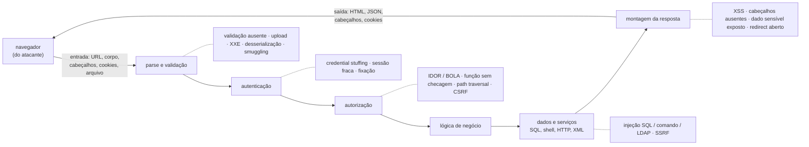

# Ponto 4 — Vulnerabilidades em aplicações web

## Objetivo

Entender as vulnerabilidades de aplicações web como consequências previsíveis de um modelo de execução específico — o navegador executa o que o servidor manda, o servidor recebe o que o navegador manda, e a identidade viaja num token — e não como uma lista de nomes a decorar. Para cada classe: o que ela é, por que o modelo a permite, que princípio de projeto ela viola, qual é a técnica nomeada de defesa e que mecanismo a executa. E entender as taxonomias (OWASP Top 10, CWE Top 25) pelo que são — instrumentos de consciência e priorização — e o ASVS pelo que é: o padrão de requisitos verificáveis.

Referências principais: OWASP Top 10 (2021; edição 2025); MITRE CWE Top 25 (2024); OWASP ASVS 4.0.3 (2021) para requisitos; Zalewski, *The Tangled Web* (2012) para o modelo de segurança do navegador; Stuttard e Pinto, *The Web Application Hacker's Handbook* (2011) para a mecânica dos ataques. Os ataques e defesas nomeados têm fonte própria no corpo do texto.

O ponto 3 terminou com a falha de design mal resolvida. Este ponto começa onde ela vira exploração: a decisão de confiar no identificador que o cliente envia (falha de projeto) é o que o atacante usa quando troca o `id` da conta (vulnerabilidade de controle de acesso). A arquitetura diz qual forma o sistema deve ter; este ponto mostra o que acontece, classe por classe, quando a forma falha na fronteira mais exposta que existe — a do navegador.

---

## 1. Por que a web é diferente — a pergunta que o ponto responde

### Três fatos do modelo de execução

A aplicação web é um programa dividido ao meio por uma fronteira de confiança que o atacante controla. Três fatos decorrem disso e explicam quase toda a lista de vulnerabilidades.

**O servidor recebe o que o cliente quiser mandar.** O navegador é um cliente conveniente, não obrigatório. Qualquer coisa que ele faça — validar um formulário, esconder um botão, montar uma URL — pode ser refeita por um script que fala HTTP diretamente. Tudo que chega ao servidor (parâmetros, cabeçalhos, cookies, corpo, nome de arquivo) é dado hostil até prova em contrário. Validação no cliente é conveniência para o usuário; nunca é controle de segurança.

**O navegador executa o que o servidor manda.** HTML, CSS e JavaScript são código. Se o servidor devolve ao navegador um texto que veio de outro usuário sem marcá-lo como dado, o navegador o interpreta como instrução. É a mesma confusão entre dado e instrução que a injeção de SQL explora no banco, agora no cliente: a classe de falha que o IEEE CSD (2014) chamou de "não separar estritamente dado de instrução de controle".

**A identidade viaja num token, e HTTP não tem memória.** Cada requisição chega sozinha. O servidor só sabe quem está falando porque um cookie ou um cabeçalho carrega uma credencial de sessão. Quem obtém o token é o usuário; quem consegue fazer o navegador do usuário enviar o token numa requisição que ele não quis é o usuário também. Daí vêm sequestro de sessão, fixação de sessão e CSRF.

### O quarto fato: a web é composição

Uma página carrega recursos de dezenas de origens — scripts, fontes, imagens, iframes, chamadas de API. O que impede o script de um site de ler os dados de outro é a *política de mesma origem* (same-origin policy), introduzida no Netscape 2 em 1995 e formalizada por Barth na RFC 6454 (2011): origem é o trio esquema, host e porta, e um documento só lê o que vem da própria origem. Grande parte das vulnerabilidades web "entre sites" (XSS, CSRF, clickjacking, vazamentos entre origens) é a política de mesma origem sendo contornada, relaxada (CORS mal configurado) ou simplesmente não cobrindo o caso (ela controla leitura, não envio — por isso o CSRF existe).

### Exemplo

A aplicação de pagamentos tem uma tela de busca de beneficiários: `GET /beneficiarios?nome=...`. O servidor monta `SELECT * FROM beneficiarios WHERE nome LIKE '%" + nome + "%'`. O nome do beneficiário cadastrado aparece depois na tela de confirmação, inserido no HTML sem codificação. O formulário de transferência é um POST com os campos conta e valor, autenticado por cookie de sessão. Em três telas há três classes: injeção de SQL na busca, XSS armazenado no nome, CSRF na transferência. Nenhuma exige ferramenta sofisticada; cada uma é um dos três fatos do modelo sendo ignorado.

---

## 2. Fundamentos — o que se toma como dado

| Fundamento | Premissa | O que decorre dela |
|---|---|---|
| Toda entrada é hostil | o cliente está do outro lado da fronteira de confiança; o navegador é opcional | validar no servidor, por lista de permissão, em toda entrada — inclusive cabeçalhos e cookies |
| Dado e instrução compartilham o canal | SQL, HTML, comandos e URLs misturam dado do usuário com código do sistema | a defesa é separar os dois por construção (parametrização, codificação por contexto), não por filtragem |
| A identidade é um token que viaja | HTTP é sem estado; a sessão é um segredo portátil | o token é ativo a proteger: confidencialidade, integridade, escopo e expiração |
| A web é composição sob a política de mesma origem | um documento carrega código de muitas origens; o navegador isola por origem, e só o que a política cobre | toda vulnerabilidade entre sites é a política contornada, relaxada ou ausente; a aplicação completa o que o navegador não faz |

### Toda entrada é hostil

A regra do ponto 2 — tudo que cruza a fronteira de confiança vindo do lado de menor confiança precisa ser reverificado — tem na web sua expressão mais pura, porque o lado de menor confiança é um programa que o atacante escreve. Não há "entrada que o usuário não consegue alterar": campos ocultos, cabeçalhos, cookies, o `Referer`, o nome de arquivo de um upload e o próprio método HTTP são escolhas do cliente. A consequência de projeto é que validação é função do servidor, na borda, por lista do que é aceito (formato, tamanho, intervalo, conjunto de valores), e não por lista do que é proibido — padrões à prova de falha (ponto 3) aplicados ao dado.

### Dado e instrução compartilham o canal

Um comando SQL é um texto; um documento HTML é um texto; um comando de shell é um texto. Quando a aplicação monta esse texto concatenando dado do usuário, o interpretador do outro lado não tem como saber onde o dado termina e a instrução começa. Esse é o mecanismo único por trás de injeção de SQL, XSS, injeção de comando, injeção de LDAP, injeção de cabeçalho e *template injection*. A defesa correta não é "filtrar caracteres perigosos" — a lista nunca fecha — e sim usar o canal que o interpretador oferece para separar dado de instrução: parâmetros vinculados na consulta, codificação de saída por contexto no HTML, argumentos em vez de string de comando. Quando o interpretador não oferece esse canal, a resposta é não deixar o dado chegar a ele.

### A identidade é um token que viaja

Depois do login, o servidor entrega ao navegador um identificador de sessão (ou um token assinado), e a partir daí cada requisição que o carrega é tratada como daquele usuário. O token é, portanto, equivalente à senha pelo tempo em que vale. Tudo que vale para a senha vale para ele: não pode vazar (confidencialidade — cookies com `Secure` e `HttpOnly`, TLS), não pode ser forjado (integridade — aleatoriedade suficiente ou assinatura), não pode ser usado para o que o usuário não pediu (escopo — `SameSite`, token anti-CSRF) e precisa expirar (rotação no login, prazo curto, invalidação no logout). O ponto 6 aprofunda autenticação e sessão; aqui basta a premissa.

### A web é composição sob a política de mesma origem

A política de mesma origem é o mecanismo de isolamento do navegador: um script carregado em `https://app.exemplo.com` não lê a resposta de `https://banco.exemplo.com` nem o DOM de um iframe de outra origem (Barth, RFC 6454, 2011; Zalewski, 2012). Mas a política tem limites por desenho: ela não impede *enviar* requisições a outra origem (formulários, imagens, scripts carregam de qualquer lugar), só impede *ler* a resposta. E ela é relaxável: CORS permite que um servidor autorize leituras de outras origens; `postMessage` permite comunicação entre janelas; cookies são enviados por host, não por origem. Cada vulnerabilidade entre sites vive numa dessas lacunas. A aplicação segura é a que sabe o que o navegador não faz por ela e completa com cabeçalhos (CSP, `frame-ancestors`, `SameSite`) e com verificação no servidor.

> **Junta.** Quatro premissas; dezenas de nomes de vulnerabilidade. Antes das classes, uma visão de onde cada uma acontece no caminho de uma requisição.

---

## 3. Overview visual — onde cada classe vive

Leitura: a requisição entra pela borda (validação), passa por quem é (autenticação), pelo que pode (autorização), pela lógica, toca dados e serviços e volta como resposta. Cada classe de vulnerabilidade é a falha de uma dessas estações. A tabela OWASP não segue essa ordem — segue frequência e impacto — mas a dissertação ganha organização se seguir o caminho da requisição.

---

## 4. Taxonomias — o que cada lista é e o que não é

### OWASP Top 10

O *Open Worldwide Application Security Project* publica desde 2003 uma lista das dez categorias de risco mais relevantes em aplicações web, com base em dados de ferramentas e pesquisa com profissionais. A edição de 2021 é a referência estável:

| 2021 | Categoria | O que cobre |
|---|---|---|
| A01 | Controle de acesso quebrado | IDOR, elevação, CORS permissivo, path traversal, falta de checagem por função |
| A02 | Falhas criptográficas | dado sensível em claro, algoritmo fraco, chave mal gerida, TLS ausente |
| A03 | Injeção | SQL, NoSQL, comando, LDAP, e — desde 2021 — XSS |
| A04 | Design inseguro | falha de projeto (ponto 3): ausência de modelagem de ameaças e de padrões seguros |
| A05 | Configuração insegura | padrão de fábrica, erro verboso, cabeçalhos ausentes, XXE (absorvido aqui) |
| A06 | Componentes vulneráveis e desatualizados | dependência com CVE conhecido (ponto 8) |
| A07 | Falhas de identificação e autenticação | credential stuffing, senha fraca, sessão sem expiração, fixação |
| A08 | Falhas de integridade de software e dados | desserialização insegura, atualização sem verificação, pipeline sem integridade |
| A09 | Falhas de registro e monitoramento | ataque não detectado por falta de log |
| A10 | Falsificação de requisição do lado do servidor (SSRF) | o servidor faz requisições a URLs que o usuário controla |

A edição de 2025 (candidata a lançamento publicada em novembro de 2025) reordena e renomeia: controle de acesso quebrado permanece em primeiro e absorve a SSRF; configuração insegura sobe para segundo; falhas na cadeia de suprimentos de software substituem "componentes vulneráveis" e sobem para terceiro; entra uma categoria nova, tratamento inadequado de condições excepcionais (falhas de erro e de *fail-open*). O movimento confirma duas teses deste laboratório: a cadeia de suprimentos virou classe de primeira linha (ponto 8), e *fail secure* (ponto 3) é vulnerabilidade quando ausente.

**O que o Top 10 é.** Instrumento de consciência e de priorização: diz para onde olhar primeiro. **O que não é.** Não é padrão de requisitos nem lista completa — a própria OWASP diz isso na introdução e aponta o ASVS para quem precisa de requisitos. Dissertação que trata o Top 10 como "a norma" erra a natureza do documento.

### CWE Top 25

O MITRE mantém a *Common Weakness Enumeration*, catálogo de tipos de fraqueza de software (CWE-79 é XSS; CWE-89, injeção de SQL; CWE-352, CSRF; CWE-22, path traversal; CWE-918, SSRF; CWE-502, desserialização insegura; CWE-862, autorização ausente). A lista anual CWE Top 25 ordena as fraquezas mais perigosas pelos CVEs do período. Na edição de 2024, as cinco primeiras são XSS, escrita fora dos limites, injeção de SQL, CSRF e path traversal — três delas web. O CWE é o vocabulário preciso: quando a dissertação diz "XSS", o nome formal é CWE-79, e o Top 25 dá a evidência de frequência.

### OWASP ASVS

O *Application Security Verification Standard* é o padrão de requisitos. A versão 4.0.3 (2021) organiza cerca de 280 requisitos em 14 capítulos (arquitetura, autenticação, sessão, controle de acesso, validação e codificação, criptografia, erros e logs, dados, comunicação, código malicioso, lógica de negócio, arquivos, API, configuração) em três níveis de garantia: L1 para toda aplicação, L2 para as que tratam dado sensível, L3 para as críticas. A versão 5.0 (2025) reorganiza os capítulos e separa requisitos de documentação dos de verificação. O ASVS é o que vira critério de aceite no backlog e roteiro de teste; o WSTG (*Web Security Testing Guide*, 4.2, 2020) é o roteiro de como testar cada requisito.

> **Junta.** As listas dizem o que é frequente. Falta o que importa na prova: o mecanismo de cada classe, o princípio violado, a defesa nomeada.

---

## 5. As classes de vulnerabilidade

Para cada classe: o que é, como acontece, o princípio de projeto violado, a técnica de defesa com fonte, o mecanismo que a executa e como se prova. A ordem segue o caminho da requisição da seção 3.

### Validação de entrada ausente ou por lista de bloqueio

**O que é.** A aplicação aceita dado fora do formato, tamanho ou conjunto esperado, e o dado chega a um componente que não foi projetado para ele.

**Como acontece.** Campo numérico aceito como texto; tamanho sem limite (negação de serviço por memória); upload sem verificação de tipo real; caminho de arquivo montado com entrada do usuário (`../../etc/passwd` — path traversal, CWE-22); XML com entidades externas (XXE), em que o parser resolve `<!ENTITY x SYSTEM "file:///etc/passwd">`; desserialização de objeto vindo do cliente (CWE-502), em que o grafo de objetos desserializado executa código — Frohoff e Lawrence (2015) mostraram cadeias de *gadgets* em bibliotecas Java comuns.

**Princípio violado.** Toda entrada é hostil; padrões à prova de falha (aceitar só o permitido).

**Técnica.** Validação por lista de permissão na borda: tipo, formato, tamanho, intervalo e conjunto de valores definidos positivamente (ASVS V5). Para arquivos, verificar tipo pelo conteúdo, renomear, armazenar fora da raiz web. Para XML, desabilitar resolução de entidades externas e DTD. Para desserialização, não desserializar formato nativo vindo do cliente — usar formato de dados (JSON) com esquema.

**Mecanismo.** Biblioteca de validação com esquema declarativo; limites de tamanho no servidor web e na aplicação; parser XML configurado com entidades desligadas; alocação de nome de arquivo pelo servidor; *canonicalização* do caminho antes de verificar o prefixo permitido.

**Prova.** Teste negativo por campo: valor fora do formato é rejeitado com erro controlado; `..` em caminho não sai do diretório; XML com entidade externa é rejeitado.

### Injeção

**O que é.** Dado do usuário é interpretado como instrução por um interpretador — SQL, shell, LDAP, XPath, motor de template, cabeçalho HTTP. CWE-89 (SQL), CWE-78 (comando de sistema), CWE-90 (LDAP), CWE-1336 (template).

**Como acontece.** `"... WHERE id = " + id`: com `id = 1 OR 1=1`, a consulta devolve tudo; com `1; DROP TABLE ...`, destrói; com `1 UNION SELECT senha FROM usuarios`, exfiltra. Halfond, Viegas e Orso (2006) classificaram os ataques de injeção de SQL — tautologias, *union*, *piggy-backed*, inferência cega por tempo ou erro — e as contramedidas. A injeção cega (sem saída visível) extrai dados bit a bit por diferença de tempo ou de comportamento. Injeção de comando é o mesmo padrão com `;` ou `|` numa chamada de shell montada com entrada.

**Princípio violado.** Dado e instrução compartilham o canal; separar dado de instrução (IEEE CSD, 2014, falha 4).

**Técnica.** Separação por construção: consultas parametrizadas (*prepared statements*), em que o dado é vinculado como valor e nunca entra no texto da consulta; ORM usado pelo caminho que parametriza; para comandos, chamada com vetor de argumentos e sem shell; para LDAP e XPath, codificação específica do interpretador (OWASP Cheat Sheets). Defesa em profundidade: a conta de banco da aplicação sem permissão para o que ela não faz (menor privilégio, ponto 3) — a injeção que entra lê o que pode, não apaga o que não pode.

**Mecanismo.** `PreparedStatement`, placeholders do driver, consultas do ORM sem interpolação; `execve` com argumentos em vez de `system()`; conta de banco somente-leitura para o serviço que só lê; procedimento armazenado com parâmetros; e, como camada extra — nunca como correção — WAF com assinaturas de injeção.

**Prova.** Teste com `' OR '1'='1` e com `'; --` em cada parâmetro que alcança o banco; revisão de código buscando concatenação em consultas; SAST com regra de fluxo de dado (ponto 7).

**O erro comum.** "Escapar aspas" não é parametrizar: depende de conjunto de caracteres, codificação e tipo de campo; falha em campos numéricos e em `LIKE`. Parametrizar é a técnica; escapar é o remendo.

### Cross-site scripting (XSS)

**O que é.** Dado controlado pelo atacante é entregue ao navegador de outro usuário e interpretado como script na origem da aplicação. CWE-79; primeiro no CWE Top 25 de 2024. Com o script executando na origem, o atacante lê o DOM, chama a API com a sessão da vítima, rouba o token se ele estiver acessível e redesenha a página.

**Como acontece.** Três variantes. *Refletido*: a entrada de uma requisição volta na resposta da mesma requisição (`?busca=<script>...`), entregue à vítima por link. *Armazenado*: a entrada é gravada (nome de beneficiário, comentário) e servida a todos que veem a página. *Baseado em DOM* (Klein, 2005): o servidor não participa — o JavaScript da página lê um valor de `location.hash` ou de `document.referrer` e o escreve no DOM com `innerHTML`.

**Princípio violado.** Dado e instrução compartilham o canal; o navegador executa o que o servidor manda.

**Técnica.** Codificação de saída por contexto (OWASP XSS Prevention Cheat Sheet): o mesmo dado precisa de codificação diferente no corpo HTML (`&lt;`), em atributo (aspas e `&quot;`), em JavaScript (`\x3c`), em URL (percentual) e em CSS — e em alguns contextos (atributo de evento, `href` com `javascript:`) nenhuma codificação torna o dado seguro: o dado não pode ir ali. Em segunda camada, *Content Security Policy* (Stamm, Sterne e Markham, 2010; W3C CSP nível 3): o servidor declara de que origens scripts podem vir e proíbe script inline, de modo que o script injetado não executa mesmo que a codificação falhe. Para XSS de DOM, APIs que não interpretam HTML (`textContent` em vez de `innerHTML`) e *Trusted Types*.

**Mecanismo.** Motor de template com escape automático por contexto (o padrão nos frameworks modernos — o risco mora nas exceções: `raw`, `dangerouslySetInnerHTML`, `v-html`); cabeçalho `Content-Security-Policy` com `script-src` por origem ou *nonce* e sem `unsafe-inline`; cookie de sessão `HttpOnly` (o script não lê, embora ainda use); sanitizador de HTML (DOMPurify) quando HTML do usuário é requisito.

**Prova.** Inserir `` em cada campo que volta à tela, em cada contexto; verificar a CSP com relatório (`report-to`) em modo *report-only* antes de bloquear.

**O erro comum.** Tratar XSS como problema de entrada. Validar entrada ajuda, mas o contexto de saída é que decide a codificação, e o mesmo dado sai em contextos diferentes. XSS é defeito de saída.

### Cross-site request forgery (CSRF)

**O que é.** O atacante faz o navegador da vítima enviar uma requisição autenticada que a vítima não quis — porque o navegador anexa o cookie de sessão a toda requisição ao site, inclusive às que partem de outra origem. CWE-352; quarto no CWE Top 25 de 2024.

**Como acontece.** A vítima está logada no banco. Visita uma página do atacante com `<form action="https://banco/transferir" method="POST">` e um script que submete o formulário. O navegador envia o cookie; o servidor vê uma transferência autenticada. A política de mesma origem não impede: ela bloqueia *ler* a resposta, não *enviar* a requisição.

**Princípio violado.** A identidade é um token que viaja — sem escopo de origem; mediação completa (o servidor não verificou que a intenção veio da própria aplicação).

**Técnica.** Barth, Jackson e Mitchell (2008) analisaram as defesas: o *token sincronizador* (um valor secreto, por sessão ou por formulário, incluído no corpo da requisição e verificado no servidor — o site do atacante não consegue lê-lo por causa da mesma origem) e a verificação do cabeçalho `Origin` (ou `Referer`) contra a origem esperada. A partir de 2016, o atributo de cookie `SameSite` (West e Wilander, revisão da RFC 6265) faz o navegador não enviar o cookie em requisições iniciadas por outro site: `Strict` nunca; `Lax` só em navegação de nível superior por GET. Chrome adotou `Lax` como padrão em 2020.

**Mecanismo.** Token anti-CSRF gerado pelo framework e verificado em todo POST/PUT/DELETE; cookie de sessão com `SameSite=Lax` ou `Strict`; verificação de `Origin` em APIs; para APIs com token no cabeçalho `Authorization` (não em cookie), o CSRF não se aplica, porque o navegador não anexa o cabeçalho sozinho.

**Prova.** Formulário em outra origem que submete contra o endpoint: deve falhar; requisição sem o token: 403; GET nunca muda estado.

**O erro comum.** "SameSite resolveu o CSRF." `Lax` ainda envia o cookie em GET de navegação; navegadores antigos ignoram o atributo; subdomínios comprometidos são o mesmo site. O token continua sendo a defesa primária; `SameSite` é profundidade.

### Controle de acesso quebrado

**O que é.** O usuário autenticado acessa recurso ou função que não lhe pertence. Primeiro no OWASP Top 10 de 2021 e de 2025. CWE-862 (autorização ausente), CWE-863 (autorização incorreta), CWE-639 (referência direta a objeto — IDOR).

**Como acontece.** *Referência direta insegura a objeto* (IDOR; na terminologia de API, BOLA — *broken object level authorization*): `GET /contas/1234/saldo` funciona para qualquer `id` porque o servidor só checou que há sessão, não que a conta é daquele usuário. *Falta de checagem por função*: a URL de administração é "escondida", mas atende quem a chamar. *Elevação horizontal e vertical*: alterar um parâmetro `papel=admin` que o servidor aceita do cliente. *Path traversal* e CORS permissivo (`Access-Control-Allow-Origin: *` com credenciais) são casos da mesma família.

**Princípio violado.** Mediação completa (ponto 3); "autorize depois de autenticar" (IEEE CSD, 2014); toda entrada é hostil (o `id` é entrada).

**Técnica.** Autorização no servidor, por requisição, por objeto: carregar o recurso e verificar que o sujeito autenticado tem o direito sobre *aquele* recurso, num ponto único (*Check Point*, ponto 3). Negar por padrão: rota sem regra explícita não atende. Referências indiretas (identificadores não sequenciais ou mapeados por sessão) reduzem a enumeração, mas não substituem a checagem. ASVS V4 é o conjunto de requisitos.

**Mecanismo.** Middleware de autorização que recebe sujeito, ação e recurso; políticas declarativas (RBAC/ABAC; motor como OPA ou Cedar); escopo de tenant aplicado na consulta (`WHERE conta.dono = :sujeito`), não depois; identificadores aleatórios (UUID) como camada extra; CORS com lista explícita de origens.

**Prova.** Matriz de autorização: para cada papel e cada recurso de outro usuário, a resposta esperada é 403 ou 404; teste automatizado que troca o `id` em todo endpoint; revisão de que nenhum endpoint novo nasce sem regra.

### Falhas de autenticação e sessão

**O que é.** O atacante se passa por outro usuário sem explorar nenhuma das classes anteriores: adivinha a senha, reusa senha vazada, rouba ou fixa a sessão. A07 em 2021; CWE-287, CWE-384 (fixação de sessão), CWE-613 (expiração insuficiente).

**Como acontece.** *Credential stuffing*: listas de senhas vazadas em outros sites testadas em massa. *Força bruta* sem limite de tentativas. *Fixação de sessão*: o atacante entrega à vítima um identificador de sessão que ele conhece; a vítima loga; o identificador continua válido e o atacante o usa. *Sequestro*: o identificador vaza por XSS, por URL, por rede sem TLS. *Expiração ausente*: sessão vale para sempre; logout não invalida no servidor.

**Princípio violado.** A identidade é um token que viaja; fator de trabalho (ponto 3).

**Técnica.** NIST SP 800-63B (2017): senha verificada contra listas de senhas comprometidas, sem regras de composição arbitrárias nem troca periódica; limitação de tentativas; MFA para o que importa. Para sessão: identificador gerado com aleatoriedade criptográfica, *rotacionado no login* (mata a fixação), transportado só em cookie `Secure` + `HttpOnly` + `SameSite`, com expiração absoluta e por inatividade, invalidado no servidor no logout. Senhas armazenadas com função de derivação lenta e salgada (bcrypt, scrypt, Argon2). O ponto 6 detalha OAuth 2.0, OIDC e os protocolos.

**Mecanismo.** Gerenciador de sessão do framework com rotação; cofre de senhas com Argon2id; limitador de taxa por conta e por IP; verificação contra lista de senhas vazadas (k-anonimato do *Have I Been Pwned*); MFA (TOTP, chave FIDO2/passkey).

**Prova.** Login fixa um identificador novo; sessão expira; logout invalida; cem tentativas erradas bloqueiam; senha "123456" é rejeitada por constar na lista.

### Falsificação de requisição do lado do servidor (SSRF)

**O que é.** A aplicação faz uma requisição HTTP a uma URL que o usuário controla, e o atacante a usa para alcançar o que só o servidor alcança: serviços internos, o endpoint de metadados da nuvem (`169.254.169.254`), portas em `localhost`. A10 em 2021; CWE-918.

**Como acontece.** Campo "URL do webhook", "importar imagem por URL", "buscar pré-visualização de link": o servidor busca a URL e devolve ou processa o resultado. O atacante aponta para a rede interna. O caso Capital One (2019) combinou SSRF com credenciais do serviço de metadados.

**Princípio violado.** Toda entrada é hostil (a URL é entrada); menor privilégio (o servidor alcança demais); menor mecanismo comum (a rede interna compartilhada).

**Técnica.** Lista de permissão de destinos (host, esquema, porta) resolvida *depois* da resolução de DNS e sem seguir redirecionamentos para fora da lista; bloqueio de faixas internas e de *link-local*; isolamento de rede do componente que faz requisições externas; metadados da nuvem com autenticação (IMDSv2).

**Mecanismo.** Cliente HTTP configurado com lista de hosts, sem redirecionamento automático, com resolução controlada; regras de saída de rede (egress) que negam faixas internas; proxy de saída dedicado; IMDSv2 obrigatório.

**Prova.** URL apontando para `http://169.254.169.254/` e para `http://localhost:` em cada campo que o servidor busca: deve ser rejeitada antes da conexão.

### Configuração insegura e cabeçalhos ausentes

**O que é.** O sistema está correto e está exposto por configuração: credencial padrão, listagem de diretório, erro com *stack trace*, recurso de depuração ligado em produção, TLS fraco, cabeçalhos de proteção ausentes. A05 em 2021, A02 em 2025.

**Como acontece.** O que não foi fechado fica aberto: a premissa de padrões à prova de falha (ponto 3) invertida pela ferramenta ou pelo time.

**Técnica.** Seguro por padrão (Howard e Lipner, 2006) aplicado à plataforma: configuração versionada e revisada; *hardening* por lista do que fica aberto; cabeçalhos de segurança como parte do contrato da aplicação. Os cabeçalhos que importam: `Strict-Transport-Security` (HSTS, RFC 6797, 2012 — o navegador só fala TLS com o host), `Content-Security-Policy`, `X-Content-Type-Options: nosniff` (o navegador não adivinha tipo), `X-Frame-Options` e `frame-ancestors` (contra *clickjacking* — a página carregada num iframe invisível sobre um botão falso), `Referrer-Policy`, e atributos de cookie.

**Mecanismo.** Infraestrutura como código com revisão; imagem base mínima; variáveis de ambiente por ambiente, sem valor padrão de produção; scanner de configuração; middleware de cabeçalhos; TLS 1.2+ com conjuntos de cifras atuais e certificado automatizado.

**Prova.** Varredura de cabeçalhos; teste de erro forçado sem detalhes internos; nenhuma credencial padrão aceita; DAST de configuração (ponto 7).

### Falhas criptográficas e exposição de dado sensível

**O que é.** Dado que precisava de proteção viaja ou repousa sem ela, ou com proteção que não protege. A02 em 2021.

**Como acontece.** Senha em texto claro ou com MD5 sem sal; cartão armazenado inteiro; TLS opcional ou com cifra obsoleta; chave no repositório; criptografia própria; dado sensível em log, em URL (fica no histórico e no `Referer`) ou em mensagem de erro.

**Princípio violado.** Desenho aberto (cripto própria); menor privilégio (quem lê a chave); identificar dado sensível e como tratá-lo (IEEE CSD, 2014, falha 7).

**Técnica.** Classificação do dado (o ativo do ponto 1) decide o controle: o que não é necessário não se guarda; o que se guarda, cifra-se em repouso com chave gerida fora da aplicação; tudo viaja por TLS; senha com função de derivação; dado sensível nunca em URL, log ou erro. Primitivas e bibliotecas padrão, nunca implementação própria.

**Mecanismo.** TLS obrigatório com HSTS; cofre de chaves (KMS) com rotação; Argon2id para senhas; tokenização de cartão por provedor certificado; mascaramento no log; `Cache-Control: no-store` em resposta sensível.

**Prova.** Varredura de segredos no repositório; inspeção de log com dado de teste identificável; teste de TLS; verificação de que senha não é recuperável do banco.

### Integridade de software e dados, e componentes vulneráveis

**O que é.** A aplicação confia em código ou dado cuja integridade não verificou: dependência com CVE (A06 em 2021; cadeia de suprimentos, A03 em 2025), atualização baixada sem assinatura, pipeline de CI que executa o que um pull request manda, objeto desserializado do cliente (A08).

**Princípio violado.** Entender como integrar componentes externos muda a superfície (IEEE CSD, 2014, falha 9); toda entrada é hostil — inclusive a que vem do registro de pacotes.

**Técnica.** Análise de composição de software (SCA) com inventário (SBOM) e política de atualização; fixação de versões e verificação de integridade (*lockfile*, *hash*); *Subresource Integrity* para scripts de terceiros no navegador (atributo `integrity`); assinatura de artefatos. O ponto 8 aprofunda; aqui basta que a aplicação web traz para dentro da origem todo script que carrega — o script de terceiros comprometido é XSS com convite.

**Mecanismo.** SCA no pipeline; `lockfile` versionado; SRI em `<script>` externo; CSP restringindo origens de script; verificação de assinatura na atualização.

### Registro e monitoramento ausentes

**O que é.** O ataque acontece e ninguém vê, porque a aplicação não registra o que importa ou registra sem integridade. A09 em 2021. É o "registro de comprometimento" de Saltzer e Schroeder (ponto 3) e o R do STRIDE (ponto 2) vistos pela ausência.

**Técnica.** Registrar eventos de segurança (login, falha de login, mudança de permissão, acesso negado, operação sensível) com identificador do sujeito, timestamp confiável e sem dado sensível; log centralizado e protegido contra alteração; alerta para padrões (muitas falhas de login, muitos 403). O ponto 10 cobre a resposta.

**Mecanismo.** Logger estruturado; envio para coletor central; retenção definida; alertas; trilha de auditoria só-anexa.

> **Junta.** As classes foram descritas uma a uma. Há um conjunto de defesas que não pertence a nenhuma classe: é a plataforma do navegador, e a aplicação precisa saber usá-la.

---

## 6. Defesas da plataforma — o que o navegador oferece

| Mecanismo | O que faz | Contra o quê | Fonte |
|---|---|---|---|
| Política de mesma origem | isola leitura de DOM e respostas por origem (esquema, host, porta) | vazamento entre sites | Netscape 1995; Barth, RFC 6454 (2011) |
| CORS | relaxa a mesma origem para leitura, por cabeçalho do servidor | — (é relaxamento; mal configurado vira falha de acesso) | W3C Fetch |
| Content Security Policy | lista de origens permitidas por tipo de recurso; proíbe script inline | XSS (segunda camada), injeção de recurso, clickjacking (`frame-ancestors`) | Stamm, Sterne e Markham (2010); W3C CSP 3 |
| Atributos de cookie | `Secure` (só TLS), `HttpOnly` (sem acesso por script), `SameSite` (sem envio entre sites) | sequestro de sessão, CSRF | RFC 6265 (2011); revisão com SameSite |
| HSTS | navegador só fala TLS com o host, inclusive no primeiro acesso se pré-carregado | downgrade, interceptação | RFC 6797 (2012) |
| `X-Content-Type-Options: nosniff` | navegador não adivinha tipo de conteúdo | XSS por arquivo interpretado como HTML | — |
| `X-Frame-Options` / `frame-ancestors` | impede carregar a página em iframe de outra origem | clickjacking | RFC 7034 (2013); CSP 2 |
| Subresource Integrity | verifica hash de script e estilo externos | terceiro comprometido | W3C SRI (2016) |
| Trusted Types | obriga que valores atribuídos a `innerHTML` e similares passem por política | XSS de DOM | W3C (rascunho) |

O que a tabela mostra: o navegador oferece isolamento, mas só o que a aplicação declara. Um servidor que não envia CSP, não marca cookies e não exige TLS está usando a plataforma em modo aberto — padrões à prova de falha invertidos.

> **Junta.** Classes e plataforma, aplicadas ao mesmo sistema dos pontos 2 e 3.

---

## 7. Exemplo guiado — a mesma aplicação de pagamentos

Sistema: front-end web e aplicativo móvel, API de pagamentos, banco, antifraude do parceiro, fila de notificações, configuração de webhook pelo cliente. Cada classe, no lugar onde ela viveria, com a defesa nomeada.

**Busca de beneficiários (injeção de SQL).** A consulta passa a usar parâmetro vinculado; o ORM é usado pelo caminho parametrizado e a revisão de código proíbe interpolação. A conta de banco do serviço de consulta é somente-leitura (profundidade). Teste: `' OR '1'='1` devolve lista vazia, não tudo.

**Nome do beneficiário na confirmação (XSS armazenado).** O template escapa por contexto; o nome entra em corpo HTML como texto, nunca em atributo de evento. CSP com `script-src 'self' 'nonce-…'` e sem `unsafe-inline`, primeiro em `report-only`, depois aplicada. Cookie de sessão `HttpOnly`. Teste: `` aparece como texto; o relatório da CSP fica vazio.

**Formulário de transferência (CSRF).** Token sincronizador por sessão em todo POST; cookie `SameSite=Lax`; verificação de `Origin` na API. Teste: formulário hospedado em outra origem recebe 403.

**`GET /contas/{id}/saldo` (IDOR).** O middleware do ponto 3 carrega a conta e confere o dono contra o sujeito do token em toda rota; a consulta já filtra por dono; identificadores viram UUID. Teste: matriz de autorização com dois clientes; conta do outro → 404.

**Login (autenticação e sessão).** Senha verificada contra lista de vazadas, Argon2id no armazenamento, limite de tentativas, identificador de sessão rotacionado no login, expiração em 30 minutos de inatividade, MFA para transferência acima do limite. Teste: fixação falha; cem tentativas bloqueiam.

**Configuração de webhook (SSRF).** A URL só é aceita se o host resolver para endereço público, com esquema `https`, sem redirecionamento; o componente que chama webhooks roda em rede sem rota para a interna; IMDSv2 obrigatório. Teste: `http://169.254.169.254/` rejeitado antes de conectar.

**Upload de comprovante (validação).** Tipo verificado pelo conteúdo, tamanho limitado, nome gerado pelo servidor, armazenamento fora da raiz web, servido com `nosniff` e `Content-Disposition: attachment`. Teste: arquivo HTML renomeado para `.pdf` é rejeitado; se aceito, nunca é interpretado.

**Cabeçalhos e TLS (configuração).** HSTS com pré-carga, CSP, `nosniff`, `frame-ancestors 'none'`, `Referrer-Policy`, cookies `Secure`. TLS 1.2+ e certificado automatizado. Erro em produção sem *stack trace*. Teste: varredura de cabeçalhos no pipeline.

**Scripts de terceiros (integridade).** Script do antifraude carregado com SRI e restrito por CSP; dependências com SCA e `lockfile`. Teste: hash alterado → script não carrega.

**Log (monitoramento).** Falha de login, acesso negado, transferência e mudança de webhook registrados com sujeito e timestamp, sem dado de cartão; alerta para rajada de 403 e de falhas de login.

O que o exemplo mostra: as classes não são independentes. A sessão `HttpOnly` limita o XSS; o XSS que sobra é limitado pela CSP; o CSRF é limitado pelo token e pelo `SameSite`; a IDOR é limitada pelo mesmo middleware que o ponto 3 pediu. Defesa em profundidade é isso: cada camada reduz o que a anterior deixou passar.

---

## 8. Erros frequentes — o que não confundir

| Confusão | Por que está errado | Como dizer certo |
|---|---|---|
| "O Top 10 é o padrão de segurança web" | é instrumento de consciência; o padrão de requisitos é o ASVS | "Top 10 para priorizar; ASVS para exigir e verificar" |
| "Validar entrada resolve XSS" | XSS é defeito de saída; o contexto de saída decide a codificação | "codificação de saída por contexto, com CSP como segunda camada" |
| "Escapar aspas resolve injeção de SQL" | escapar depende de charset e tipo; falha em numérico e em `LIKE` | "consulta parametrizada; o dado nunca entra no texto da consulta" |
| "WAF corrige a vulnerabilidade" | WAF filtra padrões conhecidos; a falha continua lá | "WAF é profundidade e ganho de tempo; a correção é no código" |
| "SameSite acabou com o CSRF" | `Lax` ainda envia em GET de navegação; subdomínio é mesmo site | "token sincronizador como primária; SameSite como profundidade" |
| "HTTPS protege contra XSS/injeção" | TLS protege o canal, não o conteúdo | "TLS contra interceptação; codificação e parametrização contra injeção" |
| "A política de mesma origem impede CSRF" | ela bloqueia ler a resposta, não enviar a requisição | "mesma origem controla leitura; CSRF é sobre envio" |
| "Esconder a URL de admin basta" | segurança por obscuridade; a função atende quem chamar | "checagem de autorização por função e por objeto, no servidor" |
| "Sanitizar HTML e escapar HTML são a mesma coisa" | sanitizar mantém HTML permitido; escapar transforma tudo em texto | "escapar quando é texto; sanitizar só quando HTML do usuário é requisito" |

---

## 9. Síntese

| Classe | Estação da requisição | Princípio violado | Técnica de defesa (fonte) | Mecanismo |
|---|---|---|---|---|
| Validação ausente, upload, XXE, desserialização | parse e validação | toda entrada é hostil; padrões à prova de falha | lista de permissão na borda (ASVS V5); entidades externas desligadas; sem desserialização nativa do cliente (Frohoff e Lawrence, 2015) | esquema de validação, limites, parser configurado, nome gerado pelo servidor |
| Injeção (SQL, comando, LDAP) | dados e serviços | separar dado de instrução | consulta parametrizada; classificação de Halfond, Viegas e Orso (2006); menor privilégio no banco | prepared statements, ORM, `execve` com argumentos, conta só-leitura |
| XSS (refletido, armazenado, DOM) | montagem da resposta | separar dado de instrução; navegador executa o que recebe | codificação de saída por contexto (OWASP); CSP (Stamm et al., 2010); DOM XSS (Klein, 2005) | template com escape automático, CSP com nonce, `HttpOnly`, Trusted Types |
| CSRF | autorização (intenção) | identidade é token que viaja | token sincronizador e `Origin` (Barth, Jackson e Mitchell, 2008); `SameSite` | token do framework, cookie `SameSite`, verificação de `Origin` |
| Controle de acesso quebrado (IDOR/BOLA, função, traversal, CORS) | autorização | mediação completa; autorizar depois de autenticar | checagem por objeto e por função no servidor, negar por padrão (ASVS V4); Check Point (ponto 3) | middleware de authz, filtro por dono na consulta, OPA/Cedar, UUID, CORS explícito |
| Autenticação e sessão | autenticação | identidade é token; fator de trabalho | NIST SP 800-63B; rotação de sessão; derivação lenta de senha | Argon2id, limitador, lista de vazadas, cookie `Secure`/`HttpOnly`/`SameSite`, MFA |
| SSRF | dados e serviços | toda entrada é hostil; menor privilégio de rede | lista de destinos pós-DNS, sem redirecionamento; egress restrito; IMDSv2 | cliente HTTP configurado, regras de saída, proxy dedicado |
| Configuração e cabeçalhos | plataforma | seguro por padrão | hardening versionado; HSTS (RFC 6797); CSP; `nosniff`; `frame-ancestors` | IaC revisada, middleware de cabeçalhos, TLS 1.2+ |
| Criptografia e dado sensível | dados, resposta | desenho aberto; classificar dado sensível | classificação → controle; cripto padrão; nada sensível em URL/log | KMS, Argon2id, tokenização, mascaramento |
| Integridade e componentes | plataforma, pipeline | terceiros mudam a superfície | SCA + SBOM; SRI; assinatura (ponto 8) | lockfile, `integrity`, CSP de script, verificação de assinatura |
| Registro e monitoramento | transversal | registro de comprometimento | eventos de segurança com sujeito e tempo; log íntegro central (ponto 10) | logger estruturado, coletor, alertas |

A cadeia em uma linha: fato do modelo (fundamento) → princípio que ele exige → classe que aparece quando o princípio falha → técnica nomeada → mecanismo → teste. Vulnerabilidade web não é lista: é o que sobra quando a arquitetura do ponto 3 encontra a fronteira do navegador.

---

## Referências

- **OWASP. *OWASP Top 10: 2021*** — dez categorias de risco; A01 controle de acesso, A03 injeção (inclui XSS), A10 SSRF; introdução distingue consciência de padrão
- **OWASP. *OWASP Top 10: 2025* (candidata a lançamento, novembro de 2025)** — reordenação: configuração em A02, cadeia de suprimentos em A03, SSRF absorvida pelo controle de acesso, nova categoria de tratamento de condições excepcionais
- **MITRE. *CWE Top 25 Most Dangerous Software Weaknesses*, 2024** — XSS (CWE-79) em primeiro; injeção de SQL (CWE-89), CSRF (CWE-352), path traversal (CWE-22) entre as cinco primeiras
- **OWASP. *Application Security Verification Standard* 4.0.3, 2021; 5.0, 2025** — padrão de requisitos verificáveis em três níveis; V4 controle de acesso, V5 validação e codificação
- **OWASP. *Web Security Testing Guide* 4.2, 2020** — roteiro de teste por classe
- **OWASP Cheat Sheet Series** — *Cross Site Scripting Prevention*, *SQL Injection Prevention*, *Cross-Site Request Forgery Prevention*, *Server-Side Request Forgery Prevention*
- **Halfond, William; Viegas, Jeremy; Orso, Alessandro. "A Classification of SQL Injection Attacks and Countermeasures". *ISSSE*, 2006** — tautologia, union, piggy-backed, inferência; contramedidas
- **Klein, Amit. "DOM Based Cross Site Scripting or XSS of the Third Kind". 2005** — a terceira variante, sem participação do servidor
- **Stamm, Sid; Sterne, Brandon; Markham, Gervase. "Reining in the Web with Content Security Policy". *WWW*, 2010** — origem da CSP; W3C *Content Security Policy Level 3*
- **Barth, Adam; Jackson, Collin; Mitchell, John. "Robust Defenses for Cross-Site Request Forgery". *CCS*, 2008** — análise do token sincronizador e do cabeçalho `Origin`
- **Barth, Adam. RFC 6454, *The Web Origin Concept*, 2011** — definição formal de origem e da política de mesma origem
- **Barth, Adam. RFC 6265, *HTTP State Management Mechanism*, 2011; revisão (rfc6265bis, West e Wilander) com o atributo `SameSite`**
- **Hodges, Jeff; Jackson, Collin; Barth, Adam. RFC 6797, *HTTP Strict Transport Security*, 2012**
- **Frohoff, Chris; Lawrence, Gabriel. "Marshalling Pickles". *AppSec California*, 2015** — cadeias de gadgets em desserialização Java
- **NIST SP 800-63B. *Digital Identity Guidelines: Authentication and Lifecycle Management*, 2017** — senhas contra listas de vazadas, sem composição nem troca periódica; limitação de tentativas; MFA
- **IEEE Computer Society Center for Secure Design. *Avoiding the Top 10 Software Security Design Flaws*, 2014** — falhas 4 (dado × instrução), 5 (validação explícita), 7 (dado sensível), 9 (componentes externos)
- **Zalewski, Michal. *The Tangled Web: A Guide to Securing Modern Web Applications*. No Starch Press, 2012** — modelo de segurança do navegador: origem, cookies, scripts, isolamento
- **Stuttard, Dafydd; Pinto, Marcus. *The Web Application Hacker's Handbook*, 2ª ed. Wiley, 2011** — mecânica dos ataques por classe
- **Howard, Michael; Lipner, Steve. *The Security Development Lifecycle*. Microsoft Press, 2006** — seguro por padrão aplicado à configuração
