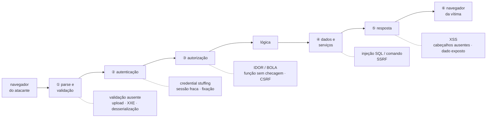

# Dissertação-modelo — Vulnerabilidades em aplicações web

> Texto corrido, no registro de uma dissertação, com cerca de dez páginas à mão. Três fontes nomeadas, um caso construído por molde (real opcional), um exemplo que atravessa o texto. **[+]** marca onde alongar; **[−]** marca o que cortar primeiro.

## Esqueleto — o que você anota em 5 minutos antes de escrever

- **Seções, na ordem:** Introdução → Quatro fatos do modelo → Taxonomias → Injeção → Cross-site scripting → Falsificação de requisição entre sítios → Controle de acesso quebrado → As demais classes → O que a plataforma oferece → Exemplo → Um caso real → O que não confundir → Conclusão
- **Figura 1:** O caminho da requisição e onde cada classe de vulnerabilidade vive.
- **Caso:** hipotético pelo molde de cinco lacunas; o elo que falha: um dado do usuário devolvido ao navegador como se fosse instrução, somado a um cookie que viaja sem escopo de intenção. (Real, se lembrar: British Airways e o Magecart, 2018.)
- **Três fontes:** OWASP Top 10 (2021; 2025) e OWASP ASVS — consciência e padrão; Barth, Jackson e Mitchell, *Robust Defenses for Cross-Site Request Forgery* (2008).
- **Exemplo:** a API de pagamentos (aplicativo, gateway, contas, transferências, banco, fila, parceiro).
- **Desfecho começa com:** "Em síntese, as vulnerabilidades em aplicações web não são uma lista de nomes, e sim consequências de uma cadeia."

## 1. Introdução — um programa dividido ao meio

Uma aplicação web é um programa dividido ao meio por uma fronteira que o atacante controla. Metade roda no servidor, sob nosso controle; metade roda no navegador, sob o controle de quem quer que esteja do outro lado — e tudo que atravessa essa fronteira, nos dois sentidos, pode ser forjado, alterado ou interpretado de um jeito que ninguém previu. As vulnerabilidades de aplicações web não são uma coleção de truques a decorar; são consequências previsíveis de alguns fatos do modelo de execução, e quem entende os fatos reconhece a vulnerabilidade nova quando ela aparece.

Este texto apresenta esses fatos, as taxonomias que organizam o assunto — o OWASP Top 10 e o padrão ASVS, entre outras —, as principais classes de vulnerabilidade com o mecanismo, a defesa nomeada e a forma de provar cada uma, o que a plataforma do navegador oferece como proteção, um exemplo aplicado e um caso real que mostra a forma mais moderna da vulnerabilidade mais antiga da web.

## 2. Quatro fatos do modelo

O primeiro fato: **o servidor recebe o que o cliente quiser mandar**. O navegador é um cliente conveniente, não obrigatório; qualquer coisa que ele faça — validar um formulário, esconder um botão, montar uma URL — pode ser refeita por um programa que fala HTTP diretamente. Parâmetros, cabeçalhos, cookies, corpo, nome de arquivo e o próprio método são escolhas do cliente. Validação no navegador é conveniência para o usuário; nunca é controle de segurança.

O segundo: **o navegador executa o que o servidor devolve**. HTML, CSS e JavaScript são código. Se o servidor devolve um texto que veio de outro usuário sem marcá-lo como dado, o navegador o interpreta como instrução. É a mesma confusão entre dado e instrução que a injeção de SQL explora no banco, agora no lado do cliente.

O terceiro: **a identidade viaja em um token, e o HTTP não tem memória**. Cada requisição chega sozinha; o servidor só sabe quem está falando porque um cookie carrega um identificador de sessão. Quem obtém o token é o usuário — e quem consegue fazer o navegador do usuário enviar o token em uma requisição que ele não quis também é.

**[+]** O quarto: **a web é composição sob a política de mesma origem**. Uma página carrega recursos de dezenas de origens, e o que impede o script de um sítio de ler os dados de outro é a política de mesma origem — criada em 1995 e formalizada por Adam Barth na RFC 6454: origem é o trio esquema, host e porta, e um documento só lê o que vem da própria origem. A política tem um limite por desenho: ela impede *ler* respostas de outra origem, não *enviar* requisições a ela — formulários e imagens carregam de qualquer lugar. É nessa lacuna que vive a falsificação de requisição entre sítios.

## 3. Taxonomias — o que cada lista é

O OWASP Top 10 é a lista das dez categorias de risco mais relevantes em aplicações web, publicada pela Open Worldwide Application Security Project desde 2003 com base em dados de ferramentas e de profissionais. Na edição de 2021: controle de acesso quebrado em primeiro, falhas criptográficas, injeção — que passou a incluir o cross-site scripting —, design inseguro, configuração insegura, componentes vulneráveis, falhas de identificação e autenticação, falhas de integridade de software e dados, falhas de registro e monitoramento, e falsificação de requisição do lado do servidor. A edição de 2025 reordena: configuração sobe, a cadeia de suprimentos de software ganha categoria própria, a falsificação de requisição do lado do servidor é absorvida pelo controle de acesso, e entra uma categoria nova sobre o tratamento inadequado de condições excepcionais — o sistema que, diante de erro, libera em vez de negar.

O que o Top 10 é: instrumento de consciência e de priorização. O que não é: padrão de requisitos nem lista completa — a própria OWASP diz isso e aponta o ASVS, o *Application Security Verification Standard*, para quem precisa de requisitos: cerca de 280 itens em 14 capítulos, em três níveis de garantia, que viram critério de aceite e roteiro de teste. **[−]** O terceiro vocabulário é o CWE do MITRE, que dá nome formal a cada tipo de fraqueza — o cross-site scripting é CWE-79, a injeção de SQL é CWE-89 — e cuja lista anual das 25 mais perigosas colocou, em 2024, o cross-site scripting em primeiro lugar.

## Figura 1 — O caminho da requisição e onde cada classe de vulnerabilidade vive

> Desenhe à mão em três ou quatro minutos, à caneta, com os elementos rotulados e numerados. Cite "a Figura 1" antes de desenhar e percorra a trilha abaixo no texto: cada número é um parágrafo, com um protagonista que atravessa a figura. É assim que o desenho vira uma página — e que o leitor o acompanha em vez de pular.

**A trilha: siga uma requisição hostil, do navegador do atacante ao navegador da vítima.** A Figura 1 é o caminho que toda requisição percorre dentro da aplicação, e cada número é uma estação em que uma classe de vulnerabilidade pode morar.

1. **① Validação.** A requisição chega com o que o atacante quis colocar nela — um arquivo que não é imagem, um XML com entidade externa, um objeto serializado. Se a estação aceita o que não tem forma, a classe é validação ausente. O fato do modelo: o servidor recebe o que o cliente mandar.
2. **② Autenticação.** Quem é? Aqui moram a senha reusada de outro vazamento, a sessão que nunca expira, o identificador plantado antes do login.
3. **③ Autorização.** Pode? Aqui mora a vulnerabilidade mais frequente: o identificador trocado que o servidor atende porque só verificou que há sessão; e a requisição forjada entre sítios, que chega autenticada porque o cookie viaja sozinho.
4. **④ Dados e serviços.** A requisição vira consulta, comando ou chamada a outro sistema. Se o dado entrou no texto da instrução, é injeção; se o servidor buscou a URL que o atacante indicou, é falsificação do lado do servidor.
5. **⑤ Resposta.** O servidor monta o que devolve. Se devolve o dado do atacante sem codificar, o navegador da vítima o executa: cross-site scripting. Se devolve sem os cabeçalhos de proteção, a plataforma roda em modo aberto.
6. **⑥ O outro navegador.** O fato do modelo que fecha a trilha: o navegador executa o que o servidor devolver. O caso da seção seguinte vive na estação ⑤.

## 4. Injeção — dado interpretado como instrução

A injeção acontece quando dado do usuário é interpretado como instrução por um interpretador: SQL, shell, LDAP, motor de template. O caso canônico é a consulta montada por concatenação: a aplicação escreve o texto da consulta juntando um pedaço fixo com o que o usuário digitou, e o banco não tem como saber onde o dado termina e a instrução começa. Com `1 OR 1=1` a consulta devolve tudo; com um comando a mais, apaga; com uma união, extrai a tabela de senhas. Halfond, Viegas e Orso classificaram em 2006 as variantes — tautologia, união, consulta anexada, inferência cega por tempo ou por erro — e as contramedidas.

A defesa correta não é filtrar caracteres perigosos; a lista nunca fecha, e "escapar aspas" falha em campos numéricos e em padrões de busca. A defesa é separar dado de instrução por construção: a consulta parametrizada, em que o texto da consulta é fixo e o dado é vinculado como valor pelo próprio banco, sem nunca entrar no texto. Para comandos de sistema, o equivalente é chamar o programa com um vetor de argumentos, sem shell. Em defesa em profundidade, a conta de banco da aplicação tem só as permissões que a aplicação usa — a injeção que entra lê o que pode, não apaga o que não pode. A prova é o teste que envia as cargas clássicas em cada parâmetro e a revisão de código que procura concatenação em consultas.

## 5. Cross-site scripting — a injeção no navegador

O cross-site scripting, ou XSS, é a injeção do lado do cliente: dado controlado pelo atacante é entregue ao navegador de outro usuário e interpretado como script na origem da aplicação. Com o script rodando na origem, o atacante lê a página, chama a API com a sessão da vítima e redesenha o que ela vê. Há três variantes: refletido, quando a entrada de uma requisição volta na resposta da mesma requisição, entregue à vítima por um link; armazenado, quando a entrada é gravada — um nome, um comentário — e servida a todos que veem a página; e baseado em DOM, descrito por Amit Klein em 2005, em que o servidor não participa — o próprio JavaScript da página lê um valor da URL e o escreve na página como HTML.

A defesa primária é a codificação de saída por contexto: o mesmo dado precisa ser codificado de um jeito no corpo do HTML, de outro em um atributo, de outro dentro de JavaScript, de outro em uma URL — e em alguns contextos nenhuma codificação é segura e o dado simplesmente não pode ir ali. Motores de template modernos codificam por padrão, e o risco mora nas exceções que o desenvolvedor abre. A segunda camada é a Content Security Policy, proposta por Stamm, Sterne e Markham em 2010: o servidor declara de que origens scripts podem vir e proíbe script embutido na página, de modo que o script injetado não executa mesmo que a codificação tenha falhado. A terceira é o cookie de sessão marcado para não ser lido por script. O erro conceitual mais comum é tratar o XSS como problema de entrada: validar ajuda, mas é o contexto de saída que decide a codificação, e o mesmo dado sai em contextos diferentes. XSS é defeito de saída.

## 6. Falsificação de requisição entre sítios — a identidade sem escopo

O CSRF explora o terceiro fato do modelo. O navegador anexa o cookie de sessão a toda requisição ao sítio, inclusive às que partem de outra origem; a vítima, logada no banco, visita uma página do atacante com um formulário que aponta para a rota de transferência e um script que o submete; o banco recebe uma transferência autenticada que a vítima não fez. A política de mesma origem não impede, porque ela bloqueia ler a resposta, não enviar a requisição.

Barth, Jackson e Mitchell analisaram as defesas em 2008: o token sincronizador — um valor secreto, por sessão, incluído no formulário e verificado no servidor, que o sítio do atacante não consegue ler justamente por causa da mesma origem — e a verificação do cabeçalho de origem da requisição. A partir de 2016, o atributo de cookie *SameSite* faz o navegador não enviar o cookie em requisições iniciadas por outro sítio, e desde 2020 o Chrome o aplica por padrão em modo *Lax*. O token continua sendo a defesa primária e o atributo, uma camada adicional: *Lax* ainda envia o cookie em navegações por GET, e subdomínios comprometidos contam como o mesmo sítio. **[+]** Uma observação que separa as arquiteturas: a API que autentica por um cabeçalho de autorização, em vez de cookie, não sofre CSRF, porque o navegador não anexa esse cabeçalho sozinho.

## 7. Controle de acesso quebrado — a vulnerabilidade mais frequente

A primeira categoria da lista da OWASP, em 2021 e em 2025, é a mais simples de descrever: o usuário autenticado acessa o que não é dele. A forma mais comum é a referência direta insegura a objeto: a rota recebe o identificador da conta, o servidor verifica que há sessão, mas não verifica que a conta pertence àquela sessão. Outras formas: a rota administrativa "escondida" que atende a quem a chamar; o parâmetro de papel que o servidor aceita do cliente; o caminho de arquivo montado com entrada do usuário que escapa do diretório permitido.

A defesa é o princípio de mediação completa levado ao código: autorização no servidor, a cada requisição, por objeto — carregar o recurso e verificar que o sujeito autenticado tem direito sobre *aquele* recurso, em um ponto único que todo endpoint atravessa, negando por padrão. Identificadores não sequenciais reduzem a enumeração, mas não substituem a verificação. A prova é uma matriz: para cada papel e cada recurso de outro usuário, a resposta esperada é negação — e o teste que troca o identificador em todos os endpoints é o que encontra a falha antes do teste de intrusão.

## 8. As demais classes — em um parágrafo cada

**[−]** As falhas de **autenticação e sessão** — reuso de senhas vazadas, força bruta sem limite, fixação de sessão, sessão que nunca expira — são tratadas pelas diretrizes de identidade digital do NIST (SP 800-63B): senhas verificadas contra listas de vazadas, limite de tentativas, identificador de sessão rotacionado no login e transportado só em cookie protegido, expiração e invalidação no servidor. A **falsificação de requisição do lado do servidor** acontece quando a aplicação busca uma URL que o usuário controla — um webhook, uma importação por link — e o atacante aponta para a rede interna ou para o serviço de metadados da nuvem; a defesa é lista de destinos permitidos resolvida depois do DNS, sem seguir redirecionamentos, e rede de saída restrita. A **configuração insegura** — credencial padrão, erro verboso, cabeçalho de proteção ausente — é o princípio de padrões à prova de falha invertido, e se trata com configuração versionada e cabeçalhos como parte do contrato. As **falhas criptográficas** — senha em texto claro ou com hash rápido, chave no repositório, dado sensível em URL ou em log — se tratam classificando o dado e usando primitivas padrão. E os **componentes vulneráveis** e a **integridade de software** — a dependência com falha pública, o script de terceiro sem verificação — fazem a ponte com a cadeia de suprimentos: inventário, análise de composição e integridade de sub-recursos.

## 9. O que a plataforma oferece

O navegador oferece isolamento, mas só o que a aplicação declara. A política de mesma origem isola a leitura; CORS a relaxa quando o servidor permite. A Content Security Policy restringe de onde vem cada tipo de recurso. Os atributos de cookie — *Secure*, *HttpOnly*, *SameSite* — decidem quando o cookie viaja e quem o lê. O HSTS faz o navegador só falar TLS com o sítio. A integridade de sub-recursos verifica o hash de scripts externos. Um servidor que não envia esses cabeçalhos está usando a plataforma em modo aberto.

## 10. Exemplo — a API de pagamentos

Na aplicação de pagamentos, a busca de beneficiários montava a consulta por concatenação: passou a usar parâmetro vinculado, com a conta de banco do serviço de consulta em modo somente leitura; o teste com a carga clássica devolve lista vazia. O nome do beneficiário, inserido sem codificação na tela de confirmação, era XSS armazenado: o template passou a codificar por contexto, a política de conteúdo restringe scripts à própria origem com um valor aleatório por resposta, e o cookie de sessão não é legível por script. O formulário de transferência era vulnerável a CSRF: ganhou token por sessão, cookie com *SameSite* e verificação de origem na API; o formulário hospedado em outra origem recebe negação. A rota de saldo aceitava qualquer identificador: passou pelo ponto único de verificação de dono, com a consulta já filtrando pelo proprietário; a matriz de autorização com dois clientes de teste roda a cada integração. A configuração de webhook aceitava qualquer URL: só aceita hosts públicos resolvidos antes da conexão, sem redirecionamento, em rede sem rota para a interna. Os cabeçalhos de proteção passaram a ser verificados à noite, e o script do parceiro de antifraude é carregado com verificação de integridade. As camadas se somam: o cookie protegido limita o XSS; a política de conteúdo limita o que sobrou; o token e o atributo do cookie limitam o CSRF; e o ponto único de verificação de dono é o mesmo que a arquitetura pediu.

## 11. Um caso — como construí-lo

> **Como montar o caso hipotético na hora (cinco lacunas).** Não precisa lembrar nome nem ano: invente uma organização plausível — por exemplo, a própria empresa dona da API de pagamentos deste texto — e preencha: (1) **contexto**: que sistema, que decisão de projeto ou de processo estava em vigor; (2) **o elo que falhou**: um dado do usuário devolvido ao navegador como se fosse instrução, somado a um cookie que viaja sem escopo de intenção; (3) **consequência em uma frase**: o que se perdeu, em termos de confidencialidade, integridade ou disponibilidade, sem detalhar o ataque; (4) **a correção**: codificação de saída por contexto, política de conteúdo, cookie protegido e token por sessão; (5) **a lição em uma frase**, que a conclusão retoma. Se lembrar do caso real equivalente, cite em uma frase como reforço: British Airways e o Magecart, 2018.

O caso entra depois do exemplo e antes dos erros, em dois parágrafos: o primeiro conta (contexto, elo que falhou, consequência); o segundo lê o caso com as lentes do texto (qual premissa foi ignorada, qual princípio violado, qual técnica teria agido) e termina com a lição. A conclusão o retoma em uma frase.

## 12. O que não confundir

O Top 10 não é o padrão de segurança web; o padrão de requisitos é o ASVS. Validar entrada não resolve XSS, porque o XSS é defeito de saída. Escapar aspas não é parametrizar. O WAF não corrige a vulnerabilidade: filtra padrões conhecidos enquanto a correção não chega. *SameSite* não acabou com o CSRF. HTTPS protege o canal, não o conteúdo. A política de mesma origem não impede CSRF, porque controla leitura e não envio. E esconder a URL administrativa não é controle de acesso.

## 13. Conclusão

Em síntese, as vulnerabilidades em aplicações web não são uma lista de nomes, e sim consequências de uma cadeia. Partem de quatro fatos do modelo de execução — o servidor recebe o que o cliente mandar, o navegador executa o que o servidor devolver, a identidade viaja em um token, a web é composição sob a política de mesma origem. Fixam como regra que toda entrada é hostil e que dado e instrução se separam por construção. Aplicam essas regras por técnicas nomeadas — a consulta parametrizada, a codificação de saída por contexto, a política de conteúdo, o token sincronizador, a autorização por objeto em ponto único — e as executam com mecanismos da aplicação e da plataforma, cuja eficácia se prova com o teste que tenta o ataque e espera a negação.

O caso mostra o custo de romper essa cadeia na composição: um script de terceiro sem integridade verificada executou na origem do sítio com os mesmos poderes do código da casa. É por isso que as vulnerabilidades web ocupam, no ciclo de vida de desenvolvimento seguro, a posição entre a arquitetura, cuja falha de desenho elas exploram, e a codificação segura, que vê a mesma injeção no nível do código e da memória — e é essa rastreabilidade, do fato do modelo ao princípio, do princípio à técnica e da técnica ao teste, que faz da defesa uma propriedade da aplicação, e não uma lista de remendos.

---

**Referências usadas no texto:** OWASP Top 10 (2021; 2025) e OWASP ASVS — consciência e padrão; Barth, Jackson e Mitchell, *Robust Defenses for Cross-Site Request Forgery* (2008); Stamm, Sterne e Markham, Content Security Policy (2010). De passagem: Barth, RFC 6454 (origem, 2011); Halfond, Viegas e Orso (2006); Klein (XSS de DOM, 2005); NIST SP 800-63B; MITRE CWE Top 25 (2024).
