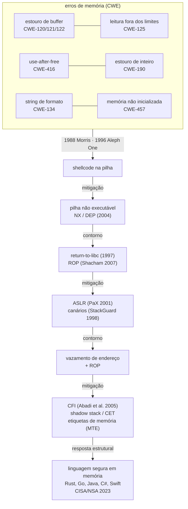

# Ponto 5 — Práticas de codificação segura e erros de memória

## Objetivo

Entender a codificação segura como a disciplina que impede o código de trair o projeto: o que se toma como dado sobre linguagens e compiladores, que regras o código não pode violar, quais padrões nomeados e ferramentas aplicam essas regras e que mecanismos as executam na compilação, no pipeline e em tempo de execução. E entender os erros de memória como a classe de defeito que define a disciplina: por que existem, como foram explorados ao longo de trinta anos, que mitigações a plataforma acumulou e por que a resposta atual é mudar de linguagem.

Referências principais: Seacord, *Secure Coding in C and C++* (2ª ed., 2013) e o SEI CERT C Coding Standard (2016); Howard e LeBlanc, *Writing Secure Code* (2ª ed., 2002); MITRE CWE Top 25 (2024); e, para a mudança de linguagem, CISA, NSA e parceiros, *The Case for Memory Safe Roadmaps* (2023). A história da exploração e das mitigações tem fonte própria no corpo do texto.

O ponto 4 mostrou a injeção web como caso de entrada não validada que vira instrução. Este ponto desce um nível: a mesma entrada hostil chegando a código que manipula memória diretamente, onde a confusão entre dado e instrução não é mais uma consulta SQL alterada, e sim o fluxo de execução do programa tomado pelo atacante.

---

## 1. Por que codificação segura é disciplina própria

### Bug de segurança não é bug comum

Um bug comum falha quando o usuário faz algo inesperado; um bug de segurança é procurado por alguém que quer que ele falhe de um jeito específico. A diferença muda a economia: o bug comum tem a probabilidade de ocorrência que o uso lhe dá; o bug de segurança tem a probabilidade que o atacante lhe dá, que é um. Por isso o teste funcional não basta — ele cobre o que o usuário faz — e por isso a codificação segura é um conjunto de regras sobre o que o código deve fazer com entrada que ninguém legítimo enviaria.

### A linguagem decide a classe de erro possível

Em C e C++, o programador controla a memória: aloca, libera, calcula endereços, e o compilador confia que ele fez certo. Quando não fez, o resultado é *comportamento indefinido*: o padrão da linguagem não diz o que acontece, e o compilador pode assumir que a situação nunca ocorre. Escrita fora dos limites de um vetor, uso de memória já liberada, estouro de inteiro com sinal — nada disso é erro de execução em C; é o programa continuando a rodar com memória corrompida. Em linguagens com segurança de memória (Java, C#, Go, Python, Rust, Swift), as mesmas operações produzem exceção, pânico ou erro de compilação. A classe inteira de erros de memória existe em uma família de linguagens e não existe na outra. Esse é o fato que organiza o ponto.

### A evidência

Miller (Microsoft, 2019) mostrou que cerca de 70% das vulnerabilidades corrigidas pela Microsoft por ano, desde 2006, são erros de segurança de memória. A equipe do Chromium (2020) chegou ao mesmo número para o navegador. Em 2023, a CISA e a NSA, com agências de cinco países, publicaram *The Case for Memory Safe Roadmaps*, pedindo que fabricantes publiquem planos de migração para linguagens seguras em memória; em 2024, o Escritório do Diretor Nacional de Cibersegurança dos Estados Unidos reforçou o pedido em *Back to the Building Blocks*. A codificação segura em C deixou de ser a resposta de primeira linha: virou o que se faz com o código que ainda não migrou.

### Exemplo

A API de pagamentos tem um componente em C que decodifica mensagens de um parceiro no formato ISO 8583. O campo de comprimento diz quantos bytes vêm a seguir; o código lê o comprimento e copia os bytes para um buffer de 256 posições com `memcpy`. O parceiro legítimo nunca manda mais de 128. Um parceiro comprometido manda 600. Os 344 bytes excedentes sobrescrevem o que está depois do buffer na pilha — inclusive o endereço de retorno da função. Nenhuma linha está "errada" para o compilador. O programa continua. É o estouro de buffer de pilha, o erro de memória mais antigo em uso.

---

## 2. Fundamentos — o que se toma como dado

| Fundamento | Premissa | O que decorre dela |
|---|---|---|
| A linguagem define a classe de erro possível | em linguagem sem segurança de memória, o programador é a única barreira entre entrada hostil e memória | escolha de linguagem é decisão de segurança; o que fica em C precisa de regra, ferramenta e mitigação |
| Comportamento indefinido é contrato rompido | o padrão não diz o que acontece; o compilador assume que não acontece | não existe "funcionou no teste": a mesma fonte produz binários diferentes; sanitizadores existem para tornar o indefinido visível |
| Toda entrada é hostil, inclusive a que parece interna | arquivo, mensagem de parceiro, variável de ambiente, resposta de outro serviço: tudo atravessa uma fronteira | validar comprimento, tipo e intervalo antes de usar; nunca confiar no campo de tamanho que veio junto com o dado |
| Regra verificável vence conselho | "tenha cuidado" não é controle; regra que uma ferramenta checa é | padrão de codificação com identificador por regra; análise estática e sanitizador no pipeline; função proibida bloqueada na compilação |

### A linguagem define a classe de erro possível

Segurança de memória é a propriedade de que todo acesso à memória é a um objeto válido, dentro dos limites, durante o tempo de vida do objeto. Linguagens garantem isso de três formas: verificação de limites e coleta de lixo em tempo de execução (Java, Go, C#); verificação em tempo de compilação por sistema de tipos e posse (Rust); ou não garantem (C, C++, assembly). A escolha não é só de desempenho: é a decisão sobre se uma classe inteira de vulnerabilidades pode existir no sistema. É um fundamento porque nenhuma regra de codificação devolve a C o que a linguagem não dá; as regras reduzem a frequência, não a possibilidade.

### Comportamento indefinido é contrato rompido

O padrão C define comportamento indefinido como aquele para o qual a norma não impõe exigência. Na prática, compiladores modernos otimizam assumindo que ele não ocorre: uma verificação `if (p + len < p)` para detectar estouro de ponteiro pode ser removida, porque estouro de ponteiro é indefinido e portanto "não acontece". A consequência é que o código pode passar em todos os testes com um compilador e nível de otimização e ser explorável com outro. Sanitizadores (Serebryany et al., 2012) existem para esse fim: instrumentam o binário para transformar comportamento indefinido em erro observável no teste.

### Toda entrada é hostil, inclusive a que parece interna

O ponto 4 estabeleceu a regra para a web. No código, a fronteira é mais sutil: a mensagem do parceiro chega por canal autenticado e ainda assim é hostil (o parceiro pode estar comprometido); o arquivo de configuração é escrito por operador e ainda assim é hostil (pode ter sido alterado); o comprimento declarado no cabeçalho do pacote é dado do pacote, não verdade sobre ele. A regra prática que decorre: o código verifica tamanho contra o buffer que ele mesmo alocou, nunca contra o que a entrada afirma.

### Regra verificável vence conselho

Howard e LeBlanc (2002) e Seacord (2013) escreveram livros de conselhos; o que mudou a prática foi a conversão de conselho em regra com identificador — CERT C MEM30-C "não acesse memória liberada", INT32-C "garanta que operações com inteiros com sinal não estouram" — e a ferramenta que aponta a violação no pipeline. A lista de funções proibidas do SDL da Microsoft (Howard, 2007) é o exemplo extremo: `strcpy`, `strcat`, `sprintf`, `gets` não compilam. O fundamento é que a disciplina não depende de atenção individual; depende de regra que a máquina cobra.

> **Junta.** Quatro premissas; a maior parte das vulnerabilidades da história em uma classe. Antes das regras, a classe.

---

## 3. Overview visual — erro de memória, exploração e mitigação

Leitura: cada mitigação da plataforma respondeu a uma técnica de exploração e foi contornada pela seguinte. Trinta anos depois, as mitigações tornaram a exploração cara, não impossível. A resposta que fecha a classe é a linguagem — e, para o código que fica em C, a soma de regra, ferramenta e todas as mitigações ligadas.

---

## 4. Erros de memória — a classe que define a disciplina

Para cada erro: o que é, como é explorado, o CWE, e a defesa em três níveis — regra de código, ferramenta que a cobra, mitigação da plataforma.

### Estouro de buffer

**O que é.** Escrita além do fim de um bloco de memória alocado. Na pilha (CWE-121), sobrescreve variáveis locais, o ponteiro de quadro e o endereço de retorno; no heap (CWE-122), sobrescreve metadados do alocador e objetos vizinhos. O caso genérico é CWE-120, "cópia sem verificar o tamanho da entrada".

**História.** O verme de Morris (1988) explorou um estouro em `fingerd` via `gets`. Aleph One (1996), em "Smashing the Stack for Fun and Profit", documentou a técnica: sobrescrever o endereço de retorno para apontar para código do atacante (*shellcode*) colocado no próprio buffer. Foi o artigo que tornou a classe conhecida.

**Variantes.** *Off-by-one*: um byte a mais, por `<=` em vez de `<` ou por esquecer o terminador nulo — suficiente para corromper o byte baixo do ponteiro de quadro. *Estouro por string de formato* (CWE-134): `printf(entrada)` em vez de `printf("%s", entrada)` permite ao atacante ler a pilha com `%x` e escrever com `%n`.

**Regra.** CERT C ARR30-C (não forme nem use ponteiros fora dos limites), STR31-C (garanta espaço para o terminador), FIO47-C (use especificadores de formato válidos — nunca entrada como string de formato). Verificar comprimento contra o buffer alocado; usar funções com limite explícito (`strlcpy`, `snprintf`, `memcpy_s`); proibir `gets`, `strcpy`, `strcat`, `sprintf`.

**Ferramenta.** Lista de funções proibidas na compilação (Howard, 2007); AddressSanitizer (ASan) detecta estouro de pilha e heap em teste; análise estática com rastreamento de tamanho; *fuzzing* (ponto 7) encontra o comprimento que estoura.

**Mitigação da plataforma.** Canários de pilha (Cowan et al., StackGuard, 1998; `-fstack-protector`): valor aleatório entre as variáveis e o endereço de retorno, verificado antes de retornar. Pilha não executável (NX/DEP, 2004): o shellcode no buffer não executa. `_FORTIFY_SOURCE`: verificações de tamanho em funções da biblioteca padrão quando o tamanho é conhecido na compilação.

### Leitura fora dos limites

**O que é.** Leitura além do fim (ou antes do início) do bloco. CWE-125; segunda no CWE Top 25 de 2024 é a escrita (CWE-787), a leitura é a sexta. Não toma o controle do fluxo; vaza o que está ao lado — chaves, senhas, endereços que derrotam o ASLR.

**História.** Heartbleed (CVE-2014-0160): a extensão *heartbeat* do OpenSSL copiava de volta ao cliente a quantidade de bytes que o cliente declarava, sem verificar contra o que ele tinha enviado — até 64 KB da memória do servidor por requisição, incluindo chaves privadas. É o fundamento "nunca confie no campo de tamanho que veio com o dado" em sua forma mais cara.

**Regra.** Mesmas do estouro de escrita; adicionalmente, verificar que o comprimento declarado é menor ou igual ao recebido antes de qualquer cópia.

**Ferramenta.** ASan detecta leitura fora dos limites; fuzzing com ASan foi o que encontrou dezenas de variantes depois do Heartbleed.

### Use-after-free

**O que é.** Uso de memória depois de liberada (CWE-416). O alocador pode já ter entregue o bloco a outro objeto; o ponteiro antigo agora lê ou escreve dentro de um objeto de outro tipo. Em C++, com objetos que têm tabela de métodos virtuais, o atacante que controla o novo conteúdo controla para onde a próxima chamada virtual salta. É a classe dominante em navegadores desde que o estouro de pilha ficou caro. *Double free* (CWE-415) é o parente: liberar duas vezes corrompe o alocador.

**Regra.** CERT C MEM30-C (não acesse memória liberada), MEM31-C (libere exatamente uma vez). Anular o ponteiro após liberar; propriedade clara de quem libera; em C++, ponteiros inteligentes (`unique_ptr`, `shared_ptr`) em vez de `new`/`delete` nus.

**Ferramenta.** ASan com quarentena de blocos liberados detecta o uso; análise estática de fluxo de posse.

**Mitigação da plataforma.** Alocadores endurecidos (quarentena, particionamento por tipo — PartitionAlloc no Chromium); *MiraclePtr* / ponteiros com verificação de referência; etiquetas de memória (ARM MTE) que invalidam o ponteiro antigo na liberação.

**Em linguagem segura.** Não existe: a coleta de lixo mantém o objeto vivo enquanto houver referência; em Rust, o verificador de empréstimos recusa compilar o uso depois da transferência de posse.

### Estouro de inteiro

**O que é.** Operação aritmética cujo resultado não cabe no tipo (CWE-190). Para inteiros sem sinal, o resultado "dá a volta" (definido); para inteiros com sinal, é comportamento indefinido. O perigo é o que vem depois: `tamanho = n * sizeof(item)` que dá a volta para um valor pequeno, `malloc` de um bloco pequeno, laço que escreve `n` itens — estouro de heap. Conversão com sinal para sem sinal (`-1` vira `4294967295`) passa por verificação de "menor que o máximo" e aloca ou copia demais (CWE-195). Truncamento de 64 para 32 bits (CWE-197) tem o mesmo efeito.

**Regra.** CERT C INT30-C (garanta que operações sem sinal não dão a volta), INT32-C (com sinal não estouram), INT31-C (conversões não perdem dado). Verificar antes de operar (`if (a > SIZE_MAX / b)`), usar funções de aritmética verificada (`__builtin_mul_overflow`), usar `size_t` para tamanhos e nunca misturar com `int`.

**Ferramenta.** UndefinedBehaviorSanitizer (UBSan) detecta estouro com sinal em teste; análise estática de intervalos.

**No domínio.** A API de pagamentos guarda valores em centavos como inteiro. Um valor de transferência que estoura o tipo e vira negativo é fraude por aritmética, não por memória — a mesma regra INT32-C protege as duas.

### Memória não inicializada e desreferência nula

**O que é.** Leitura de variável ou bloco nunca escrito (CWE-457): o conteúdo é o que sobrou de uso anterior — vazamento de informação ou decisão tomada sobre lixo. Desreferência de ponteiro nulo (CWE-476): em espaço de usuário, geralmente falha controlada; em núcleo ou sem proteção de página zero, explorável.

**Regra.** CERT C EXP33-C (não leia memória não inicializada), EXP34-C (não desreferencie nulo). Inicializar na declaração; verificar retornos de alocação e de funções que podem devolver nulo.

**Ferramenta.** MemorySanitizer (MSan) para leitura não inicializada; análise estática para nulo.

### Condições de corrida

**O que é.** Dois fluxos acessam o mesmo recurso sem sincronização e o resultado depende da ordem (CWE-362). Na forma *time-of-check to time-of-use* (TOCTOU, CWE-367), o programa verifica uma condição (o arquivo é do usuário?) e age depois (abre o arquivo), e o atacante troca o alvo entre os dois instantes.

**Regra.** CERT C CON (concorrência) e FIO45-C (evite TOCTOU ao acessar arquivos): operar sobre o descritor já aberto, não sobre o nome; verificar e agir numa única operação atômica.

**Ferramenta.** ThreadSanitizer (TSan) para corridas de dados em teste.

**Em linguagem segura.** Segurança de memória não é segurança de concorrência: Go tem corridas de dados; Java tem; Rust as impede em compilação pelo sistema de tipos (`Send`/`Sync`), e é a exceção.

> **Junta.** Erros descritos, mitigações nomeadas. Falta a regra geral: o que o código faz com qualquer entrada, em qualquer linguagem.

---

## 5. Princípios de codificação segura

Oito regras que o código não pode violar, independentemente da linguagem. Cada uma com a fonte que a formulou e a técnica que a aplica.

| Princípio | Regra | Fonte | O que viola |
|---|---|---|---|
| Validar na borda, por lista de permissão | todo dado externo é verificado em tipo, tamanho, formato e intervalo antes do primeiro uso | Howard e LeBlanc (2002); OWASP Secure Coding Practices (2010) | confiar no campo de tamanho; validar depois de usar; lista de bloqueio |
| Separar dado de instrução | dado nunca entra no texto de um comando, consulta, formato ou caminho | IEEE CSD (2014); ponto 4 | `printf(entrada)`, `system(cmd + arg)`, consulta concatenada |
| Falhar fechado e sem vazar | erro nega, libera recursos e registra; nunca segue com estado parcial nem expõe detalhe interno | Saltzer e Schroeder (1975); CERT ERR | exceção engolida, `catch` vazio, *stack trace* ao cliente, retorno de erro ignorado |
| Aritmética verificada | nenhuma operação com inteiro assume que cabe | CERT INT | multiplicação de tamanho sem verificação, conversão com sinal implícita |
| Posse e tempo de vida explícitos | cada bloco de memória tem um dono que o libera, uma vez | CERT MEM; Seacord (2013) | ponteiro compartilhado sem dono, `free` em dois lugares |
| Menor privilégio no código | o processo descarta o que não precisa; a função recebe só o que usa | Saltzer e Schroeder (1975); Provos et al. (2003) | processo como root para abrir uma porta e nunca descer; segredo global |
| Nenhum segredo no código | credencial, chave e token vivem fora do fonte e da imagem | OWASP; ponto 1 | chave em constante, `.env` no repositório, token em log |
| Compilar com tudo ligado | avisos como erro; mitigações da plataforma ativas em todo binário | Microsoft SDL; Debian/Fedora hardening | `-w`, binário sem PIE, sem canário, sem RELRO |

### Validar na borda, por lista de permissão

A validação acontece uma vez, na entrada, e produz um valor de tipo interno que o restante do código pode confiar — "analise, não valide" (*parse, don't validate*): em vez de passar a string adiante e checar em cada uso, converte-se a string em um tipo que só existe se for válido (um `Centavos`, um `IdDeConta`). Em C, isso é uma `struct` preenchida por uma função que devolve erro; em linguagens com tipos ricos, é um tipo que não tem construtor público para valor inválido. O efeito é que a verificação não pode ser esquecida no quinto uso.

### Falhar fechado e sem vazar

Toda função que pode falhar devolve ou lança erro, e quem chama trata. CERT ERR33-C: detecte e trate erros de funções da biblioteca padrão — `malloc` devolve nulo, `fopen` devolve nulo, `read` devolve menos do que pedido. O erro tratado nega a operação, libera o que foi alocado, registra sem dado sensível e devolve ao chamador uma mensagem que não ensina o atacante (sem caminho de arquivo, sem consulta, sem versão). *Fail-open* — seguir adiante com o que deu — é a categoria nova do OWASP Top 10 de 2025.

### Compilar com tudo ligado

A plataforma oferece mitigações que não custam código: `-fstack-protector-strong` (canários), `-D_FORTIFY_SOURCE=2` (verificação de tamanho), `-fPIE -pie` (endereços aleatórios), `-Wl,-z,relro,-z,now` (tabela de símbolos somente-leitura), `-fcf-protection` (CET), `-Wall -Wextra -Werror`. Um binário sem elas está escolhendo ser explorável por técnicas de 1996. A regra é que o pipeline recusa binário sem as flags — verificável com `checksec`.

> **Junta.** Regras ditas; agora os métodos nomeados que as tornam repetíveis e as ferramentas que as cobram.

---

## 6. Técnicas e ferramentas

### Padrão de codificação com regra identificada

**O que é.** Um conjunto de regras numeradas, cada uma com justificativa, exemplo não conforme, exemplo conforme e nível de risco. SEI CERT C Coding Standard (Seacord, 2008; edição 2016) e CERT Oracle Java; MISRA C (2012) para sistemas embarcados e críticos, com regras mais restritivas (subconjunto da linguagem); o CWE como vocabulário comum entre padrões.

**Por que funciona.** Regra com identificador vira item de revisão, de ferramenta e de contrato. "INT32-C violado na linha 48" é verificável; "cuidado com inteiros" não.

**Mecanismo.** Analisador estático com perfil CERT ou MISRA (ponto 7); *checklist* de revisão de código com as regras do padrão; gate no pipeline por nível de risco.

### Lista de funções proibidas

**O que é.** Howard (2007), no SDL da Microsoft: um cabeçalho (`banned.h`) que marca como obsoletas as funções da biblioteca C que não têm como ser usadas com segurança — `strcpy`, `strcat`, `sprintf`, `gets`, `scanf` sem largura — e as substitui por versões com tamanho explícito. O código que as chama não compila.

**Por que funciona.** Remove a decisão individual: ninguém precisa lembrar que `strcpy` é perigoso.

**Mecanismo.** Cabeçalho proibitivo; *lint* que bloqueia; Anexo K do C11 (`_s`) ou `strlcpy`/`strlcat` do OpenBSD.

### Sanitizadores em teste

**O que é.** Serebryany et al. (2012): instrumentação em tempo de compilação que torna comportamento indefinido observável. AddressSanitizer (estouro, uso após liberação, duplo `free`), UndefinedBehaviorSanitizer (estouro com sinal, desalinhamento, deslocamento inválido), MemorySanitizer (leitura não inicializada), ThreadSanitizer (corrida de dados). Custo de 2 a 3 vezes em tempo; só em teste, nunca em produção.

**Por que funciona.** O erro de memória que "funcionava" passa a abortar com relatório de onde alocou, onde liberou, onde usou.

**Mecanismo.** Suíte de testes e fuzzing (ponto 7) compilados com `-fsanitize=address,undefined` no pipeline; falha de sanitizador bloqueia o merge.

### Endurecimento do compilador e do binário

**O que é.** As flags da seção 5 aplicadas a todo binário, verificadas com ferramenta. ASLR (PaX, 2001; padrão nos sistemas desde meados dos anos 2000) exige binário PIE para aleatorizar o código. CFI (Abadi, Budiu, Erlingsson e Ligatti, 2005): o compilador restringe para onde chamadas indiretas podem saltar, derrotando ROP (Shacham, 2007, "return-oriented programming": encadear trechos de código existente terminados em `ret`). Shadow stack e CET (Intel, 2020) protegem endereços de retorno em hardware.

**Por que funciona.** Cada mitigação remove uma técnica de exploração ou a torna dependente de um vazamento de informação adicional. Nenhuma corrige o bug; todas elevam o fator de trabalho (ponto 3).

**Mecanismo.** Flags no sistema de build; `checksec` no pipeline; imagens base com mitigações do sistema operacional ativas.

### Linguagem segura em memória por padrão

**O que é.** A recomendação da CISA, NSA e parceiros (2023): código novo em linguagem segura em memória; código existente com plano de migração priorizado pelo que processa entrada hostil (parsers, decodificadores, protocolos de rede). Rust é a escolha onde C era obrigatório (núcleo Linux desde 2022, Android — onde a fração de vulnerabilidades de memória caiu de 76% para 24% entre 2019 e 2024 conforme o código novo migrou); Go, Java, C#, Swift onde a coleta de lixo é aceitável.

**O que não resolve.** Erros de lógica, autorização ausente, injeção em SQL, segredo em código, dependência vulnerável — nada disso é de memória. Blocos `unsafe` e interfaces com C reintroduzem a classe localmente. Segurança de memória não é segurança de concorrência (exceto em Rust). Linguagem segura fecha uma classe; as outras sete regras da seção 5 continuam valendo.

**Mecanismo.** Política de linguagem por tipo de componente; blocos `unsafe` como item de revisão obrigatório; FFI isolada em módulo pequeno e testado com sanitizador.

**Quando a linguagem não é escolha.** Janca (2020, cap. 4) trata o caso comum em que a linguagem e o framework já estão dados e formula duas regras de prática. Para o framework: escolher um suportado e com perspectiva de suporte longo, usar a versão atual ou a imediatamente anterior, verificar com SCA que a versão não tem vulnerabilidade conhecida, e varrer o repositório a cada build. Para o código que fica em linguagem sem segurança de memória, sete regras firmes: verificar limites em toda entrada, sempre; usar uma camada do framework ou dependência que verifique limites, se houver; verificar tipo em toda entrada; criar testes unitários de limites como regressão a cada commit; revisar código verificando que toda entrada tem teste; reservar tempo de teste de intrusão para limites de entrada; ligar as opções de compilação que detectam esses erros. E, por cima, as mitigações da plataforma (ASLR, DEP, canário) como camada adicional, nunca única. A lista é a versão de prática das regras CERT desta seção: diz o que o time faz na segunda-feira enquanto a migração não chega.

### Revisão de código orientada a segurança

**O que é.** Revisão com roteiro: OWASP Code Review Guide (2017) e o *checklist* de Howard e LeBlanc (2002) — por onde entra dado externo, onde ele é usado, que funções perigosas aparecem, como erros são tratados, onde ficam segredos. Difere da revisão de qualidade porque segue o dado, não a estrutura.

**Mecanismo.** Template de revisão no pull request; revisor de segurança obrigatório em componentes que processam entrada externa; ferramentas (SAST, ponto 7) como primeiro filtro, humano no que a ferramenta não vê (lógica, posse, fronteira).

> **Junta.** Erros, regras, métodos. O mesmo sistema, na linha do código.

---

## 7. Exemplo guiado — a API de pagamentos, no código

**Decodificador ISO 8583 em C (seção 1).** O campo de comprimento passa a ser verificado contra o tamanho do buffer *e* contra os bytes realmente recebidos antes do `memcpy` (ARR30-C; o Heartbleed ao contrário). `memcpy` com tamanho verificado; `strcpy` e `sprintf` não compilam (lista proibida). Binário com `-fstack-protector-strong -D_FORTIFY_SOURCE=2 -fPIE -Wl,-z,relro,-z,now -Werror`; `checksec` no pipeline. Suíte e fuzzer compilados com ASan e UBSan. Decisão de roadmap: o decodificador é o componente que mais processa entrada hostil; é o primeiro a ser reescrito em Rust, com a interface C isolada num módulo de cem linhas.

**Valores em centavos.** Tipo `Centavos` com construtor que recusa negativo e acima do limite; soma e multiplicação por função de aritmética verificada (INT32-C); conversão de string decimal para inteiro com rejeição de qualquer caractere fora de dígitos e um ponto. Um valor que estouraria vira erro de validação, não transferência negativa.

**Tratamento de erro.** Toda chamada que pode falhar é verificada; falha de alocação ou de leitura aborta a operação, libera o que alocou e devolve erro genérico ao cliente com identificador de correlação; detalhe só no log do servidor, sem dado de cartão (ERR33-C; fail secure).

**Log.** `printf("%s", msg)` e nunca `printf(msg)` (FIO47-C); mascaramento de PAN e de token antes de registrar.

**Arquivos de comprovante.** Abrir e então verificar sobre o descritor (`fstat`), nunca verificar pelo nome e abrir depois (FIO45-C, TOCTOU); descritor com `O_NOFOLLOW`.

**Segredos.** Chave do parceiro e credencial do banco vêm do cofre em tempo de execução; varredura de segredos no pipeline bloqueia commit com padrão de chave.

**Processo.** O serviço abre a porta como root e desce para usuário dedicado antes de processar a primeira mensagem (menor privilégio); contêiner sem root, sistema de arquivos somente-leitura, `seccomp` restringindo chamadas de sistema (ponto 3).

**Revisão.** Pull request com template: entradas externas, usos, funções perigosas, erros, segredos. Componente em C exige revisor de segurança; `unsafe` em Rust é item de revisão obrigatório.

O que o exemplo mostra: o código executa o desenho do ponto 3 e fecha a fronteira do ponto 4 na linha em que o dado é tocado. Cada decisão tem uma regra com identificador, uma ferramenta que a cobra e, onde cabe, uma mitigação da plataforma por trás.

---

## 8. Erros frequentes — o que não confundir

| Confusão | Por que está errado | Como dizer certo |
|---|---|---|
| "Linguagem segura em memória resolve segurança" | fecha uma classe; lógica, authz, injeção, segredo e dependência continuam | "fecha a classe de memória; as outras regras seguem valendo" |
| "ASLR/DEP impedem a exploração" | são mitigações: elevam o custo, são contornadas com vazamento + ROP | "mitigação eleva o fator de trabalho; não corrige o bug" |
| "O programa passou nos testes, logo não tem UB" | comportamento indefinido pode não se manifestar com aquele compilador e otimização | "sem sanitizador, o teste não vê UB" |
| "Segurança de memória = segurança de concorrência" | Go e Java têm corridas de dados; só Rust as impede em compilação | "são propriedades distintas" |
| "`strncpy` é a versão segura de `strcpy`" | não garante terminador nulo; preenche com zeros até `n` | "`strlcpy`, `snprintf` ou Anexo K; `strncpy` não é a resposta" |
| "Validar entrada é o mesmo que sanitizar" | validar rejeita; sanitizar transforma e pode deixar passar | "validar por lista de permissão na borda" |
| "Aviso de compilador é cosmético" | aviso de conversão com sinal ou de formato é vulnerabilidade em potencial | "`-Werror`: aviso é erro" |
| "C com programador cuidadoso é seguro" | 70% das vulnerabilidades corrigidas por Microsoft e Chromium são de memória, com programadores cuidadosos | "a evidência pede linguagem, não cuidado" |
| "Sanitizador em produção" | custo de 2 a 3 vezes e não é controle de segurança | "sanitizador em teste e fuzzing; mitigações em produção" |

---

## 9. Síntese

| Tema | Objetivo | Princípio | Técnica (fonte) | Mecanismo |
|---|---|---|---|---|
| Fundamentos | o que se toma como dado | linguagem define a classe; UB é contrato rompido; entrada hostil inclusive interna; regra verificável vence conselho | — | — |
| Erros de memória | conhecer a classe e sua história | posse e tempo de vida explícitos; aritmética verificada; validar comprimento contra o buffer | Aleph One (1996); Cowan et al. (1998); PaX (2001); Shacham (2007); Abadi et al. (2005); Serebryany et al. (2012) | canários, NX/DEP, ASLR, CFI, CET, MTE; ASan/UBSan/MSan/TSan |
| Princípios de codificação | regras que o código não viola | validar na borda; separar dado de instrução; falhar fechado; aritmética verificada; posse explícita; menor privilégio; sem segredo no código; compilar com tudo ligado | Howard e LeBlanc (2002); Seacord (2013); Saltzer e Schroeder (1975) | tipos que só existem válidos; tratamento de erro; cofre; flags de endurecimento |
| Padrões e ferramentas | regra com identificador e cobrança automática | regra verificável vence conselho | SEI CERT C (2016); MISRA C (2012); funções proibidas (Howard, 2007); OWASP Code Review Guide (2017) | SAST com perfil, `banned.h`, `checksec`, template de revisão |
| Mudança de linguagem | fechar a classe | linguagem define a classe | *Case for Memory Safe Roadmaps* (CISA/NSA, 2023); Miller (2019); sete regras para código não seguro em memória e regra de framework (Janca, 2020) | Rust/Go/Java/C# por padrão; `unsafe` e FFI isolados e revisados; SCA do framework a cada build |

A cadeia em uma linha: entrada hostil → regra com identificador → ferramenta que cobra → mitigação que segura o que escapou → linguagem que fecha a classe. Codificação segura é o ponto do ciclo em que o desenho vira linha, e a linha pode trair o desenho.

---

## Referências

- **Seacord, Robert C. *Secure Coding in C and C++*, 2ª ed. Addison-Wesley, 2013** — erros de memória, inteiros, strings de formato, e a motivação de cada regra CERT
- **SEI CERT. *SEI CERT C Coding Standard: Rules for Developing Safe, Reliable, and Secure Systems*, 2016** — regras ARR, STR, MEM, INT, EXP, ERR, FIO, CON com identificador
- **MISRA. *MISRA C:2012 — Guidelines for the use of the C language in critical systems***
- **Howard, Michael; LeBlanc, David. *Writing Secure Code*, 2ª ed. Microsoft Press, 2002** — validação de entrada, estouro de buffer, revisão de código orientada a segurança
- **Howard, Michael. "Security Development Lifecycle (SDL) Banned Function Calls". Microsoft, 2007** — lista de funções proibidas (`banned.h`)
- **Aleph One. "Smashing the Stack for Fun and Profit". *Phrack* 49, 1996** — exploração de estouro de pilha com shellcode
- **Cowan, Crispin et al. "StackGuard: Automatic Adaptive Detection and Prevention of Buffer-Overflow Attacks". *USENIX Security*, 1998** — canários de pilha
- **PaX Team. *Address Space Layout Randomization*, 2001** — ASLR
- **Shacham, Hovav. "The Geometry of Innocent Flesh on the Bone: Return-into-libc without Function Calls (on the x86)". *CCS*, 2007** — programação orientada a retorno (ROP)
- **Abadi, Martín; Budiu, Mihai; Erlingsson, Úlfar; Ligatti, Jay. "Control-Flow Integrity". *CCS*, 2005** — CFI
- **Serebryany, Konstantin; Bruening, Derek; Potapenko, Alexander; Vyukov, Dmitry. "AddressSanitizer: A Fast Address Sanity Checker". *USENIX ATC*, 2012** — sanitizadores
- **Miller, Matt. "Trends, Challenges, and Strategic Shifts in the Software Vulnerability Mitigation Landscape". *BlueHat IL*, 2019** — ~70% das vulnerabilidades da Microsoft são de segurança de memória
- **Chromium Project. "Memory Safety", 2020** — ~70% das vulnerabilidades graves do Chromium são de memória
- **CISA, NSA, FBI e parceiros. *The Case for Memory Safe Roadmaps*, 2023** — pedido de planos de migração para linguagens seguras em memória
- **White House ONCD. *Back to the Building Blocks: A Path Toward Secure and Measurable Software*, 2024**
- **Google. "Eliminating Memory Safety Vulnerabilities at the Source", 2024** — queda de 76% para 24% na fração de vulnerabilidades de memória no Android com código novo em linguagem segura
- **MITRE. *CWE Top 25*, 2024** — CWE-787 (escrita fora dos limites) em segundo, CWE-125 (leitura), CWE-416 (use-after-free), CWE-190 (estouro de inteiro)
- **OWASP. *Secure Coding Practices Quick Reference Guide*, 2010; *Code Review Guide* 2.0, 2017**
- **Provos, Niels; Friedl, Markus; Honeyman, Peter. "Preventing Privilege Escalation". *USENIX Security*, 2003** — descer privilégio no processo
- **Saltzer, Jerome; Schroeder, Michael. "The Protection of Information in Computer Systems". *Proc. IEEE*, 1975** — padrões à prova de falha e menor privilégio aplicados ao código
- **Janca, Tanya. *Alice and Bob Learn Application Security*. Wiley, 2020, cap. 4 ("Secure Code")** — escolha de framework (suportado, versão atual ou anterior, SCA a cada build); validação de dado não confiável com fluxograma; sete regras para código em linguagem sem segurança de memória; ASLR, DEP e canário como camada adicional
