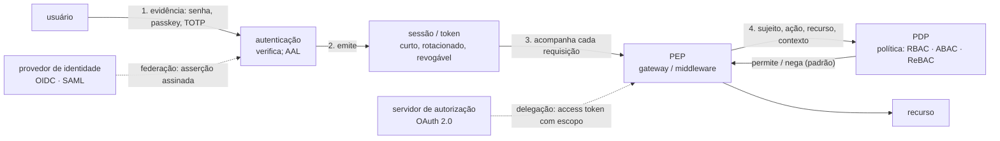

# Ponto 6 — Autenticação, autorização e gestão de sessão

## Objetivo

Entender autenticação, autorização e sessão como três problemas distintos que o código mais confunde: provar quem é, decidir o que pode e lembrar a prova entre requisições. Para cada um: o que se toma como dado, que regras não podem falhar, quais métodos e protocolos nomeados aplicam as regras e que mecanismos os executam. E entender os protocolos de identidade delegada — OAuth 2.0, OpenID Connect, SAML — pelo que resolvem e pelo que não resolvem.

Referências principais: NIST SP 800-63B (2017) para autenticação e ciclo de vida; OAuth 2.0 (RFC 6749, 2012) com o *Security Best Current Practice* (RFC 9700, 2025) e OpenID Connect Core 1.0 (2014) para delegação; Ferraiolo e Kuhn (1992) e NIST SP 800-162 (2014) para modelos de autorização; OWASP ASVS 4.0.3 capítulos V2, V3 e V4 para requisitos. As fontes específicas aparecem no corpo do texto.

O ponto 4 listou as falhas de autenticação e o controle de acesso quebrado como as classes mais frequentes. O ponto 3 deu o princípio: mediação completa, autorizar depois de autenticar. Este ponto é o desenho por dentro: como se prova identidade sem que a prova vaze, como se decide acesso sem que a decisão fique a cargo do cliente, e como a sessão carrega a prova sem virar a vulnerabilidade.

---

## 1. Três perguntas que o código confunde

### Autenticar, autorizar, lembrar

**Autenticação** responde "quem é?": o sujeito apresenta uma evidência (senha, chave, biometria, certificado) e o sistema a verifica contra o que conhece. O resultado é uma afirmação de identidade com um grau de confiança. **Autorização** responde "o que este sujeito pode fazer com este recurso, agora?": uma decisão por acesso, tomada depois da autenticação e com base nela, mas separada dela. **Sessão** responde "como o sistema lembra, na próxima requisição, que a autenticação aconteceu?": um segredo portátil que vale como a prova pelo tempo em que dura.

A confusão mais cara é tratar autenticação como se fosse autorização: "o usuário está logado, logo pode". Foi o que o `GET /contas/{id}/saldo` dos pontos anteriores fez. A segunda é tratar a sessão como detalhe de implementação: o identificador de sessão é equivalente à senha enquanto vale, e recebe menos cuidado que ela.

### O que mudou

Até os anos 2000, cada aplicação autenticava seus usuários com senha própria e guardava a sessão em cookie. Três coisas mudaram o desenho: aplicações passaram a precisar acessar recursos de outras em nome do usuário (OAuth 2.0, 2012); organizações passaram a querer um login para todas as aplicações (SAML 2.0, 2005; OpenID Connect, 2014); e a senha se mostrou o elo mais fraco — *phishing*, reuso, vazamento em massa — a ponto de o NIST reescrever as diretrizes em 2017 e de passkeys (FIDO2/WebAuthn, 2019) proporem substituí-la.

### Exemplo

Aplicativo de pagamentos: o cliente entra com e-mail e senha; o servidor devolve um JWT com validade de 30 dias guardado no `localStorage`; a API aceita qualquer requisição com JWT válido; o aplicativo de parceiro usa a senha do cliente para consultar saldo "em nome dele". Quatro decisões, quatro problemas: senha como único fator num sistema financeiro; token de longa duração sem revogação; token acessível a qualquer script da página; e credencial compartilhada com terceiro — exatamente o que OAuth existe para evitar. O restante do ponto reescreve esse desenho.

---

## 2. Fundamentos — o que se toma como dado

| Fundamento | Premissa | O que decorre dela |
|---|---|---|
| Identidade é afirmação verificada, não dado | "quem é" é o resultado de uma verificação com grau de confiança, não um campo que o cliente envia | o servidor verifica a evidência; o nível de garantia é escolha de projeto proporcional ao risco |
| Todo segredo tem ciclo de vida | senha, token, chave, cookie: criados, transportados, armazenados, usados, rotacionados, revogados | cada fase é um ponto de falha com controle próprio; segredo sem revogação é segredo eterno |
| Autorização é decisão por acesso sobre sujeito, ação, recurso e contexto | a decisão não é propriedade do sujeito ("é admin") nem da rota ("está logado"); é função dos quatro | ponto de decisão único, consultado em toda operação, negando por padrão (mediação completa) |
| Confiança delegada exige protocolo | quando um sistema age em nome de um usuário em outro, a credencial do usuário não pode ser o meio | OAuth 2.0 e OIDC existem para isso; implementação própria repete os erros que eles corrigiram |

### Identidade é afirmação verificada, não dado

O NIST SP 800-63 separa três coisas que a palavra "identidade" mistura: *prova de identidade* (quem a pessoa é no mundo, IAL), *autenticação* (que a pessoa que volta é a mesma que se cadastrou, AAL) e *federação* (que a afirmação de um sistema vale em outro, FAL). Em aplicações, o que importa é o AAL: AAL1 aceita um fator; AAL2 exige dois fatores, um deles resistente a repetição; AAL3 exige autenticador criptográfico de hardware resistente a *phishing*. O nível é decisão de projeto proporcional ao dano de um acesso indevido — um sistema financeiro não para em AAL1.

### Todo segredo tem ciclo de vida

Uma senha é criada (política de criação), transportada (TLS), armazenada (hash lento e salgado), usada (verificação com limite de tentativas), trocada (quando há indício de comprometimento, não por calendário) e, no fim, substituída. Um token de sessão tem as mesmas fases em escala de minutos. Cada fase tem seu ataque: *phishing* na criação e no uso, interceptação no transporte, vazamento de banco no armazenamento, força bruta no uso, ausência de revogação no fim. O desenho seguro trata cada fase; o inseguro cuida só da criação.

### Autorização é decisão por acesso sobre sujeito, ação, recurso e contexto

"Pode o sujeito S executar a ação A sobre o recurso R no contexto C?" — e contexto inclui hora, dispositivo, nível de autenticação, posse do recurso. Modelos de autorização (papéis, atributos, relações) são formas de expressar a política; o que não muda é que a resposta vem de um ponto de decisão que recebe os quatro parâmetros e nega quando não há regra. É mediação completa (ponto 3) com vocabulário próprio: PDP decide, PEP aplica.

### Confiança delegada exige protocolo

Antes de 2010, um serviço que queria ler o e-mail do usuário em outro pedia a senha do usuário — e passava a poder tudo, para sempre, sem que o usuário pudesse revogar sem trocar a senha. OAuth 2.0 (Hardt, RFC 6749, 2012) é a resposta: o usuário autoriza no serviço dono do recurso, que emite ao cliente um token com escopo e prazo. O fundamento é que delegação tem forma conhecida e armadilhas conhecidas (redirecionamento, CSRF no retorno, interceptação de código), e o protocolo as trata; reinventar é reencontrá-las.

> **Junta.** Três problemas, quatro premissas. O desenho começa pela prova.

---

## 3. Overview visual — onde cada peça fica

Leitura: a autenticação produz uma afirmação; a sessão a carrega; o PEP a apresenta ao PDP com a ação e o recurso; a decisão nega por padrão. Federação (OIDC, SAML) terceiriza a autenticação; delegação (OAuth) permite que um cliente aja em nome do usuário com escopo. São seis peças; a dissertação ganha se as nomear e ligar nessa ordem.

---

## 4. Autenticação

### Princípios

| Princípio | Regra | Fonte |
|---|---|---|
| Nível de garantia proporcional ao risco | o número e o tipo de fatores seguem o dano de um acesso indevido | NIST SP 800-63B (AAL1–3) |
| Fatores de naturezas distintas | dois fatores do mesmo tipo (duas senhas) são um fator | NIST SP 800-63B; Saltzer e Schroeder (separação de privilégios) |
| Segredo nunca recuperável do armazenamento | a verificação não exige conhecer o segredo; o banco vazado não devolve senhas | Morris e Thompson (1979); NIST SP 800-63B |
| Fator de trabalho contra adivinhação | o custo de tentar supera o benefício: hash lento, limite de tentativas, lista de senhas vazadas | Saltzer e Schroeder (1975); NIST SP 800-63B |
| Resistência a phishing para o que importa | a evidência não pode ser capturada e repetida por um sítio falso | CISA (2022); FIDO2/WebAuthn (2019) |
| Recuperação tão forte quanto o login | o fluxo de "esqueci a senha" é um caminho de autenticação e recebe o mesmo nível | NIST SP 800-63B |

### Senhas

**Criação.** O NIST SP 800-63B (2017) inverteu a prática: sem regras de composição (maiúscula, símbolo), sem troca periódica obrigatória, sem dicas; em vez disso, comprimento mínimo de 8 (e permitir 64+), verificação contra listas de senhas comprometidas e de senhas comuns, e medidor de força. A razão é empírica: regras de composição produzem `Senha@2024` previsível e anotada (Adams e Sasse, 1999; aceitabilidade psicológica).

**Armazenamento.** Morris e Thompson (1979), no Unix, estabeleceram a regra: guardar o resultado de uma função unidirecional, com *salt* por usuário para que senhas iguais não tenham hashes iguais e tabelas pré-computadas não sirvam. A evolução foi tornar a função deliberadamente lenta e cara em memória, para que o atacante com o banco vazado teste poucas senhas por segundo: bcrypt (Provos e Mazières, 1999), scrypt (Percival, 2009), Argon2 (Biryukov, Dinu e Khovratovich, 2015; vencedor da Password Hashing Competition). O parâmetro de custo é ajustado para que a verificação leve dezenas a centenas de milissegundos no servidor. *Pepper* (um segredo global fora do banco) acrescenta uma camada se o banco vaza sem o segredo. MD5 e SHA-1, mesmo com salt, são rápidos demais: bilhões de tentativas por segundo em GPU.

**Uso.** Limite de tentativas por conta e por origem, com atraso crescente ou bloqueio temporário; comparação em tempo constante; mensagem de erro que não distingue "usuário não existe" de "senha errada" (enumeração de usuários).

**Ataques.** *Credential stuffing*: pares usuário-senha vazados de outro sítio testados em massa — funciona porque as pessoas reúsam; a defesa é a lista de vazadas e o segundo fator. *Phishing*: a senha é capturada por um sítio falso — nenhuma política de senha resolve; só um fator resistente a phishing.

### Múltiplos fatores

Três naturezas: **algo que se sabe** (senha, PIN), **algo que se tem** (telefone, chave de hardware, certificado), **algo que se é** (biometria). MFA exige duas naturezas distintas.

**TOTP e HOTP.** HOTP (RFC 4226, 2005): código derivado de um segredo compartilhado e de um contador. TOTP (RFC 6238, 2011): o contador é o tempo, em janelas de 30 segundos. É "algo que se tem" porque o segredo está no dispositivo. Vulnerável a *phishing* em tempo real: o sítio falso pede o código e o usa nos 30 segundos.

**SMS e chamada.** O NIST SP 800-63B classifica como "restrito": troca de SIM, interceptação de SS7 e *phishing* o enfraquecem. Aceitável como fator secundário de baixo risco; não para AAL2 em sistema financeiro.

**Notificação push.** Conveniente; sofre *fadiga de MFA* — o atacante com a senha dispara notificações até o usuário aprovar por cansaço (ataque usado contra a Uber em 2022). Mitigação: *number matching*, em que o usuário digita um número exibido na tela de login.

**FIDO2 / WebAuthn e passkeys.** W3C WebAuthn (2019) com CTAP2 da FIDO Alliance: o autenticador (chave de hardware, ou o telefone/computador com biometria) gera um par de chaves por sítio; a chave privada nunca sai do dispositivo; a assinatura inclui a origem do sítio, de modo que um sítio falso recebe uma assinatura inválida para o verdadeiro. É o único fator amplamente disponível resistente a *phishing*, e é o que a CISA (2022) recomenda como "MFA resistente a phishing". *Passkeys* (2022) são credenciais WebAuthn sincronizadas entre dispositivos do usuário, pensadas para substituir a senha e não só complementá-la.

**Autenticação em degraus (step-up).** Nem toda operação exige o mesmo nível: consultar saldo em AAL1 pode ser aceitável; transferir acima de um limite exige segundo fator naquele momento. A sessão carrega o nível atingido e o PDP exige o nível da operação.

### Recuperação de conta

O fluxo "esqueci a senha" é autenticação com outra evidência — acesso ao e-mail, código por SMS, perguntas secretas — e costuma ser o elo mais fraco: perguntas secretas são adivinháveis ou pesquisáveis; o e-mail pode ter sido o primeiro alvo. Regras: link de uso único com expiração curta; invalidar sessões existentes ao trocar a senha; exigir o segundo fator também na recuperação quando a conta o tem; notificar o usuário por outro canal.

> **Junta.** A prova foi feita. Como o sistema a lembra sem que lembrá-la vire a falha?

---

## 5. Gestão de sessão

### Princípios

| Princípio | Regra | O que viola |
|---|---|---|
| O identificador de sessão vale como a senha | recebe a mesma proteção em transporte, armazenamento e exposição | sessão em URL, em `localStorage`, em log |
| Imprevisível e sem significado | gerado por gerador criptográfico, pelo menos 64 bits de entropia, sem dado codificado | sessão sequencial, baseada em tempo, com e-mail dentro |
| Rotação nas mudanças de estado | novo identificador no login, na elevação de privilégio, na troca de senha | identificador criado antes do login e mantido depois (fixação) |
| Expiração e revogação do lado do servidor | prazo absoluto e por inatividade; logout invalida no servidor | sessão eterna; logout que só apaga o cookie |
| Escopo mínimo de envio | o navegador só envia o cookie quando deve | cookie sem `Secure`, sem `HttpOnly`, sem `SameSite`, com `Domain` amplo |

### Sessão com estado (cookie)

O servidor gera um identificador aleatório, guarda o estado associado (usuário, nível de autenticação, criação, último uso) e envia o identificador em um cookie. O cookie leva `Secure` (só por TLS), `HttpOnly` (inacessível a script — o XSS não o lê, embora ainda possa usá-lo enquanto a página está aberta), `SameSite=Lax` ou `Strict` (não enviado em requisições iniciadas por outro sítio — CSRF, ponto 4), `Path` e `Domain` restritos, e prefixo `__Host-` quando possível (força `Secure`, sem `Domain`, `Path=/`). A revogação é trivial: apagar o estado no servidor. A desvantagem é o armazenamento compartilhado entre instâncias — resolvido com repositório de sessão (Redis) e não com tokens sem estado.

**Fixação de sessão.** O atacante obtém um identificador válido antes do login (por URL, por cookie injetado via subdomínio) e o entrega à vítima; a vítima loga; se o servidor mantiver o mesmo identificador, o atacante está logado como ela. Defesa: gerar novo identificador no login — sempre.

**Expiração.** Absoluta (por exemplo, 12 horas desde o login) e por inatividade (15 a 30 minutos para sistema financeiro, conforme ASVS V3). Ambas verificadas no servidor. Logout invalida o estado; troca de senha invalida todas as sessões do usuário.

### Sessão sem estado (token assinado)

Um JSON Web Token (RFC 7519, 2015) carrega as afirmações (sujeito, emissor, expiração, escopo) assinadas pelo emissor (JWS, RFC 7515); quem recebe verifica a assinatura e confia no conteúdo sem consultar armazenamento. Resolve a escala horizontal e a comunicação entre serviços. Traz problemas próprios, todos documentados:

- **Revogação.** Não há como invalidar um token assinado antes de expirar sem reintroduzir estado (lista de revogação). Resposta: *access token* de vida curta (minutos) e *refresh token* de vida longa, guardado com estado e rotacionado a cada uso (RFC 9700).
- **`alg: none` e confusão de algoritmo.** Bibliotecas que aceitavam o algoritmo declarado no próprio token permitiram tokens sem assinatura (`none`) e troca de RS256 por HS256 usando a chave pública como segredo HMAC (McLean, 2015). Resposta: o verificador fixa o algoritmo e a chave esperados; nunca lê `alg` do token.
- **Exposição.** JWT em `localStorage` é legível por qualquer script na página (XSS). Em cookie `HttpOnly`, não. Para aplicação web com navegador, cookie; para API chamada por serviço ou aplicativo nativo, cabeçalho `Authorization: Bearer`.
- **Conteúdo.** O corpo é codificado, não cifrado: nada sensível dentro. Validar `iss`, `aud`, `exp`, `nbf` sempre.
- **Vinculação ao cliente.** Um *bearer token* (RFC 6750) vale para quem o apresenta; roubado, é usado. Vinculação ao cliente por mTLS (RFC 8705, 2020) ou DPoP (RFC 9449, 2023) exige que o apresentador prove posse de uma chave.

**Quando usar.** Estado no servidor para sessão de usuário em aplicação web; token assinado para comunicação entre serviços e para delegação via OAuth. JWT não é "mais seguro que sessão": é outra troca, com revogação mais difícil.

> **Junta.** Quem é, lembrado. Agora o que pode.

---

## 6. Autorização

### Princípios

| Princípio | Regra | Fonte |
|---|---|---|
| Autorizar depois de autenticar, em toda operação | estar logado não é permissão; cada ação sobre cada recurso é decidida | IEEE CSD (2014); Saltzer e Schroeder (mediação completa) |
| Negar por padrão | sem regra que permita, nega | Saltzer e Schroeder (padrões à prova de falha) |
| Decisão no servidor, nunca no cliente | esconder botão é usabilidade; a API decide | ponto 4 (toda entrada é hostil) |
| Ponto de decisão único e política declarativa | a política vive num lugar, versionada, testável; o código pergunta | Anderson (1972); NIST SP 800-207 (PDP/PEP) |
| Objeto e função | verificar que o sujeito pode a ação *e* que o recurso é dele | OWASP API Top 10 (BOLA, BFLA); ASVS V4 |
| Menor privilégio e separação de deveres | papéis mínimos; quem executa não aprova | Saltzer e Schroeder (1975); Clark e Wilson (1987) |

### Modelos de controle de acesso

**Discricionário e mandatório.** No controle discricionário (DAC), o dono do recurso decide quem acessa — o modelo do Unix e das listas de controle de acesso. No mandatório (MAC), uma política central decide por rótulos que nem o dono altera — Bell e LaPadula (1973) para confidencialidade (não ler acima, não escrever abaixo), Biba (1977) para integridade. Modelos de sistemas militares; aparecem em aplicações como "classificação de dado" e em SELinux.

**Baseado em papéis (RBAC).** Ferraiolo e Kuhn (1992); formalizado por Sandhu, Coyne, Feinstein e Youman (1996) e padronizado como ANSI INCITS 359 (2004). Permissões são atribuídas a papéis; usuários recebem papéis; a decisão é "o papel do usuário tem a permissão?". Resolve a administração em escala (mil usuários, dez papéis). Limites: não expressa posse ("só a própria conta") nem contexto ("só em horário comercial"); tende à *explosão de papéis* quando se tenta.

**Baseado em atributos (ABAC).** NIST SP 800-162 (Hu et al., 2014): a decisão é função de atributos do sujeito (departamento, nível de autenticação), do recurso (dono, classificação), da ação e do ambiente (hora, rede). Expressa posse e contexto naturalmente; a política é um conjunto de regras avaliadas por um motor. Exige atributos confiáveis e política legível — o custo é a complexidade da política.

**Baseado em relações (ReBAC).** Zanzibar (Pang et al., Google, 2019): a permissão é derivada de relações entre objetos e sujeitos ("é membro do grupo que é editor da pasta que contém o documento"). Modelo de sistemas colaborativos; implementações abertas (SpiceDB, OpenFGA) o trouxeram para aplicações.

**Na prática.** Papéis para a grossura (cliente, operador, administrador); atributos ou relações para a finura (dono da conta, limite por nível de autenticação). A decisão vai para um motor de políticas (OPA com Rego, Cedar da AWS, Casbin) consultado pelo PEP; a política é código versionado com testes.

### Autorização por objeto e por função

O OWASP API Security Top 10 (2023) coloca em primeiro lugar a autorização quebrada no nível de objeto (BOLA): a API verifica que o sujeito pode a *ação* mas não que o *objeto* é dele. Em quinto, a quebra no nível de função (BFLA): a rota administrativa atende a quem a chamar. A regra de código que fecha as duas: toda operação carrega o recurso e passa sujeito, ação, recurso ao PDP; a consulta ao banco já filtra pelo dono (nunca "buscar e depois checar"); rotas sem política explícita não existem.

### Onde a autorização acontece

Em camadas, por defesa em profundidade: no gateway (escopo do token, papel grosso), no serviço (regra por objeto), no banco (*row-level security* como última rede). A decisão fina fica no serviço, que conhece o domínio; o gateway não tem como saber de quem é a conta.

> **Junta.** Autenticar e autorizar dentro de um sistema. Quando a identidade vem de fora, ou quando um sistema age por outro, entram os protocolos.

---

## 7. Protocolos de identidade delegada e federada

### OAuth 2.0 — delegação

**O que resolve.** Um cliente (aplicativo, serviço) acessa recursos de um usuário em um servidor de recursos sem conhecer a credencial do usuário. Quatro papéis (RFC 6749, 2012): *dono do recurso* (usuário), *cliente*, *servidor de autorização* (emite tokens) e *servidor de recursos* (aceita tokens). O resultado é um *access token* com escopo (o que pode) e prazo (até quando).

**O fluxo que importa: código de autorização com PKCE.** O cliente redireciona o usuário ao servidor de autorização; o usuário autentica e consente; o servidor redireciona de volta com um código de uso único; o cliente troca o código pelo token em canal direto. PKCE (RFC 7636, 2015): o cliente gera um segredo por requisição, envia o hash no primeiro passo e o segredo no segundo, de modo que quem intercepta o código não consegue trocá-lo. Originalmente para aplicativos móveis (sem segredo de cliente); o RFC 9700 (2025) o exige para todo cliente.

**Fluxos para máquina.** *Client credentials*: o cliente é o próprio dono do recurso (serviço para serviço). *Device authorization* (RFC 8628): dispositivos sem navegador.

**O que foi descontinuado e por quê.** *Implicit* devolvia o token na URL de redirecionamento — vazava em histórico, `Referer` e logs. *Resource owner password credentials* entregava a senha ao cliente — o que o OAuth existe para evitar. O RFC 9700 e o rascunho do OAuth 2.1 os removem.

**Ataques e defesas.** *Redirecionamento manipulado*: o atacante registra ou injeta uma URL de redirecionamento sua e recebe o código — defesa: comparação exata da URL registrada. *CSRF no retorno*: o atacante faz a vítima completar o fluxo com o código dele, ligando a conta da vítima à dele — defesa: parâmetro `state` ligado à sessão (e PKCE, que o cobre). *Mix-up*: cliente com vários servidores de autorização confunde a origem da resposta — defesa: parâmetro `iss` na resposta (RFC 9207). *Vazamento de token*: *bearer* roubado é usado — defesa: vida curta, rotação de *refresh token*, vinculação por DPoP ou mTLS.

**O que OAuth não é.** Não é protocolo de autenticação: o *access token* diz o que o cliente pode fazer, não quem é o usuário. Usar o token de acesso para "logar" o usuário no cliente é o erro que o OpenID Connect corrige.

### OpenID Connect — autenticação federada

OIDC Core 1.0 (2014) é uma camada sobre OAuth 2.0 que acrescenta o *ID token*: um JWT assinado pelo provedor de identidade com afirmações sobre o usuário autenticado (`sub`, `iss`, `aud`, `exp`, `auth_time`, `acr` — o nível de autenticação) e o `nonce` que liga a resposta à requisição. O cliente verifica assinatura, emissor, audiência e `nonce` e só então considera o usuário autenticado. Traz também o *endpoint UserInfo*, descoberta de configuração e, nas extensões, *logout* federado. É o protocolo de "entrar com Google/Microsoft/Apple" e de SSO corporativo moderno.

### SAML 2.0 — federação corporativa

SAML 2.0 (OASIS, 2005) resolve o mesmo problema de federação com XML: o provedor de identidade emite uma *asserção* assinada; o provedor de serviço a valida. Domina o SSO corporativo instalado. Seus ataques são de processamento de XML: *XML Signature Wrapping* (Somorovsky et al., 2012), em que o atacante move a asserção assinada e insere outra que o validador lê; XXE no parser. Defesa: biblioteca madura, validar a assinatura sobre o elemento que será usado, parser sem entidades externas. Para sistemas novos, OIDC é a escolha; SAML é interoperabilidade com o que existe.

### O que a federação muda

O ponto único de autenticação é também o ponto único de falha: o provedor de identidade comprometido compromete todas as aplicações. Exige o nível mais alto de proteção do provedor (MFA resistente a *phishing* para administradores, monitoramento, chaves de assinatura em HSM) e exige que cada aplicação valide a asserção inteira — emissor, audiência, prazo, assinatura, `nonce` — e não só "veio do provedor".

> **Junta.** Peças nomeadas. O mesmo sistema, redesenhado.

---

## 8. Exemplo guiado — a API de pagamentos, redesenhada

**Autenticação do cliente.** Passkey como primeira opção, senha como alternativa com verificação contra lista de vazadas, Argon2id no armazenamento, limite de tentativas por conta e por origem. Nível AAL2 por padrão para entrar; *step-up* para transferência acima do limite: TOTP ou passkey naquele momento, registrado na sessão com `acr`. SMS não é oferecido como segundo fator. Recuperação: link de uso único com 15 minutos, exige o segundo fator se a conta o tem, invalida todas as sessões, notifica por outro canal.

**Sessão da aplicação web.** Cookie `__Host-sessao`, `Secure`, `HttpOnly`, `SameSite=Lax`, identificador de 128 bits gerado por CSPRNG, estado em repositório de sessão; novo identificador no login e no *step-up*; expiração de 12 horas absoluta e 20 minutos de inatividade; logout e troca de senha invalidam no servidor. O JWT no `localStorage` sai do desenho.

**Aplicativo móvel.** OAuth 2.0 com código de autorização e PKCE contra o servidor de autorização próprio; *access token* de 10 minutos como JWT com `aud` da API; *refresh token* com estado, rotacionado a cada uso, revogado se reusado; vinculação por DPoP. O aplicativo nunca vê a senha fora da tela do servidor de autorização.

**Parceiro de antifraude.** *Client credentials* com mTLS (RFC 8705); escopo `antifraude:consultar`; token de 5 minutos. A credencial do cliente deixa de ser compartilhada.

**Autorização.** PEP no gateway valida assinatura, `iss`, `aud`, `exp`, escopo e `acr`; PEP no serviço carrega a conta e pergunta ao PDP (Cedar): `cliente` pode `ler_saldo` em `conta` se `conta.dono == sujeito`; pode `transferir` se, além disso, `acr >= 2` quando `valor > limite`; `operador` pode `estornar` se não for quem lançou (separação de deveres). Política versionada com testes; rota sem política é 404. *Row-level security* no banco como última camada.

**Federação de operadores.** Operadores internos entram por OIDC com o provedor corporativo; a aplicação valida `iss`, `aud`, `nonce`, `exp` e exige `acr` de MFA resistente a *phishing* para o papel de operador.

**Registro.** Login, falha de login, *step-up*, troca de senha, revogação, decisão negada: tudo com sujeito e tempo, sem segredo (ponto 10).

O que o exemplo mostra: cada uma das quatro decisões ruins da seção 1 foi substituída por protocolo ou regra com nome — e cada peça do diagrama da seção 3 tem um lugar.

---

## 9. Erros frequentes — o que não confundir

| Confusão | Por que está errado | Como dizer certo |
|---|---|---|
| "Autenticado, logo autorizado" | autenticação diz quem é; autorização decide por ação e recurso | "autorizar depois de autenticar, em toda operação" |
| "JWT é mais seguro que sessão com estado" | é outra troca: ganha escala, perde revogação | "access curto + refresh com estado e rotação" |
| "Token no `localStorage` é prático" | legível por qualquer script; XSS leva o token | "cookie `HttpOnly` para navegador; `Authorization` para app e serviço" |
| "OAuth autentica o usuário" | OAuth delega acesso; quem autentica é OIDC com o ID token | "OAuth para autorização; OIDC para autenticação" |
| "SMS é segundo fator suficiente" | restrito pelo NIST; troca de SIM e phishing | "TOTP no mínimo; passkey/FIDO2 para resistir a phishing" |
| "MD5/SHA-256 com salt protege senhas" | rápidos demais; GPU testa bilhões por segundo | "Argon2id, bcrypt ou scrypt com custo ajustado" |
| "Regras de composição e troca periódica fortalecem senhas" | produzem padrões previsíveis; o NIST as abandonou em 2017 | "comprimento, lista de vazadas, MFA" |
| "Esconder a rota de admin basta" | função sem verificação atende quem chamar (BFLA) | "política explícita por função; sem regra, 404" |
| "RBAC resolve posse" | papel não sabe de quem é a conta; precisa de atributo ou relação | "papel para o grosso, ABAC/ReBAC para o fino" |
| "Logout = apagar o cookie" | o identificador continua válido no servidor | "logout invalida o estado no servidor" |

---

## 10. Síntese

| Tema | Objetivo | Princípio | Técnica (fonte) | Mecanismo |
|---|---|---|---|---|
| Fundamentos | o que se toma como dado | identidade é afirmação verificada; segredo tem ciclo de vida; authz é decisão sobre S-A-R-C; delegação exige protocolo | — | — |
| Autenticação | provar quem é, no nível do risco | garantia proporcional; fatores distintos; segredo não recuperável; fator de trabalho; resistência a phishing; recuperação forte | NIST SP 800-63B (2017); Morris e Thompson (1979); Argon2 (2015); TOTP (RFC 6238); WebAuthn (2019) | Argon2id, lista de vazadas, limitador, TOTP, passkey, step-up |
| Sessão | lembrar a prova sem virar a falha | id vale como senha; imprevisível; rotação; expiração e revogação no servidor; escopo de envio | cookie com atributos (RFC 6265); JWT (RFC 7519) com access curto + refresh rotacionado (RFC 9700); DPoP (RFC 9449) | `__Host-`, `Secure`, `HttpOnly`, `SameSite`, repositório de sessão, rotação no login |
| Autorização | decidir o que pode, por acesso | autorizar após autenticar; negar por padrão; servidor decide; PDP único; objeto e função; menor privilégio e separação de deveres | RBAC (Ferraiolo e Kuhn, 1992; INCITS 359); ABAC (NIST SP 800-162); ReBAC (Zanzibar, 2019); PDP/PEP (NIST SP 800-207) | OPA/Cedar, middleware, filtro por dono, RLS, política versionada |
| Delegação e federação | agir em nome de outro; confiar em identidade externa | credencial do usuário nunca vai ao cliente; validar a asserção inteira | OAuth 2.0 (RFC 6749) + PKCE (RFC 7636) + BCP (RFC 9700); OIDC Core (2014); SAML 2.0 (2005) | código + PKCE, client credentials + mTLS, ID token com nonce, asserção validada |

A cadeia em uma linha: evidência verificada no nível do risco → sessão que carrega a prova com rotação e revogação → decisão por acesso sobre sujeito, ação, recurso e contexto, negando por padrão → protocolo nomeado quando a identidade vem de fora ou o acesso é em nome de outro.

---

## Referências

- **NIST SP 800-63B. *Digital Identity Guidelines: Authentication and Lifecycle Management*. Grassi et al., 2017** — níveis AAL1–3; senhas sem composição nem troca periódica; lista de comprometidas; SMS restrito; recuperação
- **Morris, Robert; Thompson, Ken. "Password Security: A Case History". *Communications of the ACM*, 22(11), 1979** — hash unidirecional com salt
- **Provos, Niels; Mazières, David. "A Future-Adaptable Password Scheme". *USENIX ATC*, 1999** — bcrypt
- **Percival, Colin. "Stronger Key Derivation via Sequential Memory-Hard Functions". *BSDCan*, 2009** — scrypt
- **Biryukov, Alex; Dinu, Daniel; Khovratovich, Dmitry. "Argon2: New Generation of Memory-Hard Function for Password Hashing and Other Applications". *IEEE EuroS&P*, 2016; RFC 9106, 2021**
- **RFC 4226 (HOTP, 2005); RFC 6238 (TOTP, 2011)** — senhas de uso único por contador e por tempo
- **W3C. *Web Authentication: An API for accessing Public Key Credentials*, 2019; FIDO Alliance CTAP2** — WebAuthn e passkeys
- **CISA. *Implementing Phishing-Resistant MFA*, 2022**
- **Adams, Anne; Sasse, M. Angela. "Users Are Not the Enemy". *CACM*, 1999** — base empírica contra regras de composição
- **RFC 6265. *HTTP State Management Mechanism*. Barth, 2011; revisão rfc6265bis com `SameSite` e prefixos `__Host-`**
- **RFC 7519 (JWT), RFC 7515 (JWS), 2015; RFC 8725, *JSON Web Token Best Current Practices*, 2020** — validação de `alg`, `iss`, `aud`, `exp`
- **McLean, Tim. "Critical vulnerabilities in JSON Web Token libraries". Auth0, 2015** — `alg: none` e confusão RS/HS
- **RFC 6749. *The OAuth 2.0 Authorization Framework*. Hardt, 2012; RFC 6750 (bearer tokens)**
- **RFC 7636. *Proof Key for Code Exchange by OAuth Public Clients*. Sakimura, Bradley, Agarwal, 2015** — PKCE
- **RFC 9700. *Best Current Practice for OAuth 2.0 Security*. Lodderstedt, Bradley, Labunets, Fett, 2025** — PKCE obrigatório, implicit e password descontinuados, rotação de refresh token
- **RFC 8628 (device authorization, 2019); RFC 9207 (`iss` na resposta, 2022); RFC 8705 (mTLS, 2020); RFC 9449 (DPoP, 2023)**
- **OpenID Foundation. *OpenID Connect Core 1.0*, 2014** — ID token, `nonce`, `acr`, UserInfo
- **OASIS. *SAML 2.0*, 2005; Somorovsky et al. "On Breaking SAML: Be Whoever You Want to Be". *USENIX Security*, 2012** — XML Signature Wrapping
- **Ferraiolo, David; Kuhn, Richard. "Role-Based Access Controls". *NCSC*, 1992; Sandhu et al. "Role-Based Access Control Models". *IEEE Computer*, 1996; ANSI INCITS 359-2004**
- **NIST SP 800-162. *Guide to Attribute Based Access Control (ABAC) Definition and Considerations*. Hu et al., 2014**
- **Pang, Ruoming et al. "Zanzibar: Google's Consistent, Global Authorization System". *USENIX ATC*, 2019** — ReBAC
- **Bell, David; LaPadula, Leonard. *Secure Computer Systems: Mathematical Foundations*. MITRE, 1973; Biba, Kenneth. *Integrity Considerations for Secure Computer Systems*. MITRE, 1977**
- **Clark, David; Wilson, David. "A Comparison of Commercial and Military Computer Security Policies". *IEEE S&P*, 1987** — separação de deveres
- **NIST SP 800-207. *Zero Trust Architecture*, 2020** — PDP e PEP
- **OWASP. *API Security Top 10*, 2023** — BOLA, BFLA; *ASVS* 4.0.3, capítulos V2 (autenticação), V3 (sessão), V4 (controle de acesso)
- **IEEE Center for Secure Design. *Avoiding the Top 10 Software Security Design Flaws*, 2014** — autorizar depois de autenticar; autenticação que não pode ser contornada
