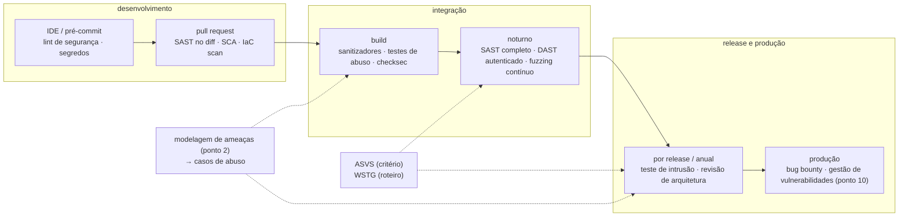

# Ponto 7 — Testes de segurança (SAST, DAST, SCA, fuzzing)

## Objetivo

Entender os testes de segurança como a fase do ciclo que transforma requisito em evidência: o que se toma como dado sobre o que um teste pode e não pode provar, que regras não podem falhar na montagem de um programa de testes, quais técnicas nomeadas existem — análise estática, análise dinâmica, análise de composição, fuzzing, teste de intrusão — com o que cada uma vê e o que cada uma não vê, e que mecanismos as executam no pipeline. E entender por que nenhuma delas substitui as outras: cada técnica observa o sistema por uma janela, e o programa de testes é a soma das janelas.

Referências principais: NIST SP 800-115 (2008), *Technical Guide to Information Security Testing and Assessment*; OWASP *Web Security Testing Guide* 4.2 (2020) e *ASVS* 4.0.3 (2021) como roteiro e critério; Chess e West, *Secure Programming with Static Analysis* (2007) para análise estática; Manès et al. (2019), "The Art, Science, and Engineering of Fuzzing: A Survey" para fuzzing; NIST SP 800-218 (SSDF, 2022), práticas PW.7 e PW.8. As fontes específicas de cada técnica aparecem no corpo do texto.

O ponto 2 terminou com a rastreabilidade: ameaça → requisito → controle → teste. Os pontos 3 a 6 produziram requisitos e controles. Este ponto fecha o circuito: o teste é o que prova que o controle existe e que a ameaça foi tratada. Sem ele, a modelagem é intenção e a arquitetura é desenho.

---

## 1. O que um teste de segurança prova — a pergunta que o ponto responde

### Teste mostra presença, não ausência

Dijkstra (1970) escreveu que o teste pode mostrar a presença de defeitos, nunca a ausência. Em segurança a frase é mais dura: o atacante procura o caso que o teste não cobriu. Um programa de testes de segurança, portanto, não "garante que o sistema é seguro"; ele produz evidência de que classes específicas de falha foram procuradas com técnicas específicas até um grau de cobertura conhecido. A honestidade sobre o que foi e não foi coberto é parte do resultado.

### Requisito negativo exige teste próprio

O teste funcional prova que o sistema faz o que deve: o cliente transfere e o saldo muda. O requisito de segurança é negativo: o cliente *não* transfere da conta de outro; o campo *não* aceita mais de 256 bytes; a sessão *não* sobrevive ao logout. Requisito negativo não se prova com o caminho feliz; exige o caso de abuso (*abuse case*, McDermott e Fox, 1999): o teste que faz o que o atacante faria e espera a negação. É por isso que cobertura de teste funcional alta não diz nada sobre segurança — ela mede o que o usuário faz, não o que o atacante tenta.

### Cada técnica vê por uma janela

Análise estática lê o código e não vê a configuração nem o comportamento em execução. Análise dinâmica observa o sistema rodando e não vê onde no código está a falha nem os caminhos que não alcançou. Análise de composição vê a dependência e a vulnerabilidade conhecida, e nada do que ainda não foi publicado. Fuzzing vê o que a entrada aleatória alcança e nada da lógica de negócio. Teste de intrusão vê o que o testador sabe procurar no tempo que tem. Nenhuma janela mostra o todo; o programa de testes é a combinação, e a dissertação precisa dizer o que cada uma cobre e o que deixa de fora.

### Exemplo

A API de pagamentos dos pontos anteriores. O SAST aponta uma consulta montada por concatenação no serviço de busca — a injeção do ponto 4 — e aponta também cinquenta "problemas" que são uso legítimo de `Random` para nomes de arquivo temporário. O DAST, rodando contra o ambiente de teste autenticado, encontra o cabeçalho `Content-Security-Policy` ausente e um XSS refletido na página de erro, e não encontra a IDOR em `/contas/{id}` porque só tem uma conta para testar. O SCA lista uma biblioteca de *parsing* de XML com CVE crítica, que o time nem sabia que usava — é transitiva. O fuzzer, em 40 minutos, derruba o decodificador ISO 8583 com uma mensagem de comprimento negativo. O teste de intrusão, com duas contas, encontra a IDOR em dez minutos. Cinco técnicas, cinco achados diferentes, nenhum redundante. Esse é o ponto.

---

## 2. Fundamentos — o que se toma como dado

| Fundamento | Premissa | O que decorre dela |
|---|---|---|
| Teste mostra presença, não ausência | nenhum conjunto de testes prova que o sistema é seguro | o resultado é evidência com cobertura declarada; o que não foi testado é dito |
| Requisito negativo exige teste negativo | o caminho feliz não prova que o indevido é negado | casos de abuso derivados da modelagem de ameaças; teste que espera 403, não 200 |
| Cada técnica observa por uma janela | estático, dinâmico, composição, fuzz e manual veem coisas diferentes | o programa combina técnicas por complementaridade; nenhuma substitui outra |
| Achado sem triagem é ruído | ferramenta gera candidatos; severidade, falso positivo e dono são decisão humana | triagem é parte do teste; achado sem dono e prazo não existe |

### Teste mostra presença, não ausência

A consequência prática é a disciplina de declarar cobertura: quais classes de falha foram procuradas (por exemplo, as do ASVS nível 2), com que técnica, em que parte do sistema, com que profundidade. "SAST limpo" significa "o analisador, com estas regras, não encontrou padrões conhecidos neste código"; não significa ausência de vulnerabilidade. O relatório de teste de segurança que não diz o que não cobriu está mentindo por omissão.

### Requisito negativo exige teste negativo

O caso de abuso vem da modelagem de ameaças (ponto 2): cada ameaça com destino "mitigar" gerou um requisito, e cada requisito gera pelo menos um teste que tenta violá-lo. "Transferência acima de X exige segundo fator" vira o teste que tenta transferir acima de X sem segundo fator e espera recusa. A rastreabilidade ameaça → requisito → teste é o que torna o programa de testes completo em relação ao modelo — não em relação ao universo, mas em relação ao que o time decidiu que importa.

### Cada técnica observa por uma janela

A taxonomia clássica divide por acesso ao código (caixa branca, cinza, preta), por momento (estático, antes de executar; dinâmico, em execução) e por agente (automatizado, manual). SAST é caixa branca estática automatizada; DAST é caixa preta dinâmica automatizada; IAST é caixa cinza dinâmica; teste de intrusão é caixa cinza ou preta manual; fuzzing é dinâmico automatizado com geração de entrada; SCA é estático sobre a lista de dependências. A janela de cada uma decide o que ela encontra bem (SAST: injeção, uso de API perigosa; DAST: configuração, cabeçalho, XSS refletido; SCA: CVE conhecida; fuzz: erro de memória e de *parsing*; manual: autorização e lógica de negócio) e o que ela não encontra.

### Achado sem triagem é ruído

Johnson et al. (2013), entrevistando desenvolvedores, encontraram o motivo principal para ferramentas de análise estática serem ignoradas: falsos positivos em volume e achados sem explicação acionável. O achado bruto não é resultado; o resultado é o achado triado — confirmado ou descartado com justificativa, com severidade, com dono e prazo. Um programa de testes que gera mil achados e não triagem nenhum é pior do que nenhum: ensina o time a ignorar a ferramenta.

> **Junta.** Quatro premissas. Antes de cada técnica, onde cada uma entra no ciclo.

---

## 3. Overview visual — as janelas e onde ficam no ciclo

Leitura: as técnicas rápidas e baratas ficam perto do desenvolvedor (segundos no pré-commit, minutos no pull request); as lentas e caras ficam no noturno e na release. A modelagem de ameaças alimenta os casos de abuso e o roteiro do teste de intrusão; o ASVS dá o critério de "testado o quê". Essa distribuição é o *shift left* do ponto 1 aplicado ao teste: cada falha é pega pela técnica mais barata capaz de pegá-la.

---

## 4. Análise estática (SAST)

### O que é

Análise do código-fonte, do *bytecode* ou do binário sem executá-lo, em busca de padrões que indicam vulnerabilidade. Chess e West (2007) organizam a disciplina: a ferramenta modela o programa, define o que é fonte de dado não confiável (*source*), o que é operação perigosa (*sink*) e o que neutraliza (*sanitizer*), e procura caminhos de fonte a destino sem neutralização.

### Como funciona — da busca textual à execução simbólica

**Busca léxica.** As primeiras ferramentas (ITS4, Flawfinder, RATS, por volta de 2000) procuravam nomes de função perigosos (`strcpy`, `gets`) no texto. Baratas, rápidas, muitos falsos positivos, nenhuma noção de fluxo.

**Casamento sobre a árvore sintática.** Ferramentas como Semgrep analisam a árvore do programa e casam padrões estruturais ("chamada a `exec` cujo argumento não é literal"). Precisão maior que a léxica; ainda local, sem seguir o dado entre funções.

**Análise de fluxo de dados e *taint*.** Livshits e Lam (2005) formularam a detecção de vulnerabilidades web em Java como análise de *taint* interprocedural: marcar o dado que vem de uma fonte (parâmetro HTTP), propagá-lo por atribuições e chamadas, e alertar quando alcança um destino (consulta SQL, saída HTML) sem passar por neutralização. É o motor das ferramentas comerciais (Fortify, Checkmarx) e do CodeQL (Avgustinov et al., 2016), em que o código vira um banco de dados consultável e a vulnerabilidade vira uma consulta.

**Interpretação abstrata.** Cousot e Cousot (1977): executar o programa sobre domínios abstratos (intervalos, sinais, ponteiros possivelmente nulos) para provar propriedades sobre todas as execuções. É a base de analisadores que provam ausência de certos erros em código crítico (Astrée, Frama-C) e do Infer (Facebook) para nulos e vazamentos. Mais sólida; mais cara; dá alarmes quando a abstração perde precisão.

**Execução simbólica.** King (1976): executar com valores simbólicos e acumular restrições por caminho; um resolvedor (SMT) decide se um caminho até uma falha é alcançável e gera a entrada que o alcança. KLEE (Cadar, Dunbar e Engler, 2008) a tornou prática para programas reais. Precisa; sofre explosão de caminhos; usada em verificação de componentes críticos e como complemento ao fuzzing.

### O que vê bem e o que não vê

**Vê bem.** Injeção (SQL, comando, XSS por fluxo de *taint*); uso de API perigosa (função proibida, criptografia fraca, aleatoriedade insegura); erro de memória por padrão (cópia sem limite, formato com entrada); segredo em código; tratamento de erro ausente. Cobre todo o código, inclusive o que nenhum teste executa, e aponta a linha.

**Não vê.** Configuração de produção, cabeçalhos HTTP, infraestrutura; comportamento que depende de dado em tempo de execução; lógica de autorização ("este usuário pode ver esta conta?" não tem padrão sintático); vulnerabilidade em dependência (isso é SCA); código gerado por *framework* ou por reflexão que a ferramenta não modela. E produz falsos positivos: Johnson et al. (2013) e a experiência de campo colocam a taxa bruta entre 30% e 70% conforme a ferramenta e a regra.

### Princípios de uso

| Princípio | Regra |
|---|---|
| Diferencial no pull request, completo no noturno | o desenvolvedor vê só o que o *diff* introduziu; a varredura completa roda à parte e alimenta o backlog |
| Linha de base e dívida | achados pré-existentes entram como dívida com dono; o gate bloqueia só achado novo acima da severidade combinada |
| Regra ajustada ao projeto | regra que gera 90% de falso positivo é desligada ou reescrita, com registro; a ferramenta padrão é ponto de partida |
| Supressão com justificativa | falso positivo é marcado no código ou na ferramenta com motivo e autor; supressão sem motivo é achado aberto |
| Resultado no fluxo do desenvolvedor | comentário no pull request e aviso na IDE, não relatório em PDF |

### Mecanismos

Semgrep ou CodeQL com regras por linguagem e *framework*; Fortify, Checkmarx, SonarQube com regras de segurança; Bandit (Python), Brakeman (Rails), gosec (Go), SpotBugs com Find Security Bugs (Java), ESLint com *plugin* de segurança (JavaScript); medição de precisão com o OWASP Benchmark ou a suíte Juliet do NIST SAMATE antes de adotar.

### Anatomia de uma regra de *taint* — e de um falso positivo

Uma regra de fluxo de dados tem três partes. **Fontes**: onde dado não confiável entra — parâmetro de requisição, cabeçalho, cookie, corpo, argumento de linha de comando, leitura de arquivo, resposta de rede. **Destinos**: operações em que dado não confiável causa dano — execução de consulta, chamada de shell, escrita em HTML, abertura de arquivo por caminho, desserialização, `eval`. **Neutralizadores**: operações que tornam o dado seguro para um destino específico — parametrização para SQL, codificação para HTML, canonicalização mais verificação de prefixo para caminho. A regra dispara quando existe caminho de uma fonte a um destino sem passar por neutralizador adequado àquele destino.

Na busca de beneficiários da API: a fonte é `params[:nome]`; o destino é a chamada que executa SQL; não há neutralizador, porque a string foi concatenada. Achado verdadeiro. No mesmo serviço, o nome de arquivo temporário é gerado com `Random` e passado a `File.open`: a ferramenta marca "aleatoriedade insegura em contexto de segurança" porque sua lista de destinos sensíveis inclui nomes de arquivo. Mas o arquivo é criado em diretório privado com `O_EXCL` e o nome não precisa ser imprevisível — falso positivo. O analista registra a supressão com motivo; se cinquenta achados iguais aparecem, a regra é ajustada para exigir que o destino seja um caminho exposto.

Os falsos positivos têm causas conhecidas. A ferramenta não modela o *framework* (o ORM parametriza por dentro, mas a ferramenta vê string chegando a "consulta"); não entende o neutralizador caseiro (a função `limpar()` do time não está na lista); perde precisão em caminhos que dependem de valor em tempo de execução (o `if` que impede o fluxo só é decidido com dado real); ou é conservadora por desenho (interpretação abstrata que não consegue provar a propriedade alerta). Os falsos negativos têm causas simétricas: fonte não modelada (dado que vem de fila de mensagens e a ferramenta não sabe), destino não modelado (API nova), código gerado ou reflexivo que a análise não alcança. Conhecer as causas é o que permite ajustar regras em vez de desligar a ferramenta.

### Como medir um analisador antes de adotar

Duas grandezas: **precisão** (dos achados reportados, quantos são verdadeiros) e **revocação** (das vulnerabilidades existentes, quantas a ferramenta encontrou). Uma ferramenta que reporta tudo tem revocação alta e precisão nula; uma que reporta só o certo e pouco tem o inverso. O NIST SAMATE mantém a suíte Juliet — dezenas de milhares de casos de teste em C e Java, cada um com a falha marcada e a variante corrigida — que permite medir as duas grandezas por classe de CWE. O OWASP Benchmark faz o mesmo para aplicações web em Java, com uma pontuação que penaliza falso positivo. A regra prática: rodar a ferramenta candidata sobre a suíte *e* sobre o próprio código por duas semanas em modo observação, medir a taxa de falso positivo por regra, e só então ligar o gate. A ferramenta que o time ignora tem revocação zero na prática.

> **Junta.** O estático lê o código e não o vê rodar. A janela seguinte é a oposta.

---

## 5. Análise dinâmica (DAST, IAST e teste de intrusão)

### DAST — o que é

Teste automatizado da aplicação em execução, sem acesso ao código: um rastreador descobre páginas, formulários e endpoints; um motor envia cargas (aspas, `<script>`, `../`, comandos) e analisa respostas (erros de banco, eco da carga, diferença de tempo, cabeçalhos). É o scanner de aplicação: OWASP ZAP, Burp Suite Scanner, Nikto, Nuclei. Para APIs, lê a especificação OpenAPI em vez de rastrear.

### O que vê bem e o que não vê

**Vê bem.** XSS refletido; injeção de SQL com erro visível ou cega por tempo; configuração — cabeçalhos ausentes, métodos HTTP abertos, listagem de diretório, versão exposta, TLS fraco; falhas que só aparecem com o sistema montado (servidor web, proxy, CDN). Testa o sistema como o atacante o vê, independentemente da linguagem.

**Não vê.** Onde no código está a falha (aponta a URL, não a linha); estados que o rastreador não alcança (fluxos com várias etapas, formulários que exigem dado válido, áreas atrás de autenticação quando o scanner não está autenticado); XSS armazenado quando a carga aparece em outra página; autorização — para encontrar IDOR é preciso duas identidades e comparar respostas, o que scanners genéricos não fazem; lógica de negócio. E é lento (horas) e potencialmente destrutivo: nunca contra produção sem contrato explícito.

### Princípios de uso

Autenticado (com credenciais de teste e gravação do fluxo de login); contra ambiente de teste com dados sintéticos; com a especificação OpenAPI para APIs; varredura passiva (só observar tráfego dos testes funcionais) no pull request e ativa no noturno; achados triados contra a arquitetura (cabeçalho ausente no ambiente de teste pode estar presente no CDN de produção — ou não).

### IAST e RASP

**IAST** (*interactive*): um agente dentro do *runtime* da aplicação observa o fluxo de dado enquanto os testes funcionais ou o DAST rodam, e reporta fonte, destino e linha. Combina a precisão do SAST (sabe a linha) com a realidade do DAST (sabe que o caminho executou), com poucos falsos positivos. Limite: só vê o que os testes exercitam; exige agente por linguagem. **RASP** (*runtime application self-protection*) é o mesmo agente bloqueando em produção — é controle, não teste, e entra como camada de defesa em profundidade, com o mesmo aviso do WAF: não corrige a falha.

### Teste de intrusão

**O que é.** Teste manual, por pessoa com método e tempo limitado, simulando o atacante. NIST SP 800-115 (2008) o estrutura em planejamento, descoberta, ataque e relatório, e distingue *vulnerability assessment* (encontrar e listar) de *penetration test* (explorar para demonstrar impacto). O OWASP WSTG (4.2, 2020) é o roteiro por classe para aplicações web; o PTES (2014) o padrão de execução.

**O que vê que as ferramentas não veem.** Autorização (duas contas, comparar); lógica de negócio (transferir valor negativo, pular etapa do fluxo, corrida entre duas requisições); encadeamento de achados de baixa severidade em um de alta; o que a modelagem de ameaças apontou como crítico e nenhuma ferramenta modela. Em troca, cobre pouco por hora: o testador escolhe onde cavar, e a modelagem de ameaças é o que diz onde.

**Princípios.** Escopo e regras de engajamento por escrito; ambiente de teste com dados sintéticos ou produção com janela e contrato; relatório com reprodução passo a passo, impacto demonstrado, severidade (CVSS como vocabulário, não como oráculo) e recomendação; reteste após correção. Frequência: por release significativa e ao menos anual; mais frequente para o que a modelagem marcou como crítico.

**Bug bounty.** Teste de intrusão contínuo e distribuído, pago por achado, em produção: pesquisadores externos com escopo e regras publicadas. Só faz sentido depois que as técnicas anteriores já tiraram o óbvio — senão paga-se caro pelo que o scanner acharia. Exige processo de triagem e de divulgação coordenada (ponto 10).

### Testar APIs e sistemas distribuídos

A aplicação moderna é um conjunto de APIs, e as janelas precisam de ajuste.

**O contrato como roteiro.** A especificação OpenAPI (ou o esquema GraphQL, ou o `.proto`) é a lista de superfície do ponto 2 em formato legível por máquina. O DAST lê o contrato em vez de rastrear; o fuzzer de API (RESTler) gera sequências válidas a partir dele; o teste de autorização itera sobre todas as operações e todos os papéis. Contrato desatualizado é cobertura falsa: a regra é gerar o contrato do código ou validar o código contra ele no pipeline.

**Autorização entre serviços.** O teste que o DAST não faz: para cada operação, chamar com identidade de outro tenant, com token sem o escopo, com token de outro serviço (`aud` errado), com token expirado, sem token. A matriz cresce com o número de serviços; por isso é gerada, não escrita à mão. E inclui as chamadas internas: o serviço B deve recusar o token com `aud` de A, e deve recusar o cabeçalho `X-User-Id` sem assinatura (ponto 6).

**Estado e sequência.** Vulnerabilidades de lógica aparecem em sequências: criar, confirmar, cancelar, confirmar de novo; transferir enquanto o saldo é consultado; pular a etapa de validação indo direto ao endpoint da etapa seguinte. Teste de intrusão as encontra; fuzzing de API com estado (RESTler) encontra algumas; o time escreve as que a modelagem apontou.

**Mensageria e filas.** Dado que chega por fila é fonte de *taint* tanto quanto requisição HTTP, e a ferramenta de SAST precisa saber disso (configurar a fonte). O teste de abuso para consumidores de fila: mensagem malformada, mensagem duplicada, mensagem fora de ordem, mensagem com identificador de outro tenant.

**Infraestrutura e nuvem como alvo.** Contas de nuvem, clusters e redes têm sua classe de teste: varredura de configuração (Prowler, ScoutSuite, kube-bench contra o CIS Benchmark), teste de intrusão de infraestrutura (NIST SP 800-115 cobre), simulação de adversário (exercício de *red team*, com o MITRE ATT&CK como catálogo de técnicas — catálogo, não método). Fica para o ponto 9 o detalhe de contêineres e APIs; aqui basta que o programa de testes inclua o que roda em volta do código.

> **Junta.** Estático e dinâmico olham o código que o time escreveu. A maior parte do código não foi escrita pelo time.

---

## 6. Análise de composição de software (SCA)

### O que é

Inventário das dependências da aplicação — diretas e transitivas — e cruzamento com bases de vulnerabilidades conhecidas (NVD/CVE, GitHub Advisory Database, OSV) e com licenças. Responde "que código de terceiros estou rodando, e algum deles tem falha publicada?". Estudos da indústria colocam a fração de código de terceiros em aplicações modernas entre 70% e 90%; o Log4Shell (CVE-2021-44228) mostrou que o time frequentemente não sabe que carrega a biblioteca — ela veio como dependência da dependência.

### Como funciona

Lê o manifesto e o *lockfile* (`package-lock.json`, `Gemfile.lock`, `go.sum`, `requirements.txt`, `pom.xml`), resolve a árvore de dependências com versões exatas, e consulta as bases. Ferramentas melhores também inspecionam o artefato construído (imagem de contêiner, *jar*) para pegar o que não está no manifesto, e geram o SBOM (*software bill of materials*, nos formatos CycloneDX ou SPDX — ponto 8).

### O que vê bem e o que não vê

**Vê bem.** Dependência com CVE conhecida, com versão corrigida disponível; licença incompatível; dependência abandonada ou desatualizada.

**Não vê.** Vulnerabilidade ainda não publicada; pacote malicioso (*typosquatting*, dependência confusa, mantenedor comprometido — isso é cadeia de suprimentos, ponto 8, e exige outros controles); se a função vulnerável é de fato alcançada pelo código da aplicação — a maioria das CVEs em dependências transitivas não é explorável no contexto, e a ferramenta não sabe. *Análise de alcançabilidade* (a ferramenta verifica se há caminho de chamada até a função vulnerável) reduz o ruído; VEX (*Vulnerability Exploitability eXchange*, CISA, 2022) é o formato para registrar "afetado", "não afetado" e por quê.

### Princípios de uso

| Princípio | Regra |
|---|---|
| Inventário antes de varredura | sem *lockfile* e SBOM não há o que varrer; o inventário é o controle primário |
| Transitivas contam | a maior parte das CVEs vem de dependência que ninguém escolheu; a árvore inteira é o escopo |
| Severidade no contexto | CVSS da base é ponto de partida; alcançabilidade e exposição decidem a prioridade; VEX registra |
| Atualização como rotina, não como incidente | atualizações pequenas e frequentes (Dependabot, Renovate) são mais baratas que a migração de emergência |
| Política por severidade e prazo | crítica em produção exposta: dias; baixa não alcançável: registrada e aceita |

### Mecanismos

OWASP Dependency-Check, Dependabot e Renovate (atualização automatizada com pull request), Snyk, Trivy e Grype (também para imagens), `npm audit` / `bundler-audit` / `pip-audit` / `govulncheck` (este com alcançabilidade); geração de SBOM no build (Syft, CycloneDX CLI); VEX para documentar decisões.

> **Junta.** As três técnicas até aqui procuram o que já tem nome: padrão conhecido, CVE publicada. Falta a que procura o que ninguém descreveu.

---

## 7. Fuzzing

### O que é

Execução repetida do programa com entradas geradas automaticamente — aleatórias, mutadas ou derivadas de gramática — observando falhas: travamento, violação de asserção, erro detectado por sanitizador, tempo excessivo. Miller, Fredriksen e So (1990) cunharam o termo ao alimentar utilitários Unix com dados aleatórios e derrubar entre um quarto e um terço deles. Manès et al. (2019) organizam o campo em uma taxonomia e um ciclo: gerar entrada, executar, observar, decidir o que guardar.

### Como funciona — de aleatório a guiado por cobertura

**Geração versus mutação.** Fuzzer de geração constrói entradas do zero a partir de um modelo (gramática, especificação de protocolo: Peach, boofuzz); fuzzer de mutação parte de um *corpus* de entradas válidas e as altera (inverter bits, inserir, truncar, trocar blocos). Geração alcança estados profundos de formatos estruturados; mutação é mais simples e descobre o inesperado.

**Guiado por cobertura.** AFL (Zalewski, 2013) mudou o campo: instrumenta o programa para medir que caminhos cada entrada exerce e guarda no *corpus* toda entrada que alcança caminho novo. O fuzzer "aprende" o formato pela resposta do programa, sem gramática. libFuzzer (LLVM) e Honggfuzz seguem o modelo; AFL++ é a continuação. Böhme, Pham e Roychoudhury (2016) modelaram o processo como cadeia de Markov e mostraram como priorizar entradas raras para achar mais com o mesmo tempo.

**Com sanitizadores.** O fuzzer sozinho só vê travamento. Compilado com ASan, UBSan e MSan (ponto 5), vê estouro de um byte, leitura não inicializada e estouro de inteiro que não derrubariam o processo. É a combinação que encontrou a maioria dos erros de memória em bibliotecas de *parsing* na última década.

**Contínuo e em escala.** OSS-Fuzz (Google, 2016) executa fuzzers de projetos de código aberto continuamente em infraestrutura dedicada e reportou dezenas de milhares de erros, muitos de segurança; ClusterFuzz é a infraestrutura; o modelo é replicável com fuzzers rodando no noturno do pipeline, guardando *corpus* entre execuções.

### Onde cabe

**Alvo ideal.** Código que analisa formato ou protocolo vindo de fora: decodificadores (imagem, áudio, documento), parsers (XML, JSON, ASN.1, ISO 8583), pilhas de rede, interpretadores, bibliotecas criptográficas no tratamento de entrada. Código em C e C++ pela classe de memória; mas também código gerenciado, onde o fuzzer encontra exceções não tratadas, laços infinitos e ReDoS (Jazzer para JVM, Atheris para Python, `go test -fuzz` nativo em Go desde 1.18).

**Além do erro de memória.** *Property-based testing* (Claessen e Hughes, QuickCheck, 2000) é fuzzing com oráculo: em vez de "não trava", verifica propriedades ("decodificar(codificar(x)) == x"; "saldo nunca negativo"). *Fuzzing diferencial* compara duas implementações da mesma especificação e aponta onde divergem — como se encontram falhas em bibliotecas TLS e em parsers de certificado. *Fuzzing de API* (RESTler, Microsoft, 2019) gera sequências de chamadas a partir do OpenAPI e encontra erros 500 e violações de estado.

### Princípios de uso

| Princípio | Regra |
|---|---|
| *Harness* pequeno e determinístico | a função alvo recebe bytes e nada mais; sem rede, sem relógio, sem aleatoriedade própria |
| *Corpus* inicial válido e versionado | entradas reais do formato aceleram a cobertura; o *corpus* cresce e é guardado entre execuções |
| Sanitizadores ligados | fuzz sem ASan/UBSan só vê travamento |
| Falha reproduzível e minimizada | cada travamento vira entrada mínima, caso de teste de regressão e, se for de segurança, achado com severidade |
| Contínuo, não evento | o fuzzer roda sempre que há tempo de máquina; a maioria dos achados vem depois de horas |

### Mecanismos

AFL++, libFuzzer, Honggfuzz para C e C++; Jazzer, Atheris, `go test -fuzz`, cargo-fuzz para linguagens gerenciadas e Rust; OSS-Fuzz ou ClusterFuzz no noturno; *corpus* no repositório; triagem automática de travamentos por assinatura de pilha.

> **Junta.** Cinco janelas descritas. Falta o que não é técnica de descoberta: o teste que o time escreve de propósito, e o programa que organiza tudo.

---

## 8. Testes escritos e o programa de testes

### Testes de segurança escritos pelo time

As ferramentas procuram classes genéricas. O que é específico do sistema — "a conta só é lida pelo dono", "transferência acima de X exige segundo fator", "o webhook não aceita endereço interno" — precisa de teste escrito, no mesmo arcabouço dos testes funcionais, derivado da modelagem de ameaças.

**Casos de abuso como testes.** Para cada ameaça mitigada, um teste que tenta o ataque e afirma a negação: `GET /contas/{id-de-outro}` → 403; transferência sem segundo fator acima do limite → 403 com código de *step-up*; URL de webhook apontando para `169.254.169.254` → rejeitada antes da conexão; sessão após logout → 401. São testes de unidade ou de integração comuns, com nome que cita a ameaça.

**Matriz de autorização.** Para cada papel e cada recurso de outro sujeito, a resposta esperada, gerada em tabela e executada automaticamente. É o teste que o DAST não faz e que encontra a IDOR antes do teste de intrusão.

**Testes de regressão de segurança.** Toda vulnerabilidade corrigida ganha o teste que a reproduzia; é o que impede o retorno silencioso. A entrada que o fuzzer encontrou vira teste; o achado do teste de intrusão vira teste.

**Testes de arquitetura.** Asserções sobre a estrutura do código: "nenhum módulo fora da camada de dados importa o cliente de banco"; "toda rota tem política de autorização registrada"; "nenhuma função com `unsafe` sem revisão marcada". ArchUnit e equivalentes as executam como testes comuns.

### O programa de testes — princípios

| Princípio | Regra | Por quê |
|---|---|---|
| Rastreabilidade ao modelo | todo teste de segurança cita a ameaça ou o requisito que prova | cobertura em relação ao modelo é a única que se consegue declarar |
| Cada falha pega pela técnica mais barata | lint no pré-commit, SAST e SCA no pull request, DAST e fuzz no noturno, intrusão por release | custo de correção cresce com a fase (Boehm, 1981) |
| Gate proporcional | bloqueia o que é novo e grave; registra o resto como dívida com dono | gate que bloqueia tudo é desligado na primeira pressa |
| Triagem como trabalho | tempo reservado, dono por achado, decisão registrada (corrigir, aceitar, falso positivo) | achado sem dono é ruído |
| Cobertura declarada | o relatório diz o que foi testado, com o quê, e o que não foi | teste mostra presença, não ausência |
| Métricas que mudam comportamento | tempo de correção por severidade, taxa de escape (achado em produção que o pipeline devia pegar), taxa de falso positivo por regra | mede o programa, não o número de achados |

### Outras varreduras do pipeline

Fora das quatro siglas, o pipeline moderno roda varreduras que são testes de segurança por outro nome: **segredos** (gitleaks, trufflehog) no pré-commit e no histórico; **infraestrutura como código** (Checkov, tfsec, KICS) contra Terraform e manifestos Kubernetes; **imagens de contêiner** (Trivy, Grype) contra pacotes do sistema operacional e configuração do Dockerfile; **configuração de nuvem** (Prowler, ScoutSuite) contra a conta. Cada uma é SCA ou SAST aplicada a outro artefato, com a mesma lógica de triagem.

### Triagem e severidade — o caminho de um achado

Um achado nasce em uma ferramenta ou em um relatório e termina em uma de três decisões. O caminho entre os dois é trabalho, e tem método.

**Confirmar.** Reproduzir: o achado de SAST é um caminho real de fonte a destino, ou a ferramenta errou? O achado de DAST reproduz com a requisição gravada? O travamento do fuzzer reproduz com a entrada minimizada? Achado que não reproduz é falso positivo (com registro) ou precisa de mais investigação (com dono e prazo).

**Classificar.** Severidade combina o quão fácil é explorar com o quanto se perde. O CVSS (FIRST; versão 3.1 de 2019, versão 4.0 de 2023) é o vocabulário comum: vetor de ataque, complexidade, privilégios exigidos, interação do usuário, escopo, e impacto em confidencialidade, integridade e disponibilidade, produzindo uma nota de 0 a 10. É vocabulário, não oráculo: a nota base ignora o contexto (a vulnerabilidade está em serviço exposto ou interno? o dado é de cartão ou de preferência de cor?), e as métricas ambientais existem para isso. Para dependências, o EPSS (FIRST, 2021) estima a probabilidade de exploração nos próximos 30 dias a partir de dados reais, e corrige a tendência do CVSS de marcar tudo como alto. O *bug bar* (Microsoft SDL) é a tabela do time que diz o que bloqueia release, o que corrige neste ciclo e o que entra no backlog — decidida antes, não durante a discussão do achado.

**Decidir.** Três saídas: corrigir (com dono, prazo pela severidade, e teste de regressão); aceitar (com dono, motivo, prazo de revisão, e registro visível — é o "aceitar" do ponto 2); falso positivo (com motivo e, se recorrente, ajuste de regra). A quarta saída — ignorar — não existe; achado sem decisão volta à fila.

**Fechar.** Correção verificada pela mesma técnica que encontrou (reteste) e por teste de regressão escrito; achado fechado com referência à mudança. Métrica: tempo entre abertura e fechamento por severidade, comparado ao SLA do *bug bar*.

**O fluxo em números.** Um pipeline maduro de aplicação média produz, por mês, dezenas de achados de SAST (metade falsos positivos antes do ajuste, um décimo depois), alguns de DAST, dezenas de SCA (a maioria não alcançável), poucos de fuzzing (quase todos verdadeiros) e, por release, uma dezena de intrusão (quase todos verdadeiros, alguns graves). Triagem semanal de uma hora dá conta; sem ela, em três meses a ferramenta está desligada.

> **Junta.** Técnicas, testes escritos, programa. O mesmo sistema, com o pipeline montado.

---

## 9. Exemplo guiado — o pipeline da API de pagamentos

**Pré-commit (segundos).** Varredura de segredos; *linter* de segurança por linguagem (Brakeman no serviço Rails, gosec no gateway em Go, Semgrep com regras do time); verificação de formato nas regras CERT para o decodificador em C.

**Pull request (minutos).** SAST diferencial (Semgrep e CodeQL) comentando no *diff*, bloqueando severidade alta nova; SCA sobre o *lockfile* com política (crítica alcançável bloqueia; demais viram pull request do Renovate); varredura de IaC nos manifestos; suíte de testes com os casos de abuso e a matriz de autorização (duas contas de teste, todos os endpoints); testes de arquitetura; compilação do decodificador com ASan e UBSan rodando a suíte; `checksec` no binário.

**Noturno (horas).** SAST completo alimentando o backlog; DAST autenticado (ZAP com o fluxo de login gravado e a especificação OpenAPI) contra o ambiente de teste com dados sintéticos; fuzzing do decodificador ISO 8583 e do parser de webhook com AFL++ e libFuzzer, *corpus* versionado, travamentos minimizados viram *issues*; RESTler contra a API; varredura de imagens.

**Por release.** Teste de intrusão com escopo derivado da modelagem de ameaças (prioridade: autorização entre contas, fluxo de transferência, integração com o parceiro), duas identidades, relatório com reprodução, reteste; revisão de arquitetura contra os dez *flaws* (ponto 3).

**Produção.** Programa de divulgação coordenada e, quando o óbvio já foi tirado, *bug bounty* com escopo; achados entram na gestão de vulnerabilidades (ponto 10) com SLA por severidade.

**Triagem.** Reunião semanal de 30 minutos: achados novos por técnica, decisão por item (corrigir com prazo, aceitar com dono e motivo, falso positivo com regra ajustada), métricas do mês (tempo de correção por severidade, taxa de escape, falsos positivos por regra).

**O que cada janela encontrou, no exemplo da seção 1.** SAST: a concatenação na busca (corrigida com parâmetro; teste de regressão). DAST: CSP ausente e XSS refletido na página de erro (corrigidos; cabeçalhos passam a ser verificados no noturno). SCA: a biblioteca XML transitiva (atualizada; política de alcançabilidade adotada). Fuzz: comprimento negativo no decodificador (corrigido com a regra INT31-C; entrada vira teste). Intrusão: a IDOR (corrigida com o middleware do ponto 3; matriz de autorização adicionada para que nunca mais dependa de um humano para ser encontrada). Cinco janelas, cinco achados, cinco testes de regressão.

---

## 10. Erros frequentes — o que não confundir

| Confusão | Por que está errado | Como dizer certo |
|---|---|---|
| "SAST limpo = código seguro" | o analisador só vê padrões conhecidos no código; não vê autorização, configuração, dependência | "SAST não encontrou padrões conhecidos; as outras janelas seguem" |
| "DAST cobre a aplicação inteira" | o rastreador não alcança fluxos com estado nem compara identidades | "DAST para configuração e injeção refletida; autorização exige teste escrito ou manual" |
| "SCA resolve cadeia de suprimentos" | SCA vê CVE conhecida; pacote malicioso e build comprometido são outro problema (ponto 8) | "SCA é inventário mais CVE; cadeia de suprimentos é integridade e proveniência" |
| "Fuzzing é só para C" | encontra exceções, laços e ReDoS em qualquer linguagem; *property-based* é fuzzing com oráculo | "fuzzing para todo código que analisa entrada" |
| "Teste de intrusão anual basta" | cobre pouco por hora e só o que o testador escolheu; o código muda toda semana | "intrusão por release, guiada pelo modelo; o resto é contínuo" |
| "Mais achados = melhor ferramenta" | achado sem triagem é ruído; taxa de falso positivo decide se a ferramenta é usada | "medir precisão com Benchmark/Juliet; ajustar regras" |
| "Cobertura de teste alta = seguro" | cobertura mede o caminho feliz; o requisito negativo exige caso de abuso | "cobertura em relação ao modelo de ameaças" |
| "WAF/RASP corrige o achado" | bloqueiam padrão conhecido; a falha continua | "camada extra e ganho de tempo; a correção é no código" |
| "Scanner em produção" | DAST ativo altera dados e derruba serviço | "ambiente de teste com dados sintéticos; produção só com contrato e janela" |

---

## 11. Síntese

| Técnica | Janela | Vê bem | Não vê | Fonte | Mecanismo |
|---|---|---|---|---|---|
| SAST | código, estático | injeção por *taint*, API perigosa, memória por padrão, segredo | configuração, autorização, dependência; falsos positivos | Chess e West (2007); Livshits e Lam (2005); Cousot (1977); King (1976); CodeQL (2016) | Semgrep, CodeQL, Fortify; diferencial no PR, completo no noturno |
| DAST | sistema em execução, caixa preta | XSS refletido, injeção com erro ou tempo, cabeçalhos, configuração | linha do código, estados profundos, autorização, lógica | NIST SP 800-115 (2008); OWASP WSTG (2020) | ZAP, Burp, Nuclei; autenticado, com OpenAPI, em ambiente de teste |
| IAST / RASP | *runtime* instrumentado | fluxo real com linha; poucos falsos positivos | só o que os testes exercitam; RASP é controle | — | agente por linguagem |
| Intrusão | manual, caixa cinza | autorização, lógica, encadeamento | pouca cobertura por hora | NIST SP 800-115; PTES (2014); WSTG | escopo do modelo, duas identidades, reteste, *bug bounty* |
| SCA | dependências | CVE conhecida, licença, abandono | vulnerabilidade inédita, pacote malicioso, alcançabilidade | NVD/OSV; CycloneDX/SPDX; VEX (CISA, 2022) | Dependency-Check, Renovate, Trivy, govulncheck |
| Fuzzing | entrada gerada, execução | memória, *parsing*, exceção, ReDoS, propriedade violada | lógica de negócio, autorização | Miller et al. (1990); AFL (2013); Böhme et al. (2016); QuickCheck (2000); Manès et al. (2019) | AFL++, libFuzzer, Jazzer, OSS-Fuzz; com sanitizadores; contínuo |
| Testes escritos | caso de abuso | o que é específico do sistema: autorização, limites, regressão | o que não foi modelado | McDermott e Fox (1999); ponto 2 | matriz de autorização, regressão, testes de arquitetura |

A cadeia em uma linha: ameaça (ponto 2) → requisito (pontos 3 a 6) → teste que tenta violar → evidência com cobertura declarada → achado triado com dono → correção com teste de regressão. O teste de segurança é o ponto do ciclo em que a intenção vira prova — e em que se diz, honestamente, o que ainda não foi provado.

---

## Referências

- **NIST SP 800-115. *Technical Guide to Information Security Testing and Assessment*. Scarfone et al., 2008** — fases de teste; avaliação de vulnerabilidade versus teste de intrusão
- **OWASP. *Web Security Testing Guide* 4.2, 2020** — roteiro de teste por classe para aplicações web
- **OWASP. *Application Security Verification Standard* 4.0.3, 2021** — critério do que testar, por nível
- **NIST SP 800-218. *Secure Software Development Framework* v1.1, 2022** — PW.7 (revisar e analisar código), PW.8 (testar código executável), RV (responder a vulnerabilidades)
- **Dijkstra, Edsger W. *Notes on Structured Programming*, 1970** — teste mostra presença de erros, não ausência
- **McDermott, John; Fox, Chris. "Using Abuse Case Models for Security Requirements Analysis". *ACSAC*, 1999** — casos de abuso
- **Chess, Brian; West, Jacob. *Secure Programming with Static Analysis*. Addison-Wesley, 2007** — fontes, destinos, neutralizadores; como a análise estática encontra vulnerabilidades
- **Livshits, Benjamin; Lam, Monica. "Finding Security Vulnerabilities in Java Applications with Static Analysis". *USENIX Security*, 2005** — análise de *taint* interprocedural para vulnerabilidades web
- **Avgustinov, Pavel; de Moor, Oege; Jones, Michael Peyton; Schäfer, Max. "QL: Object-oriented Queries on Relational Data". *ECOOP*, 2016** — base do CodeQL
- **Cousot, Patrick; Cousot, Radhia. "Abstract Interpretation: A Unified Lattice Model for Static Analysis of Programs". *POPL*, 1977**
- **King, James C. "Symbolic Execution and Program Testing". *Communications of the ACM*, 1976; Cadar, Cristian; Dunbar, Daniel; Engler, Dawson. "KLEE". *OSDI*, 2008**
- **Johnson, Brittany; Song, Yoonki; Murphy-Hill, Emerson; Bowdidge, Robert. "Why Don't Software Developers Use Static Analysis Tools to Find Bugs?". *ICSE*, 2013** — falsos positivos e usabilidade como barreira
- **NIST SAMATE. *Juliet Test Suite*; OWASP *Benchmark Project*** — medição de precisão de SAST e DAST
- **PTES. *Penetration Testing Execution Standard*, 2014**
- **Miller, Barton; Fredriksen, Lars; So, Bryan. "An Empirical Study of the Reliability of UNIX Utilities". *Communications of the ACM*, 1990** — origem do fuzzing
- **Zalewski, Michal. *American Fuzzy Lop (AFL)*, 2013** — fuzzing guiado por cobertura
- **Böhme, Marcel; Pham, Van-Thuan; Roychoudhury, Abhik. "Coverage-based Greybox Fuzzing as Markov Chain". *CCS*, 2016** — AFLFast
- **Manès, Valentin et al. "The Art, Science, and Engineering of Fuzzing: A Survey". *IEEE TSE*, 2019** — taxonomia e ciclo do fuzzing
- **Serebryany, Kostya. "OSS-Fuzz: Google's Continuous Fuzzing Service for Open Source Software". *USENIX Security*, 2017**
- **Claessen, Koen; Hughes, John. "QuickCheck: A Lightweight Tool for Random Testing of Haskell Programs". *ICFP*, 2000** — *property-based testing*
- **Atlidakis, Vaggelis; Godefroid, Patrice; Polishchuk, Marina. "RESTler: Stateful REST API Fuzzing". *ICSE*, 2019**
- **CISA. *Vulnerability Exploitability eXchange (VEX)*, 2022** — registrar afetado / não afetado por CVE em dependência
- **OWASP CycloneDX; Linux Foundation SPDX (ISO/IEC 5962:2021)** — formatos de SBOM
- **Boehm, Barry. *Software Engineering Economics*, 1981** — custo de correção por fase; base de "cada falha pela técnica mais barata"
- **FIRST. *Common Vulnerability Scoring System* v3.1 (2019) e v4.0 (2023); *Exploit Prediction Scoring System (EPSS)*, 2021** — vocabulário de severidade e probabilidade de exploração
- **Microsoft. *Security Development Lifecycle — Bug Bar*** — tabela de severidade que decide o que bloqueia a release
- **CIS. *Benchmarks* (Kubernetes, Docker, nuvens); OpenSSF *kube-bench*** — varredura de configuração de infraestrutura
- **MITRE. *ATT&CK*** — catálogo de técnicas de adversário para exercícios de *red team* (catálogo, não método de teste)
