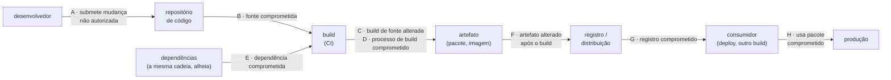

# Ponto 8 — Segurança da cadeia de suprimentos de software

## Objetivo

Entender a cadeia de suprimentos de software como o conjunto de tudo que entra no artefato final sem ter sido escrito pelo time — dependências, ferramentas de build, serviços de integração contínua, registros de pacotes, imagens base — e como cada elo pode ser atacado; o que se toma como dado, que regras não podem falhar, quais arcabouços e técnicas nomeados existem (SLSA, SSDF, SBOM, Sigstore, in-toto, TUF, builds reprodutíveis) e que mecanismos os executam. E entender a diferença entre o problema que a análise de composição resolve (dependência com falha conhecida) e o problema que este ponto trata (dependência, build ou distribuição comprometidos de propósito).

Referências principais: SLSA v1.0 (OpenSSF, 2023) para o modelo de ameaças e os níveis; NIST SP 800-218 (SSDF, 2022) para as práticas; Ladisa et al. (2023), "SoK: Taxonomy of Attacks on Open-Source Software Supply Chains" para a taxonomia de ataques; Thompson (1984), "Reflections on Trusting Trust" para o fundamento. Os incidentes e as técnicas têm fonte própria no corpo do texto.

O ponto 7 terminou com a análise de composição: inventário mais vulnerabilidade conhecida. Este ponto começa onde ela para: a dependência que não tem CVE porque foi envenenada ontem, o build que produz um binário diferente do código revisado, o pacote legítimo substituído no caminho até o deploy. O ponto 9 pegará o artefato que sai daqui — a imagem de contêiner — e o colocará em produção.

---

## 1. Código que você não escreveu — a pergunta que o ponto responde

### A fração que não é sua

Estudos anuais da indústria (o relatório OSSRA da Synopsys, por exemplo) colocam entre 70% e 90% a fração de uma aplicação moderna que é código aberto de terceiros; um aplicativo web típico carrega centenas de pacotes, a maioria transitivos — escolhidos por ninguém do time. A isso se somam o compilador, o gerenciador de pacotes, o serviço de CI, o registro de contêineres, a imagem base do sistema operacional, as *actions* e *plugins* do pipeline. O artefato que vai para produção é, em volume, majoritariamente trabalho alheio, e o time o assina como se fosse seu.

### Confiar sem verificar

Thompson (1984), ao receber o prêmio Turing, descreveu um compilador que insere uma porta dos fundos no programa de login ao compilá-lo e insere a si mesmo ao compilar o compilador — de modo que nenhuma inspeção do código-fonte revela nada. A lição que ele tira: não se pode confiar em código que não se escreveu por inteiro, e ninguém escreve por inteiro. A resposta não é desconfiar de tudo (impossível) nem confiar em tudo (o que a indústria fez por trinta anos); é tornar a confiança *verificável* — saber de onde veio cada peça, quem a produziu, se o que se recebeu é o que foi produzido, e reconstruir quando possível.

### Por que agora

Os ataques passaram de hipótese a rotina em meia década. SolarWinds (2020): o sistema de build da empresa foi comprometido e inseriu código malicioso em atualizações assinadas do produto Orion, distribuídas a cerca de 18 mil clientes, inclusive agências do governo americano. Codecov (2021): um script de upload usado em milhares de pipelines foi alterado para exfiltrar variáveis de ambiente — isto é, credenciais. Log4Shell (2021): uma vulnerabilidade em uma biblioteca de log presente em uma fração enorme do software Java do mundo, que a maioria das organizações não sabia que carregava. xz-utils (2024): um colaborador construiu reputação em um projeto de compressão por dois anos, tornou-se mantenedor e inseriu uma porta dos fundos no processo de build que alcançaria o servidor SSH de distribuições Linux — descoberta por acaso, por um engenheiro que notou meio segundo de atraso. O decreto executivo 14028 dos Estados Unidos (2021) respondeu exigindo SBOM e práticas de desenvolvimento seguro dos fornecedores do governo, e a partir dele vieram o SSDF e a adoção de SLSA.

### Exemplo

A API de pagamentos: serviço em Rails, gateway em Go, decodificador em C, front-end em TypeScript. O `Gemfile.lock` tem 180 gems; o `package-lock.json`, 1.400 pacotes; o pipeline usa 12 *actions* de terceiros do GitHub; a imagem base é `ruby:3.3`; o deploy puxa a imagem de um registro. Perguntas que o ponto responde: se um dos 1.400 pacotes for substituído por uma versão maliciosa esta noite, o pipeline percebe? Se a *action* que publica a imagem for comprometida, o que ela alcança? O binário em produção foi construído a partir do commit que passou pela revisão? Alguém consegue reconstruí-lo e obter o mesmo hash? Se amanhã sair uma CVE em uma biblioteca, em quanto tempo se sabe se ela está em produção e onde?

---

## 2. Fundamentos — o que se toma como dado

| Fundamento | Premissa | O que decorre dela |
|---|---|---|
| Código que você não escreveu é seu risco | a maior parte do artefato é de terceiros; o incidente é seu | inventário completo e atualizado é o controle primário; "não sabia que usava" não é defesa |
| Confiança precisa ser verificável, não assumida | repositório, build e registro podem ser comprometidos sem que o código-fonte mostre | proveniência assinada, verificação de integridade e, onde possível, reconstrução |
| A cadeia tem muitos elos e o atacante escolhe o mais fraco | fonte, dependência, build, distribuição e consumo são superfícies distintas | o controle é por elo; proteger só a dependência deixa o build aberto |
| Integridade é prova criptográfica mais política | um hash sem quem o assinou não prova nada; uma assinatura sem política que a exija não protege | assinatura ligada a identidade, registro transparente, e verificação obrigatória antes de usar |

### Código que você não escreveu é seu risco

A responsabilidade pelo artefato em produção é de quem o coloca lá, não de quem escreveu cada linha. O Log4Shell tornou isso visível: organizações levaram semanas para descobrir *onde* estavam vulneráveis, porque não tinham inventário. A premissa produz a primeira regra do ponto: saber o que se roda — cada dependência direta e transitiva, cada imagem base, cada ferramenta do pipeline — em formato legível por máquina (SBOM), gerado a cada build, consultável no dia do incidente.

### Confiança precisa ser verificável, não assumida

O compilador de Thompson é o caso extremo; os casos comuns são mais banais. O build roda em máquina compartilhada com acesso à rede e segredos de longa duração; o pacote baixado é o que o servidor devolveu, sem verificar hash; a *action* do pipeline aponta para uma *tag* que o mantenedor pode mover; a imagem base é `latest`. Em cada um, a confiança é assumida porque "sempre funcionou". A resposta é fazer a confiança virar evidência: a proveniência (quem construiu o quê, de que fonte, com que ferramenta) é gerada pelo próprio build, assinada, e verificada por quem consome.

### A cadeia tem muitos elos e o atacante escolhe o mais fraco

O modelo de ameaças do SLSA enumera os elos: o desenvolvedor submete código; o repositório o guarda; o build o transforma em artefato; o artefato vai ao registro; o consumidor o baixa e o usa; e, em paralelo, cada dependência percorreu a mesma cadeia em outra organização. O ataque entra onde é mais barato: convencer um mantenedor cansado (xz), roubar um token de CI (Codecov), registrar um pacote com nome parecido (*typosquatting*), publicar em registro público um pacote com o nome de um interno (*dependency confusion*, Birsan, 2021). Controle em um elo não protege o seguinte.

### Integridade é prova criptográfica mais política

Hash verifica que o artefato não mudou desde que o hash foi calculado — mas quem calculou? Assinatura liga o artefato a uma chave — mas de quem é a chave, e ela foi roubada? Um registro de transparência (Rekor, no Sigstore) torna cada assinatura pública e auditável. E nada disso protege se o consumidor não *exige* a verificação: o pipeline que aceita imagem sem assinatura válida tem assinatura decorativa. Técnica sem política é teatro; política sem técnica é intenção.

> **Junta.** Quatro premissas. Antes das técnicas, o mapa da cadeia e das ameaças por elo.

---

## 3. Overview visual — a cadeia e suas ameaças

Leitura: as letras seguem o modelo de ameaças do SLSA v1.0. A a D atacam o que o time controla (fonte e build); E é a cadeia alheia inteira; F a H atacam o caminho entre o build e o uso. SolarWinds é D; Codecov é D com exfiltração; xz é A e E ao mesmo tempo (o atacante virou mantenedor da dependência); *typosquatting* e *dependency confusion* são H; Log4Shell não é ataque à cadeia — é E sem intenção, e é o que a análise de composição (ponto 7) cobre.

---

## 4. Ameaças por elo — e o controle de cada uma

### Fonte: o repositório e quem escreve nele

**Ameaças.** Commit não autorizado (conta de desenvolvedor comprometida, sem 2FA); mudança sem revisão (push direto em `main`); histórico reescrito; mantenedor malicioso ou coagido (xz-utils, 2024: engenharia social de dois anos até receber direitos de mantenedor; event-stream, 2018: mantenedor original transferiu o pacote npm a um desconhecido que inseriu código para roubar carteiras de criptomoeda).

**Controles.** Autenticação forte obrigatória para quem escreve (2FA resistente a *phishing*, ponto 6); proteção de *branch*: revisão obrigatória por segunda pessoa, verificação de status, sem *push* direto, sem *force push*; commits assinados (GPG ou Sigstore *gitsign*) para ligar autoria a identidade; regra de "dois mantenedores" para projetos críticos; varredura de segredos no *push*; para dependências, avaliação da saúde do projeto — número de mantenedores, resposta a *issues*, prática de revisão — com o OpenSSF Scorecard como medida automatizada.

### Dependências: a cadeia alheia

**Ameaças.** *Typosquatting*: pacote `reqeusts` no PyPI para quem erra `requests`; centenas de casos por ano. *Dependency confusion* (Birsan, 2021): a organização usa pacote interno `empresa-utils`; o atacante publica `empresa-utils` no registro público com versão maior; o gerenciador prefere a versão maior. Mantenedor comprometido ou vendido: `ua-parser-js` (2021), credencial do mantenedor roubada, versão maliciosa publicada; `colors` e `faker` (2022), o próprio mantenedor sabotou. Instalação com execução: *scripts* `postinstall` do npm rodam código no momento do `install`. Dependência abandonada com vulnerabilidade sem correção. Cadeia profunda: a vulnerabilidade está na dependência da dependência da dependência.

**Controles.** *Lockfile* versionado com versões exatas e hashes (`package-lock.json`, `Gemfile.lock`, `go.sum`, `poetry.lock`) e instalação que falha se o hash divergir (`npm ci`, `pip install --require-hashes`); registro privado ou *proxy* (Artifactory, Nexus, Verdaccio) que espelha o público, aplica política e reserva os nomes internos (contra *dependency confusion*); escopo de nomes (`@empresa/`) e configuração que impede resolução de pacotes internos no registro público; revisão de dependência nova como mudança de código (quem é o mantenedor, há quanto tempo existe, Scorecard, licença); desabilitar *scripts* de instalação por padrão (`npm config set ignore-scripts true`) e habilitar por exceção; atualização automatizada e frequente (Dependabot, Renovate) com janela de quarentena para versões recém-publicadas (os ataques são descobertos em dias; esperar alguns dias antes de adotar uma versão evita a maioria); análise de composição (ponto 7) para a parte conhecida; minimizar dependências — cada pacote é um mantenedor em quem se confia.

### Build: onde o código vira artefato

**Ameaças.** O serviço de CI compromete-se por token vazado, *action* maliciosa ou máquina compartilhada (Codecov, 2021: o script `bash uploader` servido pelo site foi alterado por meses para enviar variáveis de ambiente — tokens, chaves — a um servidor do atacante); build não hermético baixa dependência da rede no momento do build, sem verificação; segredos de longa duração disponíveis a qualquer passo do pipeline; *action* de terceiro referenciada por *tag* móvel (`uses: org/action@v1`) que o mantenedor — ou quem roubou a conta dele — pode apontar para outro código; build de fonte diferente da revisada (SolarWinds, 2020: o malware SUNSPOT monitorava o processo de build e substituía um arquivo-fonte durante a compilação, de modo que o repositório ficava limpo e o binário assinado saía infectado).

**Controles.** Build em *runner* efêmero (criado para o build, destruído depois) com rede restrita; build hermético (todas as entradas declaradas e buscadas por hash antes, nenhuma rede durante); segredos de curta duração emitidos ao build por identidade federada (OIDC do CI para a nuvem) em vez de chave fixa, com o menor escopo; *actions* e *plugins* fixados por hash do commit (`uses: org/action@<sha>`), nunca por *tag*; separação entre o build e a assinatura (o passo que assina não roda código de terceiros); proveniência gerada pelo próprio serviço de build, descrevendo fonte (commit), receita e dependências, assinada por identidade do build e não por chave que um passo possa ler (SLSA Build L3); builds reprodutíveis quando possível, para que um terceiro reconstrua e compare.

### Distribuição: do build ao consumidor

**Ameaças.** Artefato alterado depois do build e antes de publicar; registro comprometido servindo versão alterada; canal de distribuição sem integridade (HTTP, *mirror* sem verificação); chave de assinatura roubada e usada para assinar o artefato alterado (SolarWinds também: o binário saiu assinado com a chave legítima); *rollback* — o atacante serve uma versão antiga, assinada, com vulnerabilidade conhecida.

**Controles.** Assinatura do artefato ligada a identidade verificável, com registro de transparência (Sigstore: *cosign* assina, Fulcio emite certificado de curta duração para a identidade OIDC do pipeline, Rekor registra publicamente); proveniência SLSA junto do artefato; The Update Framework (TUF — Samuel, Mathewson, Cappos e Dingledine, 2010) para repositórios de pacotes: papéis separados (raiz, alvos, *snapshot*, *timestamp*), chaves *offline* para a raiz, metadados com prazo para impedir *rollback* e *freeze*, de modo que o comprometimento de uma chave ou do servidor não baste; registros com publicação autenticada por identidade federada (PyPI *Trusted Publishers* e npm *provenance*, ambos de 2023, usam OIDC do CI em vez de token de longa duração); promoção de artefato entre ambientes por hash, nunca por *tag* mutável.

### Consumo: quem usa o artefato

**Ameaças.** Deploy que puxa `latest`; cluster que aceita qualquer imagem; desenvolvedor que instala pacote de qualquer fonte; verificação de assinatura desligada "porque quebrou"; SBOM gerado e nunca lido.

**Controles.** Política de admissão que exige assinatura válida e proveniência de nível mínimo antes de rodar (Kyverno, Gatekeeper, *policy-controller* do Sigstore em Kubernetes); referência por *digest*, não por *tag*; verificação de hash na instalação de pacotes; SBOM do artefato armazenado e consultável, cruzado continuamente com novas CVEs (é o que transforma o dia do próximo Log4Shell de semanas em minutos); VEX para registrar o que não afeta; imagem base mínima e fixada por *digest* (ponto 9).

### Anatomia de três incidentes — e onde cada controle teria agido

**SolarWinds, 2020 (elo: build, ameaça D).** O atacante obteve acesso à rede da SolarWinds e instalou nos servidores de build um implante (SUNSPOT) que esperava o processo de compilação do Orion começar, substituía um arquivo-fonte específico por uma versão com a porta dos fundos (SUNBURST), aguardava a compilação e restaurava o original. O repositório ficou limpo; a revisão de código não via nada; o binário saía assinado com a chave legítima da empresa, porque a assinatura acontecia depois do build, no mesmo ambiente. Cerca de 18 mil clientes instalaram a atualização. **O que teria agido:** build hermético e efêmero (o implante não sobreviveria entre builds nem teria acesso ao fonte em disco); proveniência gerada pelo serviço de build e não pela máquina (SLSA L3: a proveniência atestaria o commit, e o binário não corresponderia a ele); builds reprodutíveis (um terceiro reconstruiria do fonte e obteria hash diferente); separação entre build e assinatura. Nenhum controle de dependência ou de SCA teria visto — o código era da própria empresa.

**Codecov, 2021 (elo: build, ameaça D com exfiltração).** O *bash uploader* — um script que milhares de pipelines baixavam com `curl | bash` para enviar relatórios de cobertura — foi alterado no servidor da Codecov por um atacante que obteve credencial a partir de um erro na imagem Docker da empresa. Por dois meses, o script enviava as variáveis de ambiente do pipeline (tokens de nuvem, chaves de API, credenciais de repositório) a um servidor externo. **O que teria agido, do lado do consumidor:** fixar o script por hash e verificar antes de executar (a Codecov publicava o hash; poucos conferiam); segredos de curta duração por OIDC em vez de tokens fixos em variável de ambiente (o que vazasse expiraria em minutos); menor privilégio no *job* (o passo de cobertura não precisa de credencial de deploy); *runner* com rede de saída restrita. **Do lado do fornecedor:** build e distribuição assinados, com verificação pelo cliente.

**xz-utils, 2024 (elos: fonte e dependência, ameaças A e E).** Um colaborador sob o nome "Jia Tan" contribuiu por cerca de dois anos com o projeto de compressão xz, mantido por uma única pessoa sobrecarregada; outras contas pressionaram o mantenedor a dividir o trabalho; Jia Tan tornou-se co-mantenedor, e nas versões 5.6.0 e 5.6.1 inseriu — em arquivos de teste binários e em *scripts* de build gerados, não no código-fonte legível — uma porta dos fundos que, ao ser carregada pelo servidor SSH de distribuições Linux via dependência indireta (systemd → liblzma), permitiria execução remota com chave do atacante. Foi descoberta antes de chegar às distribuições estáveis por um engenheiro da Microsoft que investigou meio segundo de lentidão no SSH. **O que teria agido:** regra de dois mantenedores para projetos críticos (não havia dois); builds reprodutíveis a partir do fonte versionado (o *tarball* de release diferia do repositório — a porta estava no *tarball*); revisão de artefatos binários no repositório (arquivos de teste opacos); quarentena de versões novas em distribuições (o Debian *unstable* a recebeu em dias); e, estruturalmente, financiamento e redundância de mantenedores de dependências críticas (o problema que o projeto OpenSSF Alpha-Omega tenta tratar). Nenhum SCA teria visto: não havia CVE, e o código-fonte estava limpo.

O que os três mostram juntos: a vulnerabilidade da cadeia é a confiança não verificada em um elo — o servidor de build, o script baixado, o mantenedor novo. O controle é sempre o mesmo em forma: tornar aquele elo verificável por quem depende dele.

### A proveniência SLSA — o que o documento diz

A proveniência é um documento JSON (formato de atestação in-toto) assinado pelo *builder*, com quatro partes. **Sujeito**: o artefato produzido, por nome e hash. **Builder**: identificador do serviço de build que atesta (por exemplo, o *workflow* reutilizável oficial no GitHub Actions) — é quem assina, e é por isso que o código construído não pode forjar o documento. **Invocação**: o que foi pedido — repositório, commit, *workflow*, parâmetros — de modo que o consumidor verifica que o artefato veio do commit que passou pela revisão. **Materiais** (ou dependências resolvidas): o que entrou no build, por nome e hash — o código-fonte, as imagens base, os pacotes baixados. O consumidor verifica a assinatura contra a identidade esperada do *builder*, confere que o sujeito é o artefato que tem em mãos, e aplica política: "só aceito imagens cujo *builder* é X, cujo repositório é Y, construídas de *branch* `main`". É a diferença entre "a imagem está assinada" e "a imagem foi construída pelo pipeline que eu conheço a partir do código que eu revisei".

> **Junta.** Ameaças e controles por elo. As regras que atravessam todos os elos vêm a seguir.

---

## 5. Princípios

| Princípio | Regra | Fonte |
|---|---|---|
| Inventário completo e legível por máquina | tudo que entra no artefato está listado, com versão e hash, gerado a cada build | EO 14028 (2021); NTIA *Minimum Elements for an SBOM* (2021) |
| Verificar, não confiar | toda entrada do build e do deploy é verificada por hash ou assinatura antes de usar | Thompson (1984); SLSA (2023) |
| Fixar e atualizar | versões exatas e hashes fixados; atualização frequente e deliberada, com quarentena | SSDF PW.4, PS.3 |
| Menor privilégio no pipeline | segredo de curta duração, escopo mínimo, identidade federada; nenhum passo vê o que não precisa | Saltzer e Schroeder (1975); SLSA Build L3 |
| Build hermético e efêmero | entradas declaradas, sem rede durante, ambiente destruído depois | SLSA Build L3; Reproducible Builds |
| Proveniência gerada por quem constrói, não por quem é construído | o serviço de build atesta; o código construído não pode falsificar a própria proveniência | SLSA; in-toto (2019) |
| Separação de deveres | quem escreve não aprova sozinho; quem constrói não assina com chave que pode ler; quem publica é identidade, não token | Clark e Wilson (1987); ponto 3 |
| Minimizar | cada dependência é um mantenedor em quem se confia; menos dependências, menos elos | superfície de ataque (ponto 2) |
| Reprodutibilidade quando possível | o mesmo fonte produz o mesmo binário bit a bit; terceiros podem conferir | Lamb e Zacchiroli (2021) |
| Responder como processo | CVE em dependência tem SLA por severidade e exposição; SBOM diz onde | SSDF RV; ponto 10 |

### Contêineres e imagens como cadeia de suprimentos

A imagem de contêiner é a cadeia de suprimentos empacotada: a imagem base traz um sistema operacional inteiro com seus pacotes; cada camada acrescenta ferramentas, bibliotecas e a aplicação; o resultado vai a um registro e de lá para o cluster. Cada passo é um elo. **Imagem base**: `latest` é referência móvel — o que roda hoje não é o que rodou ontem; a regra é fixar por *digest* e atualizar pelo robô de dependências. Imagens mínimas (*distroless*, Alpine, *scratch* para binários estáticos) reduzem o inventário e, com ele, as CVEs que não têm nada a ver com a aplicação (a maioria dos achados de varredura de imagem é em pacotes do sistema operacional que a aplicação nunca chama). **Construção**: o `Dockerfile` baixa pacotes — com hash ou sem? — e copia segredos — que ficam na camada mesmo depois de apagados. Build em múltiplos estágios deixa fora da imagem final o compilador e as ferramentas de build. **Varredura**: Trivy, Grype e os scanners dos registros listam pacotes por camada e cruzam com CVE — é SCA para imagem — e checam configuração do `Dockerfile` (usuário root, porta exposta, segredo em `ENV`). **Assinatura e admissão**: a imagem é assinada (cosign) e acompanhada de SBOM e proveniência como *referrers* OCI; o cluster só admite o que verifica. O ponto 9 retoma a imagem em execução; aqui ela é o artefato que a cadeia entrega.

### Governança: a cadeia como relação com fornecedores

Técnica resolve o elo; política decide o que se exige de cada fornecedor. O NIST SP 800-161 rev. 1 (2022), *Cybersecurity Supply Chain Risk Management*, trata a cadeia como gestão de risco organizacional: inventário de fornecedores e componentes críticos, critérios de seleção, cláusulas contratuais, monitoramento e resposta. Na prática de software, três documentos curtos fazem a governança: a **política de dependências** (quem pode adicionar, o que se verifica — Scorecard mínimo, licença, mantenedores —, qual o prazo de atualização por severidade, o que é proibido — *scripts* de instalação, fonte fora do registro privado); o **inventário de fornecedores de software** (serviços de CI, registros, provedores de nuvem, SaaS que tocam o código) com o que se exige de cada um — autoatestação SSDF, SBOM, SLA de correção, notificação de incidente; e o **plano de resposta** para o dia da CVE crítica ou do fornecedor comprometido: quem decide, em quanto tempo, com que informação (o SBOM). O decreto 14028 e a autoatestação SSDF (formulário da CISA, 2023) formalizaram isso para quem vende ao governo americano; compradores privados copiaram o modelo em contrato.

### Código aberto como fornecedor que não se contrata

A maior parte das dependências vem de projetos sem empresa por trás: um mantenedor, ou dois, sem remuneração, sustentando código do qual dependem milhares de organizações — a situação que a tira *Dependency* (xkcd 2347) tornou proverbial e que o caso xz tornou concreta. O risco não é a licença; é a sustentabilidade: mantenedor único é ponto único de falha, para esgotamento, para venda do pacote, para engenharia social. Respostas em três níveis. **Do consumidor**: preferir dependências com mais de um mantenedor ativo e processo de revisão (o Scorecard mede), reduzir o número de dependências, e contribuir — revisão, correção, financiamento — para as que são críticas. **Da comunidade**: OpenSSF Alpha-Omega (2022) financia segurança em projetos críticos; o *Securing Open Source Software Act* e iniciativas europeias (o *Cyber Resilience Act*, 2024, com obrigações para quem comercializa software com componentes abertos) tentam distribuir o custo. **Dos registros**: 2FA obrigatória para mantenedores de pacotes populares (npm e PyPI desde 2022–2023), publicação por identidade federada, *provenance* por padrão. Nada disso substitui o inventário e a verificação do lado de quem consome; reduz a probabilidade de que o elo quebre.

> **Junta.** Regras ditas; agora os arcabouços e técnicas com nome que as tornam repetíveis.

---

## 6. Técnicas e arcabouços

### SLSA — níveis de integridade do build

**O que é.** *Supply-chain Levels for Software Artifacts* (OpenSSF, v1.0 em 2023; originado no Google a partir do processo interno *Binary Authorization for Borg*): um modelo de ameaças (as letras da seção 3) e uma escada de níveis para a trilha de build. **Build L0**: nenhuma garantia. **Build L1**: o build gera proveniência (documento que diz como o artefato foi produzido) — protege contra erro, não contra atacante. **Build L2**: a proveniência é gerada pelo serviço de build hospedado e assinada, de modo que o consumidor pode verificar que veio daquele serviço — protege contra alteração depois do build. **Build L3**: o serviço de build é endurecido — builds isolados entre si, segredos de assinatura inacessíveis ao código do build, proveniência não falsificável — protege contra a maioria dos ataques ao processo de build (D). A versão 1.0 cobre a trilha de build; trilhas de fonte e de dependências estão em elaboração.

**Mecanismo.** Serviços de CI que emitem proveniência SLSA (GitHub Actions com os *builders* oficiais do projeto SLSA; Google Cloud Build; Tekton Chains); verificação no consumo com `slsa-verifier`; política que exige nível mínimo por tipo de artefato.

### in-toto — atestações de cada passo

**O que é.** Torres-Arias et al. (2019): um arcabouço em que cada passo da cadeia (clonar, testar, construir, empacotar) produz uma *atestação* assinada — quem fez, com que entradas (hashes), que saídas (hashes) — e um *layout* assinado pelo dono do projeto declara que passos são esperados, por quem, e como as saídas de um devem ser as entradas do seguinte. O consumidor verifica a cadeia inteira de atestações contra o *layout*. A proveniência SLSA é um tipo de atestação in-toto; o formato de atestação do in-toto é o que o Sigstore e o SLSA usam.

**Mecanismo.** Atestações geradas no pipeline, armazenadas junto do artefato (no registro OCI, como *referrers*) e verificadas na admissão.

### Sigstore — assinatura sem gestão de chaves

**O que é.** Newman, Meyers, Torres-Arias et al. (2022): resolver o problema que impedia a assinatura de software em escala — gestão de chaves de longa duração. Três peças: *Fulcio*, autoridade certificadora que emite certificado de minutos para uma identidade OIDC (o e-mail do desenvolvedor, ou a identidade do *job* de CI); *Rekor*, registro de transparência *append-only* em que toda assinatura é publicada e auditável; *cosign*, a ferramenta que assina e verifica artefatos (imagens, binários, SBOMs) e atestações. O resultado é assinatura ligada a identidade verificável, sem chave para roubar, com histórico público. npm e PyPI adotaram o modelo para proveniência de pacotes em 2023.

**Mecanismo.** `cosign sign` no passo final do pipeline com identidade OIDC do *job*; `cosign verify` com a identidade esperada na admissão; *policy-controller* em Kubernetes.

### TUF — repositórios de pacotes que resistem a comprometimento

**O que é.** *The Update Framework* (Samuel et al., 2010; projeto graduado da CNCF): um desenho de metadados assinados para repositórios de software que assume que o repositório e algumas chaves serão comprometidos e limita o dano. Quatro papéis com chaves separadas — raiz (*offline*, raramente usada, define os outros), alvos (assina os pacotes), *snapshot* (assina o estado consistente do repositório), *timestamp* (assina com prazo curto que o estado é recente) — de modo que servir uma versão antiga (*rollback*), congelar o cliente numa versão (*freeze*) ou misturar versões (*mix-and-match*) é detectado, e o roubo de uma chave não permite publicar sem as outras. Implementado em registros de contêineres (Notary, originalmente), em PyPI (parcialmente) e em sistemas de atualização de veículos (Uptane).

### Builds reprodutíveis

**O que é.** O mesmo código-fonte, com as mesmas ferramentas declaradas, produz o mesmo binário bit a bit, em qualquer máquina (Lamb e Zacchiroli, 2021; projeto Reproducible Builds, iniciado no Debian em 2013). Elimina as fontes de variação — carimbos de tempo, caminhos absolutos, ordem de arquivos, aleatoriedade — do processo de build. O ganho de segurança é direto: um terceiro independente reconstrói e compara; se o hash difere, o build foi adulterado. É a resposta prática a Thompson: não se confia no build, confere-se.

**Mecanismo.** Ferramentas de build determinísticas (Bazel, Nix); `SOURCE_DATE_EPOCH`; comparação de builds por *rebuilders* independentes; a maioria dos pacotes do Debian e do Arch já é reprodutível.

### SBOM e VEX — inventário e exploração

**O que é.** O *software bill of materials* é a lista legível por máquina dos componentes de um artefato, com nome, versão, fornecedor, hash e relações de dependência. Dois formatos dominantes: SPDX (Linux Foundation; ISO/IEC 5962:2021) e CycloneDX (OWASP). A NTIA (2021) definiu os elementos mínimos após o decreto 14028. O VEX (*Vulnerability Exploitability eXchange*, CISA, 2022; perfis em CycloneDX e OpenVEX) complementa: para uma CVE em um componente do SBOM, o fornecedor declara "não afetado", "afetado", "corrigido" ou "em investigação", com justificativa — o que evita que cada consumidor reinvestigue a mesma CVE transitiva não alcançável.

**Mecanismo.** SBOM gerado no build (Syft, CycloneDX Maven/npm, `cargo sbom`), assinado e anexado ao artefato; armazenado em repositório consultável (Dependency-Track); cruzado continuamente com bases de CVE; VEX emitido pelo time para as CVEs triadas.

### SSDF — o arcabouço de práticas

**O que é.** NIST SP 800-218 (2022), produzido em resposta ao decreto 14028: quatro grupos de práticas para quem produz software — *Prepare the Organization* (PO), *Protect the Software* (PS: proteger código e artefatos contra adulteração, arquivar e proteger cada versão, publicar proveniência), *Produce Well-Secured Software* (PW: inclui reutilizar componentes seguros, PW.4, e configurar build com segurança, PW.6) e *Respond to Vulnerabilities* (RV). Não prescreve ferramenta; prescreve resultado, e referencia SLSA, SBOM e os demais. É o que o governo americano exige de fornecedores por autoatestação desde 2023, e o que grandes compradores passaram a exigir em contrato.

### OpenSSF Scorecard e a avaliação de dependências

**O que é.** Verificação automatizada (OpenSSF, 2020) de práticas de segurança de um repositório de código aberto: *branch* protegida, revisão de código, dependências fixadas, assinatura de releases, fuzzing, SAST, ausência de binários no repositório, mantenedores ativos, vulnerabilidades abertas. Produz nota de 0 a 10 por verificação. Serve para decidir se uma dependência nova entra e para acompanhar as existentes; e para o próprio projeto, como lista de controles a adotar.

### Higiene do pipeline — o conjunto mínimo

Sem arcabouço, só prática: *actions* fixadas por hash; `permissions` mínimas no *workflow*; segredos por OIDC e não por token fixo; *runners* efêmeros; nenhum segredo em *workflow* disparado por *pull request* de *fork*; *lockfile* obrigatório e `npm ci`; `ignore-scripts`; registro privado como *proxy*; imagem base por *digest*; varredura de segredos; assinatura e verificação de imagem; SBOM por build. É o que o CIS *Software Supply Chain Security Guide* (2022) lista, e o que a maioria dos incidentes da seção 1 teria impedido.

### Adotar em degraus — um roteiro de noventa dias

Os arcabouços descrevem o destino; a adoção é escada. **Primeiro mês, visibilidade**: *lockfile* em todo repositório e instalação que falha em divergência; SBOM gerado a cada build e guardado; Scorecard rodando nas dependências diretas; inventário das *actions* e serviços do pipeline. Nada ainda bloqueia; o time aprende o que tem. **Segundo mês, fixação e privilégio**: *actions* por hash; `permissions` mínimas; segredos fixos trocados por OIDC; registro privado como *proxy* com escopos reservados; `ignore-scripts`; imagem base por *digest*; *runners* efêmeros. É o mês que fecha Codecov e *dependency confusion*. **Terceiro mês, proveniência e política**: *builder* que emite proveniência SLSA (L2, depois L3 para os artefatos críticos); assinatura com *cosign* por identidade do *job*; política de admissão em modo auditoria, depois em modo bloqueio; VEX para as CVEs triadas; SLA por severidade escrito e medido. Depois: reprodutibilidade para o que processa entrada hostil, regra de dois mantenedores para o que é crítico, redução do número de dependências como meta trimestral. A ordem importa: política de admissão antes de proveniência bloqueia tudo; proveniência sem política é decorativa.

### A cadeia do próprio ambiente de desenvolvimento

A cadeia não termina no pipeline. **Extensões de IDE** executam com os privilégios do desenvolvedor e leem tudo que ele lê; marketplaces já serviram extensões maliciosas e *typosquatting* de extensões populares. **Ferramentas de linha de comando** instaladas com `curl | bash` são o Codecov em escala pessoal. **Agentes de IA que escrevem código** sugerem dependências que não existem — e atacantes registram os nomes alucinados no registro público (*slopsquatting*, 2024–2025) — e podem ser induzidos por instruções escondidas em arquivos do repositório a executar comandos. **Modelos e pesos** baixados de repositórios públicos são artefatos como outros: formatos serializados executáveis (*pickle*), sem assinatura, sem proveniência. As regras são as mesmas do resto do ponto: inventário do que se instala, verificação de origem e hash, menor privilégio para a ferramenta (o agente não tem credencial de produção), revisão humana de dependência nova sugerida por máquina, e formato seguro para artefatos (safetensors em vez de *pickle*). O elo mais fraco mudou de lugar; o controle não.

> **Junta.** Arcabouços nomeados. O mesmo sistema, com a cadeia endurecida.

---

## 7. Exemplo guiado — a cadeia da API de pagamentos

**Fonte.** 2FA com chave FIDO2 obrigatória para todos com escrita; *branch* `main` protegida: revisão por segunda pessoa, verificações obrigatórias, sem *push* direto, sem *force push*; commits assinados com *gitsign* (Sigstore); varredura de segredos no *push*; dependência nova exige *pull request* próprio com Scorecard e justificativa.

**Dependências.** *Lockfiles* versionados em Ruby, Node e Go; instalação com `bundle install --frozen`, `npm ci`, `go mod verify`; `ignore-scripts` no npm com lista de exceções; registro privado (Artifactory) como *proxy* único, com os escopos `@pagamentos/` reservados e resolução de pacotes internos bloqueada no registro público; Renovate com quarentena de 5 dias para versão nova e agrupamento semanal; SCA (ponto 7) com política de alcançabilidade; meta de reduzir o `package-lock.json` de 1.400 para menos de 800 pacotes em dois trimestres, removendo dependências com um mantenedor e sem atividade.

**Build.** GitHub Actions com *runners* efêmeros; todas as *actions* fixadas por hash do commit e revisadas por Renovate; `permissions: read-all` no *workflow* com elevação por *job*; credenciais da nuvem por OIDC do *job*, escopo mínimo, sem segredo fixo; build hermético para o decodificador em C (Bazel) e para o gateway em Go (módulos verificados antes, sem rede durante); o passo de assinatura em *job* separado que não executa código do repositório; proveniência SLSA Build L3 gerada pelo *builder* oficial e anexada à imagem.

**Distribuição.** Imagens assinadas com *cosign* pela identidade OIDC do *job* de release, registradas no Rekor; SBOM (CycloneDX, via Syft) gerado, assinado e anexado como *referrer* da imagem; promoção entre ambientes por *digest*; o pacote interno `pagamentos-sdk` publicado no npm com *provenance* via *Trusted Publisher*.

**Consumo.** Cluster Kubernetes com *policy-controller* exigindo assinatura da identidade esperada e proveniência SLSA L3 para qualquer imagem no *namespace* de produção; referência por *digest* em todos os manifestos; imagem base `distroless` fixada por *digest* e atualizada pelo Renovate; SBOMs em Dependency-Track cruzados diariamente com NVD e OSV, alertas por severidade; VEX emitido para CVEs triadas como não alcançáveis.

**Resposta.** No próximo Log4Shell: consulta ao Dependency-Track responde em minutos quais imagens em produção contêm a versão afetada; SLA por severidade e exposição (crítica exposta: 48 horas); o *pull request* do Renovate já está aberto; a imagem nova sai com proveniência e assinatura; a política de admissão garante que a antiga não volta.

O que o exemplo mostra: cada elo recebe o controle do seu elo, e a verificação acontece onde o artefato é consumido. A cadeia não ficou confiável; ficou *verificável*.

---

## 8. Erros frequentes — o que não confundir

| Confusão | Por que está errado | Como dizer certo |
|---|---|---|
| "SCA resolve cadeia de suprimentos" | SCA vê CVE conhecida; pacote malicioso, build comprometido e distribuição adulterada não têm CVE | "SCA é a parte conhecida; proveniência, assinatura e política são a cadeia" |
| "SBOM é segurança" | SBOM é inventário; sozinho não impede nada | "SBOM é o que torna a resposta possível; o controle é o que se faz com ele" |
| "Assinamos, logo está íntegro" | assinatura sem identidade verificável e sem verificação obrigatória no consumo é decorativa | "assinatura ligada a identidade, registro de transparência, política que exige" |
| "Fixar versão basta" | versão fixa sem hash ainda confia no registro; *tag* de *action* é móvel | "fixar por hash e verificar na instalação" |
| "Log4Shell foi ataque à cadeia" | foi vulnerabilidade em dependência, sem atacante na cadeia; o problema foi inventário | "Log4Shell é E sem intenção — caso para SCA e SBOM; SolarWinds é D — caso para SLSA" |
| "Código aberto é mais arriscado que fechado" | SolarWinds era fechado; o problema é verificabilidade, não licença | "aberto permite auditar e reproduzir; o risco é confiar sem verificar, em ambos" |
| "O CI é interno, logo confiável" | Codecov e SolarWinds entraram pelo build; o CI tem segredos e rede | "o build é fronteira de confiança: efêmero, hermético, menor privilégio" |
| "Reprodutibilidade é perfeccionismo" | é o único jeito de um terceiro conferir que o binário veio do fonte | "reprodutível onde possível; proveniência assinada sempre" |
| "Dependabot aberto é dívida" | atualização pequena e frequente é mais barata que migração de emergência | "atualizar é rotina com quarentena; adiar é acumular" |

---

## 9. Síntese

| Elo | Ameaças (SLSA) | Princípio | Técnica (fonte) | Mecanismo |
|---|---|---|---|---|
| Fonte | A, B: mudança não autorizada; repositório ou mantenedor comprometido (xz, event-stream) | separação de deveres; autenticação forte | *branch protection*; commits assinados; Scorecard (OpenSSF, 2020) | 2FA FIDO2, revisão obrigatória, *gitsign*, varredura de segredos |
| Dependências | E, H: *typosquatting*, *dependency confusion* (Birsan, 2021), mantenedor comprometido, *postinstall* | fixar e verificar; minimizar; quarentena | *lockfile* com hash; registro privado; revisão de dependência; SCA (ponto 7) | `npm ci`, `--require-hashes`, escopos reservados, `ignore-scripts`, Renovate |
| Build | C, D: fonte substituída no build (SolarWinds), CI comprometido (Codecov) | hermético e efêmero; menor privilégio; proveniência de quem constrói | SLSA Build L1–L3 (2023); in-toto (2019); builds reprodutíveis (2021) | *runner* efêmero, OIDC, *actions* por hash, assinatura em *job* separado, Bazel/Nix |
| Distribuição | F, G: artefato alterado, registro comprometido, *rollback* | integridade = prova + política | Sigstore (2022); TUF (2010); SBOM (SPDX/CycloneDX) | *cosign* + Fulcio + Rekor, *Trusted Publishers*, promoção por *digest* |
| Consumo | H: usa artefato não verificado | verificar antes de usar; responder como processo | política de admissão; VEX (CISA, 2022); SSDF RV | *policy-controller*, referência por *digest*, Dependency-Track |
| Transversal | — | inventário legível por máquina | SSDF (NIST SP 800-218, 2022); EO 14028 (2021); CIS Guide (2022) | SBOM por build, SLA por severidade |

A cadeia em uma linha: inventário do que entra → cada elo com seu controle → proveniência gerada por quem constrói e assinada por identidade → verificação obrigatória onde se consome → SBOM que diz onde está o problema no dia em que ele aparece. Segurança da cadeia de suprimentos é o ponto do ciclo em que a confiança deixa de ser assumida e vira evidência.

---

## Referências

- **OpenSSF. *SLSA — Supply-chain Levels for Software Artifacts*, v1.0, 2023** — modelo de ameaças (A–H) e níveis Build L0–L3
- **NIST SP 800-218. *Secure Software Development Framework (SSDF)* v1.1, 2022** — práticas PO, PS, PW, RV
- **Executive Order 14028. *Improving the Nation's Cybersecurity*, 2021; NTIA. *The Minimum Elements for a Software Bill of Materials*, 2021**
- **Thompson, Ken. "Reflections on Trusting Trust". *Communications of the ACM*, 27(8), 1984** — não se pode confiar em código que não se escreveu por inteiro
- **Ladisa, Piergiorgio; Plate, Henrik; Martinez, Matias; Barais, Olivier. "SoK: Taxonomy of Attacks on Open-Source Software Supply Chains". *IEEE S&P*, 2023** — taxonomia de ataques e salvaguardas
- **Torres-Arias, Santiago; Afzali, Hammad; Kuppusamy, Trishank Karthik; Curtmola, Reza; Cappos, Justin. "in-toto: Providing Farm-to-Table Guarantees for Bits and Bytes". *USENIX Security*, 2019**
- **Newman, Zachary; Meyers, John Speed; Torres-Arias, Santiago. "Sigstore: Software Signing for Everybody". *CCS*, 2022**
- **Samuel, Justin; Mathewson, Nick; Cappos, Justin; Dingledine, Roger. "Survivable Key Compromise in Software Update Systems". *CCS*, 2010** — The Update Framework (TUF)
- **Lamb, Chris; Zacchiroli, Stefano. "Reproducible Builds: Increasing the Integrity of Software Supply Chains". *IEEE Software*, 2021**
- **Birsan, Alex. "Dependency Confusion: How I Hacked Into Apple, Microsoft and Dozens of Other Companies", 2021**
- **CISA. *Vulnerability Exploitability eXchange (VEX)*, 2022; OpenVEX**
- **Linux Foundation. *SPDX* (ISO/IEC 5962:2021); OWASP. *CycloneDX*** — formatos de SBOM
- **OpenSSF. *Scorecard*, 2020** — avaliação automatizada de práticas de repositórios
- **CIS. *Software Supply Chain Security Guide*, 2022**
- **CNCF. *Software Supply Chain Best Practices*, 2021**
- **CISA. *Alert AA20-352A: APT Compromise of Government Agencies, Critical Infrastructure, and Private Sector Organizations* (SolarWinds), 2020; CrowdStrike. "SUNSPOT: An Implant in the Build Process", 2021**
- **Codecov. *Bash Uploader Security Update*, 2021**
- **Freund, Andres. "backdoor in upstream xz/liblzma leading to ssh server compromise". *oss-security*, 2024**
- **Synopsys. *Open Source Security and Risk Analysis (OSSRA)*, relatório anual** — fração de código aberto em aplicações
- **Clark, David; Wilson, David. "A Comparison of Commercial and Military Computer Security Policies". *IEEE S&P*, 1987** — separação de deveres
- **Saltzer, Jerome; Schroeder, Michael. "The Protection of Information in Computer Systems". *Proc. IEEE*, 1975** — menor privilégio aplicado ao pipeline
- **NIST SP 800-161 rev. 1. *Cybersecurity Supply Chain Risk Management Practices for Systems and Organizations*, 2022** — gestão de risco da cadeia como processo organizacional
- **CISA. *Secure Software Development Attestation Form*, 2023** — autoatestação SSDF para fornecedores do governo americano
- **OpenSSF. *Alpha-Omega*, 2022** — financiamento de segurança em projetos de código aberto críticos
- **União Europeia. *Cyber Resilience Act*, 2024** — obrigações de segurança para produtos com elementos digitais, incluindo componentes abertos
- **Munroe, Randall. *Dependency* (xkcd 2347), 2020** — o mantenedor único como ponto único de falha
