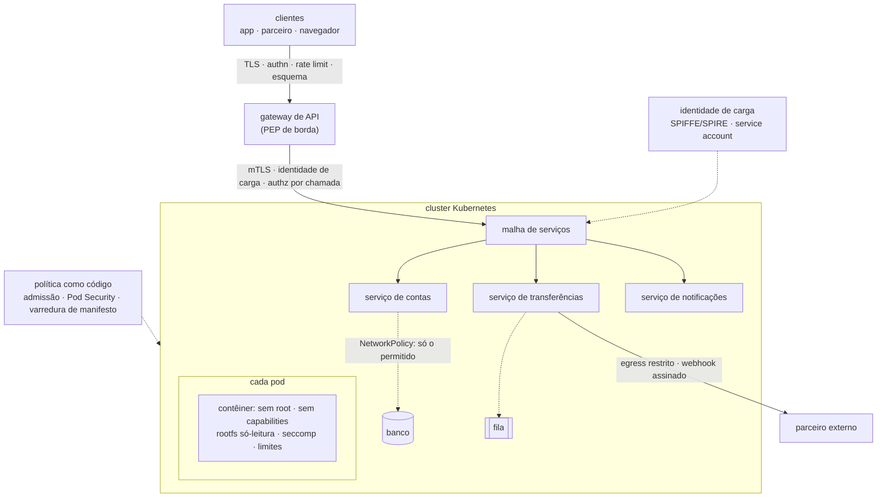

# Ponto 9 — Segurança de APIs, microsserviços e contêineres

## Objetivo

Entender a segurança de APIs, microsserviços e contêineres como a aplicação dos princípios dos pontos anteriores a uma arquitetura em que a fronteira de confiança se multiplicou: cada chamada entre serviços é uma fronteira, cada contrato de API é superfície declarada, cada contêiner é um processo com isolamento parcial, e a própria plataforma é código. O que se toma como dado, que regras não podem falhar, quais técnicas e arcabouços nomeados existem — OWASP API Security Top 10, NIST SP 800-204 e 800-190, Pod Security Standards, SPIFFE, malha de serviços — e que mecanismos os executam.

Referências principais: OWASP *API Security Top 10* (2023); NIST SP 800-204 (2019), *Security Strategies for Microservices-based Application Systems*, com 800-204A (malha de serviços, 2020) e 800-204B (ABAC na malha, 2021); NIST SP 800-190 (2017), *Application Container Security Guide*; NSA e CISA, *Kubernetes Hardening Guide* (v1.2, 2022); Kubernetes *Pod Security Standards*. As fontes específicas aparecem no corpo do texto.

Os pontos 3 a 6 trataram o sistema como se fosse um. O ponto 8 entregou a imagem assinada. Este ponto coloca a imagem em execução ao lado de dezenas de outras, conversando por rede, atrás de um gateway, dentro de um cluster — e pergunta o que mudou. A resposta: nenhum princípio; todas as superfícies.

---

## 1. O que mudou quando o sistema virou muitos — a pergunta que o ponto responde

### A fronteira se multiplicou

No monólito, a fronteira de confiança principal era uma: navegador → servidor. A chamada de função entre o módulo de contas e o de transferências não atravessava rede, não precisava de autenticação e não podia ser interceptada. Em microsserviços, a mesma chamada é uma requisição HTTP ou gRPC entre dois processos, em dois contêineres, possivelmente em dois nós — e tudo que vale para a fronteira externa (ponto 4) passa a valer para ela: a identidade de quem chama precisa ser provada, o dado precisa ser verificado, o canal precisa ser protegido. O "interior confiável" que o modelo de perímetro assumia deixou de existir; é a premissa do Zero Trust (ponto 3) tornada obrigatória pela arquitetura, não escolhida por política.

### O contrato é a superfície

Uma API é superfície de ataque declarada: cada operação do contrato é um ponto de entrada (ponto 2). Isso é bom — o inventário vem de graça do OpenAPI — e perigoso: a API expõe operações pensadas para a tela ("buscar conta por id") a qualquer cliente que fale HTTP, sem a tela que limitava o que se via e o que se pedia. A análise de 2023 da OWASP para APIs tem em primeiro lugar a autorização quebrada por objeto justamente porque a API entrega o identificador ao cliente e espera que ele peça só o que é dele.

### O contêiner é um processo, não uma máquina

Um contêiner é um processo Linux com visão restrita do sistema — *namespaces* para PID, rede, sistema de arquivos, usuários — e limites de recursos (*cgroups*). Compartilha o núcleo com todos os outros contêineres do nó. É mais leve que uma máquina virtual e isola menos: uma vulnerabilidade no núcleo ou no *runtime* (runc, 2019) é escape para o nó inteiro. Tratar o contêiner como VM é o erro de modelo mais comum do ponto; a regra correta é tratá-lo como processo em que se removeu tudo que não é necessário.

### A plataforma é código

Kubernetes, Terraform, Helm, Dockerfile: a infraestrutura que executa a aplicação é descrita em arquivos versionados. A configuração — quem pode falar com quem, com que privilégio, com que segredo — é superfície de ataque e, pelo mesmo motivo, é testável, revisável e sujeita a política automatizada (ponto 7). A má configuração passou a ser a classe dominante de incidente em nuvem porque a plataforma faz exatamente o que o arquivo manda.

### Exemplo

A API de pagamentos, agora em produção: gateway público, serviço de contas, serviço de transferências, serviço de notificações, decodificador do parceiro, banco, fila. Tudo em contêineres num cluster Kubernetes. Perguntas que o ponto responde: o serviço de notificações, se comprometido por uma dependência, consegue chamar o de transferências? Consegue ler o segredo do banco? Consegue escapar para o nó? O gateway impede que um cliente peça mil saldos por segundo? O contrato GraphQL deixa um cliente pedir, numa consulta, todas as contas com todas as transações de todos os clientes? O webhook que o parceiro chama aceita qualquer requisição que pareça vir dele?

---

## 2. Fundamentos — o que se toma como dado

| Fundamento | Premissa | O que decorre dela |
|---|---|---|
| Toda chamada entre serviços cruza uma fronteira | não há "interior confiável"; a rede do cluster é o novo perímetro mole | identidade de carga de trabalho, mTLS e autorização em cada chamada |
| O contrato é a superfície | cada operação da API é ponto de entrada enumerável | inventário por contrato; validação de esquema; autorização por objeto e por propriedade |
| O contêiner é processo com isolamento parcial | núcleo compartilhado; o isolamento é o que sobra depois de remover privilégios | menor privilégio no contêiner: sem root, sem *capabilities*, sistema de arquivos só-leitura, seccomp |
| A plataforma é código | configuração é superfície, e é versionável e testável | política como código, varredura de manifestos, admissão que recusa o não conforme |

### Toda chamada entre serviços cruza uma fronteira

Google, em *BeyondProd* (2019), descreveu o que já fazia internamente: nenhum serviço confia em outro por estar na mesma rede; cada serviço tem identidade criptográfica; toda chamada é autenticada e autorizada; a rede é só transporte. O NIST SP 800-204 (Chandramouli, 2019) formaliza para microsserviços: autenticação mútua entre serviços, autorização por política, segredos por identidade, e a malha de serviços como o lugar natural para aplicar tudo isso sem alterar código de aplicação. A consequência de projeto é que o diagrama de fluxo de dados (ponto 2) ganha uma fronteira em cada seta entre serviços — e cada uma recebe STRIDE.

### O contrato é a superfície

O OpenAPI (ou o esquema GraphQL, ou o `.proto`) é a lista de pontos de entrada em formato legível por máquina. Decorre: o que não está no contrato não deve responder (rotas esquecidas, versões antigas, endpoints de depuração — a categoria "inventário impróprio" da OWASP); o que está no contrato tem esquema, e a requisição que não casa com o esquema é rejeitada na borda antes de chegar ao código; e cada operação tem autorização declarada por objeto e por propriedade, porque o cliente pode pedir qualquer objeto e enviar qualquer propriedade.

### O contêiner é processo com isolamento parcial

O isolamento de um contêiner é a soma de seis *namespaces*, limites de *cgroups*, um conjunto de *capabilities* do núcleo (das 40 e poucas, o Docker concede 14 por padrão, inclusive algumas perigosas), um perfil seccomp que filtra chamadas de sistema (o padrão do Docker bloqueia cerca de 44 das 300 e tantas), e, opcionalmente, um perfil AppArmor ou SELinux. Cada um desses é configurável — e cada um que se relaxa (`--privileged`, `--cap-add`, montagem do *socket* do Docker, `hostPath`) é um pedaço de isolamento que deixa de existir. O NIST SP 800-190 (2017) organiza os riscos em cinco camadas: imagem, registro, orquestrador, contêiner e sistema operacional do nó; os quatro primeiros são software que o time configura.

### A plataforma é código

O manifesto Kubernetes que diz `privileged: true` ou que monta `/var/run/docker.sock` é vulnerabilidade tanto quanto uma injeção — e é encontrada por varredura de arquivo (Checkov, KICS, kube-score) e impedida por admissão (Kyverno, Gatekeeper). O *Pod Security Standards* do Kubernetes codifica três perfis — *privileged*, *baseline*, *restricted* — e o *Pod Security Admission* (estável desde a versão 1.25, 2022) os aplica por *namespace*. A regra que decorre: a configuração passa pelo mesmo pipeline que o código, com os mesmos gates.

> **Junta.** Quatro premissas. Antes das três partes, o mapa de onde cada uma fica.

---

## 3. Overview visual — as camadas e suas fronteiras

Leitura: três anéis. O gateway é a fronteira externa e aplica o que o ponto 4 pediu. A malha é a fronteira entre serviços e aplica o que o Zero Trust pede. O pod é a fronteira do processo e aplica o que o ponto 3 pediu ao contêiner. A política como código atravessa os três e decide o que pode existir no cluster.

---

## 4. APIs

### A lista de 2023

O OWASP API Security Top 10 (2023) é a taxonomia de consciência para APIs, como o Top 10 clássico é para web (ponto 4). As dez categorias, pelo que cada uma é:

| | Categoria | O que é | Controle |
|---|---|---|---|
| API1 | Autorização quebrada no nível de objeto (BOLA) | o cliente pede objeto que não é dele e recebe | autorização por objeto no serviço, filtro por dono na consulta (ponto 6) |
| API2 | Autenticação quebrada | token fraco, sem expiração, sem validação de `aud`; chave de API em URL | ponto 6 inteiro; validação completa do token no gateway *e* no serviço |
| API3 | Autorização quebrada no nível de propriedade | *mass assignment* (o cliente envia `papel=admin` e o servidor grava) e exposição excessiva (o servidor devolve o objeto inteiro e a tela filtra) | esquema de entrada com lista de propriedades aceitas; serializador de saída por lista de permissão |
| API4 | Consumo irrestrito de recursos | sem limite de taxa, de tamanho, de paginação; consulta que custa muito | *rate limit* por cliente, cota, tamanho máximo, paginação obrigatória, tempo limite |
| API5 | Autorização quebrada no nível de função (BFLA) | rota administrativa atende a qualquer autenticado | política por função; rota sem política não existe |
| API6 | Acesso irrestrito a fluxos de negócio sensíveis | automação abusa de fluxo legítimo (comprar tudo, criar mil contas) | detecção de automação, limites por fluxo, *step-up*, análise de comportamento |
| API7 | SSRF | o servidor busca URL do cliente (webhook, importação) | ponto 4: lista de destinos, egress restrito |
| API8 | Configuração insegura | CORS permissivo, erro verboso, TLS fraco, método aberto | ponto 4; varredura de configuração |
| API9 | Inventário impróprio | versão antiga no ar, endpoint de depuração, API "interna" exposta, documentação desatualizada | inventário por contrato; descontinuação com prazo; gateway só roteia o declarado |
| API10 | Consumo inseguro de APIs | confiar na resposta de API de terceiro sem validar; seguir redirecionamento; sem limite | tratar resposta de terceiro como entrada hostil; esquema; tempo limite; sem redirecionamento automático |

O que a lista mostra: seis das dez são autorização, autenticação ou inventário — problemas de fronteira e de contrato, não de código. É por isso que o ponto 6 e o ponto 2 são pré-requisitos deste.

### Princípios para APIs

| Princípio | Regra | O que viola |
|---|---|---|
| O contrato é a verdade | o que não está no OpenAPI não responde; o que está tem esquema e política | rota esquecida; `v1` ainda no ar; esquema desatualizado |
| Validar na borda, autorizar no serviço | gateway valida token, esquema, taxa; o serviço decide por objeto | gateway como único ponto de autorização (não sabe de quem é a conta) |
| Entrada e saída por lista de permissão | propriedades aceitas e devolvidas são enumeradas | *mass assignment*; serializar o objeto inteiro |
| Todo recurso tem limite | taxa, tamanho, profundidade, paginação, tempo | consulta sem `LIMIT`; GraphQL sem limite de profundidade |
| Resposta de terceiro é entrada hostil | validar esquema, limitar tamanho, não seguir redirecionamento | confiar no JSON do parceiro |
| Versão tem fim | descontinuação anunciada, prazo, desligamento | API "legada" indefinidamente no ar |

### Técnicas e mecanismos

**Gateway de API como PEP de borda.** Um ponto por onde todo tráfego externo passa: termina TLS, valida o token (assinatura, `iss`, `aud`, `exp`, escopo — ponto 6), aplica limite de taxa por cliente e por rota, valida a requisição contra o esquema OpenAPI, bloqueia métodos e rotas não declarados, registra. É o *Single Access Point* dos padrões de segurança (ponto 3). O que ele não faz: autorização por objeto — não sabe de quem é a conta — e lógica de negócio. Mecanismos: Kong, Envoy, APISIX, AWS API Gateway; WAF como camada adicional atrás ou dentro dele.

**Validação de esquema.** OpenAPI 3 com JSON Schema para corpo, parâmetros e respostas; a requisição que não casa é rejeitada com 400 na borda, antes do código. Em GraphQL, o esquema é forte por construção, e o risco se move para custo (abaixo). Em gRPC, o `.proto` tipa, mas não limita tamanho nem valida semântica — validação explícita no serviço.

**Limites de recurso.** *Rate limiting* por *token bucket* ou janela deslizante, por cliente autenticado e por endereço; cota diária; tamanho máximo de corpo; paginação obrigatória com máximo; tempo limite por requisição; para GraphQL, limite de profundidade e análise de custo da consulta antes de executar, introspecção desligada em produção, *batching* limitado, *persisted queries* como lista de permissão de consultas.

**Serialização por lista de permissão.** O objeto de domínio não é a resposta: um objeto de resposta por operação, com as propriedades que aquela operação devolve, e nada mais. Na entrada, o mesmo: um objeto de comando com as propriedades que aquela operação aceita; `papel`, `saldo`, `dono` não estão nele.

**Webhooks e chamadas de volta.** Quando a API chama o cliente (ou o parceiro chama a API), a requisição recebida é entrada hostil: assinatura HMAC do corpo com segredo compartilhado, carimbo de tempo com janela curta contra repetição, identificador de evento para idempotência, TLS com verificação, e, do lado de quem envia, lista de destinos e egress restrito (SSRF, ponto 4).

**Idempotência.** Operações que movem dinheiro recebem chave de idempotência do cliente; a mesma chave devolve a mesma resposta sem repetir o efeito. É controle de integridade contra repetição (acidental ou maliciosa).

**Inventário e descontinuação.** Catálogo de APIs gerado do que está implantado (não do que está documentado); cada API com dono, versão, data de descontinuação; o gateway recusa o que não está no catálogo. A categoria API9 existe porque a API antiga, sem dono, com a autenticação de dois anos atrás, continua respondendo.

### Autenticar clientes de API — qual credencial para quem

A API recebe três tipos de cliente, e cada um pede uma credencial (ponto 6, aplicado à borda). **Usuário final por aplicativo**: OAuth 2.0 com código de autorização e PKCE; *access token* curto com `aud` da API e escopos por operação; o aplicativo é cliente público. **Serviço de parceiro**: *client credentials* com mTLS (RFC 8705) ou chave privada (*private_key_jwt*) — nunca segredo compartilhado em cabeçalho; escopo mínimo; certificado ou chave com rotação. **Serviço interno**: identidade de carga de trabalho (SVID) e mTLS pela malha, com o sujeito original propagado por troca de token quando a chamada é em nome de um usuário. **Chave de API** fica para o caso restante — cliente sem identidade própria e baixo risco — e com as regras do ponto 6: gerada pelo servidor, armazenada como hash, em cabeçalho, com escopo, prazo e rotação.

**Escopos.** Desenhados por operação e por recurso (`contas:ler`, `transferencias:criar`), não por papel ("admin"); o gateway verifica que o token tem o escopo da rota; o serviço verifica o objeto. Escopo largo demais ("tudo") é o *mass assignment* da autenticação. **Versões.** A autenticação da `v1` é a mesma da `v2`; versão antiga com autenticação antiga é o caminho que o atacante procura (API9). **GraphQL.** A autorização é por campo e por tipo, não por endpoint: o resolvedor de cada campo sensível verifica o sujeito, porque uma consulta pode alcançar qualquer tipo por qualquer relação. Diretivas de autorização no esquema (`@auth`) tornam a regra visível e testável.

### Anatomia de três incidentes

**Capital One, 2019 (SSRF + credencial de instância + privilégio excessivo).** Um WAF mal configurado em uma instância da AWS permitiu que a atacante fizesse o servidor consultar o serviço de metadados da instância (`169.254.169.254`), que devolveu credenciais temporárias da função IAM da máquina; a função tinha permissão de listar e ler *buckets* de armazenamento; mais de 100 milhões de registros de clientes foram copiados. Três falhas encadeadas, cada uma com controle neste laboratório: SSRF (ponto 4: lista de destinos, egress); metadados sem autenticação (IMDSv2, que exige um *token* obtido por `PUT` com salto limitado, lançado meses depois do incidente); e papel IAM com privilégio muito além do que o WAF precisava (menor privilégio, ponto 3). Nenhuma das três exigia técnica sofisticada.

**Tesla, 2018 (painel do Kubernetes exposto).** O painel administrativo do Kubernetes da Tesla na nuvem estava acessível pela internet sem autenticação; dentro dele, credenciais de armazenamento em texto; atacantes usaram o cluster para minerar criptomoeda. Controles: servidor de API e painel não expostos (rede), autenticação obrigatória em todo componente do plano de controle, segredos fora de configurações legíveis (cofre), e a detecção em tempo de execução que teria visto o processo de mineração (Falco). É o NIST SP 800-190 na camada do orquestrador.

**Optus, 2022 (endpoint de API sem autenticação).** Um endpoint de API da operadora australiana, aparentemente de teste ou legado, respondia dados de clientes a qualquer requisição, com identificadores sequenciais — autenticação ausente (API2) somada a inventário impróprio (API9) e identificadores enumeráveis (API1); cerca de 10 milhões de registros expostos. Controles: catálogo gerado do que está implantado, gateway que recusa rota fora do catálogo, autenticação obrigatória por padrão (a rota sem política não existe), identificadores não sequenciais como camada extra. O Peloton (2021) teve o mesmo padrão: API devolvia dados de perfil sem verificar autenticação e, depois da primeira correção, devolvia para qualquer usuário autenticado (BOLA).

O que os três mostram: a API e a plataforma falham por configuração e por fronteira não tratada, não por exploração elaborada. A lista da OWASP e o guia do NIST descrevem exatamente esses casos.

> **Junta.** A borda está protegida. Dentro do cluster, dezenas de serviços conversam — e cada conversa é uma fronteira.

---

## 5. Microsserviços

### O que muda

Newman (2021) resume: microsserviços trocam complexidade de código por complexidade operacional. Em segurança, trocam uma fronteira por dezenas; um banco por vários; um segredo por dezenas; um log por dezenas de logs distribuídos. O NIST SP 800-204 enumera os pontos: autenticação e autorização entre serviços, gestão de segredos, descoberta de serviços, comunicação segura, registro e monitoramento distribuídos. E aponta a malha de serviços como a camada que resolve a maioria sem tocar no código da aplicação.

### Princípios

| Princípio | Regra | Fonte |
|---|---|---|
| Identidade de carga de trabalho, não de rede | cada serviço tem identidade criptográfica própria, verificável, de curta duração | BeyondProd (2019); SPIFFE |
| Autenticação mútua em toda chamada | nenhum serviço aceita chamada sem provar quem chama e sem provar quem é | NIST SP 800-204; Zero Trust (800-207) |
| Autorização por chamada, por política | "A pode chamar B.operação" é regra declarada e aplicada, não ausência de bloqueio | NIST SP 800-204B (ABAC na malha) |
| Segredo por identidade, de curta duração | o serviço obtém o segredo provando identidade; o segredo expira | Vault, KMS; ponto 6 |
| Rede nega por padrão | só o tráfego declarado passa, inclusive dentro do cluster | NetworkPolicy; padrões à prova de falha |
| Dado pertence a um serviço | cada serviço é dono do seu dado; outros pedem pela API, não leem o banco | menor mecanismo comum (ponto 3) |
| Falha contida | tempo limite, *circuit breaker*, *bulkhead*: um serviço lento não derruba os outros | disponibilidade; assume breach |

### Técnicas e mecanismos

**Identidade de carga de trabalho — SPIFFE e SPIRE.** SPIFFE (*Secure Production Identity Framework for Everyone*, CNCF) define um identificador (`spiffe://dominio/ns/pagamentos/sa/transferencias`) e um documento que o prova — o SVID, um certificado X.509 ou um JWT de curta duração. SPIRE é a implementação: atesta a carga de trabalho (pelo nó, pelo *namespace*, pela *service account*) e emite o SVID, rotacionado automaticamente. É o que substitui "confiar pelo IP" por "confiar pelo certificado que só este serviço poderia ter".

**Malha de serviços.** Istio, Linkerd, Consul: um *proxy* (Envoy, no Istio) ao lado de cada contêiner intercepta todo tráfego de entrada e saída e aplica, sem código de aplicação: mTLS automático com identidade por serviço (o SVID ou equivalente), política de autorização ("o serviço de notificações só chama o de contas em `GET /contas/{id}/contato`"), limite de taxa, tempo limite, *retry*, e telemetria uniforme. O NIST SP 800-204A (2020) descreve a arquitetura de referência; o 800-204B (2021) coloca a autorização ABAC na malha, com o *proxy* como PEP e um motor de políticas como PDP (ponto 6). O que a malha não faz: autorização por objeto (não sabe de quem é a conta) e validação semântica — isso continua no serviço.

**Autorização entre serviços com o sujeito original.** A malha decide se A pode chamar B; falta decidir se o *usuário* em nome de quem A chama pode. Duas formas (ponto 6): propagar o token do usuário trocado por um com `aud` de B (RFC 8693), ou A usar sua identidade e carregar o sujeito em afirmação assinada. O cabeçalho `X-User-Id` em texto claro, que qualquer serviço na rede pode forjar, é o deputado confuso em forma de microsserviço.

**Segredos.** Nenhum segredo em imagem, variável de ambiente em manifesto ou `ConfigMap`. O serviço prova identidade (SVID, *service account* do Kubernetes) a um cofre (HashiCorp Vault, KMS da nuvem, *External Secrets Operator*) e recebe credencial de curta duração — idealmente dinâmica: o Vault cria um usuário de banco para aquele pod, com prazo, e o apaga depois. `Secret` do Kubernetes é aceitável só com criptografia do etcd em repouso, RBAC restrito e montagem por volume (não por variável, que vaza em `kubectl describe` e em *crash dump*).

**Rede.** `NetworkPolicy` com negação por padrão em cada *namespace*, e regras explícitas de entrada e saída por rótulo; egress para a internet só pelos serviços que precisam, por *proxy* dedicado; DNS como vetor (exfiltração por DNS) controlado. Em nuvem, grupos de segurança e *endpoints* privados para serviços gerenciados.

**Fila e eventos.** A mensagem na fila é entrada hostil para o consumidor (ponto 7): esquema por tópico (Avro, Protobuf, JSON Schema com registro de esquemas), autenticação e autorização por tópico (quem publica, quem consome), criptografia em trânsito e, para dado sensível, no corpo; idempotência no consumidor.

**Observabilidade como controle.** Rastreamento distribuído com identificador de correlação que atravessa todos os serviços e chega ao log de segurança (ponto 10): sem ele, a investigação de um incidente em vinte serviços é impossível. Logs sem segredo, centralizados, com o sujeito original em cada entrada.

### Funções sem servidor — o caso-limite do contêiner efêmero

*Serverless* (AWS Lambda, Cloud Functions, Azure Functions) é o microsserviço levado ao extremo: uma função por evento, executada em contêiner ou micro-VM efêmera que o provedor gerencia. O que muda em segurança. **A unidade de privilégio é a função**: cada função recebe seu papel IAM com o mínimo — a tentação de um papel compartilhado para todas é o privilégio excessivo da Capital One em outra forma. **A entrada é o evento**: a função é disparada por HTTP, fila, arquivo em *bucket*, registro em banco, e cada fonte é entrada hostil com formato próprio (*event injection*: o nome do arquivo, a mensagem da fila, o campo do registro são dados do atacante). **Dependências pesam mais**: o pacote da função é majoritariamente dependências, e a varredura (ponto 7) e a cadeia (ponto 8) valem igual. **Não há onde instalar agente**: a observabilidade vem dos logs e dos rastreamentos do provedor; segredos vêm do cofre do provedor por identidade da função, nunca em variável de ambiente da configuração. **O contêiner efêmero reduz persistência, não ataque**: o atacante que executa código na função tem os privilégios do papel enquanto a execução dura — e pode disparar quantas execuções quiser. O NIST SP 800-204 e a OWASP (*Serverless Top 10*, 2017) cobrem o caso; os princípios são os deste ponto com o provedor fazendo a parte do contêiner.

> **Junta.** Serviços com identidade conversando por canais protegidos. Cada serviço roda num contêiner, e o contêiner é a última fronteira.

---

## 6. Contêineres e orquestração

### As cinco camadas do NIST SP 800-190

O guia de 2017 (Souppaya, Morello e Scarfone) organiza riscos e contramedidas em imagem, registro, orquestrador, contêiner e sistema operacional do nó. **Imagem**: vulnerabilidades em pacotes, configuração insegura (usuário root, segredo embutido), malware, imagem não confiável — contramedidas no ponto 8 (base mínima, varredura, assinatura, *digest*). **Registro**: conexão insegura, imagem antiga, autenticação fraca — TLS, autenticação, política de retenção. **Orquestrador**: acesso administrativo amplo, tráfego entre contêineres não isolado, mistura de níveis de sensibilidade no mesmo nó, segredos mal geridos — RBAC, política de rede, agendamento por sensibilidade, cofre. **Contêiner**: *runtime* vulnerável, rede entre contêineres irrestrita, configuração que relaxa o isolamento, aplicação vulnerável — *runtime* atualizado, política de rede, perfis restritos, varredura. **Nó**: superfície do sistema operacional, kernel compartilhado, permissões do sistema de arquivos — sistema operacional mínimo para contêineres, atualização, CIS Benchmark.

### Princípios para o contêiner

| Princípio | Regra | O que viola |
|---|---|---|
| Processo, não máquina | tudo que não é necessário ao processo é removido do contêiner | imagem com shell, compilador, gerenciador de pacotes |
| Sem root | o processo roda como usuário sem privilégio, e não pode ganhar privilégio | `USER root` implícito; `allowPrivilegeEscalation: true` |
| Capacidades mínimas | descartar todas as *capabilities* e adicionar só as necessárias (quase nunca alguma) | `--cap-add SYS_ADMIN`; `--privileged` |
| Sistema de arquivos só-leitura | o contêiner não escreve em si mesmo; volumes temporários para o que precisa escrever | rootfs gravável; atacante grava binário e executa |
| Chamadas de sistema filtradas | perfil seccomp (ao menos o padrão do *runtime*) e AppArmor/SELinux | `seccomp: Unconfined` |
| Nada do nó dentro do contêiner | sem `hostPath`, sem *socket* do Docker, sem `hostNetwork`/`hostPID` | montar `/var/run/docker.sock` = root no nó |
| Limites de recurso | CPU e memória com limite; sem limite é negação de serviço para o nó | pod sem `resources.limits` |

### Técnicas e mecanismos

**Pod Security Standards.** Três perfis do Kubernetes: *privileged* (sem restrição), *baseline* (impede as escaladas conhecidas: sem `privileged`, sem `hostPath`, sem *capabilities* além das padrão, sem `hostNetwork`), *restricted* (o endurecido: sem root, `allowPrivilegeEscalation: false`, todas as *capabilities* descartadas, seccomp `RuntimeDefault`, volumes limitados). O *Pod Security Admission* aplica um perfil por *namespace* em três modos — `enforce`, `audit`, `warn`. Regra: *restricted* em todo *namespace* de aplicação; exceções nomeadas e justificadas para o que de fato precisa (agentes de rede, por exemplo).

**Admissão por política.** Kyverno ou OPA Gatekeeper validam (e podem mutar) todo objeto antes de ele existir no cluster: imagem só de registro aprovado e por *digest*; assinatura e proveniência verificadas (ponto 8); rótulos obrigatórios; limites de recurso presentes; sem `latest`; `NetworkPolicy` obrigatória por *namespace*. É o PEP do plano de controle — a política como código em execução.

**RBAC do Kubernetes.** Papéis mínimos por *namespace*; `cluster-admin` só para pessoas, com MFA e sessão curta; *service accounts* por carga de trabalho, com `automountServiceAccountToken: false` por padrão e tokens projetados de curta duração vinculados ao pod (desde a versão 1.22); nenhuma *service account* com permissão de criar pods ou ler segredos fora do necessário — é a escalada mais comum: um pod comprometido usa a *service account* para criar um pod privilegiado.

**Plano de controle e nó.** Servidor de API não exposto à internet; etcd com TLS e criptografia em repouso; kubelet com autenticação e autorização (não anônimo); sistema operacional mínimo para contêineres (Bottlerocket, Flatcar, Talos) atualizado; CIS Benchmark para Kubernetes verificado com kube-bench; nós com sensibilidades distintas separados por *taint* e *node pool*.

**Runtimes isolados para o que exige mais.** Quando cargas de trabalho de confiança distinta compartilham nó (multi-tenant, execução de código de cliente), o núcleo compartilhado é risco demais. gVisor (Google, 2018) interpõe um núcleo em espaço de usuário que intercepta as chamadas de sistema; Kata Containers executa cada pod em micro-VM; Firecracker (Agache et al., 2020) é a micro-VM que a AWS usa para Lambda e Fargate. Trocam desempenho por fronteira de hardware.

**Detecção em tempo de execução.** Falco (Sysdig, 2016; CNCF): regras sobre chamadas de sistema e eventos do Kubernetes que apontam comportamento anômalo — shell aberto em contêiner de produção, escrita em `/etc`, leitura de segredo por processo inesperado, conexão de saída não prevista. É o "registro de comprometimento" (ponto 3) para o contêiner, e o insumo do ponto 10.

**O escape, concretamente.** CVE-2019-5736 no runc: um contêiner com root podia sobrescrever o binário do runc no nó ao ser executado, obtendo root no nó. Mitigações que teriam contido: usuário sem root no contêiner (o ataque exigia root dentro), `allowPrivilegeEscalation: false`, seccomp, e atualização rápida do *runtime* (ponto 10). O caso é o fundamento "processo com isolamento parcial" em sua forma mais clara: o isolamento depende de software, e software tem CVE.

### Multi-tenancy — isolar clientes que compartilham tudo

A API de pagamentos serve milhares de clientes no mesmo código, no mesmo cluster, no mesmo banco. O princípio de menor mecanismo comum (ponto 3) pergunta em cada camada: o que é compartilhado entre tenants, e o que acontece se o compartilhado falhar? **Na API**: o identificador do tenant vem do token, nunca do parâmetro; toda consulta filtra por ele na camada de dados, não depois; *rate limit* e cota por tenant, para que um não esgote o recurso de todos (API4). **No dado**: *row-level security* com a identidade do tenant na sessão do banco como última rede; para tenants de alto risco ou exigência contratual, esquema ou banco separado; cache com chave prefixada pelo tenant; fila com partição ou tópico por tenant quando a ordem e o isolamento importam. **No cluster**: *namespace* por tenant quando o tenant executa código próprio (não é o caso de uma API multi-cliente comum), com `NetworkPolicy`, cotas de recurso e *Pod Security* por *namespace*; *node pools* separados por *taint* para cargas de sensibilidade distinta; *runtime* isolado (gVisor, Kata) quando o código do tenant roda no cluster — o caso em que o núcleo compartilhado é risco inaceitável. **No log e na métrica**: o identificador do tenant em toda entrada, para que o incidente de um cliente seja investigável sem expor os demais. A regra geral: o isolamento é proporcional à confiança entre tenants e ao dano de um vazamento cruzado — e é testado com a matriz de autorização do ponto 7, que inclui "tenant A tenta ler recurso do tenant B" em toda operação.

### O guia da NSA e CISA em cinco áreas

O *Kubernetes Hardening Guide* (v1.2, 2022) organiza o endurecimento em cinco áreas, e serve de roteiro para a dissertação. **Segurança de pods**: contêineres sem root e imutáveis; varredura de imagem; *Pod Security Admission*; perfis seccomp e AppArmor; nada de *privileged* nem `hostPath`. **Separação e endurecimento de rede**: *NetworkPolicy* com negação por padrão; plano de controle isolado; etcd cifrado e acessível só pelo servidor de API; segredos cifrados em repouso; TLS em todo o tráfego do plano de controle. **Autenticação e autorização**: desabilitar acesso anônimo; autenticação forte para pessoas; RBAC com menor privilégio; *service accounts* mínimas. **Registro e detecção de ameaças**: *audit log* do servidor de API habilitado e enviado para fora do cluster; logs de aplicação e de nó centralizados; detecção em tempo de execução (Falco) com alertas. **Atualização e verificação**: aplicar correções do Kubernetes, do *runtime* e do nó prontamente (ponto 10); varredura periódica com kube-bench contra o CIS Benchmark; revisão de configuração a cada mudança. O que o guia acrescenta ao resto do ponto é a ênfase em *audit log*: sem o registro de quem fez o quê no plano de controle, o incidente no cluster não tem investigação.

### Auditoria do cluster como controle

O servidor de API do Kubernetes registra cada requisição — quem, o quê, em que objeto, com que resultado — conforme uma política de auditoria (`None`, `Metadata`, `Request`, `RequestResponse` por recurso). É o log mais importante do cluster: criação de pod privilegiado, leitura de segredo, mudança de RBAC, `exec` em contêiner aparecem ali. Regras: política que registra metadados de tudo e corpo das operações sensíveis (segredos, RBAC, `exec`); envio imediato para fora do cluster (o atacante com acesso ao cluster apaga o que está dentro); retenção definida; alertas sobre padrões (criação de `ClusterRoleBinding` para `cluster-admin`, `exec` em *namespace* de produção, leitura de segredo por *service account* inesperada). É o registro de comprometimento (ponto 3) do plano de controle, e o insumo do ponto 10.

> **Junta.** Borda, serviços, contêineres. O mesmo sistema, em produção.

---

## 7. Exemplo guiado — a API de pagamentos em produção

**Borda.** Gateway (Envoy) termina TLS 1.2+, valida o token OAuth (assinatura, `iss`, `aud`, `exp`, escopo, `acr`), aplica limite de taxa por cliente (100 req/min nas consultas, 10 req/min em transferências) e por endereço, valida corpo e parâmetros contra o OpenAPI gerado do código, recusa rotas fora do catálogo, registra com identificador de correlação. WAF gerenciado atrás do gateway como camada extra. A API GraphQL do *back-office* tem limite de profundidade 6, análise de custo, introspecção desligada, *persisted queries*.

**Autorização.** O gateway decide "tem escopo"; o serviço de contas decide "esta conta é deste sujeito" com o middleware do ponto 3 e o PDP (Cedar) do ponto 6; o objeto de resposta de `GET /contas/{id}/saldo` tem três campos, não o modelo inteiro; o comando de transferência aceita conta de destino, valor e descrição — nada mais.

**Serviços.** Istio com mTLS `STRICT` em todos os *namespaces*; identidades SPIFFE por *service account*; política de autorização declarada: notificações → contas só em `GET /contas/{id}/contato`; transferências → contas em `POST /contas/{id}/debitar`; nada mais passa. O token do usuário é trocado (RFC 8693) por um com `aud` do serviço de destino; `X-User-Id` é recusado pela malha. Segredos do banco emitidos pelo Vault como credenciais dinâmicas de 1 hora por pod, autenticadas pela *service account*; nenhum segredo em manifesto. `NetworkPolicy` nega tudo por padrão; egress para internet só pelo serviço de webhooks, via *proxy* com lista de destinos. Fila com esquema Avro por tópico e ACL por *service account*.

**Webhooks.** Enviados com assinatura HMAC-SHA256 do corpo, carimbo de tempo e identificador de evento; recebidos do parceiro com verificação de assinatura, janela de 5 minutos, deduplicação por identificador, e o corpo tratado como entrada hostil (esquema, tamanho).

**Contêineres.** Imagens *distroless* por *digest*, assinadas (ponto 8); todo *namespace* de aplicação em *Pod Security* `restricted` modo `enforce`: `runAsNonRoot`, `allowPrivilegeEscalation: false`, `capabilities: drop ALL`, `readOnlyRootFilesystem: true`, seccomp `RuntimeDefault`, limites de CPU e memória. O decodificador em C (o que mais processa entrada hostil) roda em gVisor. `automountServiceAccountToken: false` em tudo; *service accounts* sem permissão de criar pods.

**Cluster.** Kyverno exige imagem assinada do registro interno por *digest*, proveniência SLSA L3, limites, rótulos, `NetworkPolicy` por *namespace*; servidor de API privado; etcd cifrado; nós Bottlerocket atualizados semanalmente; kube-bench no pipeline; RBAC com `cluster-admin` só para três pessoas com FIDO2. Falco com regras para shell em contêiner, escrita fora de `/tmp`, conexão de saída inesperada, leitura de token de *service account*; alertas para o ponto 10.

**O que o exemplo responde.** Notificações comprometido: só alcança `GET /contas/{id}/contato` (malha), não lê o segredo do banco (Vault por identidade), não escapa (sem root, sem *capabilities*, seccomp, gVisor onde importa), não cria pod (RBAC), não sai para a internet (egress), e o Falco vê o shell aberto. Cliente pedindo mil saldos: limite de taxa no gateway. GraphQL pedindo tudo: profundidade e custo. Webhook forjado: assinatura e janela. Cada pergunta da seção 1 tem um controle nomeado.

---

## 8. Erros frequentes — o que não confundir

| Confusão | Por que está errado | Como dizer certo |
|---|---|---|
| "Contêiner isola como VM" | núcleo compartilhado; o isolamento é software configurável, com CVEs (runc 2019) | "processo com isolamento parcial; menor privilégio no contêiner" |
| "mTLS resolve autorização" | mTLS prova quem chama; não decide se pode, nem de quem é o objeto | "mTLS para identidade; política na malha para serviço; objeto no código" |
| "O gateway protege a API" | o gateway não sabe de quem é a conta; BOLA passa por ele | "gateway valida token, esquema e taxa; o serviço autoriza por objeto" |
| "Rede interna do cluster é confiável" | é o centro mole do Zero Trust; qualquer pod comprometido fala com tudo | "NetworkPolicy nega por padrão; mTLS e authz em toda chamada" |
| "GraphQL tem um endpoint, logo menos superfície" | um endpoint com consultas arbitrárias; custo e profundidade são a superfície | "limitar profundidade e custo; persisted queries; introspecção off" |
| "Imagem sem CVE = contêiner seguro" | configuração do pod (root, capabilities, hostPath) é outra classe | "imagem limpa + Pod Security restricted + política de admissão" |
| "Segredo em variável de ambiente é ok" | aparece em describe, em dump, em log de erro; herdado por processos filhos | "cofre por identidade, credencial dinâmica, montagem por volume se precisar" |
| "RBAC do Kubernetes é a autorização da aplicação" | RBAC controla o plano de controle; a aplicação autoriza seus próprios objetos | "RBAC para quem mexe no cluster; PDP da aplicação para quem mexe nos dados" |
| "Microsserviços são mais seguros por serem pequenos" | multiplicam fronteiras, segredos e logs; só são mais seguros se cada fronteira for tratada | "mais fronteiras = mais trabalho; a malha reduz o custo" |

---

## 9. Síntese

| Camada | Objetivo | Princípio | Técnica (fonte) | Mecanismo |
|---|---|---|---|---|
| Fundamentos | o que se toma como dado | toda chamada cruza fronteira; contrato é superfície; contêiner é processo; plataforma é código | BeyondProd (2019); NIST SP 800-204 (2019); NIST SP 800-190 (2017) | — |
| APIs | borda protegida e contrato como verdade | validar na borda, autorizar no serviço; listas de permissão; todo recurso tem limite; resposta de terceiro é hostil | OWASP API Security Top 10 (2023); OpenAPI/JSON Schema; Single Access Point (ponto 3) | gateway (Envoy, Kong), esquema, rate limit, serializadores, HMAC em webhook, idempotência, catálogo |
| Microsserviços | fronteiras entre serviços tratadas | identidade de carga; mTLS em toda chamada; authz por política; segredo por identidade; rede nega por padrão; dado tem dono | SPIFFE/SPIRE; malha (NIST SP 800-204A/B); Zero Trust (800-207); token exchange (RFC 8693) | Istio/Linkerd, SVID, AuthorizationPolicy, Vault dinâmico, NetworkPolicy, esquema em fila |
| Contêineres | processo com o mínimo | sem root; capacidades mínimas; rootfs só-leitura; seccomp; nada do nó; limites | Pod Security Standards; NIST SP 800-190; CIS Benchmark; NSA/CISA Hardening Guide (2022) | PSA restricted, Kyverno/Gatekeeper, RBAC mínimo, gVisor/Kata/Firecracker, Falco, kube-bench |
| Ponte | o que entra e o que sai | imagem assinada entra (ponto 8); alerta sai (ponto 10) | — | admissão verifica proveniência; Falco alimenta resposta |

A cadeia em uma linha: o contrato enumera a superfície → o gateway valida token, esquema e taxa → a malha prova identidade e autoriza a chamada → o serviço autoriza o objeto → o contêiner roda com o mínimo → a política como código garante que nada disso é opcional. Nenhum princípio novo; cada um aplicado em três anéis.

---

## Referências

- **OWASP. *API Security Top 10*, 2023** — BOLA, autenticação, propriedade, consumo de recursos, BFLA, fluxos de negócio, SSRF, configuração, inventário, consumo de APIs
- **NIST SP 800-204. *Security Strategies for Microservices-based Application Systems*. Chandramouli, 2019; SP 800-204A, *Building Secure Microservices-based Applications Using Service-Mesh Architecture*, 2020; SP 800-204B, *Attribute-based Access Control for Microservices-based Applications Using a Service Mesh*, 2021**
- **NIST SP 800-190. *Application Container Security Guide*. Souppaya, Morello, Scarfone, 2017** — riscos e contramedidas por camada: imagem, registro, orquestrador, contêiner, nó
- **NIST SP 800-207. *Zero Trust Architecture*, 2020**
- **NSA e CISA. *Kubernetes Hardening Guide*, v1.2, 2022** — Pod Security, rede, autenticação, auditoria, atualização
- **Kubernetes. *Pod Security Standards* e *Pod Security Admission* (estável na v1.25, 2022)** — perfis privileged, baseline, restricted
- **CIS. *Kubernetes Benchmark*; *Docker Benchmark*; OpenSSF/Aqua *kube-bench***
- **Google. *BeyondProd: A New Approach to Cloud-Native Security*, 2019** — identidade de serviço, autenticação mútua, nenhuma confiança pela rede
- **SPIFFE. *Secure Production Identity Framework for Everyone* (CNCF); SPIRE** — identificador e SVID
- **Newman, Sam. *Building Microservices*, 2ª ed. O'Reilly, 2021** — capítulo de segurança: complexidade operacional, segredos, autenticação entre serviços
- **RFC 8693. *OAuth 2.0 Token Exchange*, 2020** — propagação de identidade entre serviços
- **OWASP. *GraphQL Cheat Sheet*; *Microservices Security Cheat Sheet*; *REST Security Cheat Sheet***
- **Agache, Alexandru et al. "Firecracker: Lightweight Virtualization for Serverless Applications". *NSDI*, 2020**; **Google. *gVisor*, 2018**; **Kata Containers (OpenInfra)** — runtimes com fronteira mais forte
- **Falco (Sysdig, 2016; CNCF)** — detecção em tempo de execução por chamadas de sistema
- **CVE-2019-5736 (runc)** — escape de contêiner por sobrescrita do binário do runtime
- **Linux *man* pages: namespaces(7), cgroups(7), capabilities(7), seccomp(2)** — as primitivas do isolamento
- **HashiCorp Vault; External Secrets Operator; Kubernetes *Bound Service Account Tokens* (v1.22)** — segredos por identidade e de curta duração
- **Saltzer, Jerome; Schroeder, Michael. "The Protection of Information in Computer Systems". *Proc. IEEE*, 1975** — menor privilégio e menor mecanismo comum aplicados a contêineres e serviços
- **Capital One. *Information on the Capital One Cyber Incident*, 2019; AWS. *Add defense in depth against open firewalls, reverse proxies, and SSRF vulnerabilities with enhancements to the EC2 Instance Metadata Service (IMDSv2)*, 2019**
- **RedLock (Palo Alto Networks). *Lessons from the Cryptojacking Attack at Tesla*, 2018** — painel do Kubernetes exposto sem autenticação
- **Optus (2022) e Peloton (2021), relatos públicos de exposição de dados por endpoint de API sem autenticação ou sem autorização por objeto**
- **OWASP. *Serverless Top 10*, 2017; NIST SP 800-204 aplicado a funções**
- **Kubernetes. *Auditing* (política de auditoria do servidor de API)** — registro de quem fez o quê no plano de controle
- **RFC 8705. *OAuth 2.0 Mutual-TLS Client Authentication and Certificate-Bound Access Tokens*, 2020** — autenticação de parceiros por mTLS
