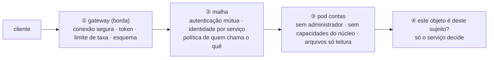
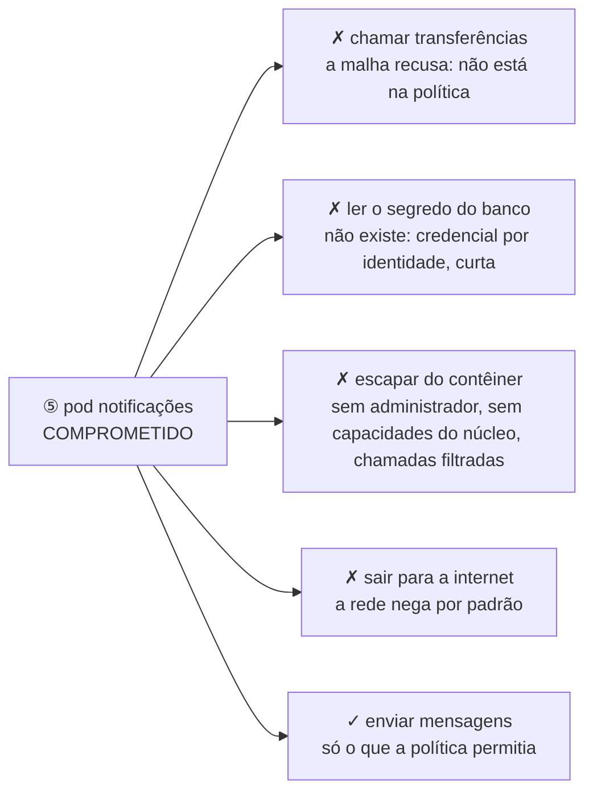

# Dissertação-modelo — Segurança de APIs, microsserviços e contêineres

> Texto corrido, no registro de uma dissertação, com cerca de dez páginas à mão. Três fontes nomeadas, um caso construído por molde (real opcional), um exemplo que atravessa o texto. **[+]** marca onde alongar; **[−]** marca o que cortar primeiro.

## Esqueleto — o que você anota em 5 minutos antes de escrever

- **Seções, na ordem:** Introdução → O que se toma como dado → Três anéis → APIs → Microsserviços → Contêineres e orquestração → Exemplo → Dois casos reais → O que não confundir → Conclusão
- **Figura 1:** Os três anéis — borda, malha e pod — com o que cada um faz e o que nenhum faz.
- **Caso:** hipotético pelo molde de cinco lacunas; o elo que falha: o plano de controle tratado como interno e o contêiner tratado como máquina isolada. (Real, se lembrar: Tesla, 2018, e o escape do runc, 2019.)
- **Três fontes:** OWASP API Security Top 10 (2023) — as dez categorias; NIST SP 800-204, *Security Strategies for Microservices-based Application Systems* (2019), e SP 800-190, *Application Container Security Guide* (2017); NSA e CISA, *Kubernetes Hardening Guide* (2022).
- **Exemplo:** a API de pagamentos (aplicativo, gateway, contas, transferências, banco, fila, parceiro).
- **Desfecho começa com:** "Em síntese, a segurança de APIs, microsserviços e contêineres não é uma lista de boas práticas, e sim a mesma cadeia aplicada em três anéis."

## 1. Introdução — quando o sistema vira muitos

No monólito, a fronteira de confiança principal era uma: o navegador de um lado, o servidor do outro. A chamada entre o módulo de contas e o de transferências não atravessava rede, não precisava de autenticação e não podia ser interceptada. Quando o sistema se decompõe em serviços que conversam por rede, cada uma dessas chamadas vira uma requisição entre processos, possivelmente entre máquinas — e tudo que valia para a fronteira externa passa a valer para ela. Quando a interface vira um contrato de API, cada operação é um ponto de entrada enumerável, exposto sem a tela que limitava o que se pedia. E quando o serviço roda em um contêiner, roda como um processo com visão restrita do sistema, compartilhando o núcleo com todos os vizinhos.

A segurança de APIs, microsserviços e contêineres não traz nenhum princípio novo. Traz a multiplicação de todas as superfícies, e a necessidade de aplicar os mesmos princípios — mediação completa, menor privilégio, confiança explícita — em três anéis: a borda, a malha entre serviços e o processo. Este texto apresenta as premissas, os três anéis, cada uma das três partes com suas ameaças, regras e técnicas, um exemplo aplicado e dois casos que mostram os dois erros de modelo mais comuns.

## 2. O que se toma como dado

Quatro premissas. **Toda chamada entre serviços cruza uma fronteira**: não há interior confiável — a rede do cluster é o novo centro mole; o Google descreveu em 2019, no documento BeyondProd, o que já fazia: cada serviço tem identidade criptográfica, toda chamada é autenticada e autorizada, a rede é só transporte; o NIST formalizou o mesmo para microsserviços na SP 800-204. **O contrato é a superfície**: a especificação da API é a lista de pontos de entrada em formato legível por máquina — o que não está nela não deve responder, o que está tem esquema, e cada operação tem autorização por objeto e por propriedade, porque o cliente pode pedir qualquer objeto e enviar qualquer campo. **O contêiner é um processo com isolamento parcial**: a soma de espaços de nomes para processos, rede e sistema de arquivos, limites de recursos, um conjunto de capacidades do núcleo, um filtro de chamadas de sistema — cada um configurável, cada um que se relaxa é um pedaço de isolamento que deixa de existir, e o núcleo é compartilhado; a publicação do NIST sobre contêineres (SP 800-190) organiza os riscos em cinco camadas: imagem, registro, orquestrador, contêiner e nó. **[+]** E **a plataforma é código**: o manifesto que descreve a implantação é superfície de ataque e, pelo mesmo motivo, é versionável, revisável e sujeito a política automatizada — a má configuração virou a classe dominante de incidente em nuvem porque a plataforma faz exatamente o que o arquivo manda.

## 3. Três anéis

A segurança se organiza em três anéis concêntricos. Na **borda**, um gateway por onde todo tráfego externo passa: termina a conexão segura, valida o token de acesso — assinatura, emissor, audiência, prazo, escopo —, aplica limites de taxa, valida a requisição contra o esquema e recusa rotas fora do catálogo. Na **malha entre serviços**, um proxy ao lado de cada contêiner intercepta toda chamada e aplica autenticação mútua com identidade por serviço e política de quem pode chamar o quê. No **processo**, o contêiner roda com o mínimo: sem privilégio de administrador, sem capacidades do núcleo, sistema de arquivos só de leitura, filtro de chamadas de sistema, limites de recursos. E uma política como código atravessa os três, decidindo o que pode existir no cluster. O que nenhum anel faz é autorizar por objeto — decidir se *esta* conta é *deste* cliente — porque nenhum deles conhece o domínio; isso continua no código do serviço.

## Figura 1 — Os três anéis — borda, malha e pod — com o que cada um faz e o que nenhum faz

> Desenhe à mão em três ou quatro minutos, à caneta, com os elementos rotulados e numerados. Cite "a Figura 1" antes de desenhar e percorra a trilha abaixo no texto: cada número é um parágrafo, com um protagonista que atravessa a figura. É assim que o desenho vira uma página — e que o leitor o acompanha em vez de pular.

⑥ A política como código (admissão, Pod Security) é a moldura que torna ①, ② e ③ obrigatórios. Na mão: três caixas aninhadas (gateway ⊃ malha ⊃ pods) e, ao lado, o pod comprometido com quatro setas riscadas e uma permitida.
**A trilha: siga uma consulta de saldo de fora para dentro — e depois siga um pod comprometido de dentro para fora.** A Figura 1 são os três anéis da plataforma, e os números percorrem os dois sentidos.

1. **① A borda.** A consulta chega ao gateway: conexão segura, token verificado em assinatura, emissor, audiência, prazo e escopo, limite de taxa, esquema. Rota fora do catálogo não responde.
2. **② A malha.** O gateway chama o serviço de contas; a chamada é autenticada mutuamente, e a política diz que o gateway pode chamar contas nesta operação. Nenhuma chamada é aceita por vir "de dentro".
3. **③ O pod.** O serviço de contas roda como processo com o mínimo: sem administrador, sem capacidades do núcleo, sistema de arquivos só de leitura, filtro de chamadas de sistema.
4. **④ A decisão que nenhum anel toma.** O serviço carrega a conta e pergunta se ela é deste sujeito. Gateway e malha não sabem de quem é a conta; por isso a falha de autorização por objeto passa pelos dois, e por isso esta seta sai do pod.
5. **⑤ Agora de dentro para fora: o pod de notificações comprometido.** Ele tenta chamar transferências — a malha recusa, não está na política. Tenta ler o segredo do banco — não há, as credenciais são por identidade e de curta duração. Tenta escapar do contêiner — sem privilégio, sem capacidades, não consegue. Tenta sair para a internet — a rede nega. Alcança só o que a política permitia: enviar mensagens.
6. **⑥ A moldura.** A política como código é o que torna ①, ②, ③ obrigatórios para tudo que entra no cluster. O caso da seção seguinte tem duas metades: fora da moldura e dentro do pod.

## 4. APIs — o contrato como verdade

A OWASP publicou em 2023 uma lista das dez categorias de risco específicas de APIs, e seis delas são problemas de fronteira e contrato, não de código. Em primeiro, a autorização quebrada no nível de objeto: o cliente pede um objeto que não é dele e recebe, porque o serviço verificou que há token e não verificou o dono. Em segundo, autenticação quebrada: token sem validação de audiência, chave de API em URL. Em terceiro, a autorização quebrada no nível de propriedade — o cliente envia um campo que não deveria poder alterar e o servidor grava; ou o servidor devolve o objeto inteiro e confia que a tela filtra. Em quarto, consumo irrestrito de recursos: sem limite de taxa, de tamanho, de paginação. Em quinto, autorização quebrada no nível de função: a rota administrativa atende a qualquer autenticado. Depois, acesso irrestrito a fluxos de negócio sensíveis, falsificação de requisição do lado do servidor, configuração insegura, inventário impróprio — a versão antiga ainda no ar, o endpoint de depuração exposto — e consumo inseguro de APIs de terceiros.

As regras decorrem. O contrato é a verdade: o que não está nele não responde; o que está tem esquema, e a requisição que não casa é rejeitada na borda. Validar na borda e autorizar no serviço: o gateway decide se o token tem o escopo; o serviço decide se o objeto é do sujeito. Entrada e saída por lista de permissão: um objeto de comando por operação com os campos aceitos, um objeto de resposta por operação com os campos devolvidos — nunca o modelo inteiro. Todo recurso tem limite: taxa, tamanho, profundidade, paginação, tempo; em GraphQL, em que um único endpoint aceita consultas arbitrárias, o custo e a profundidade da consulta são a superfície, e a análise de custo antes de executar é o controle. A resposta de um terceiro é entrada hostil. E toda versão tem fim anunciado. **[+]** Dois detalhes práticos: webhooks — quando a API chama o cliente ou o parceiro chama a API — levam assinatura do corpo com segredo compartilhado, carimbo de tempo com janela curta e identificador de evento para idempotência; e a credencial depende do cliente: usuário final por aplicativo usa delegação com código de autorização e PKCE; serviço de parceiro usa credenciais de cliente com certificado; serviço interno usa identidade de carga de trabalho; a chave de API fica para o caso residual de baixo risco.

## 5. Microsserviços — identidade de carga de trabalho e malha

Microsserviços trocam complexidade de código por complexidade operacional, e em segurança trocam uma fronteira por dezenas, um segredo por dezenas, um log por dezenas. O NIST, na SP 800-204 e seus complementos, enumera os problemas — autenticação e autorização entre serviços, gestão de segredos, comunicação segura, registro distribuído — e aponta a malha de serviços como a camada que resolve a maioria sem tocar no código da aplicação.

Os princípios: identidade de carga de trabalho, não de rede — cada serviço tem uma identidade criptográfica própria, de curta duração, atestada pela plataforma; o padrão SPIFFE define o identificador e o documento que o prova, emitido e rotacionado automaticamente, e é o que substitui "confiar pelo endereço" por "confiar pelo certificado que só este serviço poderia ter". Autenticação mútua em toda chamada e autorização por chamada, por política declarada: "o serviço de notificações só chama o de contas na operação de leitura de contato" é regra escrita e aplicada pelo proxy, não ausência de bloqueio. Segredo por identidade e de curta duração: o serviço prova quem é a um cofre e recebe uma credencial que expira — idealmente dinâmica, criada para aquele processo e apagada depois; nunca em variável de ambiente de manifesto. Rede que nega por padrão, com só o tráfego declarado permitido, inclusive dentro do cluster, e saída para a internet só pelos serviços que precisam. Cada dado com um dono: outros serviços pedem pela API, não leem o banco alheio. E, ao propagar a identidade do usuário entre serviços, trocar o token por um com a audiência do destino ou carregar o sujeito em afirmação assinada — nunca um cabeçalho em texto claro que qualquer serviço interno pode forjar, porque isso é o deputado confuso em forma de microsserviço.

**[−]** Dois casos-limite mantêm as mesmas regras. Funções sem servidor são microsserviços levados ao extremo: a unidade de privilégio é a função, o evento que a dispara é entrada hostil, e o contêiner efêmero reduz persistência, não ataque. E a multilocação — muitos clientes no mesmo código, cluster e banco — pergunta em cada camada o que é compartilhado: o identificador do cliente vem do token e nunca de parâmetro, toda consulta filtra por ele na camada de dados, e o isolamento sobe — esquema separado, nó separado, runtime isolado — conforme a confiança entre clientes desce.

## 6. Contêineres e orquestração — o processo com o mínimo

Para o contêiner, a regra é tratá-lo como processo em que se removeu tudo que não é necessário. Sem administrador dentro, e sem possibilidade de ganhar privilégio. Todas as capacidades do núcleo descartadas e só as necessárias adicionadas — quase nunca alguma. Sistema de arquivos só de leitura, com volume temporário para o que precisa escrever: o atacante que não pode gravar não planta binário. Filtro de chamadas de sistema ao menos no perfil padrão do runtime. Nada do nó montado dentro — nem o soquete do daemon de contêineres, que equivale a administrador do nó. Limites de processador e memória, porque sem limite um contêiner derruba o nó. O Kubernetes codificou isso em três perfis — privilegiado, básico e restrito —, e a admissão de segurança de pods os aplica por espaço de nomes.

No orquestrador, os controles são de plano de controle e de política. Papéis mínimos; administração de cluster só para pessoas, com segundo fator; contas de serviço por carga de trabalho sem permissão de criar pods ou ler segredos fora do necessário — a escalada mais comum é um pod comprometido usando a própria conta de serviço para criar um pod privilegiado. Servidor da API não exposto à internet; armazenamento do estado cifrado; nó com sistema operacional mínimo e atualizado, verificado contra o benchmark de referência. Admissão por política — um componente que valida todo objeto antes de ele existir: imagem só de registro aprovado e por hash, assinatura e proveniência verificadas, limites presentes, política de rede obrigatória. Para cargas de confiança distinta no mesmo nó, runtimes que interpõem um núcleo em espaço de usuário ou uma máquina virtual mínima, trocando desempenho por fronteira de hardware. E detecção em tempo de execução, com regras sobre chamadas de sistema: shell aberto em contêiner de produção, escrita em diretório de sistema, conexão de saída inesperada. O guia de endurecimento publicado pela NSA e pela CISA em 2022 organiza tudo isso em cinco áreas — pods, rede, autenticação e autorização, registro e detecção, atualização — e insiste no registro de auditoria do servidor da API enviado para fora do cluster, porque o atacante com acesso ao cluster apaga o que está dentro.

## 7. Exemplo — a API de pagamentos em produção

Na borda, o gateway termina a conexão segura, valida o token completo, aplica cem requisições por minuto nas consultas e dez nas transferências, valida corpo e parâmetros contra a especificação gerada do código, recusa rotas fora do catálogo; a API de consultas do escritório tem profundidade máxima, análise de custo e introspecção desligada. O gateway decide se o token tem escopo; o serviço de contas decide se a conta é do sujeito, pelo ponto único de verificação de dono; a resposta de saldo tem três campos, não o modelo inteiro. Entre serviços, a malha impõe autenticação mútua estrita com identidades por conta de serviço; a política declara que notificações só chama contas na leitura de contato e transferências só chama contas no débito; o token do usuário é trocado pela audiência do destino; o cabeçalho de usuário em texto claro é recusado. Os segredos do banco são credenciais dinâmicas de uma hora emitidas pelo cofre para cada pod; a rede nega tudo por padrão, e só o serviço de webhooks sai para a internet, por um proxy com lista de destinos. Os webhooks levam assinatura, carimbo de tempo e identificador de evento.

Os contêineres usam imagens mínimas, por hash, assinadas; todo espaço de nomes de aplicação está no perfil restrito: sem administrador, sem escalada, sem capacidades, sistema de arquivos só de leitura, filtro de chamadas, limites. O decodificador em C — o que mais processa entrada hostil — roda em runtime isolado. Nenhuma conta de serviço monta token automaticamente nem pode criar pods. A admissão exige imagem do registro interno, por hash, com assinatura e proveniência; o servidor da API é privado; o estado é cifrado; os nós são mínimos e atualizados semanalmente; três pessoas têm administração de cluster, com chave física. A detecção em tempo de execução tem regras para shell em contêiner, escrita fora do temporário, conexão inesperada e leitura de token de conta de serviço. O resultado, se o serviço de notificações for comprometido por uma dependência: alcança só a leitura de contato, não lê o segredo do banco, não escapa do contêiner, não cria pod, não sai para a internet — e o alerta dispara quando alguém abre um shell.

## 8. Um caso — como construí-lo

> **Como montar o caso hipotético na hora (cinco lacunas).** Não precisa lembrar nome nem ano: invente uma organização plausível — por exemplo, a própria empresa dona da API de pagamentos deste texto — e preencha: (1) **contexto**: que sistema, que decisão de projeto ou de processo estava em vigor; (2) **o elo que falhou**: o plano de controle tratado como interno e o contêiner tratado como máquina isolada; (3) **consequência em uma frase**: o que se perdeu, em termos de confidencialidade, integridade ou disponibilidade, sem detalhar o ataque; (4) **a correção**: autenticação e rede no plano de controle; menor privilégio dentro do contêiner e runtime atualizado; (5) **a lição em uma frase**, que a conclusão retoma. Se lembrar do caso real equivalente, cite em uma frase como reforço: Tesla, 2018, e o escape do runc, 2019.

O caso entra depois do exemplo e antes dos erros, em dois parágrafos: o primeiro conta (contexto, elo que falhou, consequência); o segundo lê o caso com as lentes do texto (qual premissa foi ignorada, qual princípio violado, qual técnica teria agido) e termina com a lição. A conclusão o retoma em uma frase.

## 9. O que não confundir

Contêiner não isola como máquina virtual: o núcleo é compartilhado e o isolamento é software configurável. Autenticação mútua prova quem chama; não decide se pode. O gateway não protege a API inteira: ele não sabe de quem é a conta, e a falha de autorização por objeto passa por ele. A rede interna do cluster não é confiável. Imagem sem vulnerabilidade publicada não é pod seguro: a configuração do pod é outra classe. Segredo em variável de ambiente aparece em descrições, despejos de memória e logs. E o controle de acesso do orquestrador não é a autorização da aplicação: um controla quem mexe no cluster; o outro, quem mexe nos dados.

## 10. Conclusão

Em síntese, a segurança de APIs, microsserviços e contêineres não é uma lista de boas práticas, e sim a mesma cadeia aplicada em três anéis. Parte da premissa de que toda chamada cruza uma fronteira, de que o contrato é a superfície, de que o contêiner é um processo com isolamento parcial e de que a plataforma é código. Fixa como regra que a borda valida e o serviço autoriza, que entre serviços a identidade é de carga de trabalho e a autorização é por política, e que o processo roda com o mínimo. Aplica essas regras por técnicas nomeadas — o gateway como ponto único de acesso, a malha com identidade atestada, os perfis de segurança de pods, a admissão por política — e as executa com mecanismos cuja eficácia se prova pela pergunta: se este serviço for comprometido agora, até onde chega?

O caso mostram o custo de romper a cadeia por erro de modelo — o plano de controle tratado como interno, o contêiner tratado como máquina. É por isso que este tema ocupa, no ciclo de vida de desenvolvimento seguro, a posição entre a cadeia de suprimentos, que lhe entrega a imagem assinada, e a gestão de vulnerabilidades, que recebe o alerta de produção — e é essa rastreabilidade, da fronteira ao anel que a protege e do anel à política que o torna obrigatório, que faz da segurança uma propriedade da plataforma, e não um acréscimo a cada serviço.

---

**Referências usadas no texto:** OWASP API Security Top 10 (2023) — as dez categorias; NIST SP 800-204, *Security Strategies for Microservices-based Application Systems* (2019), e SP 800-190, *Application Container Security Guide* (2017); NSA e CISA, *Kubernetes Hardening Guide* (2022). De passagem: Google, BeyondProd (2019); SPIFFE; Pod Security Standards; CVE-2019-5736 (runc).
