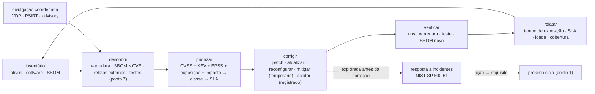

# Ponto 10 — Gestão de vulnerabilidades

## Objetivo

Entender a gestão de vulnerabilidades como o processo contínuo que governa o tempo entre a existência de uma falha e a sua correção em produção: o que se toma como dado sobre esse tempo, que regras não podem falhar, quais métodos e padrões nomeados existem — o ciclo do NIST SP 800-40, o vocabulário CVE/CVSS/CWE/KEV/EPSS, a priorização por decisão (SSVC), a divulgação coordenada (ISO/IEC 29147 e 30111) — e que mecanismos os executam. E entender por que o ponto fecha o ciclo: a vulnerabilidade encontrada em produção é o requisito do próximo ciclo (ponto 1).

Referências principais: NIST SP 800-40 rev. 4 (2022), *Guide to Enterprise Patch Management Planning*; FIRST, *CVSS* v3.1 e v4.0 e *EPSS*; CISA, catálogo *Known Exploited Vulnerabilities* (2021) e *SSVC* (2021); ISO/IEC 29147:2018 (divulgação) e 30111:2019 (tratamento); CERT/CC, *The CERT Guide to Coordinated Vulnerability Disclosure* (Householder et al., 2017). As fontes específicas aparecem no corpo do texto.

Os pontos 2 a 9 tentaram impedir que a vulnerabilidade chegasse a produção. Este ponto parte do fato de que ela chega — na dependência que ganhou CVE ontem, no componente que ninguém revisou, no sistema operacional do nó — e organiza o que se faz a partir daí: saber que existe, decidir qual importa, corrigir no prazo, provar que corrigiu, e aprender.

---

## 1. A janela de exposição — a pergunta que o ponto responde

### A vulnerabilidade tem ciclo de vida

Arbaugh, Fithen e McHugh (2000) descreveram a janela de vulnerabilidade como uma sequência de eventos: nascimento (a falha é introduzida), descoberta, divulgação (pública ou ao fornecedor), publicação de correção, publicação de *exploit*, e morte (quando a maioria dos sistemas foi corrigida). Entre a divulgação e a aplicação da correção em *um* sistema, esse sistema está exposto a quem souber da falha — e a partir da publicação do *exploit*, a quem souber usar uma ferramenta. Bilge e Dumitraș (2012) mediram o lado anterior: *zero-days* exploradas em média dez meses antes da divulgação. A gestão de vulnerabilidades governa a parte da janela que a organização controla: do momento em que a correção existe (ou em que a falha é conhecida) até o momento em que o sistema deixa de estar exposto.

### O tempo encurtou

O tempo médio entre a divulgação de uma vulnerabilidade e sua exploração em massa caiu de semanas para dias — relatórios de resposta a incidentes (Mandiant, 2023–2024) medem média de poucos dias, com casos de horas. Do outro lado, o tempo médio das organizações para aplicar correções críticas ainda se mede em semanas. A diferença é a janela em que a maioria das invasões por vulnerabilidade conhecida acontece: o Verizon DBIR de 2024 registrou que a exploração de vulnerabilidade como vetor inicial quase triplicou em relação ao ano anterior. O problema prático não é a *zero-day*; é a *n-day* — a falha com correção publicada que não foi aplicada.

### Não dá para corrigir tudo, nem tudo importa

A base nacional de vulnerabilidades dos Estados Unidos publicou mais de 28 mil CVEs em 2023 e mais de 40 mil em 2024. Uma organização média tem milhares de achados abertos ao mesmo tempo. Corrigir por ordem de nota CVSS não funciona: mais da metade das CVEs recebe nota alta ou crítica, e menos de 5% são exploradas na prática. A disciplina do ponto é decidir — com dados sobre exploração real, exposição e impacto — o que se corrige primeiro, o que se corrige depois, e o que se aceita com registro.

### Exemplo

Segunda-feira, 9h: sai uma CVE crítica em uma biblioteca de *parsing* de XML. Perguntas que a gestão de vulnerabilidades precisa responder em minutos, não dias: estamos usando? (inventário — SBOM do ponto 8); em quais serviços e versões? (inventário por artefato); algum deles está exposto à internet e processa XML de fora? (exposição); a função vulnerável é alcançada? (alcançabilidade); já está sendo explorada? (KEV, EPSS); qual o prazo pela nossa política? (SLA); há correção ou precisamos de mitigação temporária? (WAF, desligar a função); quem é o dono? (registro); como provamos que corrigimos? (nova varredura, SBOM novo). Em uma organização sem o processo, a resposta à primeira pergunta leva uma semana.

---

## 2. Fundamentos — o que se toma como dado

| Fundamento | Premissa | O que decorre dela |
|---|---|---|
| A vulnerabilidade é certa; a variável é o tempo | todo sistema terá falhas conhecidas publicamente durante sua vida | o processo mede e reduz a janela de exposição, não promete zero |
| Não se gerencia o que não se conhece | sem inventário de ativos e componentes, a varredura é amostra e a resposta é palpite | inventário completo, atualizado automaticamente, com dono por ativo |
| Nota não é risco | o CVSS base descreve a falha, não o contexto; exploração real e exposição decidem | priorização por decisão com múltiplos sinais; SLA por classe de risco, não por nota |
| É processo contínuo com ciclo e métrica | varredura trimestral e correção sob demanda não acompanham o ritmo de divulgação | ciclo permanente (descobrir, priorizar, corrigir, verificar, relatar) com métricas de tempo |

### A vulnerabilidade é certa; a variável é o tempo

A premissa muda a pergunta de "como evitar vulnerabilidades em produção?" (pontos 2 a 9) para "quanto tempo uma vulnerabilidade conhecida fica explorável nos nossos sistemas?". A grandeza central do ponto é o *tempo de exposição*: da publicação (ou da descoberta interna) até a correção verificada. Tudo o mais — inventário, priorização, *patching*, mitigação — existe para encurtá-lo onde importa.

### Não se gerencia o que não se conhece

O inventário tem três camadas, e as três faltam na maioria das organizações: ativos (servidores, contêineres, funções, dispositivos, serviços gerenciados — o que existe e quem é o dono), software instalado em cada ativo (sistema operacional, pacotes, *runtimes*) e componentes dentro de cada aplicação (as dependências — o SBOM do ponto 8). O Log4Shell foi uma crise de inventário, não de correção: a correção existia em dias; descobrir onde aplicar levou semanas. A regra é que o inventário se gera automaticamente — da nuvem, do orquestrador, do pipeline — e nunca é mantido à mão.

### Nota não é risco

O CVSS mede severidade técnica intrínseca: o quão fácil é explorar e o quanto se perde, no pior caso, sem considerar onde a falha está nem se alguém a explora. Spring et al. (2021), do CERT/CC, mostraram que a nota base é usada como se fosse risco e que isso produz priorização ruim: muitas "críticas" que ninguém explora, e "médias" em exploração ativa. Risco é a combinação de probabilidade de exploração (há *exploit*? está em uso? o sistema está exposto?) e impacto para *esta* organização (o que o ativo guarda e faz). A priorização usa a nota como um sinal entre vários.

### É processo contínuo com ciclo e métrica

O NIST SP 800-40 rev. 4 (2022) deixou de descrever *patching* como tarefa técnica e passou a descrevê-lo como gestão de risco preventiva, com planejamento, manutenção de rotina, resposta emergencial e métricas. A diretiva BOD 19-02 da CISA (2019) fixou prazos para agências federais — 15 dias para críticas, 30 para altas — e a BOD 22-01 (2021) obrigou a corrigir tudo que entra no catálogo de exploradas conhecidas em prazo definido. O que decorre: o processo tem cadência (varredura contínua, triagem semanal, janelas de correção), prazos por classe, e métricas que mostram se os prazos são cumpridos.

> **Junta.** Quatro premissas. Antes do processo, o vocabulário sem o qual ele não se descreve.

---

## 3. Overview visual — o ciclo

Leitura: o ciclo gira continuamente; o inventário o alimenta e é realimentado por ele. A divulgação coordenada é a porta por onde o mundo externo entra (pesquisador, fornecedor, cliente). Quando a vulnerabilidade é explorada antes da correção, o processo entrega o caso à resposta a incidentes — e o que se aprende volta como requisito do ciclo de desenvolvimento.

---

## 4. Vocabulário — o que cada sigla é e o que não é

| Sigla | O que é | Quem mantém | O que não é |
|---|---|---|---|
| **CVE** | identificador único de uma vulnerabilidade pública (`CVE-2021-44228`), com descrição e referências | MITRE, com CNAs (autoridades de numeração: fornecedores, pesquisadores, CERTs) desde 1999 | não é avaliação de severidade nem prova de que afeta você |
| **NVD** | base que enriquece cada CVE com CVSS, CWE, CPE e referências | NIST | não é a única base (OSV, GitHub Advisory, bases de fornecedores); tem atraso |
| **CWE** | classe de fraqueza (CWE-79 é XSS) — o *tipo* de erro | MITRE | não identifica uma instância; é o vocabulário do ponto 4 e 5 |
| **CPE** | identificador de produto e versão, para casar inventário com CVE | NIST | é impreciso para componentes de aplicação; o SBOM com *purl* é melhor |
| **CVSS** | métrica de severidade: base (explorabilidade e impacto intrínsecos), temporal/ameaça (maturidade de *exploit*), ambiental (contexto) — v3.1 (2019), v4.0 (2023) | FIRST | não é risco; a base ignora contexto e exploração real |
| **KEV** | catálogo de vulnerabilidades com exploração confirmada em campo, com prazo de correção obrigatório para agências | CISA, desde 2021 (BOD 22-01) | não é completo; é o sinal mais forte de "corrija agora" |
| **EPSS** | probabilidade estimada de exploração nos próximos 30 dias, por CVE, a partir de dados reais de exploração | FIRST, desde 2021 | não é severidade; é probabilidade; complementa o CVSS |
| **SSVC** | árvore de decisão para priorizar: exploração (nenhuma, prova de conceito, ativa), exposição, impacto técnico, impacto na missão → ação (acompanhar, atender, agir imediatamente) | CMU SEI (Spring et al., 2019); versão da CISA (2021) | não é nota; é decisão; exige saber o contexto |
| **VEX** | declaração do fornecedor sobre se uma CVE em um componente afeta o produto (afetado, não afetado, corrigido, em investigação) | CISA (2022); perfis em CycloneDX, OpenVEX, CSAF | não substitui a avaliação própria para componentes sem VEX |
| **CSAF** | formato legível por máquina para avisos de segurança de fornecedores | OASIS, 2022 | — |
| ***Zero-day*** | vulnerabilidade explorada antes de haver correção pública | — | não é a maioria dos incidentes; a *n-day* é |

**CVSS por dentro, o mínimo.** A nota base combina explorabilidade — vetor de ataque (rede, adjacente, local, físico), complexidade, privilégios necessários, interação do usuário — com impacto em confidencialidade, integridade e disponibilidade, e, na 3.x, se o escopo muda (a falha num componente afeta outro). A 4.0 reorganiza em métricas de base, de ameaça (substitui a temporal), ambientais e suplementares, e separa o impacto no sistema vulnerável do impacto em sistemas subsequentes. O vetor (`CVSS:3.1/AV:N/AC:L/PR:N/UI:N/S:U/C:H/I:H/A:H` = 9.8) diz mais que a nota: um `AV:N/PR:N/UI:N` é explorável por qualquer um na rede sem interação; um `AV:L/PR:H` exige acesso local privilegiado. A dissertação ganha se ler o vetor, não só o número.

### Três falhas de gestão que viraram manchete

**Equifax, 2017.** A vulnerabilidade CVE-2017-5638 no Apache Struts foi divulgada em março com correção disponível no mesmo dia e *exploit* público em dias; a Equifax foi notificada, mas a varredura interna não identificou o sistema afetado (inventário incompleto) e a correção não foi aplicada; a invasão começou em maio e foi detectada em julho; dados de cerca de 147 milhões de pessoas. Cada etapa do ciclo falhou: descoberta (o ativo não estava no inventário da varredura), priorização (crítica, exposta, com *exploit* — deveria ter prazo de dias), correção (dois meses sem aplicar), verificação (ninguém confirmou), detecção (um certificado expirado no inspetor de tráfego deixou o tráfego cifrado sem análise por dez meses).

**WannaCry, 2017.** O *ransomware* explorou a CVE-2017-0144 (SMB do Windows), corrigida pela Microsoft em março (MS17-010); o ataque em massa foi em maio, dois meses depois, e atingiu mais de 200 mil sistemas em 150 países — hospitais do NHS britânico entre eles — porque a correção não tinha sido aplicada, em parte por sistemas fora de suporte. Lição de *patching*: correção publicada é relógio ligado; e sistema sem suporte é exceção permanente que precisa de isolamento compensatório, não de esperança.

**MOVEit Transfer, 2023.** Uma *zero-day* (CVE-2023-34362, injeção de SQL) no software de transferência de arquivos foi explorada em massa pelo grupo Cl0p antes da correção; centenas de organizações afetadas. A lição aqui é a outra metade do ponto: quando não há correção, o que resta é inventário (saber que se usa o produto), mitigação rápida (desligar o acesso HTTP enquanto a correção não chega, como o fornecedor recomendou), monitoramento dos indicadores publicados, e resposta a incidentes. A organização que sabia em horas que usava o produto e o isolou perdeu pouco; a que levou dias para descobrir, muito.

O que os três mostram: Equifax e WannaCry são falhas de *n-day* — a correção existia; MOVEit é *zero-day* — a correção não existia. O processo trata os dois, com ênfases diferentes: prazo e verificação para o primeiro; inventário, mitigação e detecção para o segundo.

> **Junta.** Vocabulário posto. O processo, etapa por etapa.

---

## 5. O ciclo — etapa por etapa

### Descobrir

**Fontes.** Varredura de rede e de *host* (Nessus, Qualys, OpenVAS, com credenciais — a varredura sem credencial vê só o que a porta mostra e erra muito); agente nos ativos; varredura de imagens e artefatos (Trivy, Grype — SCA do ponto 7); cruzamento contínuo do SBOM com as bases (Dependency-Track); varredura de configuração de nuvem; testes do ponto 7 (SAST, DAST, intrusão); avisos de fornecedores (CSAF); relatos externos pela divulgação coordenada; inteligência de ameaças (KEV, feeds). Cada fonte vê uma fatia; o inventário é o que permite saber se a soma cobre tudo.

**Princípios.** Varredura contínua ou ao menos semanal, não trimestral; com credenciais; cobertura medida (que fração do inventário foi varrida); desduplicação entre fontes (a mesma CVE no mesmo ativo vinda de três ferramentas é um item); correlação com o dono do ativo no momento da descoberta.

### Priorizar

**O método.** Para cada achado, combinar: **exploração** (está no KEV? EPSS acima de um limiar? há *exploit* público? está sendo explorado nos nossos logs?), **exposição** (o ativo está na internet? autenticado? interno? a função vulnerável é alcançável — VEX ou análise?), **impacto** (o que o ativo guarda e faz — dado de cliente, dinheiro, disponibilidade do negócio) e **severidade técnica** (o vetor CVSS). O SSVC organiza isso em árvore de decisão com saídas acionáveis — *track* (acompanhar), *attend* (atender no ciclo normal), *act* (agir agora) — em vez de nota. A saída é uma classe de risco, e cada classe tem prazo.

**Prazos (exemplo de política).** Explorada conhecida (KEV) ou crítica exposta à internet: 48 horas a 7 dias; crítica interna ou alta exposta: 15 dias; alta interna ou média exposta: 30 dias; demais: 90 dias ou próximo ciclo de manutenção. Os números são da organização; o que não pode faltar é que existam, sejam escritos antes do incidente, e sejam medidos.

**Exceções.** O que não pode ser corrigido no prazo — sistema legado, fornecedor sem correção, risco de quebra maior que o risco da falha — vira exceção com dono, motivo, mitigação compensatória, prazo de revisão e visibilidade para quem responde pelo risco. Exceção sem prazo é aceitação permanente disfarçada.

### Priorizar com SSVC — a árvore em detalhe

O SSVC (*Stakeholder-Specific Vulnerability Categorization*) substitui a nota por uma árvore de decisão com pontos de decisão nomeados e saída acionável. Na versão da CISA para quem implanta software, os pontos são quatro. **Exploração**: *none* (nenhum *exploit* conhecido), *PoC* (prova de conceito pública, ou a falha é trivial de explorar), *active* (exploração em campo confirmada — o KEV é a fonte). **Automatizável**: o atacante consegue automatizar os passos de reconhecimento, armamento, entrega e exploração? (vulnerabilidade em serviço de rede sem autenticação: sim; que exige interação de usuário específico: não). **Impacto técnico**: *partial* (controle parcial do componente) ou *total* (controle total, por exemplo execução de código como administrador). **Impacto na missão e no bem-estar**: combinação do quanto a função do ativo importa para a organização e do dano a pessoas, em *low*, *medium*, *high*. A árvore combina os quatro em uma de quatro saídas: **Track** (acompanhar; corrigir no ciclo normal), **Track\*** (acompanhar com atenção; características que podem mudar), **Attend** (atender: exige ação da gestão, correção antes do ciclo normal), **Act** (agir: exige ação imediata, inclusive fora do horário).

No exemplo da seção 1: exploração *PoC*, automatizável *sim* (XML por rede sem autenticação do remetente além do mTLS), impacto técnico *total* (execução de código no decodificador), missão *high* (toca dinheiro) → **Act**. O serviço de relatórios: mesma CVE, mas a função não é alcançada → o ponto de decisão "exploração" na prática vira *none* para aquele ativo → **Track**, com VEX. A mesma CVE, duas decisões — o que a nota única não consegue expressar.

O ganho do SSVC não é só a saída; é que cada ponto de decisão obriga a organização a saber uma coisa sobre si (exposição, missão) que a nota do fornecedor nunca saberá. E a árvore é documentada: a decisão de hoje pode ser auditada amanhã.

### Corrigir

**Formas.** Aplicar a correção do fornecedor (*patch*); atualizar para versão corrigida (dependência, imagem base); reconfigurar (desligar a função, fechar a porta, trocar o padrão); substituir o componente; e, enquanto a correção não chega, **mitigar**: regra de WAF ou de RASP contra o padrão de exploração (*virtual patching*), isolamento de rede, remoção de exposição, monitoramento reforçado. Mitigação não fecha o item — reduz a classe de risco até a correção.

**Patching com método (NIST SP 800-40 r4).** Teste antes de aplicar (ambiente de homologação com a mesma versão); aplicação em anéis — primeiro um grupo pequeno, depois o restante — com observação entre eles; plano de reversão; janelas de manutenção para o rotineiro e caminho de emergência para o KEV; automação da aplicação (gerenciador de configuração, atualização automática de dependências — Renovate do ponto 8); e, onde a infraestrutura é imutável, **reconstruir em vez de corrigir**: a imagem nova com a base atualizada substitui a antiga, e a política de admissão (ponto 9) garante que a antiga não volta. Em contêineres e nuvem, essa é a forma normal; "aplicar *patch* no contêiner em execução" é o erro.

**Dependências como caso especial.** A maioria dos achados em aplicação é CVE em dependência transitiva. O fluxo: SBOM cruzado com a base aponta; alcançabilidade e VEX dizem se afeta; se afeta, o robô de atualização já abriu o *pull request*; o pipeline do ponto 7 testa; o ponto 8 assina e promove. O tempo de exposição cai de semanas para o tempo do pipeline.

### Corrigir em cada tipo de ambiente

O ciclo é um; a mecânica de correção muda com o que se corrige. **Servidores e máquinas virtuais**: gerenciador de configuração ou de *patches* (WSUS/Intune, Ansible, SSM), anéis, janela de manutenção, reinicialização planejada; sistemas que não podem reiniciar recebem mitigação e janela especial. **Estações de trabalho**: atualização automática do sistema e do navegador, com relatório de conformidade; o atraso de dias é aceitável, o de meses não. **Contêineres e infraestrutura imutável**: nunca corrigir o que está rodando; nova imagem base, novo build, nova implantação; a admissão recusa a antiga; o robô de dependências abre o *pull request* da base. **Serviços gerenciados de nuvem**: o provedor corrige a plataforma (responsabilidade compartilhada), a organização corrige o que configura e o que roda em cima — e precisa saber a fronteira exata por serviço. **Dependências de aplicação**: SBOM, alcançabilidade, VEX, atualização automatizada, pipeline (pontos 7 e 8). **Dispositivos de rede, firmware e tecnologia operacional**: ciclos longos, fornecedores lentos, reinicialização cara; a resposta é segmentação forte (o dispositivo não alcança o que não precisa), inventário rigoroso e aceitação de risco explícita com revisão. **Software de terceiros instalado**: depende do fornecedor; o aviso CSAF e o VEX dizem quando; a organização pressiona e mitiga. A política de prazos é a mesma para todos; a forma de cumpri-la, não.

### Nuvem: configuração como vulnerabilidade

Em nuvem, a vulnerabilidade mais comum não tem CVE: é a configuração — *bucket* público, grupo de segurança aberto, chave sem rotação, papel com privilégio excessivo, registro de auditoria desligado. Ferramentas de *Cloud Security Posture Management* (Prowler, ScoutSuite, e as nativas dos provedores) varrem a conta contra padrões (CIS Benchmarks por provedor) e produzem achados que entram no mesmo ciclo: priorizar por exposição e impacto, corrigir (em código — a infraestrutura é código, ponto 9 — e não no console), verificar (nova varredura), medir. O *drift* (a configuração em produção diverge do código) é uma classe de achado própria: o que foi mudado à mão no console volta a divergir e precisa ser reconciliado. A Capital One (ponto 9) foi uma vulnerabilidade de configuração — WAF mal configurado e papel IAM excessivo — não de software.

### Verificar

Correção aplicada não é correção verificada. Nova varredura do ativo; SBOM novo do artefato sem o componente vulnerável; teste de regressão (o caso de abuso do ponto 7, se a falha era própria); para mitigações, teste de que a regra bloqueia o padrão. O item só fecha com a evidência anexada.

### Relatar

**Métricas que importam.** Tempo médio de correção por classe de risco, comparado ao prazo; distribuição de idade dos itens abertos (quantos acima do prazo, há quanto tempo); cobertura do inventário pela varredura; fração de ativos sem dono; número de exceções e idade delas; itens do KEV abertos (deve ser zero); taxa de reincidência (a mesma classe voltando — alimenta o ponto 1). **Métricas que enganam.** Número total de vulnerabilidades (cai quando se para de varrer); número corrigido (sobe quando se corrige o fácil); nota média.

**Para quem.** Ao time: o que está atrasado e por quê. À gestão: tempo de exposição por classe e tendência, exceções com risco aceito. Ao ciclo de desenvolvimento: as classes que reincidem.

### O programa — papéis, governança e conformidade

**Papéis.** O **dono do ativo** (time de produto ou de plataforma) corrige e responde pelo prazo; a **função de segurança** mantém o inventário, as ferramentas, a política de priorização e as métricas, e triagem o que vem de fora; o **PSIRT** trata vulnerabilidades no que a organização produz; a **gestão** aceita exceções e responde pelo risco residual. Achado sem dono é o defeito mais comum do programa, e o inventário com dono por ativo é o que o evita.

**Política escrita.** Um documento curto com: escopo (que ativos), fontes de descoberta e cadência, método de priorização (SSVC ou equivalente, com os limiares), prazos por classe, processo de exceção, métricas e para quem são reportadas, e o que acontece quando o prazo estoura (escalada). Escrito antes do incidente, revisado anualmente.

**Conformidade como piso.** Normas externas fixam mínimos: o PCI DSS 4.0 (2022) exige que vulnerabilidades críticas e altas sejam corrigidas em até um mês e que varreduras internas e externas sejam trimestrais e após mudanças significativas; a ISO/IEC 27001:2022 (controle A.8.8) exige gestão de vulnerabilidades técnicas com inventário, avaliação e ação; a BOD 22-01 da CISA fixa prazos para o KEV; a *Cyber Resilience Act* europeia (2024) exige tratamento e divulgação de vulnerabilidades de fabricantes. São pisos; um programa maduro corrige críticas expostas em dias, não em um mês.

**Maturidade.** Modelos como o OWASP SAMM (prática *Vulnerability Management* no domínio *Implementation*) e o BSIMM descrevem degraus: de "corrigimos quando alguém reclama" a "ciclo contínuo com métricas e lições que mudam o desenvolvimento". A pergunta que separa os degraus: o tempo de exposição é medido, e alguém olha?

### A cadência — o que acontece todo dia, toda semana, todo mês

Processo contínuo tem relógio. **Todo dia**: o cruzamento automático de SBOM e inventário com as bases roda e abre itens; alguém olha o KEV e os avisos de fornecedores críticos (15 minutos); item em *act* é tratado no dia. **Toda semana**: triagem dos itens novos com o método (SSVC ou equivalente), atribuição de dono e prazo, revisão dos itens perto do prazo, uma hora; janela de correção rotineira para o que não é emergência. **Todo mês**: métricas por classe para a gestão (tempo de exposição, conformidade com prazo, idade, cobertura, KEV abertos, exceções); varredura completa com credenciais se não for contínua; revisão das regras de priorização com base no que aconteceu. **Todo trimestre**: revisão de todas as exceções (renovar com motivo ou corrigir); revisão da política; reconciliação do inventário com a realidade (ativos sem dono, ativos órfãos); exercício de mesa de uma CVE crítica hipotética — o exemplo da seção 8 ensaiado. **Todo ano**: revisão da política de divulgação, do contrato com o programa de recompensa, dos pisos de conformidade aplicáveis.

**Checklist de maturidade em sete perguntas.** O inventário é gerado automaticamente e tem dono por ativo? O SBOM de cada artefato em produção existe e é cruzado continuamente? A priorização usa exploração e exposição, não só nota? Os prazos por classe estão escritos e são medidos? A correção de contêineres é por reconstrução e a admissão recusa a imagem antiga? Existe `security.txt`, política de divulgação com *safe harbor* e alguém que responde em 48 horas? A última lição de incidente virou mudança no desenvolvimento? Sete "sim" é um programa; menos de quatro é um scanner com relatórios.

### Métricas — fórmulas e armadilhas

**Tempo de exposição por classe**: para cada item fechado, data de fechamento verificado menos data de publicação da vulnerabilidade (ou de descoberta interna); mediana e percentil 90 por classe de risco, por mês. A armadilha: contar da data em que o item foi *aberto na ferramenta*, o que esconde o atraso da descoberta. **Conformidade com prazo**: fração dos itens fechados dentro do prazo da classe; e, mais importante, a lista dos abertos fora do prazo com dono. **Idade dos abertos**: distribuição por faixa (até 30, 30–90, mais de 90 dias) por classe; o que cresce na faixa longa é dívida. **Cobertura**: fração do inventário varrida no período, por tipo de ativo; ativos sem dono. **KEV abertos**: contagem absoluta; a meta é zero. **Exceções**: número, idade e fração com prazo vencido. **Reincidência**: classes de falha própria (CWE) que voltam — é o indicador que vai ao desenvolvimento. **O que não medir como sucesso**: total de achados (depende de quanto se varre), total corrigido (sobe corrigindo o fácil), nota média (não é risco).

> **Junta.** O ciclo interno. Falta a porta de entrada do mundo externo: quem acha a falha antes de nós e nos avisa — ou não.

---

## 6. Divulgação coordenada

### O problema

Um pesquisador encontra uma vulnerabilidade no seu produto. O que acontece depois depende do que você preparou. Sem canal, ele desiste, publica, ou vende. Com canal, há um processo: ele relata, você confirma, corrige, publica um aviso, e ele é reconhecido. A divulgação coordenada (CVD, *coordinated vulnerability disclosure*) é esse processo, e tem norma.

### As normas

**ISO/IEC 29147:2018** (*vulnerability disclosure*) define como receber relatos de fora e como publicar avisos: canal público, confirmação de recebimento, comunicação durante o tratamento, aviso com informação suficiente para o usuário agir. **ISO/IEC 30111:2019** (*vulnerability handling processes*) define o processo interno: triagem, análise, correção, decisão de divulgação, lições aprendidas. **O guia do CERT/CC** (Householder, Wassermann, Manion e King, 2017) é o manual prático: papéis (descobridor, fornecedor, coordenador, implantador, usuário), fases, e os problemas recorrentes — fornecedor que não responde, vulnerabilidade em muitos fornecedores ao mesmo tempo, pesquisador que não concorda com o prazo. O **FIRST** mantém o *PSIRT Services Framework*, que descreve as funções de um time de resposta de segurança de produto.

### O debate do prazo

*Full disclosure* (publicar tudo imediatamente) pressiona o fornecedor e expõe o usuário; *responsible disclosure*, o termo antigo, foi criticado por colocar a responsabilidade só no pesquisador. O termo atual, *coordenada*, reflete o acordo prático: o pesquisador dá prazo, o fornecedor corrige dentro dele, a publicação é conjunta. O prazo de 90 dias do Project Zero do Google (2015, com ajustes depois) virou referência de mercado; a CISA e muitos CERTs usam 45 dias; o acordo caso a caso é a norma. Quando a vulnerabilidade já está sendo explorada, o prazo cai para dias: a informação pública protege mais do que expõe.

### O que a organização prepara

**Canal.** Um endereço e uma política publicados — `security.txt` (RFC 9116, 2022) na raiz do sítio, com contato, chave para relato cifrado, política e, se houver, link do programa de recompensa. **Política de divulgação de vulnerabilidades (VDP).** Documento público que diz o que está no escopo, o que o pesquisador pode e não pode fazer, o que a organização promete (prazo de resposta, não processar quem segue a política — *safe harbor*), e como reconhece. A BOD 20-01 da CISA (2020) tornou a VDP obrigatória para agências federais americanas. **PSIRT.** Time (ou função) que recebe, triagem em prazo definido (48 horas para confirmar recebimento é padrão), reproduz, classifica com o mesmo método da seção 5, aciona a correção, prepara o aviso e cuida da comunicação com o pesquisador. **Aviso.** Publicado em formato legível por máquina (CSAF) e em texto, com CVE (a organização pode ser CNA e numerar as próprias), versões afetadas e corrigidas, mitigação temporária, crédito ao descobridor, e VEX para os componentes que a CVE toca sem afetar. **Programa de recompensa.** Quando o processo acima funciona e o óbvio já foi removido (ponto 7), pagar por achado aumenta o fluxo de relatos de qualidade; antes disso, é pagar caro pelo que um scanner acharia.

### O outro lado: como consumidor

A organização também recebe avisos de fornecedores e precisa agir: assinar os canais (CSAF, listas, feeds), ter o inventário que diz se afeta, e tratar o aviso como descoberta na seção 5. O VEX do fornecedor reduz o trabalho; sem ele, a avaliação é própria.

> **Junta.** O que entra e o que sai. Quando a correção não chegou a tempo, o processo seguinte.

---

## 7. Quando é explorada — a ponte com a resposta a incidentes

A gestão de vulnerabilidades e a resposta a incidentes são processos irmãos com uma fronteira clara: a vulnerabilidade é a *condição*; o incidente é o *evento*. O NIST SP 800-61 (rev. 2, 2012; rev. 3, 2025, alinhada ao *Cybersecurity Framework* 2.0) estrutura a resposta em preparação, detecção e análise, contenção, erradicação e recuperação, e atividade pós-incidente. Três pontos de contato com este ponto:

**Detecção.** Os sinais de que uma vulnerabilidade conhecida está sendo explorada vêm dos logs e dos alertas que os pontos 4, 6 e 9 pediram — padrões de exploração no WAF, erros inesperados no serviço vulnerável, alertas do Falco, autenticações anômalas. Um item aberto na gestão de vulnerabilidades com indício de exploração nos logs vira incidente imediatamente e sobe para a classe máxima.

**Contenção como mitigação.** As ações de contenção de um incidente — isolar o sistema, bloquear o padrão, revogar credenciais — são as mitigações temporárias da seção 5 aplicadas sob pressão. Ter a lista pronta (qual regra de WAF, qual *NetworkPolicy*, qual *feature flag*) é parte da preparação.

**Lições para o ciclo.** A atividade pós-incidente responde: por que a vulnerabilidade existia (ponto 5 ou 3)? por que não foi encontrada antes (ponto 7)? por que a correção demorou (este ponto)? por que a detecção demorou? Cada resposta vira requisito: regra nova de SAST, caso de abuso novo, prazo revisto, log novo. É o "10 → 1" do mapa de estudo: o incidente é o *pushing left* mais caro e mais eficaz que existe.

> **Junta.** Processo interno, porta externa, ponte com o incidente. O mesmo sistema, no dia da CVE.

---

## 8. Exemplo guiado — a segunda-feira da CVE na API de pagamentos

**9h00 — descoberta.** O Dependency-Track, que cruza os SBOMs de todas as imagens em produção com NVD, OSV e GitHub Advisory a cada hora, abre um item: CVE crítica (`AV:N/AC:L/PR:N/UI:N`, 9.8) na biblioteca de XML, presente em duas imagens — o decodificador do parceiro e o serviço de relatórios. Dono de cada imagem atribuído automaticamente pelo rótulo do artefato.

**9h20 — priorização.** SSVC: exploração — ainda não está no KEV, EPSS de 0,4 (alto para o primeiro dia), prova de conceito pública; exposição — o decodificador recebe XML do parceiro por canal mTLS (exposto a um terceiro, não à internet); o serviço de relatórios usa a biblioteca só para gerar XML, nunca para analisar entrada (alcançabilidade: não afetado; VEX emitido); impacto — o decodificador toca dinheiro. Decisão: decodificador em *act*, prazo de 48 horas; relatórios em *track*, atualização no ciclo normal com VEX "não afetado" registrado.

**10h00 — mitigação.** Enquanto a correção não sai: regra no gateway interno que rejeita XML com declaração de entidade (o padrão da exploração) e alerta; o Falco já tem regra para processo inesperado no contêiner do decodificador; monitoramento reforçado dos logs do parceiro.

**10h30 — correção.** O Renovate já abriu o *pull request* com a versão corrigida; o pipeline do ponto 7 roda SAST, SCA, testes de abuso e o fuzzer do decodificador com ASan; o ponto 8 constrói, gera SBOM e proveniência, assina; promoção para homologação; teste de integração com mensagens reais do parceiro gravadas; promoção para produção por *digest* em anel (um pod, depois todos). A política de admissão recusa a imagem antiga.

**14h00 — verificação.** Dependency-Track confirma que nenhuma imagem em produção contém a versão vulnerável; teste de regressão (mensagem com entidade externa → rejeitada pelo parser configurado, já era, e agora também pela versão); item fechado com evidência. Tempo de exposição: 5 horas desde a publicação.

**Durante a semana.** Aviso interno publicado; o VEX do serviço de relatórios anexado ao SBOM; a regra temporária do gateway mantida como profundidade; métricas do mês atualizadas (tempo de correção de críticas expostas: 5 horas; KEV abertos: zero; exceções: duas, ambas com prazo).

**O relato externo.** Na quinta, um pesquisador escreve ao endereço do `security.txt`: IDOR em um endpoint antigo da API, `v1`, que o catálogo marcava como descontinuado mas o gateway ainda roteava (API9 do ponto 9). O PSIRT confirma em 24 horas, reproduz, classifica (alta, exposta, sem exploração conhecida), desliga a rota no gateway no mesmo dia (mitigação que é correção), publica aviso interno, credita o pesquisador, e paga a recompensa. A lição vai ao ponto 9 como requisito: o catálogo passa a ser gerado do gateway, não do contrário; e ao ponto 7 como teste: rota fora do catálogo → 404.

**Se tivesse sido explorada.** O alerta do Falco às 9h15 teria aberto incidente: contenção (isolar o pod, revogar as credenciais dinâmicas do Vault, bloquear o parceiro), erradicação (imagem nova), recuperação, e a lição — "o decodificador processa entrada hostil em C; é o primeiro a migrar para Rust" (ponto 5) — como requisito do próximo ciclo.

---

## 9. Erros frequentes — o que não confundir

| Confusão | Por que está errado | Como dizer certo |
|---|---|---|
| "CVSS alto = corrigir primeiro" | a nota base ignora exploração e contexto; mais da metade das CVEs é alta ou crítica | "KEV, EPSS, exposição e impacto decidem; CVSS é um sinal" |
| "Varredura limpa = seguro" | a varredura vê o que conhece, nos ativos que conhece | "cobertura do inventário e fontes combinadas; o que não foi varrido é dito" |
| "Aplicar tudo imediatamente" | correção sem teste quebra produção; o custo da quebra também é risco | "anéis, teste, reversão; emergência só para KEV e crítica exposta" |
| "Zero-day é o problema" | a maioria das invasões usa falha com correção publicada e não aplicada | "a n-day é o problema; o tempo de exposição é a métrica" |
| "WAF/virtual patch corrige" | bloqueia o padrão conhecido; a falha continua | "mitigação reduz a classe até a correção; não fecha o item" |
| "Divulgação responsável = pesquisador cala" | o termo atual é coordenada: prazo acordado, publicação conjunta | "canal, VDP com safe harbor, prazo, aviso, crédito" |
| "CVE no componente = minha aplicação vulnerável" | a função pode não ser alcançada; o contexto pode não permitir | "alcançabilidade e VEX antes de priorizar" |
| "Gestão de vulnerabilidades = ter um scanner" | scanner é uma fonte; sem inventário, priorização, prazo e verificação não há gestão | "ciclo com cinco etapas e métricas de tempo" |
| "Corrigir o contêiner em execução" | é efêmero; a próxima implantação volta à imagem antiga | "reconstruir a imagem; admissão recusa a antiga" |
| "Exceção aprovada = resolvido" | exceção sem prazo e sem mitigação é aceitação permanente | "exceção com dono, mitigação, prazo de revisão, visibilidade" |

---

## 10. Síntese

| Etapa / Tema | Objetivo | Princípio | Técnica (fonte) | Mecanismo |
|---|---|---|---|---|
| Fundamentos | o que se toma como dado | vulnerabilidade é certa, tempo é a variável; não se gerencia o que não se conhece; nota não é risco; processo contínuo | Arbaugh et al. (2000); Spring et al. (2021); NIST SP 800-40 r4 (2022) | — |
| Vocabulário | falar a mesma língua | identificador ≠ severidade ≠ risco ≠ decisão | CVE (MITRE); NVD; CWE; CVSS 3.1/4.0 (FIRST); KEV (CISA, 2021); EPSS (FIRST, 2021); SSVC (SEI, 2019; CISA, 2021); VEX; CSAF | bases cruzadas automaticamente |
| Descobrir | saber o que existe | inventário primeiro; varredura contínua com credenciais; cobertura medida | varredura, SBOM × CVE, avisos CSAF, testes (ponto 7) | Nessus/Qualys/OpenVAS, Trivy, Dependency-Track, feeds |
| Priorizar | decidir o que importa | exploração + exposição + impacto + severidade → classe → prazo | SSVC; KEV; EPSS; alcançabilidade e VEX | árvore de decisão, política de prazos escrita, exceções com prazo |
| Corrigir | fechar a janela | teste, anéis, reversão; mitigar enquanto não corrige; reconstruir, não remendar | NIST SP 800-40 r4; infraestrutura imutável; *virtual patching* | Renovate, gerenciador de configuração, imagem nova + admissão, regra de WAF |
| Verificar e relatar | provar e medir | item fecha com evidência; métricas de tempo | nova varredura, SBOM novo, regressão | tempo de exposição por classe, idade, cobertura, KEV abertos, exceções |
| Divulgação coordenada | receber do mundo | canal, prazo, aviso, crédito, safe harbor | ISO/IEC 29147 e 30111; CERT/CC CVD Guide (2017); RFC 9116; PSIRT Framework | security.txt, VDP, PSIRT, CSAF, CNA, recompensa |
| Ponte com incidente | quando falha | vulnerabilidade é condição, incidente é evento; lição vira requisito | NIST SP 800-61 r2/r3 | detecção pelos logs dos pontos 4, 6, 9; contenção = mitigação pronta; pós-incidente → ponto 1 |

A cadeia em uma linha: inventário gerado → descoberta contínua → decisão por risco real, não por nota → correção no prazo, com mitigação no intervalo → evidência de que fechou → métrica de tempo → lição que vira requisito do próximo ciclo. Gestão de vulnerabilidades é o ponto do ciclo que admite que o resto do ciclo falha, e mede quanto tempo a falha fica aberta.

---

## Referências

- **NIST SP 800-40 rev. 4. *Guide to Enterprise Patch Management Planning: Preventive Maintenance for Technology*. Souppaya, Scarfone, 2022** — patching como gestão de risco; manutenção de rotina e emergencial; métricas
- **NIST SP 800-61 rev. 2 (2012) e rev. 3 (2025). *Computer Security Incident Handling Guide*** — fases da resposta a incidentes; atividade pós-incidente
- **Arbaugh, William; Fithen, William; McHugh, John. "Windows of Vulnerability: A Case Study Analysis". *IEEE Computer*, 33(12), 2000** — ciclo de vida da vulnerabilidade
- **Bilge, Leyla; Dumitraș, Tudor. "Before We Knew It: An Empirical Study of Zero-Day Attacks in the Real World". *CCS*, 2012**
- **Spring, Jonathan; Hatleback, Eric; Householder, Allen; Manion, Art; Shick, Deana. "Time to Change the CVSS?". *IEEE Security & Privacy*, 19(2), 2021** — crítica ao uso do CVSS como risco; ***Prioritizing Vulnerability Response: A Stakeholder-Specific Vulnerability Categorization (SSVC)*. CMU SEI, 2019; CISA SSVC, 2021**
- **FIRST. *Common Vulnerability Scoring System* v3.1 (2019) e v4.0 (2023); *Exploit Prediction Scoring System (EPSS)*, 2021; *PSIRT Services Framework***
- **CISA. *Known Exploited Vulnerabilities Catalog* e *Binding Operational Directive 22-01*, 2021; *BOD 19-02*, 2019; *BOD 20-01* (VDP obrigatória), 2020; *VEX*, 2022**
- **MITRE. *CVE Program* (desde 1999) e *CWE*; NIST. *National Vulnerability Database***
- **ISO/IEC 29147:2018. *Vulnerability disclosure*; ISO/IEC 30111:2019. *Vulnerability handling processes***
- **Householder, Allen; Wassermann, Garret; Manion, Art; King, Chris. *The CERT Guide to Coordinated Vulnerability Disclosure*. CMU SEI, 2017**
- **RFC 9116. *A File Format to Aid in Security Vulnerability Disclosure* (security.txt). Foudil, Shafranovich, 2022**
- **OASIS. *Common Security Advisory Framework (CSAF)* 2.0, 2022**
- **Google Project Zero. *Vulnerability Disclosure Policy*, 2015 (atualizações posteriores)** — o prazo de 90 dias como referência
- **Verizon. *Data Breach Investigations Report*, 2024** — exploração de vulnerabilidade como vetor inicial
- **Mandiant. *M-Trends* e análises de tempo até exploração, 2023–2024**
- **Frei, Stefan; May, Martin; Fiedler, Ulrich; Plattner, Bernhard. "Large-Scale Vulnerability Analysis". *SIGCOMM LSAD*, 2006** — dinâmica entre divulgação, exploit e correção
- **OWASP. *Dependency-Track*; OWASP CycloneDX** — cruzamento contínuo de SBOM com bases de vulnerabilidades
- **U.S. House Committee on Oversight and Government Reform. *The Equifax Data Breach*, 2018; GAO-18-559, 2018** — cronologia da falha de inventário e de correção
- **Microsoft. *MS17-010*, março de 2017; relatos do WannaCry, maio de 2017** — correção publicada dois meses antes do ataque
- **CISA. *CL0P Ransomware Gang Exploits CVE-2023-34362 MOVEit Vulnerability*, 2023** — zero-day: inventário, mitigação e detecção
- **PCI Security Standards Council. *PCI DSS* v4.0, 2022, requisitos 6.3 e 11.3** — prazos e varreduras como piso de conformidade
- **ISO/IEC 27001:2022, controle A.8.8 (*Management of technical vulnerabilities*)**
- **OWASP. *Software Assurance Maturity Model (SAMM)*, prática *Vulnerability Management*; BSIMM**
- **CIS. *Benchmarks* por provedor de nuvem; Prowler; ScoutSuite** — configuração como vulnerabilidade
